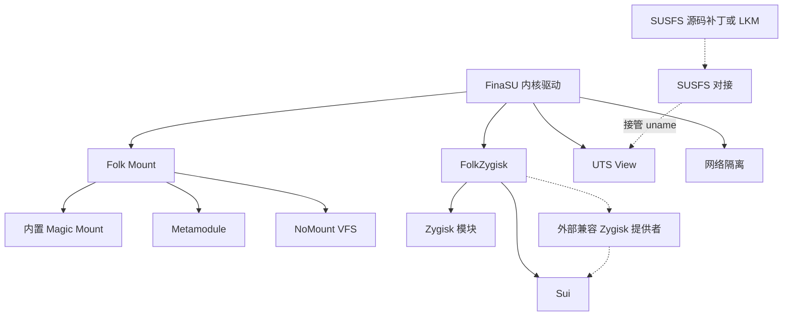

# 内置能力总览

<Badge text="按需启用" type="info" /> <Badge text="多数需要重启" type="warning" /> <Badge text="设置入口" type="tip" />

“内置能力”指随 FinaSU 发布、由 `ksud` 和内核驱动提供运行支持的功能。它们不是需要单独安装的普通模块；入口集中在管理器的 **设置 → 功能**，但每项能力的依赖、生效时机和风险并不相同。

::: warning “内置能力”不等于 Built-In 安装方案

这里的“内置”描述的是功能随 FinaSU 提供。它与安装文章中的 [Built-In 内核构建方案](/guide/install/built-in/) 不是同一个概念。LKM 安装同样可以使用 Folk Mount、FolkZygisk、Sui、UTS View 和网络隔离。

:::

## 我想……

::: table 按目标查找能力

| 我想解决的问题 | 使用 | 先检查什么 | 生效时机 |
| --- | --- | --- | --- |
| 让 Magisk 风格模块出现在系统路径中 | [Folk Mount](/builtin/folk-mount/) | 当前挂载模式、模块目录 | 通常下次启动 |
| 运行 Zygisk 模块 | [FolkZygisk](/builtin/folkzygisk/) | 是否已有外部 Zygisk 提供者 | 下次启动 |
| 给兼容 Shizuku API 的应用提供 Root 或 Shell | [Sui](/builtin/sui/) | FinaSU 驱动、Zygisk 后端、Sui 载荷 | 启用后通常重启 |
| 不建立传统挂载记录就注入模块 | [NoMount](/builtin/nomount/) | VFS 驱动状态、当前 KMI、挂载模式 | 启动注入，规则可热操作 |
| 给选定应用伪装 `uname` 信息 | [UTS View](/builtin/uts-view/) | 内核特性、SUSFS 是否接管 | 新启动的目标进程 |
| 阻止选定应用建立新的网络连接 | [网络隔离](/builtin/net-isolate/) | 内核钩子、目标 UID、隔离模式 | 保存后立即更新规则 |
| 使用已有 SUSFS 隐藏能力 | [SUSFS](/builtin/susfs/) | 内核源码集成或已加载的 SUSFS-LKM | 取决于当前实现 |

:::

## 它们如何协作

这些能力不是一条线性的功能列表。Folk Mount 与 NoMount 解决模块文件怎样被看到；FolkZygisk 向应用进程注入代码；Sui 再借助 Zygisk 提供 Shizuku API 后端。UTS View 和网络隔离直接依赖内核特性，SUSFS 则取决于内核源码集成或已加载的 SUSFS-LKM。



图中实线表示由 FinaSU 直接提供或驱动；虚线表示外部提供者。Sui 可以使用内置 FolkZygisk，也可以使用外部兼容的 Zygisk 提供者。外部提供者的实际差异是：==Sui 可以运行，但 FinaSU 无法验证其注入结果==。

## 三类能力，不要混在一起

### 用户态引擎

**Folk Mount、FolkZygisk、Sui** 由 `ksud` 管理生命周期，配置写入 `/data/adb/ksu/`。启动阶段是否真正运行，要看本次启动记录，而不是只看开关。

- FolkZygisk 可能在启动时让位给外部 Zygisk 提供者。
- Sui 依赖可用的 Zygisk 后端，自身不是 Zygisk 提供者。
- Folk Mount 的“本次启动提供者”可能因 NoMount 驱动不可用或上次启动中断而回退。

### 内核功能

**UTS View 与网络隔离** 通过内核钩子或内核特性工作。管理器能否编辑，取决于当前内核是否报告支持；保存成功也不等于目标进程已经采用新状态。

### 内核补丁与 LKM

**SUSFS** 的实现不在此仓库。FinaSU 只提供状态检测、配置和安全对接。没有内核补丁时可以使用匹配的 SUSFS-LKM，但其功能范围通常少于源码集成版。

## 开关、配置与本次启动

:::: field-group

::: field 下次启动配置
@type `持久设置`
例如 Folk Mount 模式、FolkZygisk 开关和 Sui 启用意图。写入磁盘后仍然需要重新启动相关组件或设备。
:::

::: field 本次启动状态
@type `运行结果`
表示当前这次启动实际选择了哪个提供者、是否完成注入，或者驱动是否就绪。它会因外部提供者、启动保护、驱动加载失败而不同于配置。
:::

::: field 即时规则
@type `热更新`
NoMount 的模块规则与例外、网络隔离的目标和模式通常可以在当前启动内更新。已有进程或连接仍可能保留旧状态。
:::

::: field 新进程生效
@type `进程级`
UTS View 主要影响之后启动、且仍使用初始 UTS namespace 的进程。已经运行的应用通常需要彻底关闭后重开。
:::

::::

::: important 先区分“谁提供”和“谁记住”

配置页保存的是期望状态。外部模块、启动保护、驱动不可用和上次异常退出都可能改变本次实际提供者。排查时同时查看 **配置模式**、**本次启动** 和 **错误/警告**。

:::

## 推荐启用顺序

:::: steps

1. **先确认 Root 工作正常**

   打开管理器，确认驱动已连接，并能正常执行一次受控 Root 操作。内置能力不能修复损坏的 FinaSU 驱动。

2. **一次只启用一项能力**

   先完成依赖链的底层部分：例如先确认 Zygisk 实际注入，再启用 Sui。不要同时更换 Folk Mount 后端、Zygisk 提供者和应用策略。

3. **检查是否需要重启**

   FolkZygisk、Sui 以及 Folk Mount 模式通常需要重启才进入新状态。网络隔离保存后更新内核规则，但已有连接不保证中断。

4. **用目标应用验证**

   回到目标应用检查实际效果。Zygisk 模块、Sui 权限和 UTS View 都应以目标进程结果为准，而不是只看全局开关。

5. **失败时回到最小配置**

   先关闭新增能力，确认基础 Root 与启动正常，再按错误信息定位依赖。不要连续叠加开关来“试出来”。

::::

## 常见状态词

| 显示或状态 | 通常含义 | 不要误解为 |
| --- | --- | --- |
| **未启用 / Disabled** | 当前配置没有要求该能力工作 | 功能一定不可用 |
| **已配置** | 设置已经保存，但尚未生效 | 目标进程已经采用设置 |
| **正在启动 / Mounting** | 启动阶段仍在执行 | 已成功完成 |
| **已注入 / Mounted / Ready** | 当前启动通过了对应检查 | 所有应用场景都一定兼容 |
| **部分 / Partial** | 只有部分 ABI、目标或步骤成功 | 完全失败或完全成功 |
| **不可用 / Unsupported** | 当前内核缺少特性或驱动没有响应 | 管理器按钮损坏 |
| **由外部提供者接管** | 另一个模块或内核功能正在负责 | FinaSU 的配置一定被修改 |

不同功能的检查标准不同。例如 FolkZygisk 的“已注入”要求当前启动、对应 ABI、守护进程和 Zygote 进程都得到确认；Sui 的外部提供者状态则可能只能验证服务存在，不能验证完整注入链。

## 数据与诊断

```file-tree title="/data/adb/ksu 内置能力相关位置"
/data/adb/ksu
├── mount_mode                  # Folk Mount 下次启动模式
├── mount_runtime               # 本次启动提供者与结果
├── mount_log                   # Folk Mount 运行日志
├── zygisk.json                 # FolkZygisk 下次启动开关
├── zygisk-boot.json            # 启动保护与失败计数
├── .zygisk/state.json          # 当前注入状态
├── sui/                        # Sui 状态与守护进程记录
├── uts_view.json               # UTS View 持久配置
├── netisolate.json             # 网络隔离持久配置
├── nomount_runtime             # NoMount 最近一次注入结果
├── nomount_uids                # NoMount 例外 UID
└── folksu-susfs/               # SUSFS 对接配置与状态
```

这些文件用于诊断，不是手工配置入口。直接编辑可能绕过校验、锁和事务回滚，导致管理器显示与内核实际状态不一致。

## 排错顺序

:::: steps

1. **看依赖**

   Sui 先看 Zygisk；NoMount 先看驱动和挂载模式；UTS View 先看内核特性与 SUSFS 接管状态。

2. **看启动代次**

   确认页面上的“本次启动”信息属于当前启动。配置改过但未重启时，两者本来就可以不同。

3. **看保护与回退**

   FolkZygisk 连续三次启动失败会暂停尝试；Folk Mount 在 NoMount 或元模块阶段异常后会保守回退。先处理警告，不要重复触发。

4. **用目标进程验证**

   检查目标应用是否重启、ABI 是否受支持、UID 是否选对，以及是否有独立 namespace 或额外权限限制。

5. **保留日志再恢复**

   需要回退时，先记录错误文本、时间、UID/PID 和模块列表，再关闭对应能力。删除数据目录会丢失用于定位问题的证据。

::::

## 能力边界

- **内置能力不是隐身保证。** NoMount、SUSFS、UTS View 和网络隔离各自只处理一部分可观测面。
- **Sui 不是无条件 Root。** 应用仍要连接 Sui 并取得逐应用权限。
- **网络隔离不是系统级防火墙。** 它只约束选中的应用，且不保证切断已有连接。
- **UTS View 不是完整设备指纹伪装。** 它处理 `uname` 字段，不改变系统属性、硬件证明或应用侧缓存。
- **外部 Zygisk 提供者不由 FinaSU 管理。** FinaSU 可以让位并检测服务，但不会替你验证或修复外部提供者的注入链。

## 继续阅读

::: table 各能力详细说明

| 能力 | 核心内容 |
| --- | --- |
| [Folk Mount](/builtin/folk-mount/) | 五种模式、模块合并、元模块、NoMount 回退与运行状态 |
| [FolkZygisk](/builtin/folkzygisk/) | 外部提供者优先级、五种注入状态、三次启动保护与恢复 |
| [Sui](/builtin/sui/) | 载荷、启动生命周期、管理器身份、权限、后台通知与完整排错 |
| [NoMount](/builtin/nomount/) | VFS 驱动、规则注入、例外 UID、热注入与回退边界 |
| [UTS View](/builtin/uts-view/) | 六项 `uname` 字段、全局/选定范围、SUSFS 接管与观察日志 |
| [网络隔离](/builtin/net-isolate/) | 三档模式、逐 UID 策略、私有网络/本地发现例外与拦截事件 |
| [SUSFS](/builtin/susfs/) | 内核源码集成、SUSFS-LKM、功能差距与使用边界 |

:::

:::: collapse accordion

### 为什么开关开了，功能却没生效？

先检查依赖和本次启动状态。FolkZygisk、Sui、Folk Mount 模式都需要新启动周期；UTS View 通常只影响新启动的目标进程；网络隔离只阻止新的连接。

### 多个内置能力可以同时使用吗？

可以，但要保持职责不冲突。Folk Mount 与 NoMount 是互斥的挂载提供者选择；Sui 明确依赖 Zygisk；SUSFS 与 UTS View 的 `uname` 伪装存在单一提供者仲裁。

### 需要卸载模块来关闭内置能力吗？

不需要。使用管理器中的开关或对应 `ksud` 生命周期命令。手工删除状态目录可能留下仍在运行的守护进程或与模块禁用标记不一致的状态。

### 为什么文档不推荐同时安装另一个同类提供者？

两个 Zygisk 提供者、两套挂载执行器或两个 Sui 实例会竞争同一注入点、挂载路径或 Binder 服务。FinaSU 能在部分场景主动让位，但不会替外部实现解决冲突。

::::

:::: chat title="内置能力快速问答"
{用户}
我只想运行一个 Zygisk 模块，需要先开 Sui 吗？

{助手}
不需要。Sui 只是使用 Zygisk 后端的 Shizuku API 服务，不是所有 Zygisk 模块的前置条件。

{用户}
NoMount 显示 ready，是否说明模块一定已经注入？

{助手}
不说明。ready 只代表驱动 API 可响应；还要看规则预期数、实际数和当前启动的挂载提供者。

{用户}
SUSFS 能靠安装模块补出来吗？

{助手}
源码集成版不能。也可以加载 SUSFS-LKM 作为替代，但它受 KMI 和导出能力限制，功能通常少于源码集成版。

::::
