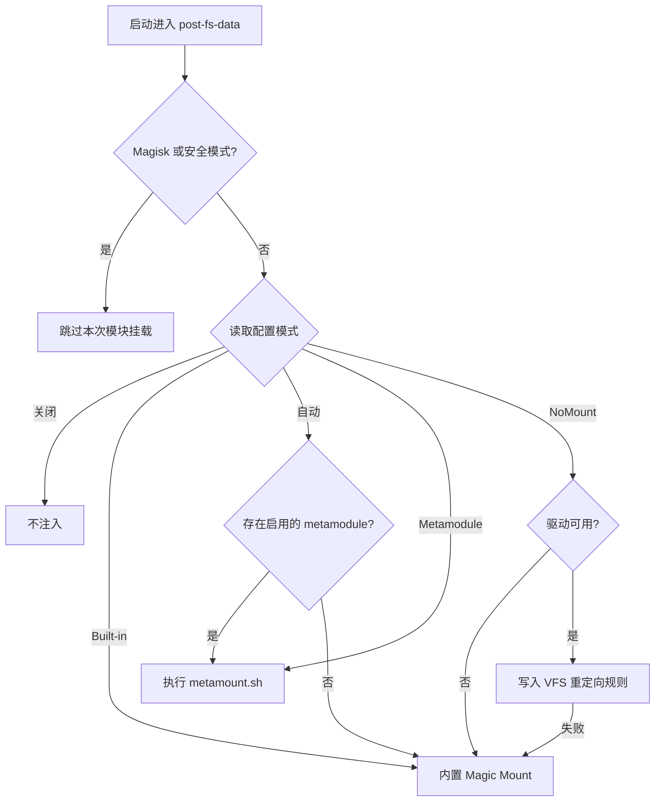

# Folk Mount

<Badge text="模块注入" type="info" /> <Badge text="模式改动下次启动生效" type="warning" />

==Folk Mount 决定启动时由谁把模块文件发布到系统路径==。它既可以通过内置 Magic Mount 直接合并模块目录，也可以把挂载阶段交给 metamodule 或 NoMount VFS 后端。它不安装模块；模块仍由模块管理器解压到 `/data/adb/modules/`。

::: tip 先看一句话

普通用户保持 **自动**。只有明确需要某个 metamodule 或 NoMount 时，才手动固定提供者。

:::

## 当前模式与本次启动

功能页同时显示两个容易混淆的值：

- **配置模式**：保存到 `mount_mode` 的持久选择，决定下次启动。
- **本次启动**：当前这次启动实际执行的提供者，以及它发布了多少目标。

修改模式只会写入配置，不会立刻重新挂载。重启后两者才应一致；如果不一致，通常发生了回退、接管或启动保护。

::: table 五种模式

| 配置模式 | 下次启动由谁执行 | 何时使用 | 关键边界 |
| --- | --- | --- | --- |
| **自动** | 有启用的 metamodule 时交给它，否则使用内置 Magic Mount | 大多数用户 | 元模块缺失或被禁用时回到内置引擎 |
| **Built-in (Magic Mount)** | 始终使用内置合并器 | 要求稳定使用 FinaSU 自带挂载 | 不把挂载阶段交给 metamodule |
| **Metamodule** | 只交给当前活动的 metamodule | 已明确依赖某个元模块的挂载机制 | 脚本缺失时是 no-op，不会静默改回内置 |
| **Built-in (VFS)** | 使用 NoMount 路径重定向 | 需要避免传统挂载记录 | 驱动不可用或注入失败时回退内置引擎 |
| **关闭挂载** | 不执行任何模块注入 | 临时排查模块导致的启动问题 | 模块仍然安装，只是本次启动不出现 |

:::

::: warning 关闭挂载不是禁用全部模块

“关闭挂载”不会删除模块，也不会执行模块自己的卸载逻辑。它只让本次启动没有提供者发布模块文件。需要永久移除模块时，应走模块管理流程。

:::

## 启动时怎样选择



启动路径还会检查 UAPI、运行锁和同一启动周期是否已经执行。检测到 Magisk 或安全模式时会记录跳过状态，而不是继续叠加模块挂载。

::: important 为什么 NoMount 会回退，而 Metamodule 不会

NoMount 是 FinaSU 可以替换的一种注入后端。驱动准备或规则发布失败时，为避免模块完全不可见，会回退到内置 Magic Mount，并记录 warning。

Metamodule 是一个独立执行器，可能还会提供自己的 `metainstall.sh`、`metauninstall.sh` 和 `metamount.sh`。它的挂载脚本是黑盒；FinaSU 不会因为脚本缺失或执行失败就擅自改跑另一套挂载逻辑。

:::

## 内置 Magic Mount 做了什么

内置执行器扫描 `/data/adb/modules/` 下可参与挂载的模块，把各自的 `system/` 树合并成一次启动注入。

### 模块参与条件

模块只有同时满足以下条件才会进入合并：

- 不是符号链接，并且是实际目录。
- 没有 `disable`、`remove` 或 `skip_mount` 标记。
- 不是当前 metamodule 本身。
- 含有 `system/` 目录，且该目录不是符号链接。

模块目录按稳定字节序排序，因此同名文件遵循 ==先出现者优先==。不要依赖文件系统返回顺序，也不要把多个模块修改同一路径当成可预测的覆盖游戏。

### 合并与发布

:::: field-group

::: field Opaque
@type `目录语义`
模块目录带有 `trusted.overlay.opaque` 时，表示用模块目录替换该目录的现有内容，而不是继续合并。
:::

::: field Whiteout
@type `删除语义`
特殊字符设备条目可以作为 whiteout，使目标路径在合并结果中表现为不存在。
:::

::: field Tmpfs
@type `类型冲突处理`
当模块节点与真实文件系统节点类型冲突，或需要构造替换目录时，执行器会准备临时文件系统再 bind/move 到目标位置。
:::

::: field 元数据
@type `发布细节`
发布时会复制必要的属主、权限、时间与 SELinux 上下文。它不是简单地把文件复制到 `/system`。
:::

::: field 事务
@type `失败处理`
新发布的挂载会登记；中途失败时按相反顺序回滚。无法撤销的目标会作为残留报告，而不会假装完全成功。
:::

::::

执行器使用 `/data/adb/ksu/workdir/` 作为工作目录，并在启动过程中切换到 PID 1 的挂载命名空间。它还会阻止同一启动周期重复执行，避免二次挂载叠加。

## Metamodule

Metamodule 是一个带 `metamodule=1` 标记的特殊模块。系统中最多只有一个活动 metamodule。

在 **自动** 模式下，可用的活动 metamodule 优先接管模块挂载。禁用、标记移除或没有活动链接的 metamodule 不会让自动模式继续选中它。

手动选择 **Metamodule** 时，即使没有 `metamount.sh`，本次结果也是 `noop`，不会悄悄切回内置引擎。这能避免用户以为元模块正在工作，实际却是另一种执行器发布了文件。

::: tip 元模块适合明确知道自己要什么的人

普通模块用户通常不需要安装 metamodule。元模块的能力和兼容性由它自己决定，FinaSU 只能负责调用与状态记录。

:::

## NoMount 后端

选择 **Built-in (VFS)** 后，Folk Mount 会先准备 NoMount 驱动，再让 NoMount 生成路径重定向规则。

以下情况会让本次启动改用内置 Magic Mount：

- 当前构建没有匹配 KMI 的 NoMount 驱动，且内核也没有内建支持。
- 驱动加载失败，或加载后 API 仍不能响应。
- 上一次 NoMount 注入阶段异常中断，保守地不重复同一路径。
- 规则发布失败。

NoMount 已在其他模块中接管注入时，内置后端会让位，不会与另一个写规则的程序竞争。

::: warning 可见性模型会改变

内置 Magic Mount 与 NoMount 对“哪些应用看到模块文件”的默认逻辑不同。切换前阅读 [NoMount 的例外应用](/builtin/nomount/#可见性模型)，不要把两者当成只有实现方式不同。

:::

## 状态与日志

::: table 本次启动结果

| 结果 | 含义 | 下一步 |
| --- | --- | --- |
| `mounting` | 正在执行提供者 | 等待启动完成，不要重复触发 |
| `mounted` | 已发布至少一个目标 | 检查目标模块与作用域 |
| `noop` | 提供者执行完成，但没有目标或脚本 | 检查模块标记、`system/` 和元模块脚本 |
| `partial` | 部分目标已发布，但后续失败或回滚不完整 | 先看错误和残留路径，再重启验证 |
| `failed` | 提供者失败 | 查看错误文本与对应后端状态 |
| `disabled` | 配置为关闭挂载 | 这是预期状态 |
| `skipped` | Magisk、安全模式或 UAPI 检查导致跳过 | 不要用关闭模块来猜故障 |

:::

页面还会显示：

- **本次启动提供者**：`builtin`、`metamodule`、`nomount` 或 `none`。
- **目标数量**：内置和 NoMount 能统计发布目标；metamodule 是黑盒时不伪造数量。
- **warning**：例如 NoMount 失败后使用内置引擎完成挂载。
- **error**：配置文件、模块遍历或提供者执行失败的原因。

:::: collapse accordion

### `mounted` 但模块没有效果

先确认模块没有被 `disable`、`remove` 或 `skip_mount` 标记，再检查模块是否真的包含 `system/`。然后确认应用是否被 App Profile 或 NoMount 例外策略隐藏了模块文件。最后检查该路径是否被后加载模块以 first-wins 规则覆盖。

### 自动模式为什么选了内置引擎

自动模式只在存在 **启用的活动 metamodule** 时交给元模块。检查 `/data/adb/metamodule` 是否存在、目标模块是否带 `metamodule=1`，以及模块目录是否出现 `disable` 或 `remove`。

### 切换到 NoMount 后应用看到了更多模块文件

NoMount 默认让应用看到注入文件，只排除明确选择的 UID；内置 Magic Mount 与 App Profile 的默认可见性不同。切换前先配置 NoMount 例外应用，重启后再验证。

### 能不能不重启就换挂载提供者

不能。模式只保存到下一次启动。NoMount 的单个模块规则可以在当前启动内热注入或撤下，但不会把 Folk Mount 的整体提供者立即从 Magic Mount 换成 VFS。

::::

## 配置与诊断位置

```file-tree title="Folk Mount 相关位置"
/data/adb/ksu
├── mount_mode                  # 持久模式
├── mount_runtime               # 本次启动提供者、结果与 warning
├── mount_log                   # 最近挂载日志
└── workdir/                    # 内置执行器工作目录
```

管理器是日常操作入口。需要脚本化诊断时，可只读查看状态：

::: code-tabs

@tab 管理器

```text
设置 → 功能 → Folk Mount
查看配置模式、本次启动、目标数量和 warning
```

@tab 命令行

```sh
/data/adb/ksud mount status --json
```

:::

管理器是日常操作入口。命令行只用于收集状态，不要用人工拼接的挂载命令替代启动流程。

## 推荐策略

1. **日常保持自动。** 没有明确需求时，不手动固定 metamodule 或 NoMount。
2. **一次只换一个后端。** 改模式后重启并验证，再继续改应用可见性或模块。
3. **先记录再回退。** 模块异常时保留 warning 和模块列表，再切回自动或关闭挂载。
4. **不要把关闭挂载当卸载。** 关闭只影响本次启动的注入，不改变模块安装状态。

::: danger 不要在启动异常后连续叠加选择

如果本次启动在某提供者阶段中断，下一次启动应优先使用保守组合并检查日志。反复切换 metamodule、NoMount 和内置引擎会让问题更难定位，也可能延长故障启动时间。

:::
