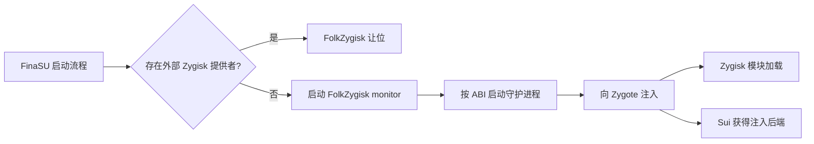

# FolkZygisk

<Badge text="Zygisk 提供者" type="info" /> <Badge text="下次启动选择" type="warning" /> <Badge text="支持 32/64 位" type="tip" />

==FolkZygisk 是 FinaSU 内置的 Zygisk 提供者==。它在启动阶段向 Zygote 注入 Zygisk 运行组件，使安装在模块目录中的 Zygisk 模块能够进入应用进程。它本身就是 Sui 可使用的后端之一，但 Sui 不是它唯一的使用者。

::: important 开关不是“当前已注入”

功能页的开关表示 **下一次启动是否尝试 FolkZygisk**。当前这次启动是否成功，要看“已注入、部分注入、正在启动、注入失败、未验证”等实际状态。

:::

## 它负责什么



Zygisk 模块和 Zygisk 提供者是两类东西：

- **提供者**负责把运行组件注入 Zygote，例如 FolkZygisk 或外部兼容实现。
- **模块**利用已经存在的 Zygisk 环境工作，例如特定框架或功能模块。

模块是否需要 Zygisk、支持哪些 Android 版本、是否需要再次重启，应以模块自身说明为准。FolkZygisk 不会替模块修复不兼容的 API 或错误脚本。

## 启用与重启

:::: steps

1. **确认引擎可用**

   打开 **设置 → 功能 → FolkZygisk**。若显示引擎缺失或启动保护，先处理对应提示，不要连续开关。

2. **检查外部提供者**

   如果列表中出现外部提供者，下一次启动会由外部实现接管。FinaSU 不会修改、卸载或重写该模块。

3. **打开开关**

   开关只保存下次启动的选择。启用成功通常提示需要重启。

4. **重启设备**

   Zygisk 注入发生在启动阶段，不能靠重新打开管理器完成。

5. **检查注入状态**

   只有当前启动显示 **已注入**，才能确认受支持的 ABI 都通过了守护进程与 Zygote 进程检查。

::::

::: tip Sui 用户注意

FinaSU 驱动可用、FolkZygisk 开关开启，并不自动等于 Sui 可用。还要确认本次启动确实有 Zygisk 提供者工作，然后检查 Sui 自身的服务状态。

:::

## 外部 Zygisk 提供者

FolkZygisk 在启动时扫描模块安装目录和待更新目录。发现被识别为提供者的活动外部模块时，==内置引擎会主动让位==，以免两个实现同时注入 Zygote。只有使用 Zygisk API 的普通模块不会被误当成提供者。

这次让位不会修改外部模块，也不会消耗内置引擎的失败次数。移除或禁用外部提供者后，下一次启动可以恢复内置引擎。

::: table 外部提供者的实际影响

| 方面 | 行为 |
| --- | --- |
| 当前启动 | 外部提供者在启动阶段优先；内置 FolkZygisk 不启动注入 |
| Sui | 外部兼容提供者可以作为 Sui 后端，Sui 能运行 |
| 注入验证 | FinaSU 无法验证外部提供者的完整注入结果 |
| 模块管理 | FolkZygisk 不会替你更新、禁用或修复外部提供者 |
| 恢复内置 | 移除或禁用外部提供者后，下一次启动重新选择 |

:::

::: warning “外部提供者已启用”不是故障

页面显示外部提供者接管时，先到外部模块自己的管理入口确认其工作状态。不要为了消除提示而同时保留两套 Zygisk 提供者。

:::

## 五种当前注入状态

FolkZygisk 不把“进程存在”直接当成注入成功。它会核对运行状态、ABI、守护进程和对应 Zygote 进程是否仍属于当前启动。

:::: field-group

::: field 已注入（Injected）
@type `成功`
当前启动中所有受支持的 ABI 都通过了注入检查。
:::

::: field 部分注入（Partial）
@type `部分成功`
至少一个受支持的 ABI 已注入，但不是全部。依赖 ABI 的模块可能只在部分应用中有效。
:::

::: field 正在启动（Starting）
@type `进行中`
运行记录存在，但受支持 ABI 尚未全部完成注入。刚开机时短暂出现是正常的。
:::

::: field 注入失败（Failed）
@type `失败`
monitor 未就绪、tracing 状态异常，或受支持 ABI 的守护进程没有运行。
:::

::: field 未验证（Unverified）
@type `没有可信回执`
没有当前启动的有效运行记录，或记录已过期。它不能证明注入成功，也不能单独证明注入失败。
:::

::::

状态行还会显示：

- **下次启动已启用 / 已停用**
- **检测到的外部提供者**
- **需要重启**
- **启动保护已暂停**
- **最近失败代码与详情**

## 启动保护

FolkZygisk 会为每次启动尝试写入保护记录。连续三次失败后，启动保护会锁存，后续启动不再自动尝试，以免设备反复进入同一条失败路径。

::: timeline 一次触发启动保护的过程

1. **第一次启动失败**

   本次尝试被记录，失败次数加一。重启后可再次尝试。

2. **连续第二次失败**

   失败次数继续增加。若管理器显示具体失败代码，应先按该代码排查。

3. **连续第三次失败**

   启动保护锁存。之后启动会跳过内置注入，等待用户处理。

4. **点击恢复**

   管理器会保留当前启动的保护，安装缺失的引擎资产（如有），并准备下一次启动重新尝试。

5. **再次重启**

   只有新一次启动完成后，才能确认保护是否解除、注入是否成功。

:::

::: warning 恢复不是“立即重新注入”

“恢复”不会在当前启动中重新拉起 monitor。它会让当前启动保持受保护状态，并安排下一次启动自动尝试。

:::

## 安全模式与 Magisk

检测到安全模式或 Magisk 时，启动阶段会跳过内置 Zygisk 注入。这是为了避免把另一套 Root 环境的启动流程与 FinaSU 叠加。

如果同时存在 Magisk 与 FinaSU，不要把 FolkZygisk 状态当作唯一的 Root 或模块诊断入口。先处理两套 Root 的共存关系。

## 模块与兼容性

Zygisk 模块仍然属于普通模块系统。模块文件在 `/data/adb/modules/`，是否带有 Zygisk 入口由模块自己决定。

- 安装模块本身不会自动修复缺失的 Zygisk 提供者。
- 外部提供者优先时，FolkZygisk 的注入状态不代表外部实现的状态。
- 某些模块只支持单一 ABI、特定 Android 版本或特定 Zygisk API。
- LSPosed 一类框架通常依赖可用的 Zygisk 提供者，但它不是提供者本身。

## 排错顺序

:::: steps

1. **先看“下次启动”和“本次启动”是否一致**

   刚改开关时不一致是正常的。没有重启就检查“已注入”没有意义。

2. **检查外部提供者**

   有外部提供者时，内置引擎按设计让位。转到对应模块排查。

3. **检查启动保护**

   连续失败后，页面可能显示暂停原因和恢复入口。先记录失败代码，再恢复。

4. **检查引擎文件**

   引擎缺失通常意味着安装不完整或被手工删除。使用管理器恢复或重新安装完整发布包，不要拼接触摸文件。

5. **检查 ABI 结果**

   只有部分注入时，确认目标应用和模块是否依赖未注入的 32 位或 64 位 ABI。

6. **最后看内核日志与模块日志**

   保留时间点和失败详情。单纯反复重启会覆盖更有价值的上下文。

::::

:::: collapse accordion

### 显示“已启用”但仍然是未验证

常见原因是尚未重启、当前启动没有有效运行记录，或记录属于上一次启动。先重启并等待系统稳定，再检查状态。

### 显示外部提供者接管，Sui 还能用吗

可以，外部提供者兼容时 Sui 可以运行。但 FinaSU 无法验证外部提供者的注入结果，需要在 Sui 和兼容应用中实际验证。

### 失败三次后怎样重新尝试

使用页面中的恢复操作。它只为下一次启动重新准备条件，当前启动不会热启动注入。

### 卸载外部提供者后什么时候恢复内置 FolkZygisk

下一次启动。提供者选择发生在启动阶段，当前运行中的 Zygote 不会被热切换。

::::

## 配置与诊断位置

```file-tree title="FolkZygisk 相关位置"
/data/adb/ksu
├── zygisk.json                 # 下次启动开关
├── zygisk-boot.json            # 启动保护、失败次数和最近问题
├── .zygisk/
│   └── state.json              # 本次启动 monitor、ABI 与注入状态
└── bin/
    └── folkzygisk/             # 内置引擎文件
```

`state.json` 只有在 boot ID、monitor PID 和进程启动时间都匹配当前系统时才会被当作有效运行记录。复制旧文件不会制造一次成功的注入。

::: code-tabs

@tab 管理器

```text
设置 → 功能 → FolkZygisk
查看状态摘要、外部提供者、启动保护和失败详情
```

@tab 命令行

```sh
/data/adb/ksud zygisk status --json
```

:::

管理器是生命周期操作的主要入口。命令行适合收集状态，避免与应用内状态不同步。

## 最佳实践

- 只保留一个活动的 Zygisk 提供者。
- 修改提供者或模块后完整重启一次。
- 连续失败时先读失败代码，不要靠第四次、第五次重启碰运气。
- 不把“Sui 能启动”当作 FolkZygisk 注入一定健康的证明。
- 外部提供者的日志与兼容性由外部实现负责，FinaSU 只能报告它检测到的事实。
