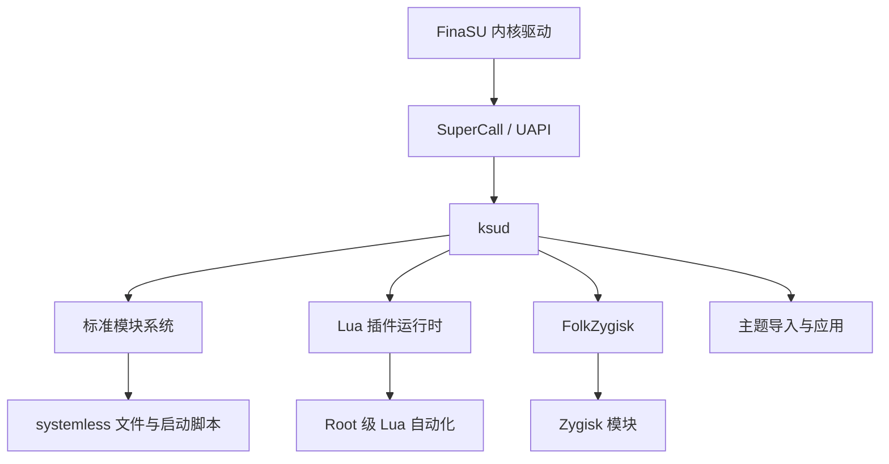

# 开发总览

<Badge text="先选扩展类型" type="tip" /> <Badge text="接口以源码为准" type="warning" /> <Badge text="Root 边界" type="danger" />

FinaSU 的“开发”不是只有编译内核。标准模块、Lua 插件、内核模块、内核源码集成、主题包和核心 UAPI 使用完全不同的打包方式、生命周期与风险边界。先选对扩展类型，再进入对应页面。

## 按目标选择

:::: table 扩展方式

| 你想做什么 | 使用 | 是否需要编译 | 入口 |
| --- | --- | --- | --- |
| 向系统路径覆盖或追加文件、执行开机脚本 | [标准模块](/developer/module-development/) | 通常不需要 | `module.prop` + ZIP |
| 提供 WebUI 或手动操作按钮 | [标准模块](/developer/module-development/) | 通常不需要 | `webroot/`、`action.sh` |
| 用 Lua 做属性、文件、命令和定时自动化 | [Lua 插件](/developer/lua-plugin/) | 不需要 | `plugin.json` + Lua |
| 编写 Zygisk 模块 | 标准模块 + Zygisk 原生库 | 需要 | `zygisk/<ABI>.so` |
| 导入独立 Linux 内核模块 | [内核模块](/manager/kernel-module/) | 需要 | `.ko` |
| 把 Root 驱动编入设备内核 | [Built-In 内核集成](/developer/builtin-integration/) | 需要完整内核构建 | 内核源码 + `CONFIG_KSU=y` |
| 新增内核功能或用户态接口 | [SuperCall 与 UAPI](/developer/supercall/) | 需要内核与用户态构建 | ioctl / 结构体 |
| 制作可导入的外观主题 | [主题包结构](/developer/theme-package/) | 不需要 | `.fpt` |

::::

::: important 这些“模块”不是同一个概念

- **标准模块**：带 `module.prop` 的 ZIP，属于 Android systemless 模块体系。
- **Lua 插件**：带 `plugin.json` 的独立自动化包，不参与 `system/` 挂载。
- **内核模块**：`.ko` 文件，由 Linux 内核加载器处理。
- **Built-In**：把 FinaSU 驱动编进内核镜像，不是“内置能力”开关。
- **FolkZygisk**：内置的 Zygisk 提供者；Zygisk 模块仍然是标准模块。

:::

## 各层怎样协作



越靠下的层越接近内核，错误的影响范围也越大：

:::: table 风险层级

| 层 | 出错后的典型表现 | 回退方式 |
| --- | --- | --- |
| 主题、Lua 配置 | 功能不生效、界面异常、单插件失败 | 重装、停用或删除对应配置 |
| 标准模块脚本 | 开机脚本阻塞、文件视图错误 | 安全模式、禁用模块 |
| 标准模块文件挂载 | 目标应用看到错误文件 | 切换挂载模式、调整 Profile |
| Zygisk / Sui 载荷 | 注入失败或应用异常 | 关闭能力并重启 |
| 内核模块 / Built-In | 驱动加载失败、内核 panic、无法开机 | 恢复原厂启动镜像 |
| 核心 UAPI | 管理器与 `ksud` 失配 | 同步更新所有 ABI 使用方 |

::::

## 仓库导航

```file-tree title="开发相关目录"
FolkSU
├── kernel/
│   ├── include/uapi/          # 内核侧 UAPI 定义
│   ├── supercall/             # ioctl 分发与权限
│   ├── policy/                # allowlist、Profile、feature
│   ├── feature/               # 内核功能
│   └── preinit/               # preinit runner
├── uapi/                      # Manager JNI 使用的镜像头文件
├── userspace/
│   ├── ksud/src/
│   │   ├── module.rs          # 标准模块安装与脚本
│   │   ├── module_config.rs   # 模块配置
│   │   └── plugin/            # Lua 插件实现
│   └── folkzygisk/            # 内置 Zygisk 引擎
├── manager/                   # Android 管理器与 JNI
├── website/                   # 文档站
└── build.sh                   # 本地发布构建入口
```

::: warning 不要随意修改 vendored 引擎

`userspace/folkzygisk/`、`userspace/sui/` 和 `userspace/nomount/` 是 vendored 源码。仓库约定要求它们除有记录的适配外保持与来源一致。修改前先读对应的 `UPSTREAM.md`，不要把临时调试补丁混进本地提交。

:::

## 先确定接口契约

不同扩展最关键的契约如下：

::::: field-group

:::: field 标准模块
@type `module.prop`
模块 ID 必须匹配 `^[a-zA-Z][a-zA-Z0-9._-]+$`，ZIP 根目录必须有 `module.prop`。安装、挂载与脚本阶段由 `ksud` 控制。
::::

:::: field Lua 插件
@type `plugin.json`
插件 ID 按 FinaSU 的插件规则校验；入口默认 `main.lua`；所有回调都返回后可被监督结束。
::::

:::: field 内核接口
@type `UAPI v6`
修改 ioctl、结构体或 feature 时，必须同步内核、`ksud` 和 Manager JNI；旧长度与旧命令的兼容策略要单独设计。
::::

:::: field 主题包
@type `.fpt`
实质是受限的平铺 ZIP 容器，外层由 AES-CBC 流包装；格式不是来源认证，导入仍要经过结构校验和事务应用。
::::

:::::

## 推荐开发流程

:::: timeline 从改动到验证

- 明确扩展类型、入口、生效阶段和最小回退方式
  time=设计 type=tip

- 对照源码确认字段、限制、返回值与失败行为
  time=核对 type=warning

- 用 `build.sh` 或对应组件入口构建，不手工拼正式发布包
  time=构建

- 在测试设备验证安装、重启、失败回退和卸载
  time=设备 type=success

- 保留日志、版本与复现步骤，再整理发布说明
  time=发布 type=info

::::

## 构建与验证

完整本地发布路径见[构建 FinaSU](/developer/build/)：

```sh
./build.sh all
```

日常修改按组件使用：

:::: code-tabs

@tab:active ksud

```sh
cargo ndk -t arm64-v8a check
cargo ndk -t arm64-v8a clippy
cargo fmt
```

@tab 管理器

```sh
cd manager
./gradlew clean assembleRelease
```

@tab 文档

```sh
cd website
pnpm docs:build
```

::::

管理器 Gradle 构建前要确保 `jniLibs` 中有可用的 `libksud.so`。正式发布仍应使用 `build.sh repack`，让当前构建的 `ksud` 被注入并重新签名。

## 安全底线

- 标准模块脚本、Lua 回调和模块 WebUI 都可能在 Root 身份下运行，不信任来源就不要安装。
- Lua API 的大小限制不是权限沙箱；插件仍能执行系统命令和读写文件。
- App Profile 的自定义 UID、能力、SELinux 与命名空间会改变真实内核凭据。
- 内核模块与 Built-In 错误可能直接导致无法开机，必须有原厂启动镜像。
- 不要把管理器密码、WebDAV 凭据、签名私钥或设备独有的密钥写入仓库。

## 继续阅读

- [构建 FinaSU](/developer/build/)：工具链、分步构建、签名与发布产物。
- [Built-In 内核集成](/developer/builtin-integration/)：内核配置、证书、preinit 与 SUSFS。
- [SuperCall 与 UAPI](/developer/supercall/)：驱动 FD、ioctl 权限和 ABI 同步。
- [标准模块开发](/developer/module-development/)：ZIP、安装脚本、启动阶段、WebUI 与 action。
- [模块配置](/developer/module-config/)：`ksud module config` 的命名、优先级和限制。
- [Lua 插件包与生命周期](/developer/lua-plugin/)：清单、安装、回调、依赖和 CLI。
- [Lua API 参考](/developer/lua-api/)：函数签名、返回值、错误和可运行示例。
- [主题包结构](/developer/theme-package/)：`.fpt` 容器、元数据、资源和兼容规则。
