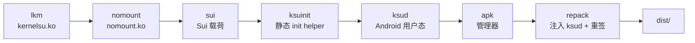

# 构建 FinaSU

<Badge text="使用 build.sh" type="tip" /> <Badge text="本地默认单 KMI" type="warning" /> <Badge text="签名必须匹配" type="danger" />

`build.sh` 是本地发布流程的入口，构建顺序与 GitHub Actions 一致。它负责跨 KMI 构建驱动、构建并嵌入内置引擎、交叉编译 `ksud`、生成管理器 APK，最后重新注入 `ksud` 并签名。

::: danger 不要手工拼正式 APK

把任意 `libksud.so` 复制进 APK 目录只能用于临时调试。正式包必须让 `repack` 注入当前构建的 `ksud`，并使用与内核信任槽位匹配的签名。

:::

## 构建阶段



:::: table 每一步做什么

| 步骤 | 主要输入 | 输出/去向 | 依赖 |
| --- | --- | --- | --- |
| `lkm` | `kernel/`、DDK 镜像、管理器第二证书 | `<kmi>_kernelsu.ko`，嵌入 `userspace/ksud/bin/aarch64/` | Docker |
| `nomount` | `userspace/nomount/`、同一 KMI 矩阵 | `<kmi>_nomount.ko`，嵌入 `ksud` | Docker |
| `sui` | `userspace/sui/` | 每个支持 ABI 的 Sui 载荷，嵌入 `ksud` | JDK、Gradle/NDK |
| `ksuinit` | `userspace/ksuinit/` | 静态 `ksuinit`，嵌入 `ksud` | Rust、NDK r29 |
| `ksud` | `userspace/ksud/` | 每个 ABI 的可执行 `ksud` | Rust、NDK、已准备的引擎资产 |
| `apk` | `manager/` 与现有 `jniLibs` | Gradle release APK | JDK、Android SDK |
| `repack` | 构建出的 `ksud`、APK、keystore | `dist/` 中的最终 APK | Python、签名工具 |

::::

## 准备环境

### 基础工具

- Linux x86_64 构建环境；仓库的本地脚本和 Docker 路径以 Linux 为主。
- Docker，可运行 privileged 容器，用于 DDK KMI 构建。
- Rust 与对应的 Android target。
- Android SDK、Build-Tools 与 **NDK `29.0.14206865`**。
- JDK 21，用于 Sui 与管理器。
- Python 3，用于载荷打包和最终 APK repack。

::: warning NDK 版本不要随手升级

`ksuinit` 需要静态链接。仓库当前固定在 NDK r29；更新 NDK 可能引入重复符号或改变静态链接行为，导致构建失败或启动异常。

:::

### 签名配置

```sh
cp manager/sign.example.properties manager/keystore.properties
```

填写：

- `KEYSTORE_FILE`
- `KEYSTORE_PASSWORD`
- `KEY_ALIAS`
- `KEY_PASSWORD`

`build.sh lkm` 会从该证书计算第二信任槽位的 DER 大小与 SHA-256，并把结果编入 `kernelsu.ko`。管理器 APK 与内核必须使用同一套证书关系。

::: important keystore 不是普通配置文件

不要提交 `keystore.properties`、JKS 文件、密码或签名私钥。CI 使用 secrets；本地 release 构建也应只保存在受控环境。

:::

## 完整构建

```sh
./build.sh all
```

等价于：

```sh
./build.sh lkm nomount sui ksuinit ksud apk repack
```

完成后查看 `dist/`。最终 APK 应包含本次构建的 `ksud`，并使用 `KEYSTORE_PROPS` 指定的密钥重新签名。

:::: steps

1. **确认工作区状态**

   不要在未理解的未提交改动上直接发布。先确认 `git status`、版本号和签名来源。

2. **先构建载荷**

   `lkm`、`nomount`、`sui` 和 `ksuinit` 会准备 `ksud` 要嵌入的资产。缺少任一必需资产时，应在对应步骤失败。

3. **交叉编译 `ksud`**

   `ksud` 会把当前 ABI 的内核模块、NoMount、Sui、FolkZygisk 与 `ksuinit` 资产编入自身。

4. **构建并重签 APK**

   `apk` 先由 Gradle 生成 APK；`repack` 再注入当前 `ksud` 并重新签名。不要只分发 Gradle 原始产物。

5. **在设备验证**

   至少验证启动、管理器身份、Root 请求、普通模块、Zygisk 与目标 ABI。完整矩阵发布前还要验证所有声明的 KMI。

::::

## 分步构建

### 内核模块

```sh
KMIS="android14-6.1 android15-6.6" ./build.sh lkm nomount
```

这一步会为指定 KMI 构建并暂存 `kernelsu.ko` 与 `nomount.ko`。DDK 镜像名来自：

```text
ghcr.io/ylarod/ddk-min:<kmi>-<DDK_RELEASE>
```

### Sui 载荷

```sh
SUI_BUILD_TYPE=release ./build.sh sui
```

`sui` 会执行 vendored Sui 项目的 `zipRelease`，再把载荷映射到每个目标 ABI 的 `ksud` 资产目录。构建过程不会额外刷入模块，也不会运行 Sui 自身的安装脚本。

### `ksuinit`

```sh
./build.sh ksuinit
```

`ksuinit` 必须在 ramdisk 的 `init` 阶段运行，因此要求静态链接。构建脚本会检查产物是否真的是静态 ELF。

### `ksud`

```sh
ABIS="arm64-v8a" KSUD_BUILD_TYPE=release ./build.sh ksud
```

输出位于 `target/<target-triple>/release/ksud`。该步骤依赖前面已经准备好的嵌入资产。

### 管理器与 repack

```sh
APP_BUILD_TYPE=release ./build.sh apk repack
```

Gradle 需要 `manager/app/src/main/jniLibs/<abi>/libksud.so` 存在。临时调试可以使用已构建的 `ksud`：

```sh
mkdir -p manager/app/src/main/jniLibs/arm64-v8a
cp userspace/ksud/target/aarch64-linux-android/release/ksud \
  manager/app/src/main/jniLibs/arm64-v8a/libksud.so
```

但 `repack` 才会把当前 release `ksud` 写进正式产物。不要在提交中留下临时复制的原生库。

## 环境变量

:::: table 常用覆盖项

| 变量 | 默认值 | 作用 |
| --- | --- | --- |
| `KMIS` | `android15-6.6` | 空格分隔的 KMI 列表 |
| `ABIS` | `arm64-v8a` | `ksud` 与 APK 的目标 ABI |
| `DDK_RELEASE` | `20260828` | DDK 镜像 tag |
| `ANDROID_API_LEVEL` | `26` | Rust Android API level |
| `KSUD_BUILD_TYPE` | `release` | `ksud` 的 Cargo profile |
| `APP_BUILD_TYPE` | `release` | Gradle APK 类型 |
| `SUI_BUILD_TYPE` | `release` | Sui ZIP 类型 |
| `OUT_DIR` | `dist` | `repack` 输出目录 |
| `KEYSTORE_PROPS` | `manager/keystore.properties` | 签名配置路径 |

::::

::: danger 本地默认不是全 KMI

`KMIS` 默认只有 `android15-6.6`。只跑一次普通本地构建，不会自动获得所有设备的驱动。完整发布应使用 CI 的 KMI 矩阵，或显式提供完整 `KMIS`。

:::

## 目标矩阵

当前 CI 构建以下 KMI：

```text
android12-5.10
android13-5.10
android13-5.15
android14-5.15
android14-6.1
android15-6.6
android16-6.12
android17-6.18
```

当前 CI 管理器目标包括 `arm64-v8a`、`x86_64` 和 `riscv64` 的 `ksud` 构建。Sui 与 FolkZygisk 没有 `riscv64` 载荷；KernelSU/NoMount 模块发布矩阵当前针对 aarch64 与 x86_64。

## 本地与 CI 的差异

::::: field-group

:::: field 本地构建
@type `单机验证`
灵活、速度快，但默认只覆盖指定 KMI，不一定包含全部引擎载荷，也不会自动完成真实的设备启动矩阵。
::::

:::: field CI 发布
@type `完整矩阵`
使用固定工具链和 KMI 矩阵，生成可用于 release 的多 ABI、多 KMI 包，并运行管理器单测与 lint。
::::

:::: field 设备验证
@type `不可替代`
即使编译、签名和单测通过，也不能证明特定厂商内核、分区布局和模块组合可启动。
::::

:::::

## 常见失败

:::: collapse accordion

### 缺少 `manager/keystore.properties`

复制 `sign.example.properties`，填入实际 keystore 路径和密码。不要用任意证书替代发布证书。

### `ksuinit` 不是静态链接

确认使用 NDK r29、正确的 Android target 和构建脚本中的静态 RUSTFLAGS。不要用普通 PIE 产物替代。

### `asset not found: ksuinit`

说明当前 `ksud` 构建没有把 `ksuinit` 嵌入。先执行 `./build.sh ksuinit`，再重新构建 `ksud` 和 APK。

### APK 安装后不是管理器

核对 APK 证书与当前内核的信任槽位。自定义签名必须重新构建内核或通过动态管理器授权。

### 只有一个 KMI 可用

检查 `KMIS`。本地默认值只构建 `android15-6.6`，这是设计行为，不是自动探测所有设备。

### 管理器构建缺少 `libksud.so`

先构建 `ksud` 并复制到对应的 `jniLibs/<abi>/libksud.so` 供 Gradle 使用；正式包仍通过 `repack` 注入最终载荷。

::::

## 发布前检查

:::: steps

1. 确认 `git status`、版本号、签名来源和 KMI 矩阵。
2. 运行与改动组件对应的编译、lint 和测试。
3. 构建 `./build.sh all` 或 CI 完整发布流程。
4. 校验最终 APK 的签名与第二信任槽位。
5. 在至少一台目标设备验证启动和管理器身份。
6. 验证 Root、标准模块、Zygisk、Sui 与目标 ABI。
7. 保留构建日志、产物哈希和已知限制。

::::

## 相关页面

- [开发总览](/developer/)：选择扩展方式。
- [Built-In 内核集成](/developer/builtin-integration/)：修改内核而不是构建独立载荷。
- [Lua 插件包与生命周期](/developer/lua-plugin/)：插件资产与运行时。
- [标准模块开发](/developer/module-development/)：模块 ZIP 和脚本。
- [排查无法开机](/troubleshoot/bootloop/)：构建后无法启动时的恢复顺序。
