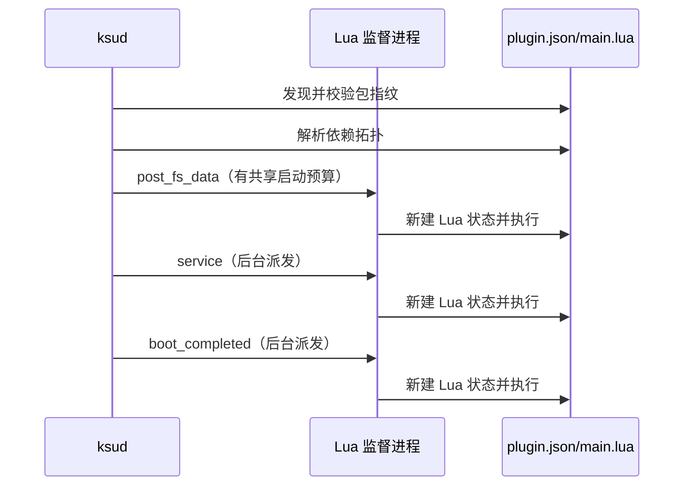

# Lua 插件包与生命周期

<Badge text="plugin.json" type="tip" /> <Badge text="事务安装" type="warning" /> <Badge text="Root 自动化" type="danger" />

`ksud` 内嵌 Lua 5.5 运行时。插件用一个 `plugin.json` 描述包，用一个 Lua 文件返回回调表；它适合属性、文件、命令、配置和定时自动化，不负责 `system/` 文件挂载。

::: important 插件不是标准模块

标准模块以 `module.prop` 为入口，交给挂载后端和模块脚本系统；Lua 插件以 `plugin.json` 为入口，运行在独立监督进程中。两者可以协作，但目录、安装格式和生命周期不同。

:::

## 最小插件

```file-tree title="hello-plugin.zip"
hello-plugin.zip
├── plugin.json
├── main.lua
└── lib/
    └── helper.lua
```

`plugin.json`：

```json
{
  "id": "hello_plugin",
  "name": "Hello Plugin",
  "author": "Example",
  "version": "1.0.0",
  "description": "Writes a greeting after the service stage.",
  "license": "MIT",
  "entry": "main.lua",
  "callbacks": ["service", "action"],
  "quick_action": {
    "function": "action",
    "label": "Write greeting"
  }
}
```

`main.lua`：

```lua
local function greeting()
  local name = get_config("name")
  if name == "" then
    name = "FinaSU"
  end
  return "Hello, " .. name .. "!\n"
end

return {
  service = function()
    assert(write_file(PLUGIN_DIR .. "/data/greeting.txt", greeting()))
    info("greeting updated")
  end,

  action = function()
    assert(write_file(PLUGIN_DIR .. "/data/greeting.txt", greeting()))
  end,
}
```

入口脚本必须返回一个 table，表中的回调值必须是函数。==入口在每次回调时重新加载==，不能依赖上一轮的 Lua 全局变量。

::: tip 回调只做本轮需要做的事

把跨轮次需要保留的数据写入 `config.json` 或文件，把 Lua 全局变量只当成本轮的临时值。这样手动运行、阶段派发和 daemon 轮次才会表现一致。

:::

## 包根与目录

ZIP 可以平铺：

```text
plugin.json
main.lua
```

也可以统一套在一层目录中：

```text
hello-plugin/
├── plugin.json
└── main.lua
```

安装器寻找最浅的 `plugin.json` 并把该目录作为包根。不要嵌套多个组件各自带 `plugin.json`，也不要依赖 ZIP 文件名的顺序决定安装内容。

安装后目录固定为：

```text
/data/adb/plugins/<id>/
```

宿主的锁、暂存和放行记录位于：

```text
/data/adb/ksu/plugin_locks/finasu/
/data/adb/ksu/plugin_stage/finasu/
/data/adb/ksu/plugin_state/finasu/
```

这些路径由宿主管理，插件不应读取、篡改或依赖其内部文件名。

## `plugin.json` 字段

:::: table 清单字段

| 字段 | 类型 | 必需 | 行为 |
| --- | --- | --- | --- |
| `id` | string | 是 | 插件唯一 ID，也是安装目录名 |
| `name` | string | 否 | 管理器显示名称 |
| `author` | string | 否 | 作者 |
| `version` | string | 否 | 面向用户的版本 |
| `description` | string | 否 | 主要说明 |
| `descriptions` | object | 否 | 按语言代码保存说明，当前管理器保留但不作为主显示来源 |
| `license` | string | 否 | 许可证文本 |
| `min_version` | number | 否 | 要求的最低 FinaSU host versionCode |
| `depends` | string[] | 否 | 依赖的插件 ID |
| `entry` | string | 否 | 入口文件名，默认 `main.lua` |
| `config` | object[] | 否 | 配置控件声明 |
| `quick_action` | string / object | 否 | 管理器快捷操作 |
| `has_action` | boolean | 否 | 声明有操作；快捷按钮还取决于回调 |
| `callbacks` | string[] | 否 | 需要自动调度的回调名 |

::::

### ID、入口和回调名

::::: field-group

:::: field 插件 ID
@type `规则`
最多 64 个字符；首字符必须是 ASCII 字母或数字，后续只允许 ASCII 字母、数字、`.`、`_`、`-`。不能是 `.` 或 `..`。
::::

:::: field 入口文件
@type `规则`
最多 128 个字符；必须是包根下的纯文件名，只允许 ASCII 字母、数字、`.`、`_`、`-`，不能带目录分隔符。
::::

:::: field 回调名
@type `规则`
最多 64 个字符；首字符必须是 ASCII 字母、数字或 `_`，后续只允许 ASCII 字母、数字或 `_`。
::::

:::::

入口只支持包根文件，不支持 `sub/main.lua`。需要拆分代码时，入口可以通过包内其他数据或模块加载约定自行组织，但入口名本身仍必须是纯文件名。

### `min_version`

`min_version` 与运行中的 host `versionCode` 比较。插件要求高于当前宿主时，清单解析失败，插件不能被启用或自动运行。

### 依赖

- 安装时允许先安装依赖尚未就绪的插件。
- 启用时要求每个 `depends` 都已安装。
- 自动阶段按依赖拓扑顺序运行。
- 依赖缺失、禁用或清单无效时，依赖它的插件也会被跳过。
- 依赖循环中的所有成员都不会运行。
- 停用或卸载仍被其他已启用插件依赖的插件会被拒绝。

插件依赖只表达运行顺序和启用关系，不会自动安装、启用或更新依赖。

## 配置控件

```json
{
  "config": [
    {
      "key": "mode",
      "label": "Mode",
      "type": "select",
      "default": "balanced",
      "options": ["fast", "balanced", "safe"]
    },
    {
      "key": "enabled",
      "label": "Enabled",
      "type": "bool",
      "default": true
    }
  ]
}
```

支持的控件类型只有：

:::: table `config[].type`

| 类型 | 额外要求 | 说明 |
| --- | --- | --- |
| `text` | 无 | 文本输入 |
| `number` | 无 | 数字输入，但保存时仍是字符串 |
| `bool` | 无 | 布尔开关 |
| `select` | `options` 必须非空 | 从固定选项中选择 |

::::

`key` 最多 64 字节且不能包含 `/` 或 `\`。`label` 是主显示文本，`labels` 可以携带按语言代码组织的文本；当前管理器只读取 `label`，尚未把 `labels` 作为主要本地化来源。

`config[].default` 只用于管理器初始展示，不会被宿主注入 Lua。插件读取时要自行 fallback：

```lua
local mode = get_config("mode")
if mode == "" then
  mode = "balanced"
end
```

## 快捷操作与 `action`

最简单且管理器当前能识别的写法是：

```json
{
  "callbacks": ["action"],
  "quick_action": {
    "function": "action",
    "label": "Run cleanup"
  }
}
```

`quick_action` 也可以直接写成字符串：

```json
{
  "quick_action": "clean_now"
}
```

此时管理器优先调用 `quick_action.function`；没有 `quick_action` 时才回退到 `action`。只写 `"has_action": true` 足以让清单标记有操作，但当前管理器不会因此凭空显示一个可执行回调，因此应同时声明 `quick_action` 或 `callbacks: ["action"]`。

`labels` 可以为快捷操作提供多语言文本，但当前管理器仍以 `label` 为主。

## 安装与更新

插件安装是事务化的：

1. 读取并验证清单。
2. 检查 ZIP 路径、重复项、符号链接、设备文件、大小和压缩比。
3. 解压到与插件目录同一文件系统的暂存目录。
4. 携带已有的 `config.json`、`disable` 和 `last_output.log`。
5. 再次读取清单，并确认入口文件存在。
6. 用原子交换或重命名切换到新版本。

任一步失败都保留旧版本。插件有 daemon 或监督进程运行时，更新和卸载会被拒绝。

:::: table 安装包限制

| 项目 | 限制 |
| --- | --- |
| `plugin.json` | 1 MiB |
| 单个解压文件 | 16 MiB |
| 解压总量 | 64 MiB |
| ZIP 成员数 | 2048 |
| 单文件压缩比 | 200 |

::::

路径必须是相对路径，不能包含绝对路径、空段、`.`、`..`、重复成员或 NUL。包内不能携带 `config.json`、`disable`、`last_output.log`；这些是用户状态，更新时由已有安装迁移。

安装后所有包文件统一设为 `0644`。需要执行权限的文件应通过 Lua 调用 `chmod` 或交给系统工具处理，不要期待 ZIP 保留 Unix mode。

## 启用与引导放行

插件被安装或启用时，宿主记录当前包内容指纹。自动启动阶段只运行指纹匹配的插件：

- 从未在 FinaSU 中安装或启用的插件不会被自动运行。
- 插件代码文件被外部修改后，指纹失效，自动阶段拒绝运行。
- 重新安装或重新启用会登记当前包指纹。
- `config.json`、日志和 `disable` 属于运行状态，不参与指纹。

这避免了共享 `/data/adb/plugins/` 中一个“已经存在但从未被当前管理器确认”的包在开机时直接获得执行机会。

## 回调与阶段

入口返回 table。自动阶段只识别三个名称：

:::: table 自动阶段

| 阶段 | Lua 回调 |
| --- | --- |
| `post-fs-data` | `post_fs_data` |
| `service` | `service` |
| `boot-completed` | `boot_completed` |

::::

插件没有 `post-mount` 自动阶段。需要在模块挂载完成后工作的插件，应使用标准模块的 `post-mount.sh`，或者明确接受在 `service` 阶段运行。



### 执行规则

- `post-fs-data` 与标准模块启动脚本共享约 35 秒预算；单回调上限 120 秒，但实际超时取剩余预算。
- `service` 与 `boot-completed` 在后台派发，不阻塞启动。
- 每个阶段每次 boot 最多自动执行一次。
- 声明 `action` 后可由管理器或 CLI 手动调用。
- 任意合法回调名都可以通过 `ksud plugin run <id> <callback>` 调用。
- 缺失回调退出码为 `2`；失败或被监督终止退出码为 `1`。
- 普通手动回调监督上限为 300 秒。

### 常驻 `main`

只有 `callbacks` 中声明 `"main"` 时，宿主才会在 `service` 回调之后启动常驻循环：

- 固定最小间隔为 1 秒。
- 每轮创建全新的 Lua 状态。
- 每插件、每回调只允许一个 daemon。
- 插件被禁用或目录消失后停止。
- 某一轮失败会写日志，后续轮次仍会重新加载包。

轮次之间没有 120 秒监督超时，回调应自行快速返回。需要常驻后台进程时，使用 `exec` 启动并管理独立程序，或显式调用 `start_daemon`。

## 配置、日志与状态

```file-tree title="已安装插件"
/data/adb/plugins/hello_plugin/
├── plugin.json          # 包清单
├── main.lua             # 入口
├── config.json          # 用户配置，JSON 字符串值
├── last_output.log      # 回调日志，最多 64 KiB
└── disable              # 存在时停用
```

配置文件上限为 4 MiB。宿主读取旧版非字符串标量时会转成文本，但新写入统一保存 JSON 字符串。损坏的 `config.json` 不会被自动覆盖，读取和写入会返回错误。

日志由 `info`、`warn` 以及回调进程的 stdout/stderr 汇入。打开已超过 64 KiB 的日志时会先截断，不能把日志当长期审计记录。

## CLI

::::: code-tabs

@tab:active 安装与状态

```sh
ksud plugin install /data/local/tmp/hello-plugin.zip
ksud plugin list
ksud plugin enable hello_plugin
ksud plugin disable hello_plugin
ksud plugin uninstall hello_plugin
```

@tab 运行与日志

```sh
ksud plugin run hello_plugin service
ksud plugin action hello_plugin
ksud plugin log hello_plugin
ksud plugin clear-log hello_plugin
```

@tab 配置

```sh
ksud plugin config --id hello_plugin list
ksud plugin config --id hello_plugin get mode
ksud plugin config --id hello_plugin set mode fast
ksud plugin config --id hello_plugin delete mode
```

:::::

`ksud plugin list` 输出 JSON 数组，包含 `enabled`、`has_action`、`quick_action`、`config`、`depends`、`callbacks` 与按插件报告的错误。清单损坏时仍会列出条目，方便定位，而不是悄悄跳过。

`ksud plugin daemon` 与 `ksud plugin stage` 是内部命令，供宿主重新执行自身使用，不属于稳定的公共插件接口。

## 与 FolkPatch 的兼容边界

插件目录、`plugin.json`、Lua 回调表和部分 CLI 形状与 FolkPatch 生态相近，因此简单插件通常可以迁移。但 FinaSU 的实现不是 FolkPatch API 的完整副本：

:::: table 不要照搬的接口

| 接口 | FinaSU 状态 |
| --- | --- |
| `save_text` / `read_text` | 不提供；使用 `write_file` / `read_file` |
| `getConfig` / `setConfig` | 不提供；使用 `get_config` / `set_config` |
| `install_module` | 不提供 |
| `modules` 全局表 | 不提供 |
| Lua 5.4 专属行为 | 不作为兼容保证；FinaSU 使用 Lua 5.5 |
| 原生 `io` / `os` | 不作为稳定契约；使用本文 API |

::::

迁移时先搜索这些接口，再逐个替换并重新测试。完整函数与错误行为见 [Lua API 参考](/developer/lua-api/)。

## 调试顺序

::::: steps

1. **确认包被识别**

   运行 `ksud plugin list`。如果 `error` 非空，先修清单；不要继续猜测回调逻辑。

2. **确认插件已启用**

   检查 `enabled` 和 `disable` 文件。自动阶段还要求包指纹已登记，重新安装或启用一次即可确认当前内容。

3. **手动运行目标回调**

   `ksud plugin run <id> <callback>` 能直接暴露语法错误、缺失回调和运行时异常。先让它成功，再重启验证自动阶段。

4. **查看日志**

   `ksud plugin log <id>` 查看 Lua 与子进程输出。日志会折叠换行，但保留最后 64 KiB 内容。

5. **检查依赖与阶段预算**

   依赖缺失、依赖循环、未放行指纹、启动预算耗尽都会让插件在自动阶段被跳过。日志通常会写出具体原因。

6. **验证更新和卸载**

   有 daemon 时先停止对应流程。更新后确认 `config.json` 与日志被保留，卸载后确认目录和放行记录都不再存在。

:::::

:::: chat title="Lua 插件开发问答"
{用户}
我可以把插件当标准模块挂载文件吗？

{.}
不可以。插件运行 Root 级 Lua，但不参与 `system/` 挂载。文件注入应使用标准模块和当前挂载后端。

{用户}
为什么 `plugin.json` 的默认值在 Lua 里读不到？

{.}
`config[].default` 只用于管理器展示。`get_config` 未保存时返回空字符串，插件必须自己提供 fallback。

{用户}
为什么设置了 `has_action` 却看不到操作按钮？

{.}
当前管理器优先使用 `quick_action.function`，否则调用 `action`。声明 `quick_action` 或把 `action` 放进 `callbacks`。

{用户}
插件能在 `io.open` 和 `write_file` 之间任选吗？

{.}
不要依赖原生 `io`。使用 `write_file` / `read_file`，它们有明确的大小和错误语义，也是 FinaSU 的兼容接口。
::::

## 相关页面

- [Lua API 参考](/developer/lua-api/)：18 个函数的签名、返回值和限制。
- [标准模块开发](/developer/module-development/)：需要文件挂载或启动脚本时使用。
- [插件管理](/manager/plugin/)：管理器中的安装、日志、配置与运行入口。
