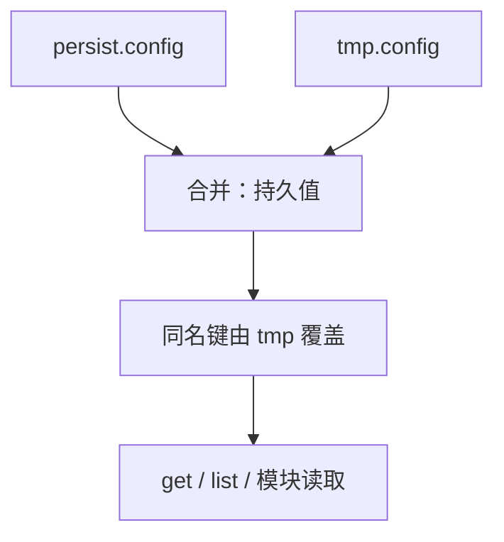

# 模块配置

<Badge text="持久 + 临时" type="tip" /> <Badge text="二进制文件" type="warning" /> <Badge text="最多 32 项" type="danger" />

模块配置让标准模块把用户选择保存在模块目录之外。模块更新时配置不会随 ZIP 覆盖，卸载模块时对应配置会被清理。它服务于 `customize.sh`、启动脚本、WebUI 和管理器，不是 Lua 插件的 `config.json`。

```file-tree title="配置存放位置"
/data/adb/ksu/
└── module_configs/
    └── example_module/
        ├── persist.config     # 持久配置
        └── tmp.config         # 临时覆盖，启动早期清理
```

## 两个配置层

:::: table 存储层

| 文件 | CLI 参数 | 生命周期 | 适合保存 |
| --- | --- | --- | --- |
| `persist.config` | 默认 | 跨重启保留，模块卸载时清理 | 用户设置、长期模式 |
| `tmp.config` | `--temp` / `-t` | 下次启动早期清除 | 一次性迁移、异常恢复、临时覆盖 |

::::

读取时先加载 `persist.config`，再用 `tmp.config` 中同名键覆盖。==删除和清空只作用于指定层==，不会自动改动另一层。

## 在模块脚本中调用

模块脚本运行时，`ksud` 会设置 `KSU_MODULE`。因此脚本不需要再传模块 ID：

```sh
mode="$(ksud module config get mode 2>/dev/null || echo balanced)"

ksud module config set mode fast
ksud module config set migration_done true --temp
```

不在模块脚本环境时，可以显式指定内部名称：

```sh
ksud module config --internal webui get mode
ksud module config --internal webui set mode fast
```

`--internal <name>` 实际解析为模块 ID `internal.<name>`，不是任意模块 ID 的别名。要操作普通模块，应通过 `KSU_MODULE` 环境进入该模块上下文。

## CLI

::::: code-tabs

@tab:active 读写

```sh
ksud module config get mode
ksud module config set mode fast
ksud module config set mode balanced --temp
ksud module config delete mode
ksud module config clear
```

@tab 从 stdin 写入

```sh
printf '%s' "$long_value" | ksud module config set description
printf '%s' "$long_value" | ksud module config set description --stdin
```

@tab 查看全部

```sh
ksud module config list
```

:::::

- `set` 省略 value，或显式传入 `--stdin`，都会从标准输入读到 EOF。
- `get` 找不到键时返回错误，不输出空字符串。
- `delete` 找不到键时返回错误。
- `clear` 删除整个目标配置文件；文件本来不存在时仍算成功。
- `list` 输出合并后的 `key=value`，临时值覆盖持久值。

## 文件格式

配置文件是 FinaSU 自己维护的二进制格式：

- Magic 为 `KSUM`，小端值 `0x4b53554d`。
- 当前格式版本为 `1`。
- 内容由数量、带长度的键和带长度的值组成，全部按 UTF-8 解释。
- 写入使用临时文件、`sync_all` 和原子重命名。

::: danger 不要手工编辑

手改二进制文件可能造成魔数、版本、长度或 UTF-8 错误。损坏后模块读取配置会失败；应重新写入或删除对应配置文件。

:::

## 取值限制

:::: table 边界

| 项目 | 限制 |
| --- | --- |
| 单个配置文件的配置项数量 | 最多 32 |
| 键长度 | 最多 256 字节 |
| 键格式 | `^[a-zA-Z][a-zA-Z0-9._-]+$` |
| 键最短长度 | 2 个字符 |
| 值长度 | 最多 1 MiB |
| 值编码 | 任意合法 UTF-8 |

::::

注意键规则与模块 ID 一致：首字符是 ASCII 字母，后续至少还有一个字母、数字、`.`、`_` 或 `-`。因此 `a` 不合法，`a1` 合法。

::: warning 值不是布尔类型

配置值始终是字符串。读取布尔值时，安装器相关约定只把大小写不敏感的 `true` 和精确的 `1` 视为真，其余值视为假。模块应明确约定自己的解析规则并在文档中说明。

:::

## 优先级示例

```sh
ksud module config set mode balanced
ksud module config set mode fast --temp
ksud module config list
```

本次启动读到：

```text
mode=fast
```

`tmp.config` 在启动早期被清理。下一次启动读取：

```text
mode=balanced
```



## 声明托管 Feature

模块可以通过持久配置声明自己管理某个 FinaSU feature：

```sh
ksud module config set manage.su_compat true
```

管理器列出模块时，会把所有值为真的 `manage.<feature>` 汇总为模块的 `managedFeatures`。安装器读取 `module.prop` 的 `managedFeatures` 后，会检查 feature 是否受内核支持、是否已经被另一个模块管理。

这项约定只表达“模块声明自己管理”，不会自动关闭或接管 feature。模块必须自己完成实际操作，并保证卸载后恢复。

```properties
id=example_module
managedFeatures=su_compat
```

::: warning 重复管理不会自动解决

两个模块同时管理同一 feature 时，安装器只能给出警告。功能冲突仍要由模块作者避免，不能假设最后一个安装的模块会可靠获胜。

:::

## 模块说明覆盖

持久配置中的 `override.description` 会覆盖管理器显示的模块说明：

```sh
ksud module config set override.description \
  "当前模式：fast（由模块配置动态更新）"
```

这适合展示当前模式或运行状态。不要把实时大段日志写进说明；模块列表会频繁读取它。

## 开发建议

::::: steps

1. **先定义键和默认值**

   为每个键记录类型、允许值、默认值和修改后何时生效。不要只在读取脚本里隐式处理。

2. **区分持久与临时**

   用户选择写持久层；一次启动内的迁移或恢复写临时层。不要让临时值被误认为永久设置。

3. **处理缺键**

   `get` 失败是正常情况。脚本应准备默认值，并在需要时显式写入持久配置。

4. **限制并发写**

   多个 WebUI 请求或脚本同时更新配置时，应由模块自己串行化。单次 CLI 写入是原子的，不代表多次读改写构成事务。

5. **验证卸载清理**

   卸载后确认模块目录和 `/data/adb/ksu/module_configs/<id>/` 都被清理，且没有遗留 feature 声明。

:::::

::::: collapse accordion

:::: collapse 配置会随模块更新丢失吗
不会。配置位于 `/data/adb/ksu/module_configs/<id>/`，模块 ZIP 覆盖的是模块目录。只要模块 ID 不变，持久配置会继续存在。
::::

:::: collapse 可以直接修改 `persist.config` 吗
不建议。格式包含魔数、版本、数量和长度字段；错误写入会使整个文件读取失败。使用 `ksud module config`。
::::

:::: collapse 为什么 `--temp` 值重启后消失
这是设计行为。`post-fs-data` 早期会清理所有模块的 `tmp.config`，避免一次性状态跨启动污染正式配置。
::::

:::: collapse WebUI 应怎样调用
WebUI 可以执行 `ksud module config ...`，但必须校验用户输入、避免把未转义内容拼入 shell，并处理命令非零退出。
::::

:::::

## 相关页面

- [标准模块开发](/developer/module-development/)：模块安装、脚本生命周期与 WebUI。
- [Lua API 参考](/developer/lua-api/)：插件的 `get_config` / `set_config`，使用另一套 JSON 存储。
