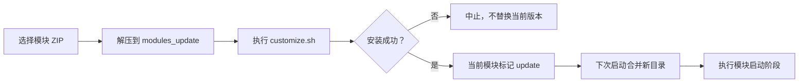

# 标准模块开发

<Badge text="module.prop" type="tip" /> <Badge text="ZIP 根目录" type="warning" /> <Badge text="启动阶段" type="danger" />

标准模块是带 `module.prop` 的 ZIP 包，由 FinaSU 解压到模块目录，并按模块规则处理 `system/` 文件、属性、SELinux 规则和启动脚本。==Zygisk 模块、WebUI 模块和 metamodule 也建立在这套模块格式上==，但它们各自还有额外要求。

::: important 先分清“模块”指什么

本文的模块是 `/data/adb/modules/` 下的 Android systemless 模块。Linux `.ko` 内核模块见[受管内核模块](/manager/kernel-module/)；把 Root 驱动编入内核见[Built-In 内核集成](/developer/builtin-integration/)。

:::

::: tip 从一个路径覆盖开始

如果目标只是替换一个系统文件，先完成最小的 `module.prop` 与 `system/` 目录，再验证挂载和 Profile。不要一开始就加入常驻脚本、热安装或 metamodule。

:::

## 最小可安装结构

ZIP 的根目录必须直接包含 `module.prop`。标准模块不支持把所有内容统一套在一层目录中。

```file-tree title="最小模块"
example-module.zip
├── module.prop
├── customize.sh
├── post-fs-data.sh
├── service.sh
└── system/
    └── bin/
        └── example
```

`module.prop` 示例：

```properties
id=example_module
name=Example Module
version=1.0.0
versionCode=1
author=Example Author
description=An example systemless module.
```

安装入口实际强制校验的是 `id`：

- 必须匹配 `^[a-zA-Z][a-zA-Z0-9._-]+$`。
- 首字符必须是 ASCII 字母。
- 最少 2 个字符，不能包含空格、斜杠或非 ASCII 字符。

其余字段缺失时通常不会阻止安装，但管理器会显示空名称、空版本或空说明。正式模块应完整填写。

:::: table `module.prop` 常用字段

| 字段 | 作用 | 建议 |
| --- | --- | --- |
| `id` | 模块唯一标识、目录名和配置命名空间 | 必填，发布后不要随意更改 |
| `name` | 管理器显示名称 | 必填 |
| `version` | 面向用户的版本字符串 | 必填 |
| `versionCode` | 用于比较版本的数字 | 必填，每次发布递增 |
| `author` | 作者 | 必填 |
| `description` | 模块说明 | 必填，保持简短 |
| `managedFeatures` | 声明模块管理的 FinaSU feature，逗号分隔 | 只有确实接管 feature 时填写 |

::::

::: warning 模块 ID 是持久标识

配置、预启动副本和卸载清理都按模块 ID 关联。改名会让已有配置看起来“消失”；如果旧模块仍在，也可能形成两个不同 ID 的模块。

:::

## 安装发生了什么

标准模块只能通过已启动的 Android 环境安装。`ksud module install` 会先确认 `sys.boot_completed=1`，然后把 ZIP 解压到：

```text
/data/adb/modules_update/<id>/
```

安装脚本在暂存目录中运行。默认安装成功后，当前运行模块目录会写入 `update` 标记；下一次启动时，`ksud` 才把暂存目录合并到 `/data/adb/modules/<id>/`。



因此，“安装完成”不表示 `system/` 文件已经立刻出现在目标进程里。除明确支持的热安装外，新版本要在重启后完整生效。

## 安装脚本

现代模块使用 `customize.sh`。旧的 `install.sh` 仍能被兼容路径识别，但它使用另一套安装接口，新模块不应再以它为主。

### 默认行为

如果没有设置 `SKIPUNZIP=1`，`customize.sh` 被加载前已经发生以下操作：

1. ZIP 内容被解压到 `$MODPATH`，但排除 `META-INF/`。
2. 普通目录设为 `0755`，普通文件设为 `0644`。
3. `system/bin`、`system/xbin`、`system/system_ext/bin` 下的文件设为可执行。
4. `system/vendor` 使用 vendor 文件上下文和可执行权限。
5. 然后才 source `customize.sh`。

设置 `SKIPUNZIP=1` 后，默认解压与权限步骤会跳过，作者必须自己把所需文件放入 `$MODPATH`。除非模块需要按机型筛选文件，否则不建议增加这套复杂度。

### 可用安装函数

:::: table 安装脚本公共函数

| 函数 | 作用 |
| --- | --- |
| `ui_print <text>` | 向管理器安装输出写入一行 |
| `abort <text>` | 输出错误、清理暂存目录并终止安装 |
| `set_perm <path> <uid> <gid> <mode> [context]` | 设置单个路径的属主、权限和 SELinux 上下文 |
| `set_perm_recursive <path> <uid> <gid> <dir-mode> <file-mode> [context]` | 递归设置权限 |
| `mktouch <path> [content]` | 创建文件并写入可选内容，权限设为 `0644` |
| `mark_remove <path>` | 用特殊节点标记要从模块视图中删除的目标 |

::::

最小 `customize.sh`：

```sh
#!/system/bin/sh

ui_print "- Installing $(grep '^name=' "$MODPATH/module.prop" | cut -d= -f2-)"
set_perm "$MODPATH/system/bin/example" 0 2000 0755
```

### 安装环境

::::: field-group

:::: field `MODPATH`
@type `路径`
本次安装的暂存模块目录。脚本对模块文件的修改都应基于这个变量。
::::

:::: field `ZIPFILE`
@type `路径`
原始模块 ZIP 的绝对路径。
::::

:::: field `TMPDIR`
@type `路径`
安装临时目录，当前为 `/dev/tmp`。脚本退出前不要依赖其中内容长期存在。
::::

:::: field `ARCH` / `ABI` / `API`
@type `设备信息`
分别表示检测到的架构、主 ABI 和 Android API level。
::::

:::: field `BOOTMODE`
@type `布尔值`
FinaSU 在已启动 Android 中安装，该值为真。脚本仍应避免假设 recovery 环境。
::::

:::::

安装器还会提供 `KSU=true`、`KSU_VER`、`KSU_VER_CODE`、`KSU_UAPI_VER`、`KSU_RUNTIME_MODE` 与 `KSU_HAS_HOT_INSTALL`。不要把这些变量用于未经验证的旧管理器兼容分支。

## 启动脚本

模块脚本由 BusyBox `ash` 执行。所有模块脚本都应先从自身路径解析目录：

```sh
MODDIR=${0%/*}
```

不要写死 `/data/adb/modules/<当前模块>/` 后再把脚本复制到别处；使用 `MODDIR` 才能保持路径与当前安装位置一致。

:::: table 生命周期

| 阶段 | 文件 | 是否等待 | 适用场景 |
| --- | --- | --- | --- |
| `post-fs-data` | `post-fs-data.sh` | 是，有超时预算 | 必须尽早执行的数据准备 |
| `post-mount` | `post-mount.sh` | 与前一阶段共享预算 | 需要模块文件视图已建立后的操作 |
| `service` | `service.sh` | 否，后台派发 | 服务启动、常驻进程 |
| `boot-completed` | `boot-completed.sh` | 否，后台派发 | 系统可交互后的任务 |

::::

`post-fs-data` 与 `post-mount` 共用约 35 秒启动预算。脚本不要无界等待、循环探测或启动不会退出的前台进程；常驻工作应交给 `service.sh`，并使用自己的日志与停止条件。

普通模块之间的脚本顺序没有稳定的全局排序保证。元模块的阶段脚本会先于普通模块执行。模块之间需要协作时，应使用明确的标记文件、超时和幂等逻辑，不能依赖安装目录的遍历顺序。

安全模式下，`ksud` 会跳过 common/module 启动脚本并停用模块。把“安全模式没有执行”误判成脚本损坏，会得到错误结论。

## 模块目录中的其他入口

:::: table 文件与目录

| 路径 | 作用 |
| --- | --- |
| `system/` | 通过挂载后端发布到对应系统路径 |
| `system.prop` | 在启动早期设置属性 |
| `sepolicy.rule` | 向当前策略追加 SELinux 规则 |
| `action.sh` | 管理器中的手动执行入口 |
| `webroot/` | 模块 WebUI 静态资源 |
| `uninstall.sh` | 下次启动删除模块前执行 |
| `initrc/*.rc` | 汇入 preinit 生成的 `modules.rc` |
| `preinit/` | 需要极早执行的 preinit 资源，必须包含 `preinit.conf` |
| `zygisk/<ABI>.so` | Zygisk 模块原生库 |
| `skip_mount` | 保留脚本执行，但跳过 `system/` 文件注入 |
| `disable` | 停用模块 |
| `remove` | 下一次启动删除模块 |

::::

### Zygisk 入口

Zygisk 原生库按设备 ABI 放置：

```text
zygisk/arm64-v8a.so
zygisk/armeabi-v7a.so
zygisk/x86_64.so
zygisk/x86.so
```

标准模块格式只负责把文件放到模块目录；真正完成注入的是当前可用的 Zygisk 提供者。不要因为模块包含 `zygisk/` 就认为注入一定成功，也不要在模块脚本里假定内置 FolkZygisk 一定是当前提供者。

### WebUI 与手动操作

- `webroot/index.html` 是 WebUI 入口。WebUI 以 Root 能力展示模块内容，必须把输入视为不可信。
- `action.sh` 由管理器的模块操作按钮执行，适合短任务；需要长期运行时自行转后台并记录日志。
- 模块配置可通过 [模块配置](/developer/module-config/) 暴露给脚本和 WebUI。

## 热安装

常规模块更新要重启后完整生效。高级模块可以在 `customize.sh` 中显式请求热安装：

```sh
MODULE_HOT_INSTALL_REQUEST=true
MODULE_HOT_RUN_SCRIPT=post-install.sh
```

热安装会尽量立即替换 live 模块目录，并运行指定的模块内脚本。它只解决“目录已切换”和“指定脚本已执行”：

- `system/` 文件仍在下次启动时挂载。
- `system.prop` 仍在下次启动时加载。
- `post-fs-data.sh` 与 `post-mount.sh` 不会补跑。
- preinit 操作从下次启动开始。
- metamodule 不支持热安装。
- 安全模式下会回退到普通重启生效路径。

::: danger 不要把热安装当默认方案

热安装适合已经验证过替换协议的模块。运行中的进程仍可能持有旧文件、旧挂载或旧代码；错误切换会把“更新成功”和“下次启动故障”混在一起。

:::

## Metamodule 边界

在 `module.prop` 中声明 `metamodule=1` 的模块接管模块安装或挂载流程。FinaSU 同时只允许一个活动 metamodule，其阶段脚本优先执行。

开发 metamodule 前必须确认：

- 自定义安装器遵守 FinaSU 的脚本环境和退出码。
- 不与活动 NoMount 注入后端同时接管相同路径。
- 卸载、禁用到一半时有可恢复路径。
- 更新不会把用户配置、其他模块或当前挂载状态覆盖丢失。

普通功能模块不需要成为 metamodule。只有确实要替换公共安装/挂载流程时才使用它。

## 调试与验证

:::: code-tabs

@tab:active 安装模块

```sh
adb push example-module.zip /data/local/tmp/
adb shell su -c 'ksud module install /data/local/tmp/example-module.zip'
```

@tab 查看模块

```sh
adb shell su -c 'ksud module list'
adb shell su -c 'ksud module enable example_module'
adb shell su -c 'ksud module disable example_module'
```

@tab 手动操作

```sh
adb shell su -c 'ksud module action example_module'
adb shell su -c 'ksud module skip example_module'
adb shell su -c 'ksud module skip example_module --off'
```

::::

::::: steps

1. **先在暂存目录验证安装**

   查看 `customize.sh` 是否以成功状态结束，以及 `module.prop`、入口脚本和 ABI 文件是否都在最终模块目录中。

2. **重启后验证各阶段**

   分别检查 `post-fs-data`、`post-mount`、`service` 和 `boot-completed` 的实际结果。不要只验证一个阶段就推断整套生命周期正常。

3. **验证停用与卸载**

   `disable`、`skip_mount`、`remove` 和 `uninstall.sh` 都要实际走一遍。尤其要确认卸载不会留下反向代理、进程、挂载或属性。

4. **在目标 ABI 与 Android 版本上测试**

   `arm64-v8a` 可用不代表 `x86_64`、32 位 ABI 或另一个 Android 版本也可用；原生库和系统路径都可能变化。

5. **保留失败现场**

   记录 `module.prop`、安装输出、`ksud` 日志、`logcat`、模块脚本输出和重启前后的目录状态。仅记录“无法开机”不足以定位问题。

:::::

## 发布检查

::::: collapse accordion

:::: collapse ID 与版本
确认模块 ID 不含路径字符、`versionCode` 已递增、ZIP 根目录直接存在 `module.prop`。
::::

:::: collapse 安装与卸载
全新安装、覆盖安装、停用、重新启用、卸载和卸载后重启都已验证；覆盖安装不会丢用户配置。
::::

:::: collapse 启动预算
`post-fs-data.sh` 与 `post-mount.sh` 快速返回；常驻任务不在阻塞阶段启动；所有外部命令都有超时或失败处理。
::::

:::: collapse 文件与权限
`system/` 目标路径、SELinux 上下文、文件模式与 ABI 都正确；不存在为测试留下的调试二进制或临时证书。
::::

:::: collapse 安全
脚本没有接收未校验的网络输入，没有把凭据写入日志，没有以可预测临时路径执行高权限文件，也没有默认打开危险功能。
::::

:::::

:::: chat title="标准模块开发问答"
{用户}
我只想替换一个系统文件，需要写进程守护脚本吗？

{.}
不需要。先做最小的 `module.prop` 加 `system/` 路径覆盖；确认挂载模式与 Profile 行为后，再考虑脚本。

{用户}
模块安装后为什么文件还没变化？

{.}
标准安装通常先进入 `/data/adb/modules_update/<id>/`，重启后才合并并参与挂载。检查模块上的 `update` 标记和当前挂载模式。

{用户}
可以把 `post-fs-data.sh` 当常驻服务入口吗？

{.}
不可以。它属于有总预算的阻塞阶段。常驻工作应放到 `service.sh` 或独立受控进程，并处理停止与重复启动。
::::

## 相关页面

- [模块配置](/developer/module-config/)：持久与临时配置的 CLI 和限制。
- [Folk Mount](/builtin/folk-mount/)：模块文件由哪个挂载后端发布。
- [FolkZygisk](/builtin/folkzygisk/)：Zygisk 模块依赖的注入提供者。
- [受管内核模块](/manager/kernel-module/)：与标准模块不同的 `.ko` 加载路径。
