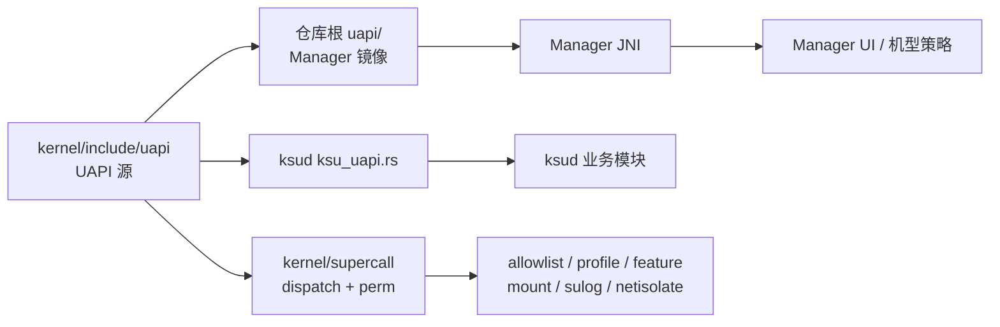
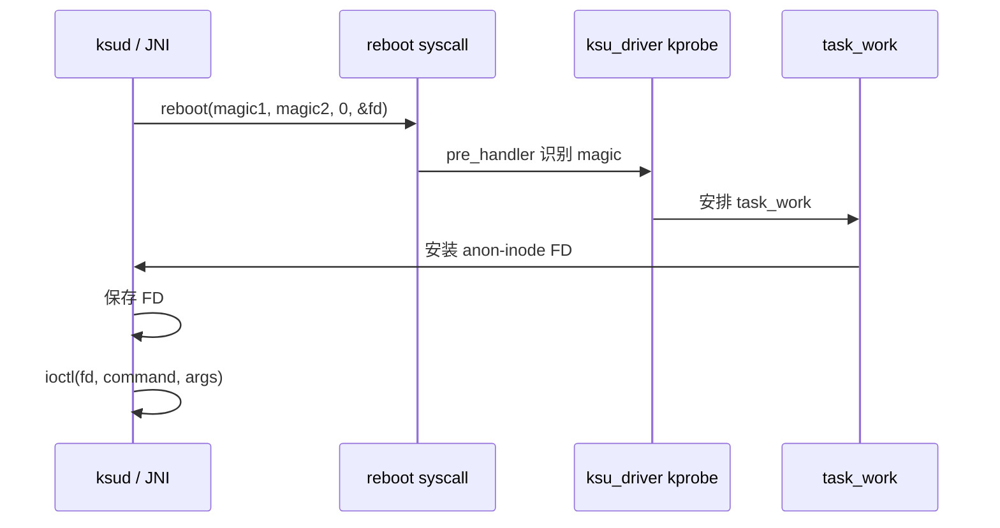
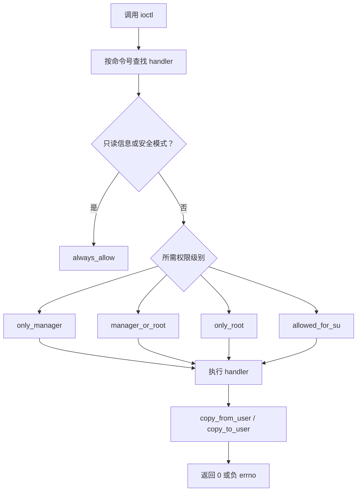

# SuperCall 与 UAPI

<Badge text="UAPI v6" type="tip" /> <Badge text="权限先检查" type="warning" /> <Badge text="全链路同步" type="danger" />

SuperCall 是 FinaSU 内核驱动暴露给 `ksud` 与管理器 JNI 的 ioctl 接口。用户态不直接猜测内核地址：驱动安装一个匿名 inode 文件描述符，调用方对 FD 发 ioctl，==内核先检查调用者权限==，再解析固定布局的命令结构体。

## 整体结构



两层 API 必须分清：

- **UAPI**：结构体、命令号、版本、feature ID 和权限契约。
- **SuperCall 分发**：内核收到 ioctl 后选择 handler，并执行参数、长度与权限检查。

`ksud`、Manager JNI、preinit runner 和部分内置组件都是调用方；它们不能各自维护一份不兼容的 ABI。

## FD 从哪里来

驱动通过重启 syscall 的 kprobe 安装匿名 inode FD。调用方使用固定 magic：

```text
KSU_INSTALL_MAGIC1 = 0xDEADBEEF
KSU_INSTALL_MAGIC2 = 0xCAFEBABE
```

内核在 `reboot` 路径识别 magic，并用 `task_work` 把 FD 安装到当前进程。FD 名称为 `[ksu_driver]`；SU 会话可能使用带额外权限标记的 `[ksu_driver_su]`。



::: danger 这是内部安装协议

magic、FD 获取方式和 SU 会话标志属于实现细节。第三方组件应优先使用公开的管理器/模块接口；直接复制这套协议会与内核版本和权限模型耦合。

:::

## 一次 ioctl 的检查顺序



权限助手定义在 `kernel/supercall/perm.c`：

:::: table 权限级别

| 检查 | 允许对象 | 典型用途 |
| --- | --- | --- |
| `always_allow` | 任意调用方 | 版本、信息、安全模式等只读探测 |
| `only_manager` | 已识别的管理器 | 读取和写入 App Profile |
| `manager_or_root` | 管理器或 UID 0 | allowlist、feature、挂载辅助、配置 |
| `only_root` | UID 0 | 启动事件、SELinux、调试和内核符号查询 |
| `allowed_for_su` | 管理器或已授权 Root UID | `GRANT_ROOT` |

::::

`GET_WRAPPER_FD` 和 `DISABLE_ESCAPE_TO_ROOT` 还允许持有 SU 会话 FD 的调用者。不要自行放宽这两个例外，它们与 Root 会话的挂载/提权生命周期绑定。

## 命令分组

:::: table 当前 UAPI 命令组

| 命令组 | 主要命令 | 作用 |
| --- | --- | --- |
| 信息 | `GET_INFO`、`GET_INFO_LEGACY`、`GET_FULL_VERSION` | 驱动版本、能力标志、UAPI 与完整版本 |
| 事件 | `REPORT_EVENT`、`CHECK_SAFEMODE` | post-fs-data/service/boot-complete 与安全模式 |
| Allowlist | `GET_ALLOW_LIST`、`NEW_GET_ALLOW_LIST`、`UID_GRANTED_ROOT`、`UID_SHOULD_UMOUNT` | Root 授权和卸载决策 |
| Profile | `GET_APP_PROFILE`、`SET_APP_PROFILE` | 每 UID 的 Root/非 Root 策略 |
| Feature | `GET_FEATURE`、`SET_FEATURE` | 查询支持状态与切换功能 |
| 挂载 | `GET_WRAPPER_FD`、`MANAGE_MARK`、`ADD_TRY_UMOUNT`、`NUKE_EXT4_SYSFS` | 文件包装、标记与卸载 |
| 诊断 | `GET_SULOG_FD`、`LOOKUP_SYMBOLS` | SU 日志流与内核符号解析 |
| 动态管理器 | `SET_DYNAMIC_MANAGERS`、`GET_DYNAMIC_MANAGERS`、`SET_DYNAMIC_MANAGER_GRANTS` | 持久化候选与授权 UID |
| 内核策略 | UTS View、NetIsolate 的 GET/SET/POLICY/EVENT | 内核态策略和事件流 |

::::

`GET_INFO` 返回的 capability flags 用于区分 LKM、受信管理器、late-load、PR 构建、Bundled 和 preinit。UAPI 版本是 `6`；feature ID 的当前最大值来自 `KSU_FEATURE_MAX`，不要在客户端硬编码旧的 5 或 6。

## 源码布局

```file-tree title="UAPI 与调用方"
FolkSU
├── kernel/include/uapi/
│   ├── supercall.h
│   ├── app_profile.h
│   └── feature.h
├── uapi/
│   ├── supercall.h
│   ├── app_profile.h
│   └── feature.h
├── kernel/supercall/
│   ├── supercall.c
│   ├── dispatch.c
│   └── perm.c
├── userspace/ksud/src/
│   ├── ksu_uapi.rs
│   └── ksucalls.rs
└── manager/app/src/main/cpp/
    ├── uapi -> ../../../../../uapi
    ├── ksu.cc
    └── jni.cc
```

## 修改 UAPI 的同步清单

::::: steps

1. **先定义兼容目标**

   明确是新增命令、扩展现有结构体，还是改变语义。尽量新增 feature/command；不要无版本迁移地改变已有字段顺序、宽度或含义。

2. **修改内核 UAPI**

   更新 `kernel/include/uapi/` 中的结构体、命令号、feature ID 与 `KERNEL_SU_UAPI_VERSION`。命令号必须避免复用仍有用户态调用的旧编号。

3. **同步仓库根镜像**

   Manager 的 CMake 构建通过 `manager/app/src/main/cpp/uapi` 符号链接使用根 `uapi/`。任何结构体变化都必须同步根目录头文件。

4. **同步 Rust 调用层**

   更新 `userspace/ksud/src/ksu_uapi.rs` 的结构体与常量，再更新 `ksucalls.rs` 的 ioctl 封装。检查所有调用方对返回值和长度错误的处理。

5. **同步 Manager JNI 与 Kotlin**

   更新 `manager/app/src/main/cpp/ksu.cc`、`jni.cc` 和 Kotlin `Natives` 接口。只改 C++ 而遗漏 Kotlin 参数类型，会把 ABI 错误推迟到运行时。

6. **验证权限**

   新命令必须有明确 `perm_check`。涉及管理器身份、Root、Profile、SELinux、内核符号或全局策略的写入不能使用 `always_allow`。

7. **验证旧内核/新用户态边界**

   检查 UAPI 版本不匹配时是拒绝、降级还是继续调用。不能依赖“字段碰巧为 0”来兼容旧内核。

:::::

## 设计约束

- 结构体通过 ioctl 传递时保持明确的固定宽度类型，避免 C/Rust/Kotlin 对 `long`、指针宽度和 padding 的理解不同。
- `copy_from_user` 与 `copy_to_user` 失败必须返回 `-EFAULT`；业务错误不能伪装成成功。
- 命令长度、数量、偏移和数组边界在进入业务逻辑前验证。
- 同一字段不能在多份头文件中手工维护出不同值；根 `uapi/` 是 Manager 镜像，不是第二套协议。
- Feature 查询要区分“不支持”“支持但未启用”“已强制”和“当前值”，不要只返回一个布尔值。
- 管理器身份检查依赖签名和包观察逻辑；不能把“安装了同名包”当作授权。

::: warning 不要绕过 `perm.c`

在 handler 中重新发明 UID 检查会遗漏 `only_manager`、SU 会话 FD 或动态管理器授权等条件。权限结论应在分发层集中处理。

:::

## 测试要点

::::: code-tabs

@tab:active Rust 与内核

```sh
cargo ndk -t arm64-v8a check
cargo ndk -t arm64-v8a clippy
cargo fmt
```

@tab Manager

```sh
cd manager
./gradlew :app:assembleRelease
```

@tab 设备协议

```sh
adb shell su -c 'ksud feature list'
adb shell su -c 'ksud module list'
adb logcat -b kernel | grep -i ksu
```

:::::

至少覆盖：

- 普通应用、管理器、Root UID 与 SU 会话分别调用敏感命令。
- 旧版客户端访问新增或扩展结构体。
- ioctl 请求长度错误的返回。
- feature 不支持时的返回，而非直接崩溃。
- 管理器退出、重启和动态管理器授权状态变化。

## 相关页面

- [Built-In 内核集成](/developer/builtin-integration/)：内核构建和签名槽位。
- [App Profile](/manager/app-profile/)：Profile 字段的用户侧效果。
- [动态管理器](/manager/dynamic-manager/)：候选管理器与授权模型。
