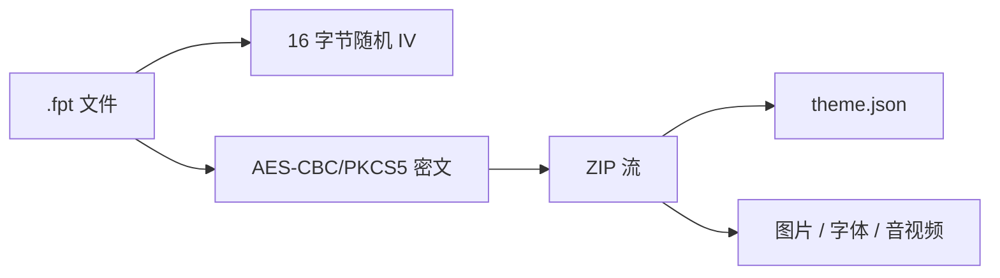

# 主题包结构

<Badge text=".fpt" type="tip" /> <Badge text="平铺 ZIP" type="warning" /> <Badge text="不是签名格式" type="danger" />

`.fpt` 是 FinaSU 管理器的主题容器，包装一个 `theme.json` 和一组平铺资源文件。它只改变管理器的外观、布局、壁纸、字体和声音等体验，不修改 Root 授权、App Profile、模块列表或内核状态。

:::: important 用管理器导出作为基准

先在管理器中配置出一套外观，使用“壁纸 → 导出主题包”生成 `.fpt`，再解包研究字段与资源。==容器使用固定对称密钥加密，但不是数字签名。==它不能证明作者、来源或文件未被修改。

::::

## 容器结构



文件的密文格式是：

```text
[16-byte IV][AES-CBC/PKCS5 encrypted ZIP bytes]
```

AES 密钥由应用内固定字符串的 SHA-256 派生。它能阻止普通解压工具直接打开，但不提供鉴权、来源认证或完整性认证。能读取应用代码的人可以构造、替换或重新封装主题。

::::: table 容器边界

| 项目 | 限制 |
| --- | --- |
| 密文读取上限 | 1 GiB + 32 MiB ZIP/头部开销 |
| 解密后总上限 | 1 GiB，包含 `theme.json` |
| ZIP 条目数 | 最多 128 个 |
| `theme.json` | 最多 1 MiB |
| 单个资源 | 不能为空 |
| 条目路径 | 必须平铺在 ZIP 根目录 |

:::::

## ZIP 条目规则

所有条目必须满足：

- 非空且不是目录；
- 名称不能包含 `/`、`\` 或 NUL；
- 名称不能是 `.`、`..`、`original.json`、`applied.json`；
- 名称不能重复；
- 文件内容不能为空；
- `theme.json` 必须存在，并解析为 JSON 对象。

:::: danger 不要把路径当目录结构

主题容器不是模块 ZIP。嵌套目录、脚本、文件路径穿越和任意可执行内容都不属于格式能力。读取器不会因为某个条目叫 `service.sh` 就执行它。

::::

## `theme.json` 顶层

最小元数据：

```json
{
  "meta_name": "Example Theme",
  "meta_type": "phone",
  "meta_version": "1.0.0",
  "meta_author": "Example Author",
  "meta_description": "A FinaSU manager theme."
}
```

::::: table 元数据与默认值

| 字段 | 读取默认值 | 校验行为 |
| --- | --- | --- |
| `meta_name` | 空 | 转为字符串 |
| `meta_type` | `phone` | `phone` / `tablet` 之外的值保留并警告 |
| `meta_version` | `1` | 转为字符串 |
| `meta_author` | 空 | 转为字符串 |
| `meta_description` | 空 | 转为字符串 |
| `appLanguage` | 字段缺失 | BCP-47 标签列表；非法值删除并保留当前语言 |

:::::

`appLanguage` 是例外：字段完全缺失时保留当前应用语言；字段存在且为空字符串时恢复跟随系统。导入的语言标签不检查资源中是否真的有对应翻译，最终仍可能回退到 Android 资源。

## 设置字段

### 主题、颜色与布局

```json
{
  "customColor": "indigo",
  "folksu_keyColor": -12345678,
  "nightModeEnabled": true,
  "nightModeFollowSys": true,
  "useSystemDynamicColor": false,
  "colorGenerationMode": "custom",
  "colorStandard": "M3E_2025",
  "colorStyle": "TONAL_SPOT",
  "colorContrast": "STANDARD",
  "homeLayoutStyle": "focus",
  "statsTopLayout": "list",
  "isListWorkingCardModeHidden": false
}
```

::::: table 颜色与布局枚举

| 字段 | 允许值 | FinaSU 内部映射 |
| --- | --- | --- |
| `customColor` | 20 个兼容颜色 token | 映射到预设 ARGB |
| `folksu_keyColor` | 32 位 ARGB 整数 | 精确保留任意种子；优先于 `customColor` |
| `colorGenerationMode` | `classic` / `custom` | `classic` 优先使用 FolkPatch 色表；`custom` 使用 MaterialKolor |
| `colorStandard` | `MD3_2021` / `M3E_2025` | 持久化为 `SPEC_2021` / `SPEC_2025` |
| `colorStyle` | 9 个 UPPER_SNAKE 风格名 | 转为 `PaletteStyle` 名称 |
| `colorContrast` | `STANDARD` / `MEDIUM` / `HIGH` | 0.0 / 0.5 / 1.0 对比度 |
| `homeLayoutStyle` | `circle`、`kernelsu`、`focus`、`dashboard_ui`、`stats`，以及兼容 token `default`、`sign` | 后两者显示为 CircleUI |
| `statsTopLayout` | `list` / `grid` | Stats 顶部状态区形态 |
| `isListWorkingCardModeHidden` | 布尔 | 隐藏 Circle / Stats 列表顶部状态卡的运行模式标签 |

:::::

20 个 `customColor` token：

```text
indigo blue light_blue cyan teal green light_green lime yellow amber
orange deep_orange red pink purple deep_purple brown blue_grey sakura ink_wash
```

9 个 `colorStyle` 值：

```text
TONAL_SPOT NEUTRAL VIBRANT EXPRESSIVE RAINBOW
FRUIT_SALAD MONOCHROME FIDELITY CONTENT
```

其中 `M3E_2025` 只对 TonalSpot、Neutral、Vibrant 和 Expressive 直接生效；其他风格会回退到 2021 规范。

:::: warning 缺失设置不总是“保留当前值”

导入校验会为一组历史字段补入 FolkPatch 默认值，包括 `customColor=indigo`、`homeLayoutStyle=circle`、`statsTopLayout=list`、`nightModeFollowSys=true`、`useSystemDynamicColor=true`、`colorGenerationMode=classic`、`colorStandard=MD3_2021`、`colorStyle=TONAL_SPOT`、`colorContrast=STANDARD` 和 `isListWorkingCardModeHidden=false`。因此旧主题或纯配置主题可能被规范化到这些默认值。`appLanguage` 不在补默认列表内。

::::

### 主壁纸与高级标题

```json
{
  "isBackgroundEnabled": true,
  "backgroundOpacity": 0.6,
  "backgroundBlur": 20,
  "backgroundDim": 0.2,
  "isDualBackgroundDimEnabled": true,
  "backgroundDayDim": 0.2,
  "backgroundNightDim": 0.4,
  "isMultiBackgroundEnabled": true,
  "wallpaper_use_color": true,
  "isVideoBackgroundEnabled": false,
  "videoVolume": 0.0,
  "isAdvancedTitleStyleEnabled": true,
  "titleImageDayOpacity": 1.0,
  "titleImageNightOpacity": 0.8,
  "titleImageDim": 0.1,
  "titleImageOffsetX": 0.0,
  "titleTextMode": "custom",
  "titleCustomText": "FinaSU"
}
```

::::: field-group

:::: field 数值范围
@type `0..1`
`backgroundOpacity`、两个暗度、`videoVolume`、标题透明度、标题暗度限制在 0 到 1。
::::

:::: field 模糊
@type `导入 0..100 / 运行 0..64`
导入校验接受 0 到 100；运行时 `WallpaperConfig.updateBlur` 最终夹到 0 到 64。
::::

:::: field 标题偏移
@type `-2..2`
主题 JSON 存浮点值；界面显示与实际位移为 `value × 100dp`，即 `-200..200 dp`。
::::

:::: field 标题文字
@type `default / kernelsu / custom`
`titleCustomText` 只在 `custom` 模式使用。
::::

:::::

### 字体、音乐与音效

```json
{
  "fontMode": "custom",
  "isFontEnabled": true,
  "isMusicEnabled": true,
  "musicFilename": "background_music.mp3",
  "musicVolume": 0.7,
  "isAutoPlayEnabled": true,
  "isLoopingEnabled": true,
  "isSoundEffectEnabled": true,
  "soundEffectFilename": "sound_effect_custom.wav",
  "soundEffectScope": "bottom_bar"
}
```

`fontMode` 允许 `app`、`system`、`custom`。旧主题可能只有 `isFontEnabled`，导入时会推断为自定义或软件默认。

音乐和音效通过 ZIP 中的实际文件名引用。`musicFilename` 不是固定基础名；音效预设导出为 `sound_effect_preset_<Preset>.wav`，本地音效使用实际文件名。导入器用 `imported[name]` 查找资源，不会把元数据字符串直接当任意文件路径使用。

`soundEffectScope` 只允许 `global` 或 `bottom_bar`。启动音效与振动不属于导出资源。

### 导航图标

```json
{
  "navIconCustomEnabled": true,
  "navIcons": {
    "Home": "nav_icon_Home.png",
    "KModule": "nav_icon_Plugin.png",
    "SuperUser": "nav_icon_SuperUser.png",
    "AModule": "nav_icon_Module.png",
    "Settings": "nav_icon_Settings.png"
  }
}
```

::::: table 导航 destination 与导出文件名

| 界面页面 | `themeKey` | 导出条目 |
| --- | --- | --- |
| 首页 | `Home` | `nav_icon_Home.png` |
| 插件 | `KModule` | `nav_icon_Plugin.png` |
| 超级用户 | `SuperUser` | `nav_icon_SuperUser.png` |
| 模块 | `AModule` | `nav_icon_Module.png` |
| 设置 | `Settings` | `nav_icon_Settings.png` |

:::::

用户选择的图标会先中心裁剪、降采样并转成 PNG。主题中的图标文件会被复制到管理器私有目录；缺失目的地或文件不存在的项只会产生警告，不会创建新的导航页面。

## Surface 字段

FinaSU 的 surface 模型把每组可配置背景描述成注册表项。主键形式为：

```text
surface.<surface-id>.<field>
surface.<surface-id>.flag.<flag>
```

支持的 toggle 字段为 `enabled`、`dual_opacity`、`dual_dim`；数值字段为 `opacity`、`day_opacity`、`night_opacity`、`dim`、`day_dim`、`night_dim`；flag 为 `hide_icon`、`hide_text`、`hide_mode`。所有数值限制在 0 到 1。

::::: table 可主题化 surface

| Surface ID | 图片基础名 | 关键字段 |
| --- | --- | --- |
| `layout.grid.workCard` | `grid_working_card_background` | enabled、透明度、日夜不透明度、dim、三个隐藏 flag |
| `layout.focus` | 无 | 四张卡的共享父级透明度与暗度 |
| `layout.focus.card.kernel` | `focus_card_kernel_bg` | 只保存图片存在位 |
| `layout.focus.card.app` | `focus_card_app_bg` | 只保存图片存在位 |
| `layout.focus.card.device` | `focus_card_device_bg` | 只保存图片存在位 |
| `layout.focus.card.storage` | `focus_card_storage_bg` | 只保存图片存在位 |
| `layout.dashboard.hero` | `dashboard_card_bg` | enabled、透明度、日夜不透明度、dim、日夜 dim |

:::::

### 读取优先级

每组 surface 先读 `surface.<id>.<field>`，再回退到历史 FolkPatch 键。图片是否显示由 presence/enable 规则决定：

- Dashboard 使用独立的 `hasDashboardCardBg` 存在位和 `isDashboardCardBackgroundEnabled` 启用位；
- Focus 子卡使用自己的 enabled 位或 `hasFocusCard*Bg` 历史键判断图片；
- Grid 使用 enabled 与文件存在性判断；
- Focus 父级 enabled 是所有子卡图片的总开关。

:::: warning 图片文件存在不等于会显示

资源写入包内只代表可导入。若 enabled/存在位为 false，管理器仍可能保留文件供再次导出，但首页不会绘制该 surface。

::::

## 资源映射

::::: table 主要资源

| 用途 | 基础名 / 引用 |
| --- | --- |
| 单图主壁纸 | `background` |
| 首页、插件、超级用户、模块、设置分页 | `background_home`、`background_kernel`、`background_superuser`、`background_system_module`、`background_settings` |
| 视频背景 | `video_background` |
| 高级标题 | `title_image` |
| 自定义字体 | `font` |
| Grid 工作卡 | `grid_working_card_background` |
| Focus 卡 | `focus_card_kernel_bg`、`focus_card_app_bg`、`focus_card_device_bg`、`focus_card_storage_bg` |
| Dashboard Hero | `dashboard_card_bg` |
| 导航图标 | `nav_icon_<themeKey>.png` |

:::::

普通图片按 `jpg`、`png`、`gif`、`webp`、`jpeg` 顺序选择；视频按 `mp4`、`webm`、`mkv`；字体按 `ttf`、`otf`。同基础名多文件会产生 warning。

## 导入事务

::::: steps

1. **准备**

   读取 `.fpt`，解密到缓存目录，校验 ZIP 条目、总大小、名称和 `theme.json`，然后把规范化前的 JSON 写入 `original.json`。

2. **确认**

   界面展示元数据、预览和资源数量。启用应用锁时，先通过主题导入认证。

3. **备份**

   记录主题拥有的 SharedPreferences 与文件，包括 `settings`、`wallpaper`、`wallpaper_surfaces`、字体、音乐、音效、视觉媒体和元数据。

4. **应用**

   依次应用资源、surface、设置和语言。资源先解析并复制，功能开关再恢复，避免仅选择文件就意外开启功能。

5. **保存保留层**

   写入 `theme_passthrough/theme.json` 与原始资源，再生成 `applied.json`，用于后续导出时判断哪些字段由当前管理器维护。

6. **提交或回滚**

   全部成功才持久化。异常时删除部分写入并恢复主题拥有的文件与偏好；语言在最后应用。

:::::

## 校验行为

:::::: field-group

::::: field 布尔
@type `true / false`
接受 JSON 布尔，也接受大小写不敏感的字符串 `true` / `false`。其他值删除并记录 warning。
:::::

::::: field 数字
@type `有限数值 + 范围`
非有限数值删除；超出范围夹到边界并警告。`folksu_keyColor` 允许完整 32 位整数范围。
:::::

::::: field 枚举
@type `固定集合`
未知值删除，当前设置继续生效。`default` 与 `sign` 是受支持的兼容布局 token。
:::::

::::: field 资源
@type `存在性检查`
功能启用但资源缺失时产生 warning 并使用回退，不保证整个主题失败。无效枚举或容器结构错误可能导致整体失败。
:::::

::::::

::::: collapse accordion

:::: collapse `theme.json` 缺失
确认它位于 ZIP 根目录且大小写正确。主题容器不允许嵌套目录。
::::

:::: collapse 背景图没有出现
检查 `isBackgroundEnabled`、`isMultiBackgroundEnabled`、对应基础名、扩展名优先级、surface enabled 和图片是否可解码。
::::

:::: collapse 设置了透明度但没有图片
surface 图片不存在时，透明度与暗度没有可见对象。先确认图片条目以及 enabled/presence 字段。
::::

:::: collapse 字体或视频开启但资源缺失
导入通常回退并给出 warning。补齐 `font.*` 或 `video_background.*`，或关闭功能。
::::

:::: collapse `.fpt` 能证明主题来自可信作者吗
不能。固定密钥只防止普通解压，不构成作者签名或完整性保护。
::::

:::::

## 与 FolkPatch 的兼容矩阵

::::: table 已实现与未承诺

| 范围 | FinaSU 行为 |
| --- | --- |
| `.fpt` 容器 | 使用 FolkPatch 风格 IV + AES-CBC + 平铺 ZIP |
| 历史布局 token | `default` / `sign` → CircleUI；其余四个直接对应 |
| 历史 surface 键 | 优先新键，回退到 FolkPatch 兼容键 |
| 未知字段与资源 | 保留到 passthrough，供再次导出 |
| 颜色目录 | 支持 20 个兼容 token，并额外保留精确 ARGB |
| 完整语义一致 | 未承诺 |
| 跨端无损往返 | 未承诺 |
| 启动音、振动 | 不属于主题导出协议 |

:::::

兼容工作的目标是把可表达的显示配置带过去，而不是证明两个实现完全一致。跨端发布前应执行 FinaSU → 对方 → FinaSU 以及对方 → FinaSU → 对方的实际回导。

## 调试清单

::::: table 症状与检查点

| 症状 | 首先检查 |
| --- | --- |
| `.fpt` 完全无法读取 | 文件头 16 字节、总长度是否 16 对齐、是否被改成其他后缀 |
| 提示 `theme.json` 缺失 | ZIP 根目录、大小写、是否有嵌套目录 |
| 主题能导入但布局没变 | `homeLayoutStyle` 是否为允许枚举；当前设置是否保留 |
| 图片总是不显示 | presence/enable、资源基础名、扩展名优先级、系统解码 |
| Stats 网格样式没有工作卡设置 | `homeLayoutStyle=stats` 且 `statsTopLayout=grid` |
| Focus 四卡透明度不一致 | 四卡共享父级 `layout.focus`；子卡只应有图片开关 |
| 音乐/音效字段存在但无声 | 文件名是否与 ZIP 条目完全一致，设备是否支持该编码 |
| 回导少了 FinaSU 扩展 | 是否经过其他实现重新保存，是否保留 passthrough |

:::::

:::: danger 不要用修改 Root 状态来“修主题”

主题异常属于显示层。修改 allowlist、模块、内核配置或 SELinux 不会让缺失资源变得可读，反而会扩大故障范围。

::::

## 相关页面

- [成为主题开发者](/theme/theme-dev/)：制作和发布流程。
- [导出主题](/theme/export/info/)：导出入口与范围。
- [分享主题](/theme/export/share/)：接收与跨端注意事项。
- [夜间模式与颜色](/theme/global/theme-style/)：颜色字段的用户侧说明。
- [壁纸](/setting/wallpaper/)：背景与 surface 的实际界面。
