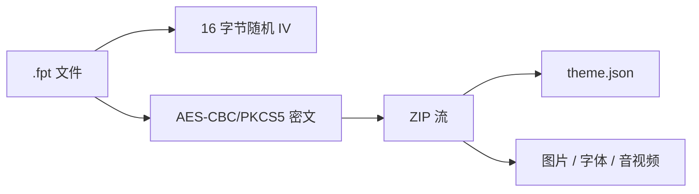

# 主题包结构

<Badge text=".fpt" type="tip" /> <Badge text="平铺 ZIP" type="warning" /> <Badge text="不是签名格式" type="danger" />

`.fpt` 是 FinaSU 管理器的主题容器，包装一个 `theme.json` 和一组平铺资源文件。它只改变管理器的外观、布局、壁纸、字体和声音等体验，不修改 Root 授权、App Profile 或模块列表。

::: important 推荐从管理器导出

最稳妥的主题开发流程是：在管理器中配置出一套外观，使用导出功能生成 `.fpt`，解包研究 `theme.json` 后再修改资源和受支持字段。==容器内部格式不是公共安全协议==，不能据此实现来源认证。

:::

## 容器结构



容器使用 AES-CBC/PKCS5。固定对称密钥由应用内字符串的 SHA-256 派生。它可以阻止普通解压工具直接打开，但**不是数字签名、来源认证或完整性保护**；任何能调用应用代码的人都能构造或修改容器。

:::: table 容器边界

| 项目 | 限制 |
| --- | --- |
| 密文总上限 | 1 GiB + 32 MiB |
| 解密后总上限 | 1 GiB，包含 `theme.json` |
| ZIP 条目数 | 最多 128 |
| `theme.json` | 最多 1 MiB |
| 单个资源 | 不能为空 |

::::

## ZIP 条目规则

所有条目必须位于包根目录：

- 不能包含 `/` 或 `\`。
- 不能包含 NUL。
- 名称不能是 `.`、`..`、`original.json` 或 `applied.json`。
- 不能出现重复名称。
- 不能是空文件。
- `theme.json` 必须存在，并解析为 JSON 对象。

::: danger 不要把路径当成目录结构

主题容器是平铺资源包，不是可执行模块 ZIP。资源路径、脚本、文件名穿越和嵌套目录都不属于格式能力。

:::

## 最小 `theme.json`

```json
{
  "meta_name": "Example Theme",
  "meta_type": "phone",
  "meta_version": "1.0.0",
  "meta_author": "Example Author",
  "meta_description": "A small FinaSU manager theme."
}
```

元数据读取默认值：

:::: table 元数据

| 字段 | 默认值 | 说明 |
| --- | --- | --- |
| `meta_name` | 空 | 主题名称 |
| `meta_type` | `phone` | `phone` 或 `tablet`；未知值会保留并给出警告 |
| `meta_version` | `1` | 主题格式/内容版本字符串 |
| `meta_author` | 空 | 作者 |
| `meta_description` | 空 | 说明 |

::::

导入时会补齐旧主题缺少的默认字段。未知字段和无法映射到当前页面的资源会尽量保留，以便再次导出，但不应依赖它们产生某种隐藏行为。

## 资源命名

常用资源按固定基础名和扩展名选择：

:::: table 资源优先级

| 类型 | 基础名示例 | 扩展名优先级 |
| --- | --- | --- |
| 普通图片 | `background`, `title_image` | `jpg`, `png`, `gif`, `webp`, `jpeg` |
| 视频背景 | `video_background` | `mp4`, `webm`, `mkv` |
| 字体 | `font` | `ttf`, `otf` |
| 分页壁纸 | `background_home`, `background_kernel`, `background_superuser`, `background_system_module`, `background_settings` | 同普通图片 |

::::

同一基础名存在多个允许扩展名时，按上表顺序选择第一个可用项。多余文件可能被保留，但不保证被使用。

导航图标通过 `navIcons` 对象把页面键映射到包内文件名：

```json
{
  "navIcons": {
    "home": "home.webp",
    "settings": "settings.webp"
  }
}
```

缺少图标、页面键不存在或格式不支持时，应视为回退或警告，而不是主题整体必然成功。

音乐与音效通过 `musicFilename`、`soundEffectFilename` 之类的字段引用包内实际文件名。名称写错只会导致资源缺失，不会把任意路径变成可读取文件。

## 常见可配置区域

主题可以影响：

- 背景、模糊、暗化、透明度与日夜模式。
- 主色、色板、动态色和部分页面布局。
- 壁纸、标题图、字体、视频背景。
- 导航图标。
- 音乐、音效与播放行为。
- 应用语言提示。

主题不包含：

- Root 授权和 App Profile。
- 模块安装状态或模块列表。
- 内核配置、SUSFS 规则或 SuperCall 权限。
- 可执行脚本。

## 导入与回滚

导入不是“把文件复制到目录就完成”：

1. 读取并限制密文流。
2. 解密 ZIP，逐项检查名称、数量和总大小。
3. 把文件写入临时目录。
4. 解析 `theme.json` 并规范化布尔、数字、枚举和元数据。
5. 检查启用功能所需的资源是否存在。
6. 应用主题并保存 `original.json`、`applied.json` 与保留资源。
7. 任一步失败时删除暂存内容，保留当前主题。

`original.json` 和 `applied.json` 由导入/导出流程维护，不能出现在用户主题 ZIP 中。

## 校验与回退

::::: field-group

:::: field 布尔值
@type `true / false`
接受 JSON boolean，也接受大小写不敏感的字符串 `true` / `false`。其他值会删除并回退默认。
::::

:::: field 数字
@type `range`
透明度、模糊、音量、偏移等都有范围；超范围会被夹到边界并产生警告。
::::

:::: field 枚举
@type `固定集合`
布局、颜色模式、字体模式等未知值会被移除，当前设置继续生效。
::::

:::: field 资源
@type `存在性检查`
功能已启用但文件缺失时会警告并使用回退；不会为了缺失图片中止整个导入。
::::

:::::

不要依赖“损坏字段会自动变成某个想要的值”。校验结果的正式含义是：非法值被移除或修正，并记录 warning；能不能达到预期仍取决于默认设置和当前管理器版本。

## 开发流程

::::: steps

1. **从已应用主题导出**

   在管理器中应用并微调外观，再导出 `.fpt`。这比手工猜测完整字段更快，也能保留当前版本需要的结构。

2. **只修改主题资源与外观字段**

   不要加入脚本、路径、任意 Web 内容或与 Root 策略相关的字段；导入器不会把它们变成权限能力。

3. **检查资源命名和扩展名**

   同一基础名只保留一个首选文件，确认文件非空、格式可被 Android 解码器读取。

4. **在干净安装上导入**

   验证首次导入、覆盖导入、失败导入回滚、未知资源保留与再次导出。

5. **在手机和平板尺寸测试**

   `meta_type` 和布局可能影响界面。至少检查窄屏、横屏和大屏下的裁切、对比度与可读性。

:::::

## 调试清单

::::: collapse accordion

:::: collapse 导入提示 `theme.json is missing`
确认 `theme.json` 位于 ZIP 根目录且文件名大小写正确。主题容器不允许嵌套目录。
::::

:::: collapse 背景图没有出现
检查 `isBackgroundEnabled`、多背景开关、对应基础名、扩展名优先级，以及图片是否能被系统解码。
::::

:::: collapse 字体或视频功能开启但资源缺失
这类情况通常回退而不是中止导入。关闭功能再重新启用，或补齐 `font.*` / `video_background.*`。
::::

:::: collapse 主题能导入但界面异常
先恢复原主题或重新导入已知可用主题，再对比 `theme.json` 的枚举、数值范围、语言标签和资源格式。不要用修改 Root 配置的方式“修复”主题。
::::

:::: collapse `.fpt` 能证明主题来自可信作者吗
不能。容器没有来源签名。使用可信下载来源，并在导入前保留当前主题与备份。
::::

:::::

## 相关页面

- [壁纸图鉴](/setting/wallpaper-gallery/)：下载图片与设置壁纸的区别。
- [管理器外观](/setting/appearance/)：颜色、字体、背景与视频等用户侧选项。
- [主题开发](/theme/theme-dev/)：面向使用者的主题字段和页面说明。
