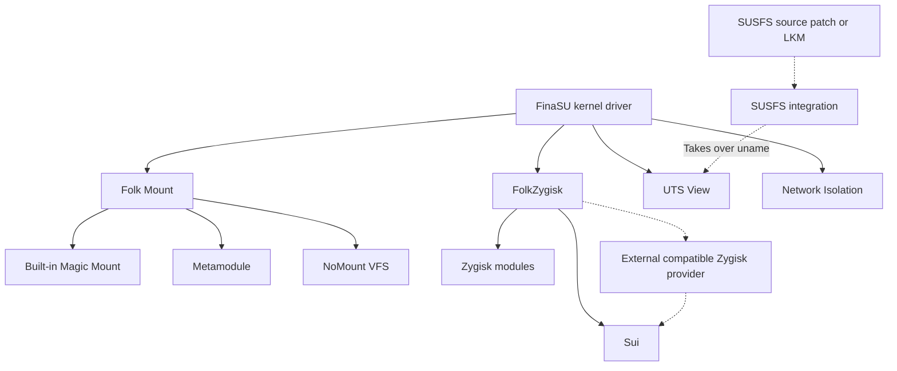

# Built-In Capabilities Overview

<Badge text="Enable as Needed" type="info" /> <Badge text="Most Require a Reboot" type="warning" /> <Badge text="Settings Entry" type="tip" />

"Built-in capabilities" means features released with FinaSU whose runtime support is provided by `ksud` and the kernel driver. They are not ordinary modules that must be installed separately; the entry points are gathered under **Settings → Features** in the Manager, but each capability differs in dependencies, timing and risk.

::: warning "Built-in capabilities" is not the Built-In installation

The word "built-in" here describes that the feature ships with FinaSU. It is not the same concept as the [Built-In kernel build option](/en/guide/install/built-in/) in the installation article. An LKM installation can also use Folk Mount, FolkZygisk, Sui, UTS View and Network Isolation.

:::

## I Want To

::: table Find a Capability by Goal

| Goal | Use | Check First | When It Takes Effect |
| --- | --- | --- | --- |
| Make Magisk-style modules appear in system paths | [Folk Mount](/en/builtin/folk-mount/) | Current mount mode, module directory | Usually next boot |
| Run Zygisk modules | [FolkZygisk](/en/builtin/folkzygisk/) | Whether an external Zygisk provider already exists | Next boot |
| Give apps that support the Shizuku API Root or Shell | [Sui](/en/builtin/sui/) | FinaSU driver, Zygisk backend, Sui payload | Usually a reboot after enabling |
| Inject modules without creating traditional mount records | [NoMount](/en/builtin/nomount/) | VFS driver state, current KMI, mount mode | Injected at boot, rules can be changed while running |
| Spoof `uname` information for selected apps | [UTS View](/en/builtin/uts-view/) | Kernel features, whether SUSFS has taken over | Newly started target processes |
| Block selected apps from opening new network connections | [Network Isolation](/en/builtin/net-isolate/) | Kernel hooks, target UID, isolation mode | Rules update immediately after saving |
| Use existing SUSFS hiding capabilities | [SUSFS](/en/builtin/susfs/) | Kernel source integration or a loaded SUSFS-LKM | Depends on the current implementation |

:::

## How They Work Together

These capabilities are not a linear feature list. Folk Mount and NoMount decide how module files are seen; FolkZygisk injects code into app processes; Sui then uses Zygisk to provide the Shizuku API backend. UTS View and Network Isolation depend directly on kernel features, while SUSFS depends on kernel source integration or a loaded SUSFS-LKM.



Solid lines in the diagram mean FinaSU provides or drives the capability directly; dashed lines mean an external provider. Sui can use the built-in FolkZygisk, and it can also use an external compatible Zygisk provider. The real difference with an external provider is that ==Sui can run, but FinaSU cannot verify its injection result==.

## Three Kinds of Capabilities, Do Not Mix Them Up

### Userspace Engines

**Folk Mount, FolkZygisk and Sui** have their lifecycle managed by `ksud`, with configuration written to `/data/adb/ksu/`. Whether they actually run during a boot depends on that boot's record, not on the switch alone.

- FolkZygisk may stand down at boot in favor of an external Zygisk provider.
- Sui depends on a working Zygisk backend and is not a Zygisk provider itself.
- The Folk Mount "provider for this boot" may fall back because the NoMount driver is unavailable or the previous boot was interrupted.

### Kernel Features

**UTS View and Network Isolation** work through kernel hooks or kernel features. Whether the Manager can edit them depends on whether the current kernel reports support; a successful save also does not mean the target process has already adopted the new state.

### Kernel Patches and LKMs

**SUSFS** is not implemented in this repository. FinaSU only provides state detection, configuration and safe integration. Without a kernel patch you can use a matching SUSFS-LKM, but its feature scope is usually smaller than the source-integrated version.

## Switches, Configuration and This Boot

:::: field-group

::: field Next Boot Configuration
@type `Persistent setting`
For example the Folk Mount mode, the FolkZygisk switch and the Sui enable intent. After being written to disk they still require restarting the relevant component or the device.
:::

::: field This Boot State
@type `Run result`
Indicates which provider this boot actually selected, whether injection completed, or whether the driver is ready. It can differ from the configuration because of external providers, boot protection or driver load failure.
:::

::: field Live Rules
@type `Hot update`
NoMount module rules and exceptions, plus Network Isolation targets and modes, can usually be updated within the current boot. Existing processes or connections may still keep the old state.
:::

::: field Takes Effect for New Processes
@type `Process level`
UTS View mainly affects processes started later that still use the initial UTS namespace. Apps that are already running usually need to be fully closed and reopened.
:::

::::

::: important Separate Who Provides from What Is Remembered

The configuration page stores the desired state. External modules, boot protection, an unavailable driver and a previous abnormal exit can all change the actual provider for this boot. When troubleshooting, check **configuration mode**, **this boot** and **errors/warnings** together.

:::

## Recommended Enable Order

:::: steps

1. **Confirm Root works first**

   Open the Manager, confirm the driver is connected, and run one controlled Root operation successfully. Built-in capabilities cannot repair a broken FinaSU driver.

2. **Enable one capability at a time**

   Finish the lower layer of the dependency chain first: for example confirm that Zygisk actually injects before enabling Sui. Do not change the Folk Mount backend, the Zygisk provider and app policies at the same time.

3. **Check whether a reboot is needed**

   FolkZygisk, Sui and Folk Mount modes usually need a reboot to enter the new state. Network Isolation updates kernel rules after saving, but existing connections are not guaranteed to be cut.

4. **Verify with the target app**

   Go back to the target app and check the actual effect. Zygisk modules, Sui permissions and UTS View should all be judged by the result in the target process, not just the global switch.

5. **Return to a minimal configuration on failure**

   Disable the newly added capability first, confirm that basic Root and boot work, then locate the dependency from the error message. Do not stack switches one after another to "try it out".

::::

## Common Status Terms

| Display or Status | Usual Meaning | Do Not Mistake It For |
| --- | --- | --- |
| **Disabled** | The current configuration does not require this capability to work | The feature is definitely unavailable |
| **Configured** | The setting is saved but has not taken effect yet | The target process has adopted the setting |
| **Mounting** | The boot stage is still running | It has completed successfully |
| **Injected / Mounted / Ready** | This boot passed the corresponding checks | Every app scenario is definitely compatible |
| **Partial** | Only some ABIs, targets or steps succeeded | A total failure or a total success |
| **Unsupported** | The current kernel lacks a feature or the driver does not respond | The Manager button is broken |
| **Taken Over by an External Provider** | Another module or kernel feature is in charge | FinaSU's configuration must have been modified |

Different features use different verification standards. For example FolkZygisk "Injected" requires the current boot, the corresponding ABI, the daemon and the Zygote process to all be confirmed; for Sui, an external provider state may only verify that the service exists, not the full injection chain.

## Data and Diagnostics

```file-tree title="/data/adb/ksu built-in capability locations"
/data/adb/ksu
├── mount_mode                  # Folk Mount next-boot mode
├── mount_runtime               # provider and result for this boot
├── mount_log                   # Folk Mount runtime log
├── zygisk.json                 # FolkZygisk next-boot switch
├── zygisk-boot.json            # boot protection and failure count
├── .zygisk/state.json          # current injection state
├── sui/                        # Sui state and daemon records
├── uts_view.json               # UTS View persistent configuration
├── netisolate.json             # Network Isolation persistent configuration
├── nomount_runtime             # last NoMount injection result
├── nomount_uids                # NoMount exception UIDs
└── finasu-susfs/               # SUSFS integration configuration and state
```

These files are for diagnostics, not manual configuration entry points. Editing them directly can bypass validation, locks and transaction rollback, causing the Manager display to differ from the kernel's actual state.

## Troubleshooting Order

:::: steps

1. **Check the dependency**

   For Sui check Zygisk first; for NoMount check the driver and mount mode first; for UTS View check kernel features and the SUSFS takeover state first.

2. **Check the boot generation**

   Confirm that the "this boot" information on the page belongs to the current boot. When the configuration was changed without a reboot, the two are expected to differ.

3. **Check protection and fallback**

   FolkZygisk pauses attempts after three consecutive boot failures; Folk Mount falls back conservatively after an exception in the NoMount or Metamodule stage. Handle warnings first instead of triggering them again.

4. **Verify with the target process**

   Check whether the target app was restarted, whether its ABI is supported, whether the UID was chosen correctly, and whether an independent namespace or extra permission restriction applies.

5. **Keep logs before restoring**

   When a rollback is needed, record the error text, time, UID/PID and module list first, then disable the corresponding capability. Deleting the data directory loses the evidence used to locate the problem.

::::

## Capability Boundaries

- **Built-in capabilities are not a hiding guarantee.** NoMount, SUSFS, UTS View and Network Isolation each cover only part of the observable surface.
- **Sui is not unconditional Root.** Apps still need to connect to Sui and obtain per-app permission.
- **Network Isolation is not a system-level firewall.** It only constrains selected apps, and it does not guarantee that existing connections are cut.
- **UTS View is not a complete device fingerprint spoof.** It handles `uname` fields and does not change system properties, hardware attestation or app-side caches.
- **External Zygisk providers are not managed by FinaSU.** FinaSU can stand down and detect the service, but it will not verify or repair the external provider's injection chain for you.

## Continue Reading

::: table Capability Details

| Capability | Key Content |
| --- | --- |
| [Folk Mount](/en/builtin/folk-mount/) | Five modes, module merging, Metamodule, NoMount fallback and runtime state |
| [FolkZygisk](/en/builtin/folkzygisk/) | External provider priority, five injection states, three-boot protection and recovery |
| [Sui](/en/builtin/sui/) | Payload, boot lifecycle, Manager identity, permissions, background notifications and full troubleshooting |
| [NoMount](/en/builtin/nomount/) | VFS driver, rule injection, exception UIDs, hot injection and fallback boundaries |
| [UTS View](/en/builtin/uts-view/) | Six `uname` fields, global/selected scope, SUSFS takeover and observation log |
| [Network Isolation](/en/builtin/net-isolate/) | Three modes, per-UID policy, private network/local discovery exceptions and blocked events |
| [SUSFS](/en/builtin/susfs/) | Kernel source integration, SUSFS-LKM, feature gaps and usage boundaries |

:::

:::: collapse accordion

### Why is the switch on but the feature has no effect?

Check the dependency and this boot's state first. FolkZygisk, Sui and Folk Mount modes all need a new boot cycle; UTS View usually only affects newly started target processes; Network Isolation only blocks new connections.

### Can several built-in capabilities be used at the same time?

Yes, but keep their responsibilities from conflicting. Folk Mount and NoMount are mutually exclusive mount provider choices; Sui clearly depends on Zygisk; SUSFS and UTS View's `uname` spoofing arbitrate a single provider.

### Do I need to uninstall modules to turn off a built-in capability?

No. Use the switch in the Manager or the corresponding `ksud` lifecycle command. Deleting the state directory manually can leave daemons still running or a state inconsistent with the module disable marker.

### Why does the documentation advise against installing another provider of the same kind?

Two Zygisk providers, two mount executers or two Sui instances will compete for the same injection point, mount path or Binder service. FinaSU can stand down on its own in some scenarios, but it will not resolve the conflict for an external implementation.

::::

:::: chat title="Built-In Capabilities Quick Q&A"
{User}
I just want to run one Zygisk module. Do I need to enable Sui first?

{Assistant}
No. Sui is only a Shizuku API service that uses the Zygisk backend; it is not a prerequisite for all Zygisk modules.

{User}
NoMount shows ready. Does that mean the modules are definitely injected?

{Assistant}
No. ready only means the driver API responds; you also need to look at the expected and actual rule counts and the mount provider of the current boot.

{User}
Can SUSFS be added by installing a module?

{Assistant}
The source-integrated version cannot. You can also load SUSFS-LKM as an alternative, but it is limited by the KMI and exported capabilities, so it usually offers fewer features than the source-integrated version.

::::
