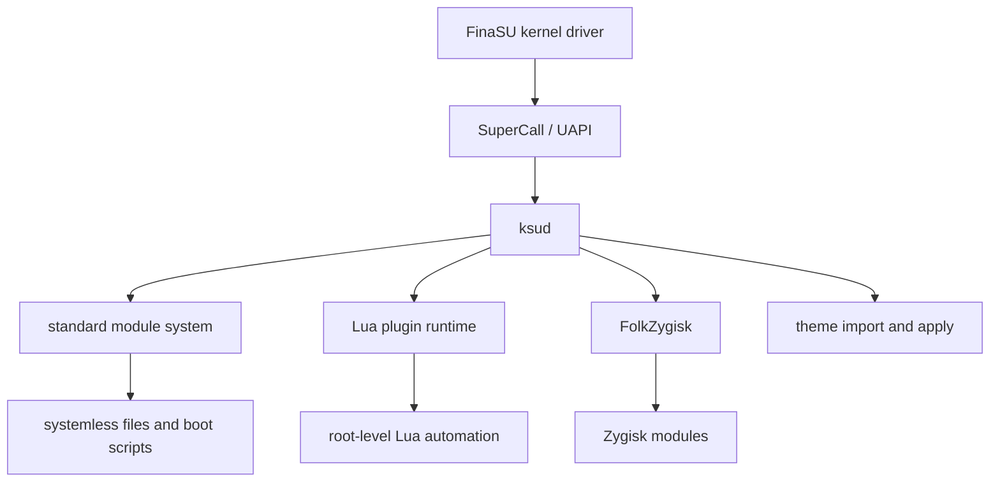

# Development Overview

<Badge text="Pick the type first" type="tip" /> <Badge text="Source defines interfaces" type="warning" /> <Badge text="Root boundary" type="danger" />

Development in FinaSU is not only compiling the kernel. Standard modules, Lua plugins, kernel modules, kernel source integration, theme packages and the core UAPI each use completely different packaging, lifecycles and risk boundaries. Pick the right extension type first, then open the matching page.

## Choose by Goal

:::: table Extension Types

| What You Want to Do | Use | Needs Compilation | Entry Point |
| --- | --- | --- | --- |
| Overlay or append files to system paths, run boot scripts | [Standard module](/en/developer/module-development/) | Usually no | `module.prop` + ZIP |
| Provide a WebUI or manual action buttons | [Standard module](/en/developer/module-development/) | Usually no | `webroot/`, `action.sh` |
| Automate properties, files, commands and schedules with Lua | [Lua plugin](/en/developer/lua-plugin/) | No | `plugin.json` + Lua |
| Write a Zygisk module | Standard module + Zygisk native library | Yes | `zygisk/<ABI>.so` |
| Import a standalone Linux kernel module | [Kernel module](/en/manager/kernel-module/) | Yes | `.ko` |
| Build the root driver into the device kernel | [Built-In kernel integration](/en/developer/builtin-integration/) | Full kernel build required | Kernel source + `CONFIG_KSU=y` |
| Add a kernel feature or a userspace interface | [SuperCall & UAPI](/en/developer/supercall/) | Kernel and userspace builds required | ioctl / struct |
| Create an importable appearance theme | [Theme package structure](/en/developer/theme-package/) | No | `.fpt` |

::::

::: important These module types are not the same concept

- **Standard module** — a ZIP with `module.prop`, part of the Android systemless module system.
- **Lua plugin** — a standalone automation package with `plugin.json`; it does not take part in `system/` mounting.
- **Kernel module** — a `.ko` file handled by the Linux kernel loader.
- **Built-In** — compiles the FinaSU driver into the kernel image; it is not a built-in capabilities switch.
- **FolkZygisk** — the built-in Zygisk provider; Zygisk modules are still standard modules.

:::

## How the Layers Work Together



The lower a layer sits, the closer it is to the kernel, and the wider the impact of a mistake:

:::: table Risk Levels

| Layer | Typical Symptom After a Mistake | Rollback |
| --- | --- | --- |
| Themes, Lua configuration | Features do not take effect, abnormal UI, a single plugin fails | Reinstall, disable or delete the related configuration |
| Standard module scripts | Boot scripts block, wrong file view | Safe mode, disable the module |
| Standard module file mounts | The target app sees wrong files | Switch mount mode, adjust the App Profile |
| Zygisk / Sui payload | Injection fails or the app misbehaves | Turn off the capability and reboot |
| Kernel module / Built-In | Driver load failure, kernel panic, device will not boot | Restore the stock boot image |
| Core UAPI | Manager and `ksud` mismatch | Update every ABI consumer together |

::::

## Repository Map

```file-tree title="Development Directories"
FinaSU
├── kernel/
│   ├── include/uapi/          # kernel-side UAPI definitions
│   ├── supercall/             # ioctl dispatch and permissions
│   ├── policy/                # allowlist, profile, feature
│   ├── feature/               # kernel features
│   └── preinit/               # preinit runner
├── uapi/                      # mirrored headers used by Manager JNI
├── userspace/
│   ├── ksud/src/
│   │   ├── module.rs          # standard module install and scripts
│   │   ├── module_config.rs   # module configuration
│   │   └── plugin/            # Lua plugin implementation
│   └── folkzygisk/            # built-in Zygisk engine
├── manager/                   # Android Manager and JNI
├── website/                   # docs site
└── build.sh                   # local release build entry
```

::: warning Do Not Modify Vendored Engines Casually

`userspace/folkzygisk/`, `userspace/sui/` and `userspace/nomount/` are vendored sources. The repository conventions require them to stay identical to their origin except for documented adaptations. Read the matching `UPSTREAM.md` before changing anything, and do not mix temporary debug patches into a local commit.

:::

## Decide the Interface Contract First

The most important contract for each extension type:

::::: field-group

:::: field Standard Module
@type `module.prop`
The module ID must match `^[a-zA-Z][a-zA-Z0-9._-]+$`, and the ZIP root must contain `module.prop`. `ksud` controls installation, mounting and the script stages.
::::

:::: field Lua Plugin
@type `plugin.json`
Plugin IDs are validated by the FinaSU plugin rules; the entry point defaults to `main.lua`; the process can be terminated by the supervisor once every callback has returned.
::::

:::: field Kernel Interface
@type `UAPI v6`
When you change an ioctl, a struct or a feature, you must update the kernel, `ksud` and the Manager JNI together; compatibility for old lengths and old commands needs a separate design.
::::

:::: field Theme Package
@type `.fpt`
It is essentially a restricted flat ZIP container wrapped in an AES-CBC stream; the format is not provenance authentication, and import still goes through structure validation and a transactional apply.
::::

:::::

## Recommended Workflow

:::: timeline From Change to Verification

- Define the extension type, entry point, activation stage and minimal rollback
  time=Design type=tip

- Confirm fields, limits, return values and failure behavior against the source
  time=Check type=warning

- Build with `build.sh` or the matching component entry, never hand-assemble a release package
  time=Build

- Verify install, reboot, failure rollback and uninstall on a test device
  time=Device type=success

- Keep logs, versions and reproduction steps, then write the release notes
  time=Release type=info

::::

## Build and Verify

The full local release path is in [Build FinaSU](/en/developer/build/):

```sh
./build.sh all
```

For day-to-day changes, use the component entry points:

:::: code-tabs

@tab:active ksud

```sh
cargo ndk -t arm64-v8a check
cargo ndk -t arm64-v8a clippy
cargo fmt
```

@tab Manager

```sh
cd manager
./gradlew clean assembleRelease
```

@tab Docs

```sh
cd website
pnpm docs:build
```

::::

Before running the Manager Gradle build, make sure a usable `libksud.so` exists in `jniLibs`. For a release you should still use `build.sh repack`, so the `ksud` from the current build is injected and the APK is signed again.

## Security Baseline

- Standard module scripts, Lua callbacks and module WebUI may all run as root; do not install anything from a source you do not trust.
- The Lua API size limits are not a permission sandbox; plugins can still run system commands and read and write files.
- Custom UIDs, capabilities, SELinux settings and namespaces in an App Profile change the real kernel credentials.
- A mistake in a kernel module or in Built-In integration can lead directly to a device that will not boot; always keep a stock boot image.
- Do not write the Manager password, WebDAV credentials, signing private keys or device-specific keys into the repository.

## Further Reading

- [Build FinaSU](/en/developer/build/): toolchain, step-by-step builds, signing and release artifacts.
- [Built-In kernel integration](/en/developer/builtin-integration/): kernel configuration, certificates, preinit and SUSFS.
- [SuperCall & UAPI](/en/developer/supercall/): driver FD, ioctl permissions and ABI synchronization.
- [Standard module development](/en/developer/module-development/): ZIP, install scripts, boot stages, WebUI and action.
- [Module configuration](/en/developer/module-config/): naming, precedence and limits of `ksud module config`.
- [Lua plugin package & lifecycle](/en/developer/lua-plugin/): manifest, installation, callbacks, dependencies and CLI.
- [Lua API reference](/en/developer/lua-api/): function signatures, return values, errors and runnable examples.
- [Theme package structure](/en/developer/theme-package/): `.fpt` container, metadata, resources and compatibility rules.
