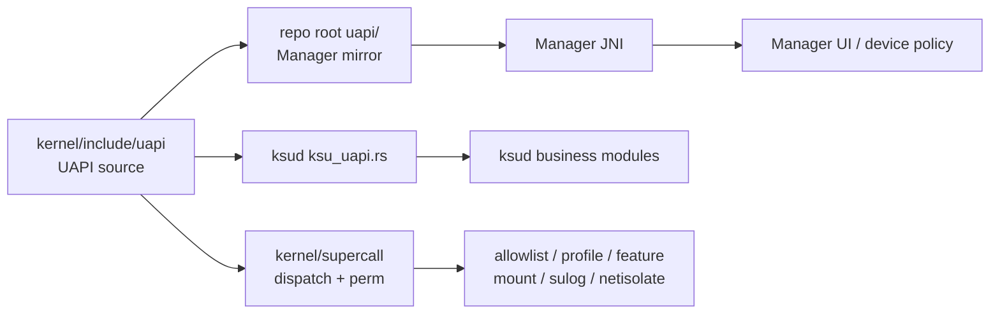
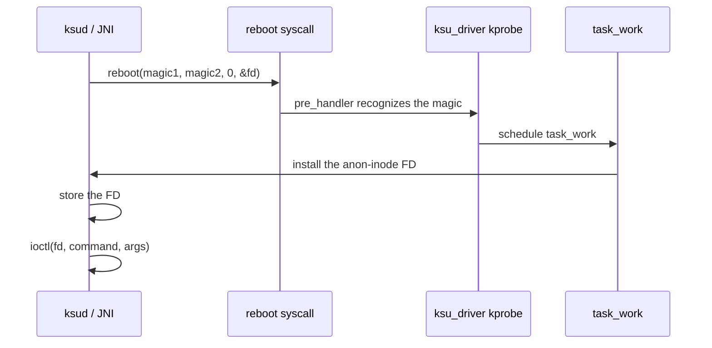
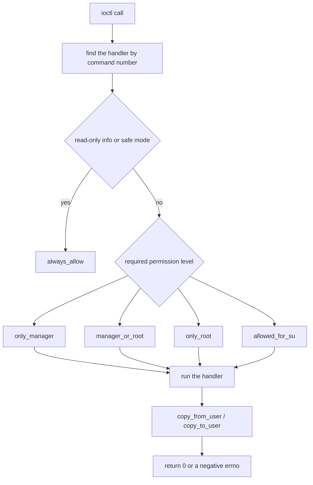

# SuperCall & UAPI

<Badge text="UAPI v6" type="tip" /> <Badge text="Permissions first" type="warning" /> <Badge text="Sync the whole chain" type="danger" />

SuperCall is the ioctl interface that the FinaSU kernel driver exposes to `ksud` and the Manager JNI. Userspace does not guess kernel addresses: the driver installs an anonymous inode file descriptor, the caller sends ioctls on that FD, and ==the kernel checks the caller's permissions first== before parsing the fixed-layout command struct.

## Overall Structure



Two API layers must be kept apart:

- **UAPI**: structs, command numbers, version, feature IDs and the permission contract.
- **SuperCall dispatch**: after receiving an ioctl, the kernel picks a handler and runs the argument, length and permission checks.

`ksud`, the Manager JNI, the preinit runner and some built-in components are all callers; they cannot each maintain an incompatible ABI of their own.

## Where the FD Comes From

The driver installs an anonymous inode FD through a kprobe on the reboot syscall. Callers use fixed magic values:

```text
KSU_INSTALL_MAGIC1 = 0xDEADBEEF
KSU_INSTALL_MAGIC2 = 0xCAFEBABE
```

The kernel recognizes the magic on the `reboot` path and uses `task_work` to install the FD into the current process. The FD is named `[ksu_driver]`; an SU session may use `[ksu_driver_su]`, which carries an extra permission marker.



::: danger This Is an Internal Installation Protocol

The magic values, the FD acquisition method and the SU session flag are implementation details. Third-party components should use the public Manager and module interfaces; copying this protocol directly couples you to kernel versions and to the permission model.

:::

## Check Order for One ioctl



The permission helpers are defined in `kernel/supercall/perm.c`:

:::: table Permission Levels

| Check | Allowed Caller | Typical Use |
| --- | --- | --- |
| `always_allow` | any caller | read-only probes such as version, info and safe mode |
| `only_manager` | a recognized Manager | read and write App Profiles |
| `manager_or_root` | the Manager or UID 0 | allowlist, features, mount helpers, configuration |
| `only_root` | UID 0 | boot events, SELinux, debugging and kernel symbol lookups |
| `allowed_for_su` | the Manager or an authorized root UID | `GRANT_ROOT` |

::::

`GET_WRAPPER_FD` and `DISABLE_ESCAPE_TO_ROOT` also allow callers holding an SU session FD. Do not relax these two exceptions on your own; they are tied to the mount and privilege lifecycle of a root session.

## Command Groups

:::: table Current UAPI Command Groups

| Group | Main Commands | Purpose |
| --- | --- | --- |
| Info | `GET_INFO`, `GET_INFO_LEGACY`, `GET_FULL_VERSION` | driver version, capability flags, UAPI and full version |
| Events | `REPORT_EVENT`, `CHECK_SAFEMODE` | post-fs-data/service/boot-complete and safe mode |
| Allowlist | `GET_ALLOW_LIST`, `NEW_GET_ALLOW_LIST`, `UID_GRANTED_ROOT`, `UID_SHOULD_UMOUNT` | root grants and unmount decisions |
| Profile | `GET_APP_PROFILE`, `SET_APP_PROFILE` | per-UID root and non-root policy |
| Feature | `GET_FEATURE`, `SET_FEATURE` | query support state and toggle features |
| Mount | `GET_WRAPPER_FD`, `MANAGE_MARK`, `ADD_TRY_UMOUNT`, `NUKE_EXT4_SYSFS` | file wrapping, marks and unmounting |
| Diagnostics | `GET_SULOG_FD`, `LOOKUP_SYMBOLS` | SU log stream and kernel symbol resolution |
| Dynamic Manager | `SET_DYNAMIC_MANAGERS`, `GET_DYNAMIC_MANAGERS`, `SET_DYNAMIC_MANAGER_GRANTS` | persist candidates and authorized UIDs |
| Kernel Policy | GET/SET/POLICY/EVENT for UTS View and NetIsolate | kernel-side policy and event streams |

::::

The capability flags returned by `GET_INFO` distinguish LKM, trusted Manager, late-load, PR builds, Bundled and preinit. The UAPI version is `6`; the current maximum feature ID comes from `KSU_FEATURE_MAX`, so do not hardcode an older 5 or 6 on the client side.

## Source Layout

```file-tree title="UAPI and Callers"
FinaSU
├── kernel/include/uapi/
│   ├── supercall.h
│   ├── app_profile.h
│   └── feature.h
├── uapi/
│   ├── supercall.h
│   ├── app_profile.h
│   └── feature.h
├── kernel/supercall/
│   ├── supercall.c
│   ├── dispatch.c
│   └── perm.c
├── userspace/ksud/src/
│   ├── ksu_uapi.rs
│   └── ksucalls.rs
└── manager/app/src/main/cpp/
    ├── uapi -> ../../../../../uapi
    ├── ksu.cc
    └── jni.cc
```

## Synchronization Checklist for UAPI Changes

::::: steps

1. **Define the compatibility target first**

   Decide whether you are adding a command, extending an existing struct or changing semantics. Prefer adding features and commands; do not change the order, width or meaning of existing fields without a versioned migration.

2. **Change the kernel UAPI**

   Update the structs, command numbers, feature IDs and `KERNEL_SU_UAPI_VERSION` in `kernel/include/uapi/`. Command numbers must not reuse an old number that userspace still calls.

3. **Sync the repository-root mirror**

   The Manager CMake build uses the root `uapi/` through the `manager/app/src/main/cpp/uapi` symlink. Any struct change must be mirrored in the root headers.

4. **Sync the Rust call layer**

   Update the structs and constants in `userspace/ksud/src/ksu_uapi.rs`, then update the ioctl wrappers in `ksucalls.rs`. Check how every caller handles return values and length errors.

5. **Sync the Manager JNI and Kotlin**

   Update `manager/app/src/main/cpp/ksu.cc`, `jni.cc` and the Kotlin `Natives` interface. Changing only C++ while missing the Kotlin parameter types pushes the ABI error to runtime.

6. **Verify permissions**

   A new command must have an explicit `perm_check`. Writes that touch Manager identity, root, profiles, SELinux, kernel symbols or global policy must not use `always_allow`.

7. **Verify the old-kernel/new-userspace boundary**

   Check whether a UAPI version mismatch is rejected, downgraded or still dispatched. Do not rely on a field happening to be 0 to stay compatible with an old kernel.

:::::

## Design Constraints

- When structs cross the ioctl boundary, keep explicit fixed-width types so that C, Rust and Kotlin do not disagree about `long`, pointer width and padding.
- A failing `copy_from_user` or `copy_to_user` must return `-EFAULT`; business errors must not masquerade as success.
- Validate command lengths, counts, offsets and array bounds before entering the business logic.
- The same field must not be maintained by hand in multiple headers with different values; the root `uapi/` is the Manager mirror, not a second protocol.
- A feature query must distinguish "not supported", "supported but disabled", "enforced" and "current value"; do not return a single boolean.
- Manager identity checks rely on signature and package observation; never treat an installed package with the same name as authorization.

::: warning Do Not Bypass `perm.c`

Reinventing UID checks inside a handler misses conditions such as `only_manager`, the SU session FD or dynamic manager authorization. Permission decisions belong in the dispatch layer.

:::

## Testing Highlights

::::: code-tabs

@tab:active Rust and kernel

```sh
cargo ndk -t arm64-v8a check
cargo ndk -t arm64-v8a clippy
cargo fmt
```

@tab Manager

```sh
cd manager
./gradlew :app:assembleRelease
```

@tab Device protocol

```sh
adb shell su -c 'ksud feature list'
adb shell su -c 'ksud module list'
adb logcat -b kernel | grep -i ksu
```

:::::

Cover at least:

- An ordinary app, the Manager, a root UID and an SU session each calling sensitive commands.
- An older client accessing a new or extended struct.
- The return value when an ioctl request has a wrong length.
- The return value when a feature is unsupported, instead of a crash.
- The Manager exiting, rebooting and changes in dynamic manager authorization state.

## Related Pages

- [Built-In kernel integration](/en/developer/builtin-integration/): kernel builds and signature slots.
- [App Profile](/en/manager/app-profile/): the user-facing effect of profile fields.
- [Dynamic Manager](/en/manager/dynamic-manager/): candidate managers and the authorization model.
