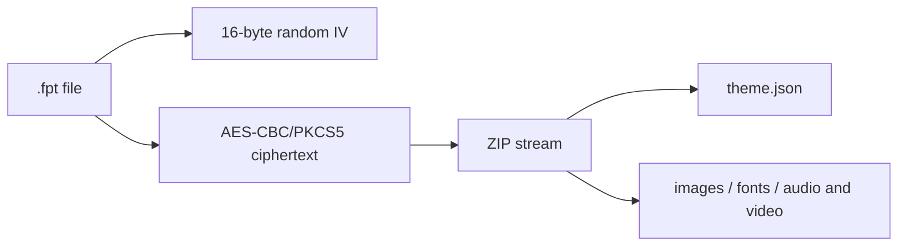

# Theme Package Structure

<Badge text=".fpt" type="tip" /> <Badge text="Flat ZIP" type="warning" /> <Badge text="Not a signature format" type="danger" />

`.fpt` is the theme container of the FinaSU Manager. It wraps one `theme.json` and a set of flat resource files. It changes only experience aspects of the Manager such as appearance, layout, wallpaper, font and sound; it does not modify root authorization, App Profile, the module list or kernel state.

:::: important Use a Manager export as the baseline

First configure an appearance in the Manager, use "Wallpaper → Export theme package" to generate a `.fpt`, then unpack it to study the fields and resources. ==The container is encrypted with a fixed symmetric key, but it is not a digital signature.== It cannot prove the author, the origin or that the files are unmodified.

::::

## Container Structure



The ciphertext format of the file is:

```text
[16-byte IV][AES-CBC/PKCS5 encrypted ZIP bytes]
```

The AES key is derived from the SHA-256 of a fixed string inside the app. It blocks ordinary extraction tools from opening the file, but it provides no authentication, origin verification or integrity verification. Anyone who can read the app code can craft, replace or repackage a theme.

::::: table Container boundaries

| Item | Limit |
| --- | --- |
| Ciphertext read limit | 1 GiB + 32 MiB ZIP/header overhead |
| Total after decryption | 1 GiB, including `theme.json` |
| ZIP entry count | At most 128 |
| `theme.json` | At most 1 MiB |
| Single resource | Cannot be empty |
| Entry path | Must be flat in the ZIP root |

:::::

## ZIP Entry Rules

Every entry must satisfy:

- it is non-empty and not a directory;
- the name cannot contain `/`, `\` or NUL;
- the name cannot be `.`, `..`, `original.json` or `applied.json`;
- names cannot repeat;
- file content cannot be empty;
- `theme.json` must exist and parse as a JSON object.

:::: danger Do not treat paths as a directory structure

A theme container is not a module ZIP. Nested directories, scripts, path traversal and arbitrary executable content are not part of the format. The reader will not execute an entry just because it is named `service.sh`.

::::

## `theme.json` Top Level

Minimal metadata:

```json
{
  "meta_name": "Example Theme",
  "meta_type": "phone",
  "meta_version": "1.0.0",
  "meta_author": "Example Author",
  "meta_description": "A FinaSU manager theme."
}
```

::::: table Metadata and defaults

| Field | Default when read | Validation behavior |
| --- | --- | --- |
| `meta_name` | Empty | Converted to a string |
| `meta_type` | `phone` | Values other than `phone` / `tablet` are kept with a warning |
| `meta_version` | `1` | Converted to a string |
| `meta_author` | Empty | Converted to a string |
| `meta_description` | Empty | Converted to a string |
| `appLanguage` | Field missing | List of BCP-47 tags; invalid values are removed and the current language is kept |

:::::

`appLanguage` is the exception: when the field is completely missing, the current app language is kept; when the field exists and is an empty string, it goes back to following the system. Imported language tags are not checked against whether the resources really contain that translation, so the result may still fall back to Android resources.

## Setting Fields

### Theme, Color and Layout

```json
{
  "customColor": "indigo",
  "finasu_keyColor": -12345678,
  "nightModeEnabled": true,
  "nightModeFollowSys": true,
  "useSystemDynamicColor": false,
  "colorGenerationMode": "custom",
  "colorStandard": "M3E_2025",
  "colorStyle": "TONAL_SPOT",
  "colorContrast": "STANDARD",
  "homeLayoutStyle": "focus",
  "statsTopLayout": "list",
  "isListWorkingCardModeHidden": false
}
```

::::: table Color and layout enums

| Field | Allowed values | FinaSU internal mapping |
| --- | --- | --- |
| `customColor` | 20 compatible color tokens | Mapped to preset ARGB |
| `finasu_keyColor` | 32-bit ARGB integer | Preserves any seed exactly; takes priority over `customColor` |
| `colorGenerationMode` | `classic` / `custom` | `classic` prefers the FolkPatch color table; `custom` uses MaterialKolor |
| `colorStandard` | `MD3_2021` / `M3E_2025` | Persisted as `SPEC_2021` / `SPEC_2025` |
| `colorStyle` | 9 UPPER_SNAKE style names | Converted to `PaletteStyle` names |
| `colorContrast` | `STANDARD` / `MEDIUM` / `HIGH` | 0.0 / 0.5 / 1.0 contrast |
| `homeLayoutStyle` | `circle`, `kernelsu`, `focus`, `dashboard_ui`, `stats`, plus the compatible tokens `default` and `sign` | The last two are displayed as CircleUI |
| `statsTopLayout` | `list` / `grid` | Shape of the Stats top status area |
| `isListWorkingCardModeHidden` | Boolean | Hides the run mode label of the top status card in Circle / Stats lists |

:::::

The 20 `customColor` tokens:

```text
indigo blue light_blue cyan teal green light_green lime yellow amber
orange deep_orange red pink purple deep_purple brown blue_grey sakura ink_wash
```

The 9 `colorStyle` values:

```text
TONAL_SPOT NEUTRAL VIBRANT EXPRESSIVE RAINBOW
FRUIT_SALAD MONOCHROME FIDELITY CONTENT
```

Of these, `M3E_2025` takes direct effect only for TonalSpot, Neutral, Vibrant and Expressive; other styles fall back to the 2021 specification.

:::: warning Missing settings do not always "keep the current value"

Import validation fills a group of legacy fields with FolkPatch defaults, including `customColor=indigo`, `homeLayoutStyle=circle`, `statsTopLayout=list`, `nightModeFollowSys=true`, `useSystemDynamicColor=true`, `colorGenerationMode=classic`, `colorStandard=MD3_2021`, `colorStyle=TONAL_SPOT`, `colorContrast=STANDARD` and `isListWorkingCardModeHidden=false`. An old theme or a configuration-only theme may therefore be normalized to these defaults. `appLanguage` is not in the default-filling list.

::::

### Main Wallpaper and Advanced Title

```json
{
  "isBackgroundEnabled": true,
  "backgroundOpacity": 0.6,
  "backgroundBlur": 20,
  "backgroundDim": 0.2,
  "isDualBackgroundDimEnabled": true,
  "backgroundDayDim": 0.2,
  "backgroundNightDim": 0.4,
  "isMultiBackgroundEnabled": true,
  "wallpaper_use_color": true,
  "isVideoBackgroundEnabled": false,
  "videoVolume": 0.0,
  "isAdvancedTitleStyleEnabled": true,
  "titleImageDayOpacity": 1.0,
  "titleImageNightOpacity": 0.8,
  "titleImageDim": 0.1,
  "titleImageOffsetX": 0.0,
  "titleTextMode": "custom",
  "titleCustomText": "FinaSU"
}
```

::::: field-group

:::: field Numeric ranges
@type `0..1`
`backgroundOpacity`, the two dim values, `videoVolume`, and the title opacity and title dim are limited to 0 through 1.
::::

:::: field Blur
@type `0..100 on import / 0..64 at runtime`
Import validation accepts 0 through 100; at runtime `WallpaperConfig.updateBlur` finally clamps to 0 through 64.
::::

:::: field Title offset
@type `-2..2`
The theme JSON stores a floating point value; the interface shows and actually moves by `value × 100dp`, that is `-200..200 dp`.
::::

:::: field Title text
@type `default / kernelsu / custom`
`titleCustomText` is used only in `custom` mode.
::::

:::::

### Font, Music and Sound Effects

```json
{
  "fontMode": "custom",
  "isFontEnabled": true,
  "isMusicEnabled": true,
  "musicFilename": "background_music.mp3",
  "musicVolume": 0.7,
  "isAutoPlayEnabled": true,
  "isLoopingEnabled": true,
  "isSoundEffectEnabled": true,
  "soundEffectFilename": "sound_effect_custom.wav",
  "soundEffectScope": "bottom_bar"
}
```

`fontMode` allows `app`, `system` and `custom`. Old themes may only have `isFontEnabled`, which is inferred as custom or the software default on import.

Music and sound effects are referenced by the actual file name inside the ZIP. `musicFilename` is not a fixed base name; sound effect presets are exported as `sound_effect_preset_<Preset>.wav`, and local sound effects use the actual file name. The importer looks up resources by `imported[name]` and never uses the metadata string directly as an arbitrary file path.

`soundEffectScope` allows only `global` or `bottom_bar`. Boot sounds and vibration are not part of the exported resources.

### Navigation Icons

```json
{
  "navIconCustomEnabled": true,
  "navIcons": {
    "Home": "nav_icon_Home.png",
    "KModule": "nav_icon_Plugin.png",
    "SuperUser": "nav_icon_SuperUser.png",
    "AModule": "nav_icon_Module.png",
    "Settings": "nav_icon_Settings.png"
  }
}
```

::::: table Navigation destinations and export file names

| Interface page | `themeKey` | Export entry |
| --- | --- | --- |
| Home | `Home` | `nav_icon_Home.png` |
| Plugins | `KModule` | `nav_icon_Plugin.png` |
| Superuser | `SuperUser` | `nav_icon_SuperUser.png` |
| Modules | `AModule` | `nav_icon_Module.png` |
| Settings | `Settings` | `nav_icon_Settings.png` |

:::::

An icon chosen by the user is center-cropped, downsampled and converted to PNG first. Icon files in the theme are copied into the Manager private directory; an item with a missing destination or a nonexistent file only produces a warning and never creates a new navigation page.

## Surface Fields

The FinaSU surface model describes each configurable background group as a registry entry. Primary key forms are:

```text
surface.<surface-id>.<field>
surface.<surface-id>.flag.<flag>
```

The supported toggle fields are `enabled`, `dual_opacity` and `dual_dim`; numeric fields are `opacity`, `day_opacity`, `night_opacity`, `dim`, `day_dim` and `night_dim`; flags are `hide_icon`, `hide_text` and `hide_mode`. All numeric values are limited to 0 through 1.

::::: table Themeable surfaces

| Surface ID | Image base name | Key fields |
| --- | --- | --- |
| `layout.grid.workCard` | `grid_working_card_background` | enabled, opacity, day and night opacity, dim, three hide flags |
| `layout.focus` | None | Shared parent opacity and dim for the four cards |
| `layout.focus.card.kernel` | `focus_card_kernel_bg` | Stores only the image presence bit |
| `layout.focus.card.app` | `focus_card_app_bg` | Stores only the image presence bit |
| `layout.focus.card.device` | `focus_card_device_bg` | Stores only the image presence bit |
| `layout.focus.card.storage` | `focus_card_storage_bg` | Stores only the image presence bit |
| `layout.dashboard.hero` | `dashboard_card_bg` | enabled, opacity, day and night opacity, dim, day and night dim |

:::::

### Read Priority

Each surface group reads `surface.<id>.<field>` first, then falls back to legacy FolkPatch keys. Whether an image is displayed is decided by presence/enable rules:

- Dashboard uses a separate `hasDashboardCardBg` presence bit and the `isDashboardCardBackgroundEnabled` enable bit;
- Focus child cards decide the image through their own enabled bit or the legacy `hasFocusCard*Bg` keys;
- Grid decides through enabled plus file existence;
- The Focus parent enabled bit is the master switch for all child card images.

:::: warning An existing image file does not mean it will be displayed

A resource written into the package only means it can be imported. If the enabled/presence bit is false, the Manager may still keep the file for export again, but the home screen will not draw that surface.

::::

## Resource Mapping

::::: table Main resources

| Purpose | Base name / reference |
| --- | --- |
| Single-image main wallpaper | `background` |
| Home, plugins, superuser, modules, settings pages | `background_home`, `background_kernel`, `background_superuser`, `background_system_module`, `background_settings` |
| Video background | `video_background` |
| Advanced title | `title_image` |
| Custom font | `font` |
| Grid working card | `grid_working_card_background` |
| Focus cards | `focus_card_kernel_bg`, `focus_card_app_bg`, `focus_card_device_bg`, `focus_card_storage_bg` |
| Dashboard Hero | `dashboard_card_bg` |
| Navigation icons | `nav_icon_<themeKey>.png` |

:::::

Regular images are picked in the order `jpg`, `png`, `gif`, `webp`, `jpeg`; video in `mp4`, `webm`, `mkv`; fonts in `ttf`, `otf`. Multiple files with the same base name produce a warning.

## Import Transaction

::::: steps

1. **Prepare**

   Read the `.fpt`, decrypt into a cache directory, validate the ZIP entries, total size, names and `theme.json`, then write the pre-normalization JSON to `original.json`.

2. **Confirm**

   The interface shows metadata, a preview and the resource count. When the app lock is enabled, theme import authentication runs first.

3. **Back up**

   Record the SharedPreferences and files owned by the theme, including `settings`, `wallpaper`, `wallpaper_surfaces`, font, music, sound effects, visual media and metadata.

4. **Apply**

   Apply resources, surfaces, settings and language in order. Resources are resolved and copied first, then feature switches are restored, so that merely selecting a file does not accidentally turn a feature on.

5. **Save the passthrough layer**

   Write `theme_passthrough/theme.json` and the original resources, then generate `applied.json`, which later exports use to decide which fields are maintained by the current Manager.

6. **Commit or roll back**

   Persist only when everything succeeded. On an exception, delete partial writes and restore the theme-owned files and preferences; language is applied last.

:::::

## Validation Behavior

:::::: field-group

::::: field Boolean
@type `true / false`
Accepts a JSON boolean and also the case-insensitive strings `true` / `false`. Other values are removed and a warning is recorded.
:::::

::::: field Number
@type `Finite value + range`
Non-finite values are removed; out-of-range values are clamped to the boundary with a warning. `finasu_keyColor` allows the full 32-bit integer range.
:::::

::::: field Enum
@type `Fixed set`
Unknown values are removed and the current setting stays in effect. `default` and `sign` are supported compatible layout tokens.
:::::

::::: field Resource
@type `Existence check`
When a feature is enabled but its resource is missing, a warning is produced and a fallback is used; the whole theme is not guaranteed to fail. An invalid enum or a container structure error may cause an overall failure.
:::::

::::::

::::: collapse accordion

:::: collapse `theme.json` is missing
Confirm it is in the ZIP root and with the correct letter case. Theme containers do not allow nested directories.
::::

:::: collapse The background image does not appear
Check `isBackgroundEnabled`, `isMultiBackgroundEnabled`, the matching base name, the extension priority, the surface enabled bit, and whether the image can be decoded.
::::

:::: collapse Opacity is set but there is no image
When the surface image does not exist, opacity and dim have no visible target. Confirm the image entry and the enabled/presence fields first.
::::

:::: collapse The font or video is enabled but the resource is missing
Import usually falls back with a warning. Add the `font.*` or `video_background.*` entry, or turn the feature off.
::::

:::: collapse Can a `.fpt` prove the theme comes from a trusted author
No. The fixed key only blocks ordinary extraction and does not constitute an author signature or integrity protection.
::::

:::::

## Compatibility Matrix with FolkPatch

::::: table Implemented and not promised

| Scope | FinaSU behavior |
| --- | --- |
| `.fpt` container | Uses FolkPatch-style IV + AES-CBC + flat ZIP |
| Legacy layout tokens | `default` / `sign` → CircleUI; the other four map directly |
| Legacy surface keys | New keys first, falling back to FolkPatch compatible keys |
| Unknown fields and resources | Kept in passthrough for export again |
| Color catalog | Supports 20 compatible tokens and additionally preserves the exact ARGB |
| Full semantic equivalence | Not promised |
| Lossless round trip across implementations | Not promised |
| Boot sounds, vibration | Not part of the theme export protocol |

:::::

The goal of the compatibility work is to carry over the display configuration that can be expressed, not to prove that two implementations are identical. Before publishing across implementations, run the actual round trips FinaSU → the other side → FinaSU and the other side → FinaSU → the other side.

## Debugging Checklist

::::: table Symptoms and checkpoints

| Symptom | Check first |
| --- | --- |
| `.fpt` cannot be read at all | The 16-byte file header, whether the total length is aligned to 16, whether the extension was changed |
| A `theme.json` missing message appears | The ZIP root, letter case, whether there are nested directories |
| The theme imports but the layout does not change | Whether `homeLayoutStyle` is an allowed enum; whether the current setting was kept |
| Images never display | presence/enable, resource base name, extension priority, system decoding |
| The Stats grid style has no working card settings | `homeLayoutStyle=stats` and `statsTopLayout=grid` |
| Focus card opacity differs between the four cards | The four cards share the parent `layout.focus`; child cards should only have an image switch |
| Music/sound effect fields exist but there is no sound | Whether the file name exactly matches the ZIP entry, whether the device supports the codec |
| A round trip loses FinaSU extensions | Whether another implementation re-saved the theme, whether passthrough was kept |

:::::

:::: danger Do not "fix a theme" by changing root state

A theme problem belongs to the display layer. Changing the allowlist, modules, kernel configuration or SELinux will not make missing resources readable, and only widens the fault scope.

::::

## Related Pages

- [Become a Theme Developer](/en/theme/theme-dev/): authoring and publishing workflow.
- [Export Theme](/en/theme/export/info/): export entry points and scope.
- [Share Theme](/en/theme/export/share/): receiving a theme and cross-implementation notes.
- [Night Mode and Color](/en/theme/global/theme-style/): user-side description of the color fields.
- [Wallpaper](/en/setting/wallpaper/): the actual interface for background and surfaces.
