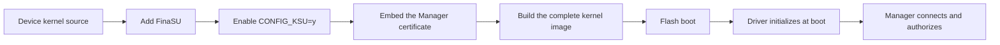

# Built-In

<Badge text="Advanced" type="warning" /> <Badge text="Replaces the kernel" type="danger" />

Built-In compiles the FinaSU driver directly into the Linux kernel instead of placing it in the ramdisk. It suits users who need a built-in driver, SUSFS, or who already maintain a custom kernel. The result is a complete kernel image, which the Manager cannot install for you with "Direct install".

A built-in kernel can be distributed by the kernel author as a complete `boot` image, or packaged as an AnyKernel3 ZIP and flashed on the device.

::: tip Already Rooted?

If the device is already rooted by Magisk, KernelSU or one of its forks, or by APatch/KernelPatch, do not keep stacking FinaSU inside the kernel. Read the matching switching guide first:

- [Switching from Magisk](/en/guide/switch/magisk/)
- [Switching from KernelSU](/en/guide/switch/kernelsu/)
- [Switching from APatch](/en/guide/switch/apatch/)

:::

## How Built-In Works



The Built-In driver starts with the kernel and does not go through a `kernelsu.ko` in the ramdisk. It therefore cannot be replaced on its own by the Manager the way an LKM can, and both updates and OTA require handling the kernel again.

## Confirm the Partition First

::: table Built-In vs LKM

| Item | Built-In | LKM |
| --- | --- | --- |
| Driver location | Inside the Linux kernel image | `kernelsu.ko` in the ramdisk |
| Main modified partition | `boot` | Usually `init_boot`, or `boot` when absent |
| Replaces the Linux kernel | Yes | No |
| Can the Manager install it directly | No | Yes, depending on device conditions |
| After a system OTA | Rebuild and flash the kernel | Patch the boot image again |

:::

`init_boot` is not the target of a built-in driver; do not touch it unless your kernel package explicitly requires it.

::: warning The Kernel Lives in boot

Built-In modifies the Linux kernel, which is usually in `boot`. Flashing only `init_boot` neither replaces a built-in driver nor turns an LKM into Built-In.

:::

## Prerequisites

:::: field-group

::: field Kernel source
@type `Required`
@default `Matches the device`
Prepare source or a kernel tree matching the device model, Android version and kernel version. Kernel source for a nearby version is not a substitute.
:::

::: field Build environment
@type `Required`
@default `Matching toolchain`
Use the device kernel maintainer's compiler, DDK or CI environment. Different compilers, configurations and kernel trees can produce incompatible output.
:::

::: field Manager certificate
@type `Required`
@default `Matches the APK`
The kernel must embed the certificate size and SHA-256 matching the target FinaSU Manager. When the signature differs, the Manager cannot obtain Manager identity.
:::

::: field Bootloop rescue image
@type `Required`
@default `Stock boot`
Prepare the stock `boot` that exactly matches the current system, and read [Bootloop Rescue](/en/guide/rescue-bootloop/).
:::

::::

::: danger Do Not Stack an Old Root Solution on the Kernel

Before you start, remove the kernel modifications of old root solutions such as Magisk, KernelSU or its forks, and APatch/KernelPatch. Two sets of hooks, supercalls or kernel patches at the same time can directly prevent the device from booting.

:::

## Clean Up Old Integrations

Remove the old KernelSU-family integration from the target kernel source first:

- Disable the old `CONFIG_KSU` or the matching driver option.
- Remove the old hooks, supercalls, kernel command line arguments and patches.
- Confirm no symbols or init entry points remain from the old driver.

Do not enable two KernelSU drivers in the same kernel.

::: tip SUSFS

The SUSFS kernel implementation is not in the FinaSU repository. Apply only the SUSFS patch matching the target kernel version and enable `CONFIG_KSU_SUSFS`. The current SUSFS integration usually requires `CONFIG_KSU=y` and may also require `CONFIG_THREAD_INFO_IN_TASK=y`.

:::

## Integrate and Build

Run the integration script at the root of the target kernel source, then build the way the device maintainer does. Full options and certificate requirements are in [Kernel Integration](/en/developer/builtin-integration/).

::: code-tabs

@tab Integrate FinaSU

```sh
./kernel/setup.sh --dir /path/to/FinaSU
scripts/config --enable KSU
scripts/config --enable KPROBES
scripts/config --enable KALLSYMS_ALL
scripts/config --enable EXT4_FS
scripts/config --enable HEADERS_INSTALL
```

@tab Build the kernel

```sh
make ... KSU_REQUIRE_PREINIT=1
```

:::

::: steps

1. **Confirm the source version**

   Use source that matches the device system and kernel version. Reusing build output across versions can prevent boot.

2. **Run the integration script**

   Run `kernel/setup.sh` and confirm that options such as `CONFIG_KSU=y`, KPROBES, EXT4_FS and HEADERS_INSTALL are enabled.

3. **Build and check the log**

   Pass `KSU_REQUIRE_PREINIT=1` explicitly. Check the version, KMI and certificate information in the log.

4. **Prepare the stock image**

   Keep the stock `boot` matching the current system, and confirm the A/B slot and the current boot partition.

5. **Flash the complete kernel**

   Flash the complete kernel image you built into `boot`. Do not treat it as an LKM and put it in the ramdisk.

:::

::: timeline Built-In Build and Install

- Prepare matching kernel source and toolchain
  time=Prepare type=tip

- Clean up old root integration and add FinaSU
  time=Integrate

- Embed the certificate and build the complete kernel
  time=Build

- Flash boot and reboot
  time=Take effect

- Verify Built-In, root and modules
  time=Wrap up type=success

:::

## Flash the Complete Kernel

::: code-tabs

@tab Non-A/B devices

```sh
fastboot flash boot boot.img
```

@tab A/B devices

```sh
fastboot getvar current-slot

# apply when the current slot is a; for b, change _a to _b
fastboot flash boot_a boot.img
```

:::

::: danger Do Not Flash the Wrong Partition

Treating the `init_boot` produced by the LKM patch flow as the kernel image described here, or flashing a complete kernel into `init_boot`, can prevent the device from booting. The Built-In target is usually `boot`.

:::

## What Is AnyKernel3

AnyKernel3 is a general on-device boot image installation format; it is neither a kernel nor a root solution itself. It is usually used to distribute built-in kernels: the kernel author puts the compiled kernel, patches or related files into a ZIP, and the `anykernel.sh` and `update-binary` inside the package handle unpacking, replacement, repacking and flashing.

::: steps

1. **The installer reads the current boot image**

   AnyKernel3 reads the current slot's boot image on the device instead of shipping a complete partition backup.

2. **Replace the contents from the ZIP**

   The scripts in the package replace the kernel, ramdisk or other boot contents with the files the author provides. For Built-In, the ZIP should already contain a kernel with the FinaSU driver built in.

3. **Repack and write to the partition**

   The installer regenerates the boot image, and `anykernel.sh` decides whether to write `boot` or the partition and slot the author specifies.

4. **Reboot and verify**

   Reboot after flashing; the home screen should show **Built-In**. If it still shows LKM or not installed, check whether the ZIP really contains a FinaSU kernel rather than an ordinary LKM package.

:::

::: warning FinaSU Only Checks the ZIP and Does Not Guarantee Kernel Compatibility

The FinaSU Manager runs the AnyKernel3 install script with root privileges but only checks the ZIP format and structure. It does not override the slot choice inside the package, and it does not fix the partition or update `ksud` after flashing. A script that exits successfully only means the installer reported no error; it does not prove the device will boot.

:::

::: danger

Scripts in an AnyKernel3 package run with root privileges and may already have written to the partition before failing. Use only packages that explicitly support the current device, system build and kernel version. Before flashing, prepare the complete stock `boot` and read [Bootloop Rescue](/en/guide/rescue-bootloop/); if the device will not boot after installation, do not keep flashing a second unknown ZIP.

:::

## Install a Matching Manager

The built-in driver verifies the Manager signature. Install the FinaSU APK whose certificate matches the one used for the kernel build; when the signature differs, the Manager may not obtain Manager identity or root.

After rebooting, confirm:

- The home screen shows **Built-In**.
- The Manager can read the version and authorized apps.
- A test app can obtain root normally.
- Modules and the built-in engines work as expected.

::: warning The Signature Must Match

A custom-signed build must update the Manager certificate size and SHA-256 when compiling the kernel. Do not mix an APK and a kernel from different sources without confirming the signature relationship.

:::

## System OTA

A system OTA replaces the kernel. After an OTA you must rebuild and flash a FinaSU kernel matching the new system; you cannot keep using the old kernel image. On an A/B device that has not rebooted since the OTA, confirm the kernel build for the new system is ready before deciding how to flash.

::: danger A Kernel Version Mismatch Can Prevent Boot

Do not flash the old kernel onto a new system to save effort. When the kernel, vendor modules and system version do not match, boot can fail outright.

:::

## Data and Modules

```file-tree title="Built-In related locations"
/data/adb
├── ksud                      # userspace command-line tool
├── ksu/
│   ├── .allowlist            # authorization state
│   ├── .dynamic_manager      # Manager registration
│   └── profile/              # App Profile
└── modules/                  # installed modules
```

A system OTA usually does not delete `/data/adb`, but old modules can still break when the system or kernel changes. After switching, disable the old modules first and then enable compatible ones one at a time.

## Troubleshooting

::: collapse accordion

- **The device will not boot after flashing**

  Stop rebooting repeatedly and restore the stock `boot` following [Bootloop Rescue](/en/guide/rescue-bootloop/). Check the kernel version, partition, slot and build configuration first.

- **The home screen still shows LKM or not installed**

  Confirm you flashed a complete kernel rather than an `init_boot` patched by LKM; check whether the kernel really contains the FinaSU driver.

- **The Manager opens but cannot authorize**

  Check whether the Manager certificate size and SHA-256 embedded in the kernel match the current APK.

- **It asks to update the Manager or the kernel**

  This is a UAPI mismatch. Install a matching Manager version, or rebuild the matching kernel; see [Updating FinaSU](/en/guide/update/).

- **Missing preinit or UAPI headers**

  Confirm `KSU_REQUIRE_PREINIT=1` was passed explicitly during the build, and check options such as `HEADERS_INSTALL`.

- **Modules do not mount**

  Check whether the module supports FinaSU's mounting method and whether the kernel configuration meets the module's requirements.

- **The device will not boot after flashing AnyKernel3**

  The ZIP may not support the current device or kernel version, or it may not contain a FinaSU built-in kernel. Restore the stock `boot` and do not keep stacking other unknown packages.

- **The device will not boot after an OTA**

  Do not keep using the old kernel. Restore the stock `boot` and rebuild a FinaSU kernel matching the new system.

- **SUSFS status is abnormal**

  Confirm the kernel has the matching SUSFS patch applied and `CONFIG_KSU_SUSFS` enabled; FinaSU only configures an existing kernel implementation.

:::

## FAQ

::: chat title="Built-In Installation Questions"
{User}
Which is better, Built-In or LKM?

{.}
Most users choose LKM. Built-In suits users who need a built-in driver, full source-level SUSFS integration or their own kernel, but building, upgrading and OTA are all more involved.

{User}
Can the Manager install Built-In directly?

{.}
No. The Manager can only flash a boot image or patch an LKM; Built-In requires building the driver into the kernel and flashing the complete kernel.

{User}
Why does the home screen show Built-In?

{.}
The kernel is not built as a loadable module, so the LKM flag is not set. Built-In means the driver is compiled into the kernel; it is not a separate set of features.

{User}
Must the kernel and Manager signatures match?

{.}
They must match. The kernel verifies the Manager certificate; when they differ, the Manager may not obtain Manager identity or root.

{User}
Do I need to rebuild after an OTA?

{.}
Usually yes. An OTA replaces the kernel, so you need to rebuild and flash a FinaSU kernel matching the new system.

{User}
Is AnyKernel3 an LKM?

{.}
No. AnyKernel3 is only a packaging format for flashing boot images on the device, usually to distribute built-in kernels; everyday LKM installs use file patching or direct install.

{User}
What if I already have Magisk/KernelSU/APatch?

{.}
Read the matching switching guide, remove the old kernel patches and then build FinaSU; do not stack them directly.
:::

## Related Pages

- [Installation Options](/en/guide/install/)
- [LKM installation](/en/guide/install/lkm/)
- [Jailbreak mode installation](/en/guide/install/jailbreak/)
- [Kernel Integration](/en/developer/builtin-integration/)
- [Updating FinaSU](/en/guide/update/)
- [Switching from Magisk](/en/guide/switch/magisk/)
- [Switching from KernelSU](/en/guide/switch/kernelsu/)
- [Switching from APatch](/en/guide/switch/apatch/)
- [Bootloop Rescue](/en/guide/rescue-bootloop/)

*[LKM]: Loadable Kernel Module
*[KMI]: Kernel Module Interface, the Android kernel module interface version
*[GKI]: Generic Kernel Image
*[OTA]: Over-The-Air system update
*[UAPI]: the stable interface between the kernel and userspace
*[AVB]: Android Verified Boot
