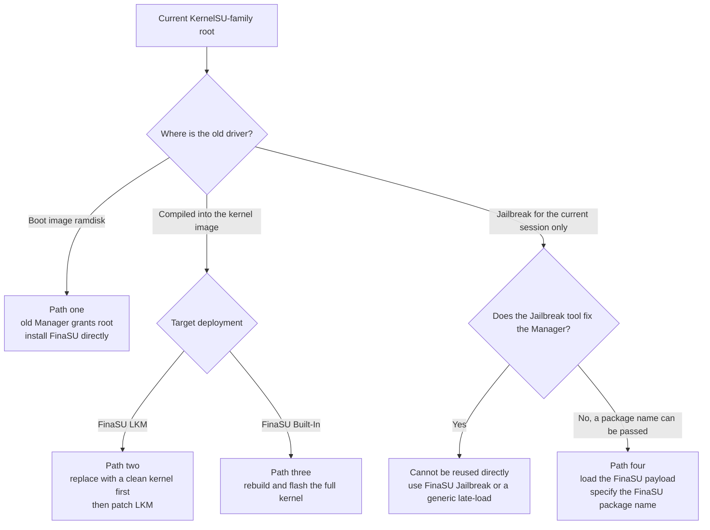

# KernelSU

<Badge text="Four starting points" type="warning" /> <Badge text="Never two drivers" type="danger" />

FinaSU keeps KernelSU's core model, but Manager trust, the built-in engines and part of the storage protocol are different. KernelSU-family devices may run LKM, have the driver compiled into the kernel, or use a Jailbreak tool that only recognizes a fixed Manager; these three environments cannot share a single uninstall process.

The first step of switching is not installing FinaSU, but confirming ==where the old driver lives==. The location of the old driver determines whether you can install directly, must replace the kernel first, or can only jailbreak again.

::: danger Do not stack two drivers

Keep only one kernel-level root solution on a device. When FinaSU LKM coexists with an old built-in driver, or with two LKMs, they compete for hooks, supercall, the allowlist and `/data/adb/ksud`; at best authorization fails, at worst the device does not boot.

:::

## First determine the old driver form

:::: field-group

::: field LKM of the old Manager
@type `Common`
@default `Boot image patched`
The old Manager provides root by patching `boot` or `init_boot`, and `kernelsu.ko` exists in the ramdisk of the boot image. In this case you can usually install FinaSU directly using the old root.
:::

::: field Built-in kernel build
@type `Kernel replacement`
@default `CONFIG_KSU=y`
The driver is compiled into the Linux kernel image and the Manager only handles authorization. Uninstalling the old Manager alone does not remove the driver; a kernel without the old driver must be flashed first.
:::

::: field Jailbreak environment
@type `Session only`
@default `Lost on reboot`
Root only exists in the current boot session, and there is no recoverable boot image patch. Switching depends on whether the Jailbreak tool can load FinaSU's payload and specify the FinaSU package name.
:::

::: field Cannot determine
@type `Safety first`
@default `Treat as built-in`
When the driver location cannot be confirmed, do not install directly. Prepare a stock boot image matching the current system first, and follow the "other kernel build → FinaSU LKM" process.
:::

::::

::: tip Telling LKM from Built-In

If the old Manager offers "uninstall and restore the stock image", it usually means it modified the boot image; whether it is LKM still depends on whether the current kernel already contains a built-in driver. If root comes from a custom kernel the device is currently running and the Manager has no boot image restore function, the driver is probably already compiled into the kernel. Technical users can unpack the boot image and check whether `kernelsu.ko` exists in the ramdisk.

:::

## Understand boot and init_boot first

Persistent root modifies the boot partition, not files inside the Manager APK. Beginners should remember these partitions first:

- **boot**: holds the Linux kernel; some devices also put the generic ramdisk here.
- **init_boot**: holds only the generic ramdisk. Some GKI devices since Android 13 split this into a separate partition.
- **vendor_boot**: a few devices put the vendor ramdisk here. Choose it only when the Manager explicitly shows `vendor_boot`.

::: table Where Built-In and LKM each make changes

| FinaSU deployment | Where the driver actually lives | Default partition modified | Flash back when reverting to stock |
| --- | --- | --- | --- |
| **Built-In** | inside the Linux kernel image | `boot` | stock `boot` |
| **LKM**, device has `init_boot` and KMI is not `android12-*` | ramdisk of `init_boot` | `init_boot` | stock `init_boot` |
| **LKM**, device has no `init_boot`, or KMI is `android12-*` | ramdisk of `boot` | `boot` | stock `boot` |
| **LKM**, `vendor_boot` selected manually | ramdisk of `vendor_boot` | `vendor_boot` | stock `vendor_boot` |

:::

The one-line rule: ==Built-In replaces the kernel, so flash boot; LKM changes the ramdisk, so usually flash init_boot and flash boot only when there is no init_boot==. Kernels with `android12-*` are the exception: even when `init_boot` exists, LKM still selects `boot` by default.

If you selected another partition manually, use the partition actually modified when reverting to stock, not the defaults in the table.

::: important The Manager display is the final reference

Boot layouts differ between devices. The install page shows the default partition it detected; do not guess from the Android version or from online guides alone. Choosing the wrong partition writes the kernel image into the ramdisk partition or the reverse, and directly prevents the device from booting.

:::

### Flash back the stock partition

Confirm the current slot first. On A/B devices, flash only the current slot and do not touch the other slot that can still boot. From the commands below, run only the line that matches the current deployment, and never flash `boot.img` into `init_boot`.

::: code-tabs

@tab Non-A/B device

```sh
# built-in, or LKM without init_boot
fastboot flash boot boot.img

# LKM with init_boot
fastboot flash init_boot init_boot.img
```

@tab A/B device

```sh
fastboot getvar current-slot

# current slot is a; if it is b, replace _a with _b
fastboot flash boot_a boot.img
fastboot flash init_boot_a init_boot.img
```

:::

If the install page explicitly shows `vendor_boot`, replace `boot` or `init_boot` in the commands above with `vendor_boot` and flash back the matching vendor image.

::: warning The image must match the current system

Use a stock image that exactly matches the current Android version, kernel version and slot. Do not make do with an image from another system version, another device model or another slot. If you flash the wrong one, recover as described in [Bootloop Rescue](/en/guide/rescue-bootloop/).

:::

::: collapse Unsure which partition the old Manager modified

1. Open the install page of the old Manager or of FinaSU and check the default partition it shows.
2. Connect the device to a computer and run `adb shell getprop ro.boot.slot_suffix` to confirm the current slot; an empty output means the device is not an A/B device.
3. If you are still unsure, flash back the stock `boot` matching the current system; if the device has `init_boot`, flash the stock `init_boot` as well. This removes both kinds of boot image modification but does not affect modules in `/data`.
4. Do not infer the partition from "it still boots after flashing"; a wrong image can sometimes boot but will fail on the next OTA or slot switch.

:::

## Four switching paths

::: table Choosing a path by old driver

| Current state | Can FinaSU be installed directly | Path to follow |
| --- | --- | --- |
| LKM of another Manager | usually yes, using the old root | Path one: direct install |
| Old driver compiled into the kernel, target is LKM | no | Path two: replace the kernel with a clean one, then install LKM |
| Old driver compiled into the kernel, target is a Built-In build | no | Path three: rebuild and flash the kernel |
| Jailbreak, and the tool accepts a package name | depends on the escalation environment | Path four: load the FinaSU payload |
| Jailbreak tool hardcodes the old Manager | no | cannot be reused, use FinaSU's built-in Jailbreak or a generic late-load |
| Unsure | no | restore a clean boot image first, then follow path two |

:::



## Path one: LKM from another Manager to FinaSU LKM

This is the most common way to switch. The old Manager still provides usable root; the FinaSU Manager merely applies for root as another app, then uses that root to run `boot-patch` and replace the old LKM in the boot image with the FinaSU version.

::: info LKM changes the ramdisk, not the kernel

LKM replaces only `kernelsu.ko` and the boot wrapper in the ramdisk, not the Linux kernel. It therefore modifies `boot` or `init_boot`, depending on whether the device has a separate `init_boot`. A Built-In build is the opposite: it replaces the kernel inside `boot`.

:::

::: warning The prerequisite is that the old Manager can still grant

The old Manager must be able to grant root to other apps. If the old Manager is already broken, cannot grant, or the device has no usable root shell, direct install cannot be used, and you must follow the boot image restore process instead.

:::

::: table Which partition to choose for direct install

| Partition where the old LKM actually lives | What to choose for a direct FinaSU install |
| --- | --- |
| `boot` | `boot` |
| `init_boot` | `init_boot` |
| `vendor_boot` | `vendor_boot` |
| Unsure | do not guess; flash back the stock `boot` and `init_boot` (when present) first, then patch files from the stock images |

:::

::: steps

1. **Back up the current state**

   Back up `boot` and `init_boot` (when present) for the current slot, `/data/adb/ksu/.allowlist`, the modules you want to keep and App Profiles. Record the system version, KMI, slot and the partition the old Manager actually modified.

2. **Install the FinaSU Manager**

   Install the official FinaSU APK while the old Manager still works. Do not uninstall the old Manager or clean up old modules yet.

3. **Grant FinaSU in the old Manager**

   Open the old Manager and grant root to the FinaSU Manager. Before the switch is complete, the FinaSU home screen may show "not installed" or an unknown version; that does not prevent it from using the granted root shell.

4. **Install directly in FinaSU**

   Go to **Install & Flash → Direct install**. Confirm the KMI and target partition, enable the pre-flash backup, and run it. This process repatches the current boot image and writes FinaSU's `ksud` to `/data/adb/ksud`.

   The partition must match the one the old Manager actually modified: choose `init_boot` if the old LKM is in `init_boot`, and `boot` if it is in `boot`. If the FinaSU default partition differs from the old Manager, do not continue; select the old partition manually, or flash back the stock `boot` and `init_boot` first and then patch files.

5. **Reboot as soon as possible**

   After a successful flash, do not keep running services on the old driver. `/data/adb/ksud` has already been replaced, and `ksud` calls the old Manager depends on may fail before the reboot.

6. **Verify and remove the old Manager**

   After rebooting, confirm the home screen shows **LKM**, the Manager identity is correct and root works. Only after FinaSU is confirmed working, uninstall the old Manager and clean up modules or configuration that belong only to it.

:::

::: timeline LKM switch sequence

- Back up the boot image and `/data/adb` state
  time=Prepare type=tip

- Install FinaSU and have the old Manager grant root
  time=Transition

- FinaSU patches the boot image and writes its own `ksud`
  time=Replace

- Reboot and load FinaSU LKM
  time=Take effect

- Verify root, modules and built-in engines
  time=Wrap up type=success

:::

### When direct install is unavailable

**Direct install** requires existing root and a GKI device. When these conditions are not met:

1. Prepare the stock `boot` that exactly matches the current system; if the device has `init_boot`, prepare the stock `init_boot` as well.
2. On the FinaSU install page, choose **Select a file and patch**.
3. Use the stock image rather than an image already patched by another Manager; after patching `boot` or `init_boot`, flash the matching partition.
4. If the old Manager modified `init_boot`, do not flash only `boot`; the reverse is also true.

### Do not keep two Managers after switching

The old Manager may stay temporarily until FinaSU verification is complete, but the two should not coexist long term. The FinaSU kernel trusts only its own Manager certificate and registered Managers; the old Manager can neither manage FinaSU correctly nor refrain from modifying shared directories.

## Path two: another kernel build to FinaSU LKM

If the old driver is already compiled into the kernel, ==a direct install stacks FinaSU LKM on top of the old driver==, and both drivers take over the kernel. The correct approach is to replace the kernel with a version that has no old driver, then install FinaSU LKM.

### Steps

::: steps

1. **Back up and confirm the stock image**

   Prepare the stock `boot` image that exactly matches the current Android version, kernel version and slot; it is required to remove the built-in driver. If the device has `init_boot`, prepare its stock image as well for the later LKM patch. Do not start without a recoverable image.

2. **Remove the old built-in driver**

   Flash the stock `boot` back to the current slot, or rebuild a kernel with the old KernelSU integration disabled and flash it into `boot`. A built-in driver lives in the Linux kernel, usually inside `boot`; flashing only `init_boot` does not remove it. Uninstalling the old Manager APK alone does not remove the driver in the kernel either.

3. **Reboot and confirm root is removed**

   After rebooting, confirm the old Manager can no longer grant. If the old driver still exists, the kernel was not really replaced, and you must resolve that before continuing.

4. **Install the FinaSU Manager**

   Install the official Manager matching the target FinaSU LKM. The device has no root at this point, which is a normal intermediate state.

5. **Patch a clean boot image**

   In FinaSU, choose **Select a file and patch**. The patch input should be the stock `init_boot` (when the device has one and the KMI is not `android12-*`) or the stock `boot`; this is not necessarily the same image as the `boot` used in step 2 to remove the built-in driver. The Manager puts FinaSU's `ksuinit` and the `kernelsu.ko` for the matching KMI into the ramdisk.

6. **Flash and verify**

   Flash the patched image into the matching `init_boot` or `boot` and reboot. The home screen should show **LKM**; then grant apps again and enable modules one by one.

:::

::: danger Do not use "keep the custom kernel" as an excuse to skip cleanup

If the custom kernel must be kept, you still have to disable the old KernelSU configuration and patches in the sources, rebuild and flash it, and then patch FinaSU LKM. While the old hooks, supercall or kernel patches still exist, FinaSU cannot take over safely.

:::

### A/B devices

Switching replaces the `boot` or `init_boot` of the current slot. Confirm the other slot still has a bootable system and that you know how to switch back. Do not flash both slots while an OTA is still in progress.

## Path three: another kernel build to FinaSU kernel build

The goal is to compile FinaSU into the kernel directly rather than continuing to use LKM. This path requires rebuilding the full kernel and cannot be completed by installing from the Manager.

### Clean up the old integration

First remove the old KernelSU-family integration from the target kernel sources:

- Disable the old `CONFIG_KSU` or the corresponding driver option.
- Remove the old hooks, supercall, patches and kernel command line parameters.
- Confirm there are no leftover symbols or init entry points from the old driver.

Do not enable two KernelSU drivers in the same kernel.

### Integrate and build

::: code-tabs

@tab Integrate FinaSU

```sh
./kernel/setup.sh --dir /path/to/FinaSU
scripts/config --enable KSU
scripts/config --enable KPROBES
scripts/config --enable KALLSYMS_ALL
scripts/config --enable EXT4_FS
scripts/config --enable HEADERS_INSTALL
```

@tab Build the kernel

```sh
make ... KSU_REQUIRE_PREINIT=1
```

:::

The full option and certificate requirements are described in [Kernel Integration](/en/developer/builtin-integration/). The kernel must compile in the certificate size and SHA-256 matching the target Manager; when the signature does not match, the Manager cannot obtain the Manager identity.

::: steps

1. **Start from clean sources**

   Use sources matching the device system and kernel version. Do not stack FinaSU on top of patches from another root solution.

2. **Run the integration script**

   Run `kernel/setup.sh` and confirm that options such as KSU, KPROBES, EXT4_FS and HEADERS_INSTALL are enabled.

3. **Build and check the log**

   Pass `KSU_REQUIRE_PREINIT=1` explicitly. Check the version, KMI and certificate information in the build log, and do not reuse artifacts across kernel versions.

4. **Flash the full kernel image**

   Flash the full kernel into `boot` the way the device maintainer does, rather than putting the LKM into the ramdisk. `init_boot` is not the target of a built-in driver; only touch it when the kernel package explicitly requires it. Prepare a rescue image before flashing.

5. **Verify Built-In**

   After rebooting, the home screen should show **Built-In**, the Manager should be recognized by the kernel, and root and modules should work.

6. **Re-establish grants and profiles**

   The old Manager's allowlist and App Profiles are not guaranteed to be compatible. Grant apps again one by one, disable old modules first and restore them as needed.

:::

::: warning Kernel builds are tied to system OTA

A system OTA replaces the kernel. After an OTA you must rebuild and flash a FinaSU kernel matching the new system; the old kernel image cannot be reused.

:::

## Path four: switching from a fixed-manager Jailbreak tool

Jailbreak mode loads the driver after the current system has booted, and there is no recoverable boot image patch. The Jailbreak flow built into FinaSU is triggered by `AppZygotePreload` inside the Manager: it runs the bundled `ksud late-load --magica 5555 --package-name <current Manager package name>`, and `ksud` loads FinaSU's `<KMI>_kernelsu.ko`; on success the current Manager is force-stopped and restarted.

The **Jailbreak** button on the home screen is FinaSU's own compatibility option; the more common approach today is to obtain uid 0 through a CVE first and then run FinaSU's `ksud late-load`. Whether a fixed tool can be reused depends on whether it only starts a fixed Manager, or allows replacing the `ksud` or kernel module it executes.

::: danger A fixed-manager tool does not become generic automatically

Such tools may report "jailbreak successful" while actually still operating on the old Manager or an old payload. Do not equate "the tool reports success" with FinaSU having root.

:::

### Preferred approach: a dynamic escalation tool that can select the Manager

If the escalation tool supports choosing an installed Manager, prefer that. The tool reads `libksud.so` from the native library directory of the selected Manager (which is essentially `ksud`), instead of only recognizing hardcoded KernelSU or fork package names.

When using it, select the FinaSU Manager. Official builds usually use the package name `me.yuki.fina`, PR builds use `me.yuki.fina.pr`, and custom builds may differ; use the package name actually installed on the device. The tool should read the `libksud.so` inside that package, not a copy left by the old Manager.

::: tip Why prefer a dynamic tool

This avoids replacing `ksud` by hand and avoids accidentally using the old Manager because of the tool's fixed package list. As long as the tool re-resolves the selected Manager on every run, it also uses the new `ksud` after a FinaSU APK update; if the tool caches the old path, reselect the Manager or clear its cache.

:::

::: steps

1. **Install the FinaSU Manager**

   Confirm the Manager is installed and note its actual package name. Do not keep the old KernelSU or fork Manager at the same time unless the tool allows specifying FinaSU explicitly.

2. **Select FinaSU in the tool**

   Open the Manager selection in the dynamic escalation tool, choose FinaSU and confirm that the `ksud` path it shows is inside the FinaSU installation directory, not the old Manager directory.

3. **Run the escalation flow**

   Run the CVE flow for the device kernel. The log should show the `libksud.so` path of the selected Manager, along with the KMI and exit status of `late-load`.

4. **Verify FinaSU**

   Open FinaSU; the home screen should show **Jailbreak mode** and root should work. If the tool still uses the old path, clear its cache or uninstall the old Manager and select again.

:::

::: warning Selecting a Manager dynamically is not automatic escalation

The tool still needs a matching CVE or kernel profile to obtain uid 0. Choosing FinaSU only solves which copy of `ksud` is used; it does not bypass the vulnerability matching conditions of the device kernel.

:::

### Case A: the old Jailbreak tool can still provide a usable root shell

If the old tool allows other apps to obtain root, follow path one: install the FinaSU Manager, have the old Manager or tool grant root to FinaSU, and then use Direct install in FinaSU to install LKM. This turns the switch result into LKM instead of continuing to rely on Jailbreak.

After switching, still reboot as soon as possible, and remove the old tool only after FinaSU is confirmed working.

### Case B: CVE escalation tools (current mainstream)

The more common way to jailbreak now is to escalate from an ordinary unauthorized app to uid 0 through a CVE, then run FinaSU's `ksud late-load`. For example, GhostLock exploits CVE-2026-43499 to obtain uid 0 on a matching kernel and bypass seccomp, then calls:

```sh
ksud late-load --kmi <KMI> --allow-shell
```

The public implementation is at [YuKongA/ghostlock-app](https://github.com/YuKongA/ghostlock-app). It matches the kernel profile exactly by device `uname -r`; it cannot be used when the kernel does not match or the vulnerability has already been fixed.

::: warning GhostLock does not know FinaSU by default

GhostLock looks for `ksud` in this order:

1. `ksud` in its own working directory
2. `libksud.so` inside an installed KernelSU or fork Manager package
3. `/data/local/tmp/ksud`
4. `/data/adb/ksu/bin/ksud`

If the Managers listed above are still installed on the device, GhostLock may prefer their `ksud`. To make it load FinaSU, uninstall those old Managers, replace the `ksud` in GhostLock's working directory directly, or place FinaSU's `ksud` at `/data/local/tmp/ksud` after confirming the first two do not exist.

:::

::: steps

1. **Prepare FinaSU's ksud**

   Install the official FinaSU Manager, or extract `libksud.so` for the matching ABI from the APK. It is essentially the executable `ksud`; rename it to `ksud` when needed.

2. **Push it to the device**

   Place `ksud` where GhostLock can find it and make sure it is executable.

3. **Make GhostLock use it**

   Remove the old KernelSU or fork Manager, or replace the `ksud` in GhostLock's working directory. If you only place the file in `/data/local/tmp` and the working directory already holds an old `ksud`, GhostLock still prefers the old one.

4. **Run the CVE flow**

   Run the profile for the matching kernel in GhostLock. The log should show `ksud=...`, `late-load kmi=...` and `late-load exit=0`, and the `kernelsu` module should then be detected.

5. **Verify FinaSU**

   Open FinaSU; the home screen should show **Jailbreak mode** and root should work. If it does not enter that state, check the `ksud` path GhostLock actually used and the KMI first.

6. **Decide whether to make it persistent**

   A CVE jailbreak is also valid only for the current boot session. If you need persistent root, switch to LKM through path one or path two, or flash a Built-In kernel through path three.

:::

::: code-tabs

@tab Extract ksud from the APK

```sh
# replace arm64-v8a with the device's actual ABI
unzip -p FinaSU.apk lib/arm64-v8a/libksud.so > ksud
```

@tab Push to a temporary directory

```sh
adb push ksud /data/local/tmp/ksud
adb shell chmod 755 /data/local/tmp/ksud
```

:::

::: danger CVE tools are not a universal solution

GhostLock needs a profile that exactly matches the device kernel; support cannot be judged from the Android version alone. When the kernel has already fixed the vulnerability, the profile does not match, or the device is not on the supported list, do not keep trying. Wrong kernel parameters may restart the device or prevent it from booting.

:::

### Case C: the Jailbreak button on the FinaSU home screen (compatibility option)

If the device is already in Permissive SELinux or has a Magica escalation environment, you can also use **Jailbreak** on the FinaSU home screen directly. This path does not require a CVE profile and is the more permissive compatibility option, but it is not the current mainstream.

::: steps

1. **Prepare FinaSU**

   Install the official FinaSU Manager and confirm it contains `ksud` and `kernelsu.ko` for the matching architecture and KMI. Back up the old Manager and module state.

2. **Confirm the Jailbreak conditions**

   The device needs a usable Magica escalation environment and the corresponding SELinux state, and usually must also allow FinaSU to start automatically. Jailbreak is not a generic escalation vulnerability; do not try it when the conditions are not met.

3. **Use the FinaSU Jailbreak entry**

   Tap **Jailbreak** on the home screen. The flow temporarily enables the local ADB TCP channel, runs late-load through `adb shell` and restores the ADB properties afterwards. When the home screen has no entry or the conditions are not met, use the CVE tool from Case B instead.

4. **Wait for the Manager to restart**

   After a successful cleanup the Manager is force-stopped and restarted. If it has not recovered in about 30 seconds, check the log for the failure reason and do not keep tapping.

5. **Verify and clean up**

   The home screen should show **Jailbreak mode** and root should work. Once confirmed, remove the old Jailbreak tool and old Manager so they do not inject again.

:::

### Case D: keep the fixed tool and replace the payload it executes

If the device can only trigger Jailbreak through a specific fixed tool, you can try to make it execute FinaSU's payload. Such tools usually end up executing some `ksud` in the data directory, which then loads a `kernelsu.ko` from the same directory or from embedded resources; therefore ==replacing the `ksud` the tool actually executes usually makes it load the FinaSU driver==. Some tools also load their own `kernelsu.ko` directly; in that case the matching module and configuration must be replaced as well.

::: steps

1. **Find the file the tool actually executes**

   Do not guess from the file name. Check the tool's data directory, logs and startup scripts to confirm whether it executes `/data/adb/ksud`, a `ksud` in its own directory, or a binary extracted from its APK. Back up the original file completely first.

2. **Prepare a matching FinaSU payload**

   Take the matching version from `lib/<ABI>/libksud.so` in the official FinaSU APK (essentially the executable `ksud`) or from the standalone `ksud` in the release package. When the tool only executes `ksud`, that `ksud` loads the module for the matching KMI from its embedded resources; when the tool loads the module directly, you also need a `<KMI>_kernelsu.ko` matching that KMI. Do not replace anything when the ABI, KMI or architecture does not match.

3. **Replace in place and keep permissions**

   Overwrite the file the tool actually executes with FinaSU's `ksud`, keeping the original file name, executable permission and SELinux context. Replace only the payload; do not overwrite the grants or profiles in `/data/adb/ksu` with the tool's state files.

4. **Handle the fixed package name**

   If the tool also hardcodes the old Manager package name or Activity, prefer changing the launch target to FinaSU; if that is not possible, the FinaSU driver may still have loaded, but the tool restarts the old Manager. In that case, open FinaSU manually and check whether the home screen entered **Jailbreak mode**.

5. **Run and verify**

   Run the tool's Jailbreak flow again and check the module and `ksud` version actually loaded in the log. The switch is successful only when the FinaSU home screen shows **Jailbreak mode** and root works.

6. **Keep the rollback files**

   Keep backups of the original `ksud`, module and configuration. A tool update or payload re-extraction may overwrite the replacement, so recheck after upgrading.

:::

::: danger Replacing the payload is not an officially supported path

This is a manual adaptation for fixed tools, and directory structure, verification and launch parameters differ between tools. If the tool verifies the payload hash or signature, the replacement may fail outright; do not disable other security protections on the device just to bypass verification. A wrong kernel module may prevent the device from booting.

:::

::: tip Replacing ksud and replacing kernelsu.ko are not the same thing

If the tool runs `insmod` itself or loads a fixed `kernelsu.ko` directly, replacing only `ksud` does not change the driver. In that case you must replace the module it actually loads; if the tool runs FinaSU's `ksud late-load`, FinaSU's `ksud` loads the matching module from its own embedded resources.

:::

::: warning Jailbreak is only valid for the current session

A normal reboot loses root and Jailbreak must be run again. If you need persistent root, switch to LKM or a Built-In kernel build. Do not flash partitions on a device with a locked bootloader just to make persistence work.

:::

::: info Why tools hardcode the Manager

Some beginner-oriented Jailbreak tools only support the package name, Activity, APK location or signature of a single Manager. FinaSU uses its own package name, `ksud` and driver payload, so even when the underlying payload format is the same, the tool must point the package name and payload at FinaSU. A hardcoded Manager does not make the tool unusable: if the tool executes a replaceable `ksud` or module, a manual payload replacement may still let FinaSU take over; but that is manual adaptation, not automatic migration.

:::

## Data and modules

```file-tree title="Common KernelSU-family data locations"
/data/adb
├── ksud                      # user-space command-line tool, replaced during a switch
├── ksu/
│   ├── .allowlist            # authorization state
│   ├── .dynamic_manager      # Manager registration
│   └── profile/              # App Profile
└── modules/                  # installed modules
```

KernelSU and FinaSU may use the same paths, so data that looks like it is "still there" does not mean the format is fully compatible. After switching you should:

- Recheck granted apps and the default policy.
- Disable modules specific to the old Manager first, then enable them one by one.
- Do not edit `.allowlist` or `.dynamic_manager` by hand.
- Do not copy the old Manager's APK, `ksud` or `kernelsu.ko` into the FinaSU directories.

::: warning Module compatibility

Modules that depend on interfaces specific to the old Manager may fail under the new driver. A similar module ZIP structure does not mean identical behavior; when boot problems appear, enter safe mode first or remove the most recently enabled modules.

:::

## Post-switch checks

::: steps

1. **Confirm the run mode**

   The home screen should show **LKM**, **Built-In** or **Jailbreak mode**, consistent with the path you chose.

2. **Confirm the Manager identity**

   FinaSU should be able to read the version, granted apps and managed modules normally. If it shows not installed or cannot grant, check whether the signature and UAPI match first.

3. **Test root**

   Request root from a test app and confirm that both the grant dialog and `su` work.

4. **Verify modules**

   Enable one module first and reboot to confirm mounting and scripts work. Do not restore all old modules at once.

5. **Verify the built-in engines**

   When using Sui, FolkZygisk or NoMount, check each status one by one. Zygisk and Sui usually require a reboot to finish injection.

:::

## Troubleshooting

::: collapse accordion

- **Direct install is unavailable**

  That option requires existing root and a GKI device. Check whether the old Manager can still grant, and use "Select a file and patch" on a stock boot image instead.

- **The Manager shows not installed after switching**

  Confirm first that the boot image really was flashed and that the KMI matches the device. When the signature does not match, the kernel does not recognize FinaSU as the Manager.

- **Root works but modules are not loaded**

  Check whether `/data/adb/ksud` is the new version, whether the modules are marked as disabled by the old Manager, and whether the modules depend on interfaces specific to the old Manager.

- **The old Manager can still grant**

  This means the old driver still exists. Check whether a clean kernel or boot image was flashed; do not keep enabling modules while two drivers coexist.

- **Jailbreak times out**

  Check the Magica environment, SELinux state, ADB channel and the Manager autostart permission. If it has not recovered in about 30 seconds, read the log first and do not trigger it repeatedly.

- **The Jailbreak tool reports success but FinaSU has no root**

  The tool most likely hardcodes the old Manager or an old payload. Use FinaSU's own Jailbreak entry instead, or a late-load flow that can specify the FinaSU package name and payload.

- **The device does not boot after switching**

  Stop rebooting repeatedly and restore the stock boot image as described in [Bootloop Rescue](/en/guide/rescue-bootloop/). Common causes are a wrong partition, slot or kernel version mismatch.

:::

## FAQ

::: chat title="Switching from KernelSU Q&A"
{User}
The old Manager still works; can I keep it for now?

{.}
You can keep it temporarily until FinaSU verification is complete, but do not let them coexist long term. The FinaSU kernel trusts only its own Manager, and the old Manager may keep modifying shared directories.

{User}
Why can an old Manager LKM be installed over directly?

{.}
Because the old driver can still provide a root shell. FinaSU uses that root to repatch the boot image, replaces the old LKM with its own module, and takes over after the reboot.

{User}
The old driver is built in; can I still install directly?

{.}
No. A direct install only adds FinaSU LKM to the ramdisk, the old built-in driver is still in the kernel, and the two drivers conflict. You must flash a kernel without the old driver first.

{User}
Does uninstalling the old Manager APK remove the built-in driver?

{.}
No. The APK only handles authorization and management; the built-in driver is in the Linux kernel image, so the kernel must be rebuilt or a clean one flashed.

{User}
Why do Jailbreak tools not recognize FinaSU?

{.}
Some tools hardcode the package name, Activity, payload path or signature of the old Manager. FinaSU needs its own package name and payload passed to the late-load flow, and installing FinaSU does not change the tool's hardcoding.

{User}
Do old modules recover automatically after switching?

{.}
Not necessarily. The module directories may still exist, but modules that depend on old Manager interfaces will fail. Disable the old modules first, then enable and verify them one by one.
:::

## Related pages

- [Install & Flash](/en/guide/install/)
- [Updating FinaSU](/en/guide/update/)
- [Kernel Integration](/en/developer/builtin-integration/)
- [Bootloop Rescue](/en/guide/rescue-bootloop/)
- [FAQ](/en/guide/faq/)

*[KSU]: KernelSU, a kernel-based Android root solution
*[LKM]: Loadable Kernel Module, a loadable kernel module
*[KMI]: Kernel Module Interface, the Android kernel module interface version
*[GKI]: Generic Kernel Image, the Android generic kernel image
*[UAPI]: The stable interface between the kernel and userspace
*[AVB]: Android Verified Boot, Android boot verification
*[ADB]: Android Debug Bridge
