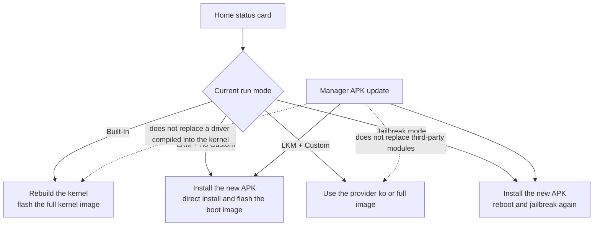

# Updating FinaSU

<Badge text="Three deployment methods" type="warning" /> <Badge text="Confirm before you start" type="danger" />

FinaSU consists of the Manager APK, the kernel driver `kernelsu.ko`, the userspace command-line tool `ksud` and the embedded engines. They may come from the same release, but **the install location and the moment they take effect are not the same**: updating the Manager APK does not replace the running kernel driver, and a built-in kernel build does not change just because a new APK is installed.

So before updating, confirm which deployment the device uses: a **built-in kernel build**, **LKM**, or **Jailbreak mode**. All three may use the same driver file, but the load method and the update path are completely different.

::: warning Manager version is not driver version

Seeing only the Manager version change does not prove the kernel driver was updated. After updating, check the run mode, Manager version, kernel build version and UAPI version on the home screen at the same time.

:::

## Confirm the Deployment Method First

Open the status card on the Manager home screen and use the three items below to determine the current deployment.

:::: field-group

::: field Run mode
@type `Must read`
@default `LKM or Built-In`
Showing **LKM** means the driver runs as a loadable module; showing **Built-In** means the driver is already compiled into the kernel image rather than being a separate code branch.
:::

::: field Custom badge
@type `Optional`
@default `Custom`
The **Custom** badge means the current LKM is not the one bundled in the Manager APK but a third-party or self-built module.
:::

::: field Jailbreak badge
@type `Must read`
@default `Jailbreak mode`
The **Jailbreak mode** label means the driver is loaded after the system has booted. This mode is valid only for the current boot session; after a normal reboot, root is gone.
:::

::::

::: tip The three methods are not three feature sets

Built-in builds and LKM use the same kernel source. The kernel side only sets the LKM flag when building as a module, so `CONFIG_KSU=y` compiled into the kernel shows **Built-In** on the home screen. Jailbreak mode also loads the standard `kernelsu.ko`; it is only loaded after boot by a process that already holds privileges.

:::

## Update Path Overview

The update path is decided by the driver's current deployment, not by the Manager version. Look at the home status card first, then follow the matching branch:

- **Built-In**: the driver is compiled into the kernel, so the full kernel image must be rebuilt and flashed.
- **LKM (no Custom)**: the driver comes from the payload bundled in the APK; after installing the new APK, patch the boot image again with direct install or the inactive slot.
- **LKM (Custom)**: the driver is third-party or self-built; update with the provider's module, full image or a local `.ko`.
- **Jailbreak mode**: install the new APK, reboot fully, then run the jailbreak again so the new payload enters the current kernel session.

The flowchart below draws the same decision as a visual path:



What these paths have in common: **the Manager APK covers the userspace and the bundled resources, while the kernel driver must be updated separately according to its own deployment**. During the update, do not run a system OTA, batch-flash modules or switch to another root solution at the same time.

::: danger Prepare a rescue method first

Any write to the boot partition can cause a failure to boot because of an image, partition, KMI or slot mismatch. Before updating, read [Bootloop Rescue](/en/guide/rescue-bootloop/) and make sure you can restore a stock image that exactly matches the current system.

:::

## Update the Manager APK

The Manager checks for updates after boot by default. With **Settings → General → Check for updates** enabled, it requests the latest stable release from the FinaSU repository and parses the version information from the release assets.

::: steps

1. **Confirm the current version**

   On the home screen, note the Manager version, kernel build version and run mode. That way, even if something goes wrong after the update, you can tell whether the userspace or the kernel side changed.

2. **Read the release notes**

   When the Manager finds a new version it shows the version number and the notes. Confirm that the release targets the current deployment and does not require switching the kernel first.

3. **Download the official APK**

   The update card opens the download address in a browser. Use only the APK from the official FinaSU release page; do not mix in Managers from unknown sources or so-called "enhanced" builds.

4. **Install over the existing app**

   Android only allows an APK with the same signature to install over the existing app. If the signature differs, the old Manager must be uninstalled first, and whether the kernel accepts the new Manager also depends on the certificates it trusts.

5. **Continue according to the deployment**

   After the Manager is installed, LKM and Jailbreak mode still need the driver updated as described in the matching sections below; built-in kernel builds need the kernel flashed again.

:::

### Release Asset Naming

The Manager parses the version number from the asset file name, so official releases use a fixed format. If the file name does not match, the update check may fail to recognize the release even when it exists.

::: code-tabs

@tab Naming format

```text
<app name>_<version name>_<version code>-<build type>.apk
```

@tab Stable release example

```text
FinaSU_v1.0.10_33034-release.apk
```

@tab Pre-release example

```text
FinaSU_v1.1.0-beta1_33102-release.apk
```

:::

The version name comes from `git describe` and usually starts with `v`; the version code is generated as `30000 + commit count`. Tags with suffixes such as `-beta` or `-rc` are published as pre-releases and do not appear in the "latest stable release" check result; if you need a beta, download it manually.

::: important The signature matters more than the version number

The kernel verifies the Manager's APK signature. A Manager with a different signature may fail to gain Manager identity or root permissions even if it is newer. Custom-signed builds must also update the certificate size and SHA-256 trusted by the kernel side.

:::

## Update the LKM Driver

In LKM mode the driver sits in the ramdisk of the boot image as `kernelsu.ko` and is loaded early in boot by `ksuinit`. Updating the driver means patching and flashing the boot image again, not replacing a file inside the Manager.

### Bundled LKM

Without the **Custom** badge, the current driver comes from the payload embedded in the official FinaSU APK. When the kernel version code differs from the Manager version code and the UAPI is compatible, the home screen reports that a newer bundled LKM is available.

::: steps

1. **Handle the version hint**

   Tap the "A newer bundled LKM is available" hint to open the [Installation Options](/en/guide/install/) page.

2. **Choose the flashing method**

   If the device already has root and is GKI, choose **Direct install**. On A/B devices right after an OTA that has not been rebooted yet, choose **Install to inactive slot**.

3. **Confirm the target image and partition**

   Check the KMI, slot and partition the Manager detected automatically. Do not swap `boot` and `init_boot` by hand, and do not substitute an image from another system version for the current one.

4. **Enable the pre-flash backup**

   If it is not already enabled in Settings, enable the backup temporarily on the install page. When an update fails, the original boot image is often more useful than any log.

5. **Flash and reboot**

   Reboot normally after flashing. The driver only really takes effect once the home screen still shows **LKM** after the reboot and both the version and the UAPI are updated.

:::

::: warning Non-GKI devices have no direct install

The install page only offers **Direct install** when the device already has root and is GKI. Non-GKI devices that receive an LKM update hint still need a boot image matching the current system and must use "select a file and patch".

:::

### Custom LKM

With the **Custom** badge, the Manager does not treat the driver as a bundled payload and does not offer to replace it with the official bundled LKM. The driver is supplied by the kernel author or built locally.

The update method depends on the provider:

- If the provider ships a full kernel or an AnyKernel3 package, flash it as the provider instructs.
- If the provider ships only a new `kernelsu.ko`, choose **Use a local LKM file** on the install page and patch the current boot image again.
- Before choosing a `.ko` manually, confirm that the architecture, the KMI and the Manager signature trust all match. A wrong module fails to load during boot.

::: danger Do not mix modules and Managers

Combining a third-party LKM with an official Manager of any version can break authorization because of UAPI or signature differences. Before updating either side, confirm the compatibility range given by the provider.

:::

### LKM Update Timeline

::: timeline A complete LKM update

- The Manager finds a new version and downloads the APK
  time=Preparation type=tip

- Install the Manager over the existing app; bundled resources and `ksud` update
  time=Userspace

- Choose direct install or the inactive slot and repack the boot image
  time=Driver

- Flash the target partition and reboot
  time=Take effect

- Confirm the LKM flag, version and UAPI on the home screen
  time=Verify type=success

:::

## Update a Built-In Kernel Build

A built-in kernel build compiles the driver into the kernel image, so the driver is no longer a separate module in the ramdisk. The Manager cannot replace such a driver with "direct install", and the related hints do not offer a one-tap install entry.

### Rebuild

To update, recompile against the target kernel source and keep using the certificate configuration that matches the current Manager.

::: code-tabs

@tab Integrate FinaSU

```sh
./kernel/setup.sh --dir /path/to/FinaSU
scripts/config --enable KSU
scripts/config --enable KPROBES
scripts/config --enable KALLSYMS_ALL
scripts/config --enable EXT4_FS
scripts/config --enable HEADERS_INSTALL
```

@tab Build the kernel

```sh
make ... KSU_REQUIRE_PREINIT=1
```

:::

For the full option reference and certificate requirements, see [Built-In Kernel Integration](/en/developer/builtin-integration/). The build output is a complete kernel, not a standalone module that can go into the ramdisk.

::: steps

1. **Sync the source**

   Fetch the FinaSU source for the target version and rerun the integration script against the current kernel version. Do not replace only single files inside the old kernel source.

2. **Confirm the configuration**

   Keep `CONFIG_KSU=y` and pass `KSU_REQUIRE_PREINIT=1` explicitly. When the UAPI headers are missing, preinit silently turns off and boot-time behavior no longer matches expectations.

3. **Recompile**

   Use a build environment that matches the device kernel version, compiler and configuration. Reusing build artifacts across versions can directly cause a failure to boot.

4. **Flash the full kernel image**

   Flash the new image the way the kernel maintainer prescribes. A built-in build usually replaces the kernel inside `boot` rather than patching the ramdisk.

5. **Verify the Manager identity**

   After the reboot, confirm that the home screen shows **Built-In** and that the Manager can authorize properly. If the signature does not match, the driver rejects the Manager.

:::

::: danger The kernel and system version must match

A built-in build is replaced wholesale along with a system OTA. Continuing to use an old kernel after a system upgrade can cause a failure to boot, broken modules or UAPI incompatibility. After a system update you must rebuild and flash a kernel that matches the new system.

:::

## Update Jailbreak Mode

Jailbreak mode (late load) loads the driver after the current system has booted, which suits devices that cannot patch the boot image directly but already have a privilege escalation entry. It is **not a different driver**: it still loads the standard `<KMI>_kernelsu.ko`, installs the same `ksud`, and runs the same installation, module and boot script flow after loading.

::: info The same files are reused

The jailbreak flow takes the `kernelsu.ko` matching the device KMI from the embedded resources of the current `ksud`, and this file name is the same as the module used when patching the boot image. After loading successfully, it also writes `ksud` through the normal install path. So the key to updating jailbreak mode is to make **the payload embedded in the current APK** the new version.

After the driver loads, the same `ksu_cred`, SELinux domain and authorization model take over; there is no lower-privilege "jailbreak-only" variant. The difference comes from the load timing: a delayed load skips part of the kprobe registration performed early in boot.

:::

### Why It Cannot Be Updated Directly

Jailbreak mode has no boot image patch that can be re-flashed, and the Manager does not offer a kernel update button in this mode. In addition, the jailbreak flow checks at start whether KernelSU already exists in the system:

- If it is not loaded yet, it loads `kernelsu.ko` from the embedded resources.
- If it is already loaded, it skips the module load and only reruns the subsequent installation and boot scripts.

This means that running the jailbreak again within the same boot session **does not replace the driver already in memory**. The bundled badge is also meaningless in jailbreak mode, because it cannot be updated by flashing the boot image.

### Update Steps

::: steps

1. **Update the Manager APK**

   Install the new version over the existing app as described in "Update the Manager APK". The new `ksud` and `<KMI>_kernelsu.ko` arrive with the APK.

2. **Reboot normally**

   A normal reboot ends the current kernel session and root disappears with it. This is a necessary step to get the old driver out of memory.

3. **Run the jailbreak again**

   After the device boots, run the jailbreak again. This time it loads the driver embedded in the new APK instead of the old module from the previous session.

4. **Check the versions**

   After a successful jailbreak the home screen should show both **Jailbreak mode** and the new kernel build version. If you only updated the APK without jailbreaking again, the driver is still the old version.

:::

::: warning A soft reboot cannot update the driver

A soft reboot keeps the loaded kernel modules and only restarts the Android userspace. It suits making module changes take effect but not replacing the driver. To update the jailbreak-mode driver you must reboot fully and jailbreak again.

:::

## Android System OTA

A system OTA replaces the boot chain and the kernel, so every deployment must re-confirm the FinaSU state after an OTA. Modules and most settings live in `/data` and are usually not deleted by an OTA, but old modules may stop working because of system changes.

::: table Handling after an OTA

| Deployment | A/B devices | Non-A/B devices |
| --- | --- | --- |
| Bundled LKM | Do not reboot right after the OTA completes; choose **Install to inactive slot**, then reboot into the new system | Restore the stock image to finish the OTA, then patch the boot image of the current system again |
| Custom LKM | Use the kernel or module the provider released for the new system | Same as the left column; you must wait for a build compatible with the new system |
| Built-in kernel build | Rebuild a kernel matching the new system and flash it | Same as the left column; the OTA has already overwritten the old kernel |
| Jailbreak mode | Run the jailbreak again after the OTA | Same as the left column; there is no boot partition patch to preserve |

:::

"Install to inactive slot" requires existing root, a GKI device and A/B partitions. If the conditions are not met, the Manager does not offer the option.

::: danger Do not reboot too early after an OTA

On A/B devices, "Install to inactive slot" can only be done after the OTA has been written but before the reboot. Rebooting into the new system first loses this chance to patch directly, and you can only extract the image again or jailbreak again.

:::

## Bundled Engines and Modules

`ksud`, the FolkZygisk, Sui and NoMount payloads and the Manager APK are released together. After updating the APK, these userspace components take effect on the next boot or when the matching feature publishes its payload again.

- **FolkZygisk** and **Sui** need a reboot to inject into Zygote again.
- If **Sui** is in an abnormal state, you can run "Repair payload" on its page to republish the files from the current `ksud`.
- The **NoMount** kernel module is compiled per KMI; after changing the system kernel you must use the version matching the new KMI.
- Installed modules are checked separately by "Check module updates", which is not the same thing as FinaSU's own version update.

::: warning Module updates are not system updates

If a module author does not provide reliable version information, the Manager may not report an update. Do not read "latest" in the module list as meaning the whole FinaSU installation is up to date.

:::

## Checks After Updating

::: steps

1. **Confirm the run mode**

   The home screen should show the expected **Built-In**, **LKM** or **Jailbreak mode**. If the run mode differs from before the update, stop further steps.

2. **Check the three versions**

   Note the Manager version, kernel build version and UAPI version. The status card shows the driver information as `kernel version code-UAPI`; the kernel build version comes from the driver, and kernels too old to support that interface hide this line, which is itself compatibility information.

3. **Check the compatibility hints**

   The home screen should not show a "Manager update required" or "Kernel update required" warning. If a hint remains, handle it as described in the next section.

4. **Verify root and modules**

   Open an authorized app to test root and confirm that module mounting and the Folk Mount provider work. A working Manager UI alone does not mean the driver works.

5. **Verify the built-in engines**

   If you use Sui, FolkZygisk or NoMount, check their running state separately. Injection features usually need one full reboot.

:::

## When Versions Do Not Match

The Manager's compatibility hints compare the kernel UAPI with the Manager UAPI, not version number strings.

::: table Common hints and how to handle them

| Hint in the UI | Meaning | What to do |
| --- | --- | --- |
| **Manager update required** | The kernel UAPI is newer than the Manager | Install a newer official Manager APK |
| **Kernel update required. Tap to install.** | The Manager UAPI is newer than the kernel, and flashing is currently allowed | Update the driver with the LKM procedure |
| **Kernel update required** (no button) | A built-in build or jailbreak mode cannot be flashed directly | Rebuild the kernel, or reboot and jailbreak again |
| **A newer bundled LKM is available** | The version code of the bundled LKM differs from the Manager | Use direct install or the inactive slot |
| **Custom** badge | The current LKM is not the official bundled payload | Update through the provider |
| **Jailbreak mode** label | Root is valid only for the current boot session | Reboot and jailbreak again |

:::

## Files Involved in Updates

```file-tree title="Common locations involved in updates"
/data/adb
├── ksud                      # userspace command-line tool
├── ksu/
│   ├── .allowlist            # authorization and profile state
│   ├── profile/
│   └── sui/                  # Sui state directory
└── modules/                  # installed modules
    └── <module ID>/
```

Do not manually delete the whole `/data/adb/ksu` or `/data/adb/modules` directory to get a "clean" update. These directories also hold authorization, profiles, modules and engine state, and deleting them by mistake causes lost permissions or modules that cannot be restored.

## Troubleshooting

::: collapse accordion

- **After updating the APK it says the kernel is too old**

  This means the Manager UAPI is newer than the current driver. A bundled LKM can be updated with direct install; a built-in build needs the kernel recompiled; jailbreak mode needs a full reboot and another jailbreak.

- **The install page has no "direct install"**

  That option requires existing root and a GKI device. Non-GKI devices must first prepare a boot image matching the current system, then use "select a file and patch".

- **The device will not boot after the update**

  Stop repeated reboots immediately and restore the stock image as described in [Bootloop Rescue](/en/guide/rescue-bootloop/). Common causes are a partition, slot, KMI or kernel version mismatch.

- **The jailbreak succeeds but the version is still old**

  Within the same boot session, the jailbreak flow detects that the driver is already loaded and skips the module load. Only a full reboot followed by another jailbreak uses the driver embedded in the new APK.

- **The update check shows nothing**

  Confirm that "check for updates" is enabled, the network works, and the current version is not a newer pre-release. Pre-releases do not appear in the "latest stable release" check result.

- **The built-in engines do not take effect after an update**

  Injection components need a reboot. If the Sui payload is abnormal, run "Repair payload" and then reboot; do not use repeated toggling instead of a reboot.

- **Modules disappear or stop working after an OTA**

  Check whether `/data/adb/modules` still exists and confirm the modules support the new system and KMI. After a system upgrade, module compatibility must be verified again.

:::

## FAQ

::: chat title="Updating FinaSU Q&A"
{User}
If I only update the Manager APK, is the kernel driver updated as well?

{.}
No. The APK update covers the Manager, `ksud` and the bundled resources. A built-in build needs the kernel flashed again; a bundled LKM needs the boot image patched again; jailbreak mode needs a full reboot and another jailbreak.

{User}
Are the driver files different between a built-in build and LKM?

{.}
The source is the same; the deployment differs. LKM compiles the driver into a standalone module placed in the ramdisk; a built-in build compiles the driver straight into the kernel image. **Built-In** and **LKM** on the home screen only report how the kernel loaded it.

{User}
Does jailbreak mode reuse the same file?

{.}
Yes. It loads the `kernelsu.ko` matching the device KMI from the embedded resources of the current `ksud` and installs the same `ksud`. The difference is the load timing and the load method, not a different driver.

{User}
Why can't I tap "install kernel update" in jailbreak mode?

{.}
Jailbreak mode has no boot partition patch that can be re-flashed, and the device may have a locked bootloader. The Manager does not offer a kernel flashing entry in this mode.

{User}
Can I just reboot after an OTA?

{.}
On A/B devices, if you want to install FinaSU into the new slot, you must act after the OTA finishes but before the reboot. Other deployments should also confirm the kernel or jailbreak conditions for the new system before rebooting.

{User}
What should I check first after a failed update?

{.}
First confirm whether you can still get into the system or recovery. If not, prioritize bootloop rescue; if you can, check the run mode, Manager version, kernel build version and UAPI, then decide whether the problem is in the userspace or the driver.
:::

## Related Pages

- [Installation Options](/en/guide/install/)
- [Built-In Kernel Integration](/en/developer/builtin-integration/)
- [Updates and Version Settings](/en/setting/update/)
- [Bootloop Rescue](/en/guide/rescue-bootloop/)
- [FAQ](/en/guide/faq/)

*[LKM]: Loadable Kernel Module, a kernel module that can be loaded at runtime
*[KMI]: Kernel Module Interface, the Android kernel module interface version
*[UAPI]: the stable interface between the kernel and userspace
*[OTA]: Over-The-Air, online system update
*[GKI]: Generic Kernel Image, the Android generic kernel image
*[AVB]: Android Verified Boot
