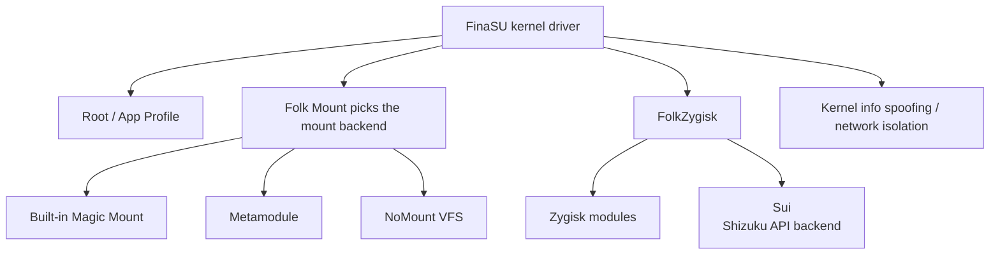

# Feature Settings

<Badge text="Settings entry 4/8" type="info" /> <Badge text="Changes system behavior" type="danger" />

Features is not an ordinary appearance page. It controls how modules are mounted, which kernel information is hidden, whether Zygisk and Sui run, and whether apps can reach the network. Before changing anything, confirm the current deployment method and the kernel's supported range.

::: tip How to get there

Open Manager → Settings → tap the first entry in the second row, **Features**.

:::

## How the Features Relate

::: important A tappable switch does not mean the current kernel supports it

Many features map the state returned by the kernel to `supported`, `forced`, `managed` or `unsupported`. A grayed-out control usually means the kernel does not support it, the boot configuration forces it, or a module has taken it over; it does not mean the button is broken.

:::

## Root and Module Visibility

### Module Unmounting (Master Switch)

This is the master switch for the module-unmount policy in App Profile. When enabled, the kernel can hide module-injected content from target apps according to that policy.

- When on, apps that match the policy see a file system view closer to stock.
- When off, the kernel does not perform this per-app unmount layer.
- The files actually seen still depend on the current Folk Mount backend.

This capability does not share its list with the NoMount exception apps. NoMount has its own visibility model.

### Default Unmount Modules

Sets the global default for "Unmount modules" in App Profile.

- On: apps without their own configuration hide module injection by default.
- Off: apps without their own configuration keep module files by default.
- A single app's App Profile can override the default.

### Custom Unmount Mountpoints

In addition to the per-UID module policy, you can target exact mountpoints and hide them from an app the next time it starts.

- Rules apply only to UIDs whose App Profile allows module unmounting.
- The path must be a mountpoint root in the target namespace; directory recursion, wildcards and regular expressions are not supported.
- Running apps do not change immediately. Restart the target app after saving.
- Entries added automatically by modules are read-only and are not deleted by the Manager.
- This changes real mounts and file content, unlike the `/proc` display filtering provided by "Hide mount records".

See [Custom Unmount Mountpoints](/en/setting/umount-paths/) for the full workflow and troubleshooting.

::: tip When an app cannot find module files

Do not disable the whole module mount system first. Check whether that app's App Profile has "Unmount modules" enabled, then check the NoMount exception list to see whether the app needs to see injected content.

:::

### Hide Mount Records

Removes Root and module-related records from the `/proc` mount view of ordinary apps and isolated processes.

The switch appears when available; it shows "unavailable" when the current kernel cannot use it, and returns to the actual state when a write fails. This feature does not delete modules, and it does not replace per-app unmounting.

## Logging and Security Helpers

### AVC Log Spoofing

Handles KernelSU target contexts in SELinux audit logs, reducing the chance that the logs expose related objects directly.

It is not full SELinux hiding, and it does not hide every system difference. The switch cannot be changed when the kernel does not report support.

### SU Log

Records Root execution, legacy SU, authorization and log events. After you turn it off, new SU events are no longer recorded, but existing logs are not deleted by this switch.

For viewing and filtering, see [SU Log](/en/manager/su-log/).

### Allow Any App to Become Dynamic Manager

This is an experimental feature. By default, only a manager with a preset signature can see "Set as dynamic manager" in the app UI; when this is on, any app may show that entry.

::: danger This widens the trust boundary

Do not set unknown apps as dynamic manager just to try it. The entry is hidden completely when the current kernel does not support it.

:::

For the dynamic manager flow, see [Dynamic Manager](/en/manager/dynamic-manager/).

## FolkZygisk

FolkZygisk is the Zygisk backend driven by FinaSU, used to inject Zygisk modules into Android app processes.

The status line may show:

- **Injected**: injection succeeded during this boot.
- **Partially injected**: only some targets or processes were injected.
- **Starting**: the injection flow has not finished yet.
- **Injection failed**: it failed during boot.
- **Unverified**: no result proving successful injection was obtained.

The list also shows whether it is enabled for the next boot, the external provider detected, and whether a reboot or boot protection is needed. When boot protection pauses injection, a "Restore" action appears.

::: warning An enabled switch does not mean it took effect this boot

The switch expresses the choice for the next boot. If an external Zygisk provider is also installed, the built-in FolkZygisk steps aside; the actual injection state is determined by the status line and by the result after a reboot.

:::

See [FolkZygisk](/en/builtin/folkzygisk/).

## Sui

<Badge text="Requires a Zygisk backend" type="warning" />

Sui is the Shizuku API backend built into FinaSU. Sui is not a Zygisk provider itself; ==it must rely on a working Zygisk backend to run==. You can use the built-in FolkZygisk or an external compatible Zygisk provider; either can serve as Sui's backend.

The practical difference between an external and a built-in provider is this: ==Sui can run, but FinaSU cannot verify the injection result of that external provider==. The status may therefore read "external provider enabled, but injection unverified", which does not mean Sui is necessarily unusable.

The Features page is where you:

- View Sui's current state and the Zygisk backend it depends on.
- Enable or disable Sui.
- Try to repair the payload when it is missing or outdated.
- Open the Sui permission management page.
- View daemon, conflict and payload diagnostics.

A confirmation prompt appears when you enable Sui. If Zygisk is currently unavailable, a conflict exists or the payload is missing, the switch may be inoperable; handle the diagnostic result first.

::: info Full lifecycle

For enabling Sui, payload installation, dual daemons, manager registration, permissions and troubleshooting, see [Sui Guide](/en/builtin/sui/).

:::

## Folk Mount

Folk Mount decides who injects module files into the system at boot. Changing the mode usually requires a reboot, and the summary shows both the "configured mode" and the "provider actually used this boot".

::: table Five modes

| Mode | Behavior | Best for |
| --- | --- | --- |
| **Automatic** | Hands over to a Metamodule when one is available, otherwise uses the built-in Magic Mount | Most users |
| **Built-in (Magic Mount)** | Always uses the built-in Folk Mount | Fixing on the built-in mount engine |
| **Metamodule only** | Always hands over to the Metamodule | Already committed to a particular mount module |
| **Built-in (VFS)** | Uses the NoMount VFS driver; falls back to the built-in engine when the driver is unavailable | Needing NoMount's path-level injection |
| **Mounting off** | Injects no module content | Temporarily troubleshooting module problems |

:::

::: warning NoMount has a different default visibility

After switching to VFS, NoMount initially lets every app see injected files; the built-in Magic Mount hides them from non-Root apps according to App Profile by default. To keep the old behavior, go to "NoMount → Exception apps" before rebooting and select the apps that should see the stock file system.

:::

::: tip This boot and the next boot

The mode dropdown is the configuration for the next boot; only the "this boot" row shows the provider currently in use. It is normal for the two to differ, and they match after a reboot.

:::

See [Folk Mount](/en/builtin/folk-mount/).

## NoMount

The NoMount page shows the VFS driver, injection rules, module contributions and exception apps.

### Driver

The state may be:

- **Ready**: the driver responds and the injection and visibility settings are available.
- **Unavailable**: the driver is not loaded, or the current package lacks the module for this KMI.
- **Version mismatch**: the kernel driver API is too old and the kernel needs an upgrade.
- **Taken over by another module**: another module manages a driver with the same name, so the built-in backend steps aside.

### Injection

- **Redirect rules**: shows the number of active rules and the expected number.
- **Reinject**: writes the current module rules to the driver again.
- **Clear rules**: stops injecting module files until the next reboot.
- The module list can inject a module immediately or take it down until the next reboot.

### Visibility

NoMount's default model is "every app can see injected files". Apps selected under "Exception apps" see the stock file system.

- Apps that share a UID are affected together.
- You can copy the apps with "Unmount modules" from App Profile, but the copy does not follow later Profile changes.
- "Clear all" deletes the rules and exceptions until the next boot.

See [NoMount](/en/builtin/nomount/).

## Kernel Info Spoofing (UTS View)

UTS View makes selected apps, or every process that still uses the initial UTS namespace, see different `uname` information.

### Common Fields

- **System name**
- **Node name**
- **Kernel release**
- **Build version**
- **Machine architecture**
- **Domain name**

Usually only "kernel release" needs changing. Keep the fields self-consistent; a version, build time and architecture combination that clearly conflicts may cause new compatibility problems.

### Scope

- **Selected apps only**: up to 128 apps can be selected.
- **All apps and terminals**: ignores the app list and applies to every process that still uses the initial UTS namespace.

Processes that already have a private UTS namespace are not modified retroactively. After a change, target apps usually have to be closed completely and opened again.

### Relation to SUSFS

If SUSFS is currently providing UTS spoofing, UTS View shows "managed by SUSFS". You can use "Spoof with this feature instead" to let UTS View take over; this first restores SUSFS's `uname` spoofing, then the values saved by UTS View take over.

"Restore real information" turns UTS View off and deletes its contents; if SUSFS is currently providing the spoofing, only the UTS View settings are deleted and the SUSFS settings are untouched.

### Diagnostics

The "run log" shows the hit count, the most recent UID/PID, the skip reasons, and the number of failures to create a separate UTS namespace. When a target app still sees the old values, close the app completely and open it again, then read the log.

## Network Isolation

Network isolation prevents selected apps from creating new outbound IPv4/IPv6 connections.

:::: field-group

::: field Normal isolation
@type `Mode`
Blocks new external connections, and also blocks loopback.
:::

::: field Allow loopback
@type `Mode`
Allows only loopback connections to `127.0.0.0/8` and `::1`. A local proxy may still forward traffic to the internet.
:::

::: field Total block
@type `Mode`
Prevents apps from creating IPv4/IPv6 sockets; existing connections are not interrupted.
:::

::: field App policy
@type `Per-app`
When the kernel supports it, each target app can choose normal, loopback or total mode separately.
:::

::: field Exceptions
@type `Optional`
Allows private networks and mDNS/SSDP local discovery. When strict socket blocking is enabled, these exceptions cannot be used at the same time.
:::

::::

Additional rules:

- Established connections are not guaranteed to drop immediately.
- Manager itself is always exempt, including Manager in a work profile.
- Up to 256 UIDs can be selected.
- When the current kernel does not support per-app policies or 32-bit app coverage, the related controls are grayed out.
- "Recent blocked events" shows interception events; clearing events does not change the isolation configuration.

::: warning Isolation is not an offline switch

It only constrains what new connections the selected apps can open. Do not treat it as a system-wide firewall, and do not add critical system processes to the list.

:::

## Recommended Troubleshooting Order

:::: steps

1. **Confirm the state first, do not keep toggling**

   Read `forced`, `managed`, `unsupported` or the specific error text first to determine whether the problem is permission, kernel or configuration.

2. **Separate the configured value from this boot's value**

   Folk Mount, Zygisk and Sui have both a "next boot" and a "current run" state. First confirm whether you have rebooted.

3. **Check the dependency chain**

   Sui checks Zygisk; NoMount checks the driver API and KMI; module mounting checks the current Folk Mount provider.

4. **Change one item at a time**

   Do not switch the mount backend, Zygisk, Sui and hiding policies all at once. Reboot and verify item by item so you know which one caused the change.

5. **Return to a safe baseline when needed**

   Set Folk Mount back to "Automatic", turn off experimental features you are not using, then locate the problem from the logs.

::::

## Features Q&A

::: chat title="Feature settings Q&A"
{User}
FolkZygisk shows enabled, so why can't Sui work yet?

{.}
Check the Zygisk injection state for this boot. Enabled is the choice for the next boot; if FolkZygisk stepped aside for an external provider, or injection has not finished, Sui may still be unavailable.

{User}
Can Sui work with an external Zygisk provider?

{.}
Yes. Sui relies on a working Zygisk backend, and both the built-in FolkZygisk and external compatible providers can serve. The only difference is that FinaSU cannot verify the external provider's injection result.

{User}
Why can every app see modules after switching to NoMount?

{.}
NoMount has no exception apps initially. To hide them, select the apps that should see the stock file system under "NoMount → Exception apps", then reboot or apply as the page suggests.

{User}
Does turning Folk Mount off uninstall modules?

{.}
No. Installed modules are not deleted. It only stops injecting module content during this boot, so the modules stay installed but do not take effect.

{User}
Can network isolation cut off an app that is downloading right away?

{.}
Not guaranteed. It mainly blocks new connections; existing connections may keep working until they end on their own.
:::

## Related Pages

- [Root & Mount Policy](/en/setting/root-policy/)
- [Custom Unmount Mountpoints](/en/setting/umount-paths/)
- [FolkZygisk](/en/builtin/folkzygisk/)
- [Folk Mount](/en/builtin/folk-mount/)
- [NoMount](/en/builtin/nomount/)
- [Sui Guide](/en/builtin/sui/)
- [UTS View](/en/builtin/uts-view/)
- [Network Isolation](/en/builtin/net-isolate/)
- [SUSFS](/en/builtin/susfs/)
- [SU Log](/en/manager/su-log/)
- [Dynamic Manager](/en/manager/dynamic-manager/)
