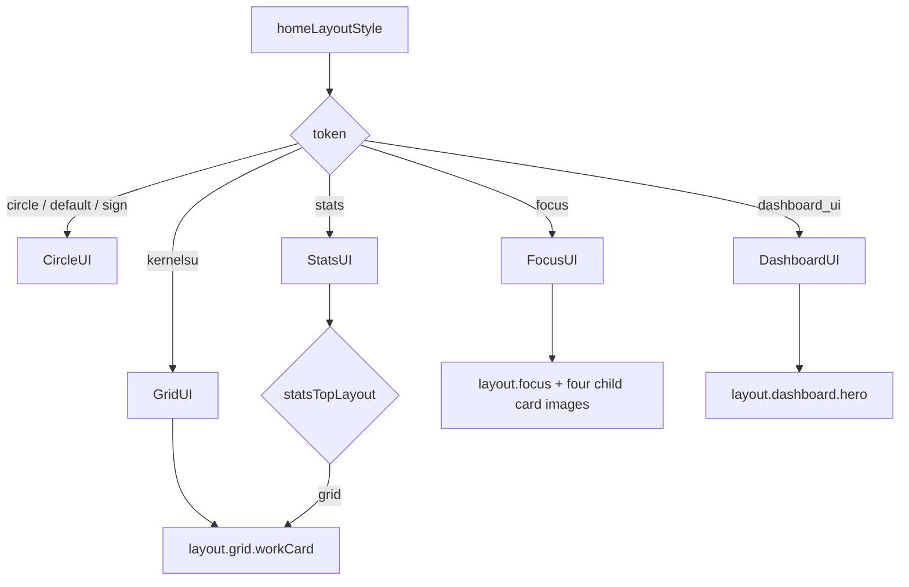

# Become a Theme Developer

<Badge text="Start from an export" type="tip" /> <Badge text="Flat resource package" type="warning" /> <Badge text="No signature protection" type="danger" />

The most reliable way to develop a FinaSU theme is not to guess fields from an empty JSON file, but to configure a working appearance in the Manager first, export the `.fpt`, and then modify the known fields and resources. The Manager export flow writes the structure, resource extensions and compatibility keys that the current version actually supports.

==The subject of theme development is display resources and preference fields, not an executable module.== Do not put scripts, path traversal, arbitrary web content or root configuration into a theme package.

## Workflow

::::: timeline From design to release

- Decide the phone or tablet target and which of the five layouts to support
  time=Design type=tip

- Set colors, wallpaper, font, layout and media in a clean Manager environment
  time=Production type=info

- Fill in the metadata and export from Wallpaper → Export theme package
  time=Packaging type=warning

- Unpack and inspect `theme.json`, changing only the fields and flat resources listed here
  time=Adjustment type=warning

- Import for real on phone, tablet, light mode, dark mode and different layouts
  time=Verification type=tip

- Check re-export, cross-platform re-import, rollback on failure and missing-resource warnings
  time=Regression type=success

:::::

## Theme Package Directory

A decoded `.fpt` is a flat ZIP. Every entry sits at the root and nested directories are not allowed.

```file-tree title=".fpt internal structure"
theme.fpt (encrypted container)
└── ZIP root
    ├── theme.json
    ├── background.webp
    ├── background_home.webp
    ├── video_background.mp4
    ├── title_image.png
    ├── grid_working_card_background.webp
    ├── focus_card_kernel_bg.webp
    ├── dashboard_card_bg.webp
    ├── font.ttf
    ├── nav_icon_Home.png
    ├── background_music.mp3
    └── sound_effect_custom.wav
```

The actual entries depend on the current configuration, so you do not need to include every example file. `original.json` and `applied.json` are internal Manager records, and those two names are forbidden in a user theme ZIP.

:::: warning File names are flat entries, not paths

An entry name cannot contain `/`, `\` or NUL; cannot be empty; cannot repeat; and cannot be `.`, `..`, `original.json` or `applied.json`. A resource reference must use the actual file name in the same ZIP root.

::::

## Minimal Metadata

```json
{
  "meta_name": "Example Theme",
  "meta_type": "phone",
  "meta_version": "1.0.0",
  "meta_author": "Example Author",
  "meta_description": "A FinaSU manager theme."
}
```

:::: table Metadata fields

| Field | Default | Behavior |
| --- | --- | --- |
| `meta_name` | Empty | Primary name for the import preview and the exported file name |
| `meta_type` | `phone` | `phone` or `tablet`; other values are kept with a warning |
| `meta_version` | `1` | Content version string, not used in overwrite comparison |
| `meta_author` | Empty | Displayed author |
| `meta_description` | Empty | Description text |

::::

The export dialog requires a non-empty name and lets you choose phone or tablet. The file name has characters unsuitable for a file name removed and is written to `Download/FinaSU/Themes/<name>.fpt`.

## Common Fields

::::: code-tabs

@tab:active Appearance and layout

```json
{
  "customColor": "indigo",
  "finasu_keyColor": -12345678,
  "nightModeEnabled": true,
  "nightModeFollowSys": true,
  "useSystemDynamicColor": false,
  "colorGenerationMode": "custom",
  "colorStandard": "M3E_2025",
  "colorStyle": "TONAL_SPOT",
  "colorContrast": "STANDARD",
  "homeLayoutStyle": "focus",
  "statsTopLayout": "list",
  "isListWorkingCardModeHidden": false
}
```

@tab Main wallpaper and video

```json
{
  "isBackgroundEnabled": true,
  "backgroundOpacity": 0.6,
  "backgroundBlur": 20,
  "backgroundDim": 0.2,
  "isDualBackgroundDimEnabled": true,
  "backgroundDayDim": 0.2,
  "backgroundNightDim": 0.4,
  "isMultiBackgroundEnabled": true,
  "wallpaper_use_color": true,
  "isVideoBackgroundEnabled": false,
  "videoVolume": 0.0
}
```

@tab Advanced title and font

```json
{
  "isAdvancedTitleStyleEnabled": true,
  "titleImageDayOpacity": 1.0,
  "titleImageNightOpacity": 0.8,
  "titleImageDim": 0.1,
  "titleImageOffsetX": 0.0,
  "titleTextMode": "custom",
  "titleCustomText": "FinaSU",
  "fontMode": "custom",
  "isFontEnabled": true
}
```

@tab Music and sound effects

```json
{
  "isMusicEnabled": true,
  "musicFilename": "background_music.mp3",
  "musicVolume": 0.7,
  "isAutoPlayEnabled": true,
  "isLoopingEnabled": true,
  "isSoundEffectEnabled": true,
  "soundEffectFilename": "sound_effect_custom.wav",
  "soundEffectScope": "bottom_bar"
}
```

@tab Navigation icons

```json
{
  "navIconCustomEnabled": true,
  "navIcons": {
    "Home": "nav_icon_Home.png",
    "KModule": "nav_icon_Plugin.png",
    "SuperUser": "nav_icon_SuperUser.png",
    "AModule": "nav_icon_Module.png",
    "Settings": "nav_icon_Settings.png"
  }
}
```

:::::

These are only the common fields, not the complete protocol. For layout-specific surface keys see the page for each layout and [Theme Package Structure](/en/developer/theme-package/).

## Resource Selection Rules

:::: table Base names and extension priority

| Type | Base name | Extension priority |
| --- | --- | --- |
| Ordinary image | `background`, `title_image`, the surface base name | `jpg`, `png`, `gif`, `webp`, `jpeg` |
| Video | `video_background` | `mp4`, `webm`, `mkv` |
| Font | `font` | `ttf`, `otf` |
| Per-page background | `background_home`, `background_kernel`, `background_superuser`, `background_system_module`, `background_settings` | Same as ordinary images |

::::

When several allowed extensions exist for the same base name, only the one with the highest priority is chosen. Extra files are kept as unknown resources but are not guaranteed to render. A GIF plays only when the system decoder supports it; ordinary images and video still depend on Android media capabilities.

## Layout Compatibility Keys

::::: field-group

:::: field CircleUI
@type `circle`
The FolkPatch `default` and `sign` values map to CircleUI. Circle has no separate working card background; importing the original token can keep it until the next export while the local setting is unchanged.
::::

:::: field GridUI
@type `kernelsu`
The working card image base name is `grid_working_card_background`. Whether the image exists and whether the feature is enabled are two separate states, and there are also opacity, dim and element-hiding fields.
::::

:::: field FocusUI
@type `focus`
The four cards share the opacity and dim of the parent surface and only store their own images: kernel, app, device, storage.
::::

:::: field DashboardUI
@type `dashboard_ui`
The hero uses `dashboard_card_bg`, including image, enabled flag, opacity, dim and day and night variants.
::::

:::: field StatsUI
@type `stats`
`statsTopLayout` is `list` or `grid`. When `grid` is chosen the top area reuses the Grid working card, so its surface settings also belong to Stats.
::::

:::::

## Layout Tokens and Interfaces



## Validation and Compatibility

The importer handles the following errors and lists recoverable issues as warnings:

- the JSON is not an object, or `theme.json` is missing or was deleted;
- a ZIP entry is empty, duplicated, exceeds the count limit or exceeds the decrypted total;
- a boolean is neither a boolean nor a case-insensitive `"true"` / `"false"`;
- a number is not finite or is outside the field range;
- an enumeration value is unsupported;
- a feature is enabled but its resource is missing;
- a navigation destination does not exist or an icon file does not exist;
- a music or sound effect file name declared in the theme is not in the package;
- several extensions appear for the same resource base name.

==Unknown fields are not unconditionally interpreted as features.== The validator removes illegal types or unsupported enumerations; booleans, numbers and missing resources fall back according to their own rules. On export, saved unknown fields and resources may still be carried back to support limited two-way compatibility.

## Starting from a FolkPatch Theme

FinaSU accepts the container and historical fields commonly used in the FolkPatch ecosystem, but compatibility is not item-by-item equivalence:

- import into each of the five FinaSU layouts first and check whether historical surface keys still point at the correct card;
- check whether `default`/`sign` layouts should be interpreted as CircleUI;
- check whether color tokens map to the 20 compatible color values in FinaSU;
- check whether disabled states, image-presence flags and feature-enable flags agree;
- check whether FinaSU extension fields still exist after another implementation saves the theme;
- export the theme from FinaSU and import it again to confirm no resources were lost.

Passing a theme through another platform may change or lose extension semantics, so do not claim "fully lossless interoperability between the two sides" when publishing.

## Checks Before Publishing

:::: steps

1. **Import after restoring an empty theme**

   Clear the influence of the old theme, then verify that background, layout, font, icons, media and language take effect as expected.

2. **Overwrite-import once**

   Keep the existing local resources, import the same theme again and confirm old files are replaced or cleaned up correctly.

3. **Verify rollback on failure**

   Use a test package with a missing `theme.json`, a wrong enumeration or a corrupted resource, and confirm the current theme is not left half-applied.

4. **Verify a second export**

   Export straight after import without changes and compare the result of importing it again. Unknown resources and compatibility tokens should be kept as far as possible.

5. **Test across sizes and languages**

   At minimum check narrow screens, landscape, tablet width, light mode, dark mode, AMOLED, and the font fallback when complete CJK glyphs are absent.

6. **Check package size and performance**

   Video, GIFs, high-resolution images and fonts all increase package size and rendering cost. Test scrolling, page switching, returning to the foreground and low-memory scenarios.

::::

## Publishing and Distribution

The repository documentation does not define automatic submission, manual store review or a fixed listing deadline. You can distribute a `.fpt` through file sharing, the project community or a compatible theme index; whether a particular store lists it depends on that store's actual process.

When sharing, providing the following together is recommended:

- theme name, author, version and the supported phone or tablet type;
- the supported FinaSU version range;
- which layouts, fonts and media resources are used;
- a preview image and the original `.fpt`;
- known limits, such as Focus only, no tablet adaptation, or a dependency on large fonts.

## Do Not Write a Theme as a Module

:::: danger This is not a root feature package

A theme cannot install modules, run a shell, modify the allowlist, load a `.ko`, change SELinux or grant root. Even if a script with a matching name exists in the ZIP, it does not enter the module execution chain because of that.

::::

## Related Pages

- [Theme Package Structure](/en/developer/theme-package/): container, complete field groups, import transaction and debugging tables.
- [Export Theme](/en/theme/export/info/): Manager export scope and save location.
- [Share Theme](/en/theme/export/share/): distribution and what the receiver does.
- [Dark Mode and Colors](/en/theme/global/theme-style/): color catalog and generation modes.
- [Global Background](/en/theme/global/transparency/): the relationship between background, transparency and surfaces.
