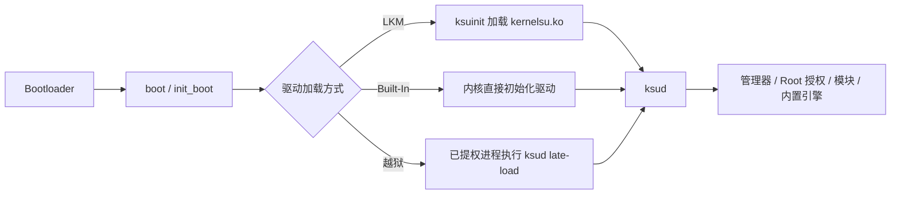

# 基础概念

<Badge text="新手先读" type="warning" /> <Badge text="概念不等于操作" type="tip" />

FinaSU 涉及内核、启动镜像、Root 授权和模块注入。很多故障来自把不同层的东西混在一起：APK 不是驱动，LKM 不是普通模块，Built-In 也不是另一种“模式开关”。本页先把这些概念分开，再给出操作文章的入口。

::: tip 已经有 Root？

如果你已经用 Magisk、KernelSU 或其分支、APatch/KernelPatch 获得 Root，先看对应的切换文章：

- [从 Magisk 切换](/guide/switch/magisk/)
- [从 KernelSU 切换](/guide/switch/kernelsu/)
- [从 APatch 切换](/guide/switch/apatch/)

:::

## 一张图看懂 FinaSU



无论哪种方式，最终都是让内核里的 FinaSU 驱动开始工作，再由 `ksud` 和管理器提供授权、模块与引擎管理。区别在于驱动从哪里来、什么时候加载、重启后是否还在。

## 启动链

Android 开机时，Bootloader 先验证并加载启动镜像，然后启动 Linux 内核和第一个用户态程序 `init`。FinaSU 的持久安装必须在这个早期阶段介入，所以会修改启动链中的某个镜像。

::: table 启动分区

| 分区 | 主要内容 | 与 FinaSU 的关系 |
| --- | --- | --- |
| `boot` | Linux 内核；部分设备也包含通用 ramdisk | Built-In 替换内核；没有 `init_boot` 时 LKM 修改 ramdisk |
| `init_boot` | 部分新设备的独立通用 ramdisk | 有它且 KMI 不是 `android12-*` 时，LKM 通常修改这里 |
| `vendor_boot` | 厂商启动资源和 ramdisk | 少数设备使用；只有管理器明确显示时才选 |

:::

::: warning `init_boot` 里没有 Linux 内核

`init_boot` 是 ramdisk 分区，不是内核分区。不要因为它名字里有 “boot” 就把完整内核刷进去，也不要把 `boot.img` 和 `init_boot.img` 互换。

:::

### Bootloader 与 AVB

Bootloader 是设备最早的引导程序。很多设备在解锁后才允许写入自定义启动镜像。AVB（Android Verified Boot）会校验启动链；在锁定 Bootloader 上刷写可能破坏验证，导致无法开机。

越狱模式不修改启动分区，因此可能在没有解锁 Bootloader 的设备上使用；LKM 和 Built-In 则需要解锁并能恢复启动镜像。

### A/B 槽位

A/B 设备有两套系统槽位，常见后缀是 `_a` 和 `_b`。OTA 通常写入未使用的槽位，重启后切换。刷写前要确认当前槽位，不要把 `_a` 的镜像写到 `_b`，也不要在未确认时同时处理两个槽位。

## 驱动与用户态

:::: field-group

::: field `kernelsu.ko`
@type `LKM / 越狱`
@default `内核驱动`
FinaSU 的 Root 驱动。LKM 把它放进 ramdisk，越狱模式在启动后加载它；Built-In 则把它编进内核，不再单独存在。
:::

::: field `ksuinit`
@type `LKM`
@default `启动包装器`
安装在 ramdisk 中的早期启动程序，负责在 `init` 阶段加载 `kernelsu.ko`。
:::

::: field `ksud`
@type `用户态`
@default `/data/adb/ksud`
用户态命令行工具，由启动事件或管理器按子命令调用，处理模块、授权、内置引擎和启动脚本。
:::

::: field 管理器 APK
@type `用户态`
@default `官方签名`
提供界面、授权记录、安装更新和日志。被内核信任的管理器才能管理驱动；只安装 APK 不等于获得 Root。
:::

::: field supercall
@type `内核接口`
@default `ioctl`
内核向用户态提供的管理接口，管理器与 `ksud` 通过它读取状态、管理授权和触发功能。
:::

::::

::: important LKM 不是“内核模块页面”里的普通模块

文档里的 LKM 专指 FinaSU 的 Root 驱动 `kernelsu.ko`。管理器“模块”页面里的条目是普通模块或内核模块管理项，与“用什么方式获得 Root”不是同一件事。

:::

::: info `sulogd` 是例外

`ksud` 本体是命令行工具，按子命令执行；只有隐藏的 `sulogd` 子命令会以守护进程方式常驻，用于读取 SU 日志。不要把 `sulogd` 的常驻行为当成整个 `ksud` 的运行方式。

:::

## 三种运行方式

::: table LKM、Built-In 与越狱

| 项目 | LKM | Built-In | 越狱模式 |
| --- | --- | --- | --- |
| 驱动位置 | ramdisk | 内核镜像 | 启动后加载 |
| 是否修改启动分区 | 是 | 是 | 否 |
| 重启后保留 Root | 是 | 是 | 否 |
| 通常修改的分区 | `init_boot` 或 `boot` | `boot` | 不修改 |
| 适合场景 | 大多数用户 | 自行编译内核、源码集成 SUSFS | 无法或不想刷写的设备 |

:::

详细流程见[安装与刷写](/guide/install/)的分类菜单。

::: warning Built-In 不等于 GKI

Built-In 描述的是“驱动已经编入内核”，GKI 描述的是“通用内核与厂商模块的拆分方式”。两者不是同一个概念，Built-In 也可能运行在非 GKI 内核上。

:::

## KMI、GKI、ABI 与 UAPI

::: table 四个容易混淆的术语

| 术语 | 含义 | 实际影响 |
| --- | --- | --- |
| **KMI** | Kernel Module Interface，内核模块接口版本，例如 `android15-6.6` | LKM 和 NoMount 必须与设备 KMI 完全匹配 |
| **GKI** | Generic Kernel Image，通用内核与厂商模块拆分 | GKI 设备更容易通过 LKM 加载驱动，但 KMI 仍要匹配 |
| **ABI** | CPU 架构与调用约定，例如 arm64、x86_64 | 驱动和 `ksud` 必须匹配设备架构 |
| **UAPI** | 内核与用户态之间的稳定接口版本 | 管理器与内核 UAPI 不一致时会提示更新或功能不兼容 |

:::

官方预构建 LKM 支持 `arm64-v8a` 和 `x86_64`；riscv64 目前没有 LKM 驱动资产，Sui 也没有 riscv64 载荷。完整 KMI 列表见[快速开始](/guide/get-started/)。

## Root 授权模型

FinaSU 的 Root 决定发生在内核侧，管理器只是发起请求和展示结果。

### 白名单

内核维护允许或拒绝 Root 的 UID 列表，并持久化到 `/data/adb/ksu/.allowlist`。白名单记录不等于给某个应用永久开放所有能力；具体行为还会受 App Profile 影响。

### App Profile

App Profile 是每个应用或 UID 的策略，分为：

- **Root Profile**：允许 Root 时使用的 UID、GID、附加组、能力、SELinux 域、命名空间和 `no_new_privs` 等设置。
- **Non-root Profile**：应用未获得 Root 时的行为，例如是否卸载模块。

App Profile 可以使用默认策略或模板，也可以按应用单独配置。不要把它和“应用本身是否请求 Root”混为一谈。

### 管理器身份

内核默认只信任构建时写入的管理器签名。debug、自行编译或使用其他密钥签名的管理器不会自动获得管理权限。需要其他签名时，可以使用[动态管理器](/manager/dynamic-manager/)，但这会扩大内核信任范围。

::: danger 不要随便信任任意管理器

“允许任意应用作为动态管理器”是实验选项。被信任的管理器拥有管理内核 Root 的能力，只应对自己构建并校验过的 APK 使用。

:::

### su 兼容

FinaSU 保留 `su` 兼容层：符合条件的应用执行 `/system/bin/su` 时，会被导向 `ksud` 的授权流程。它方便旧应用继续工作，但不会绕过白名单和 App Profile。

## 模块系统

普通模块通常是带 `module.prop` 的 ZIP。`ksud` 解包到 `/data/adb/modules/<id>/`，并在启动阶段执行模块脚本。

```file-tree title="模块与 FinaSU 数据目录"
/data/adb
├── ksud                      # 用户态命令行工具（文件）
├── ksu/
│   ├── .allowlist            # 授权状态
│   ├── .dynamic_manager      # 管理器登记
│   └── profile/              # App Profile
├── modules/
│   └── <模块 ID>/
│       ├── module.prop       # 模块元数据
│       ├── post-fs-data.sh
│       ├── post-mount.sh
│       ├── service.sh
│       ├── boot-completed.sh
│       ├── disable           # 禁用标记
│       ├── remove            # 待移除标记
│       └── skip_mount        # 跳过挂载标记
├── modules_update/           # 等待合并的模块更新
└── metamodule -> /data/adb/modules/<模块 ID>
```

::: table 模块标记

| 标记 | 作用 |
| --- | --- |
| `disable` | 禁用模块，但保留文件 |
| `remove` | 下次启动时删除模块 |
| `skip_mount` | 模块脚本仍可运行，但跳过文件挂载 |

:::

### 元模块

元模块是在 `module.prop` 中声明 `metamodule=1` 的特殊模块。它接管普通模块的挂载或安装钩子，同时只能有一个活动元模块。FinaSU 默认不要求安装元模块。

## 挂载、注入与内核能力

::: table FinaSU 的模块与注入组件

| 组件 | 作用 | 依赖 |
| --- | --- | --- |
| [Folk Mount](/builtin/folk-mount/) | 选择挂载提供者并注入模块，可委托元模块 | FinaSU 驱动 |
| [NoMount](/builtin/nomount/) | 通过内核 VFS 路径重定向注入文件，不建立传统挂载 | 匹配 KMI 的 NoMount 模块 |
| [FolkZygisk](/builtin/folkzygisk/) | 内置 Zygisk 引擎，在 Zygote 启动阶段注入 | 启用并重启 |
| [Sui](/builtin/sui/) | Shizuku API 后端 | FinaSU 驱动与 Zygisk |
| [SUSFS](/builtin/susfs/) | 隐藏与路径伪装能力接口 | 内核源码集成或已加载 SUSFS-LKM |

:::

FolkZygisk 在检测到外部 Zygisk 提供者时会让位；Sui、LSPosed 等依赖 Zygisk 的功能需要至少一个可用提供者。SUSFS 不是 FinaSU 内置的内核实现；它需要内核源码集成版或已加载的 SUSFS-LKM。

## SELinux 与隐藏

SELinux 是 Android 的强制访问控制机制。Root 不代表关闭 SELinux；FinaSU 会为授权进程建立相应的域和权限。

::: warning 不要长期关闭 SELinux

把系统改成 Permissive 会降低整体安全性。越狱模式可能依赖特定 SELinux 状态，但这不代表应该永久关闭保护。

:::

隐藏 Root 通常需要按应用组合使用 App Profile 的模块卸载策略、NoMount、SELinux 隐藏和 AVC 日志处理。没有对所有检测都有效的单一开关。

## 常见误区

::: collapse accordion

- **安装了管理器 APK 就等于 Root**

  不是。APK 只提供界面和管理能力；驱动没有加载时，管理器也无法授予真正的 Root。

- **LKM 就是管理器里的普通模块**

  不是。LKM 指 Root 驱动 `kernelsu.ko`；普通模块是另一套模块系统。

- **Built-In 就是 GKI 模式**

  不是。Built-In 表示驱动编进内核；GKI 是内核与厂商模块的布局方式。

- **`init_boot` 是内核分区**

  不是。`init_boot` 主要存放 ramdisk；Linux 内核通常在 `boot`。

- **解锁 Bootloader 就一定安全**

  不是。解锁只是允许刷写；错误的镜像、分区或 KMI 仍会导致无法开机。

- **Zygisk 等于 Root**

  不是。Zygisk 是注入机制，需要可用的 Root 或内核能力配合；它本身不提供 Root。

- **FinaSU 自带 SUSFS**

  不是。SUSFS 需要内核源码集成版或单独加载 SUSFS-LKM；FinaSU 只提供配置界面。

- **Magisk 模块在 FinaSU 下一定可用**

  不一定。模块结构可能兼容，但依赖 Magisk 专有接口或挂载方式的脚本可能失败。

:::

## 术语速查

::: table 常用术语

| 术语 | 一句话解释 |
| --- | --- |
| Root | 以最高权限执行系统操作；FinaSU 由内核裁决 |
| KernelSU 系 | 由内核驱动提供 Root、管理器负责授权的一类方案 |
| LKM | 可加载内核模块；本文特指 FinaSU 的 Root 驱动 |
| Built-In | 驱动直接编入 Linux 内核 |
| 越狱 / late load | 系统启动后临时加载驱动，重启失效 |
| ramdisk | 启动镜像中的早期用户态文件系统 |
| KMI | 内核模块接口版本 |
| GKI | Android 通用内核镜像与厂商模块拆分 |
| UAPI | 内核与用户态之间的接口版本 |
| supercall | 内核向管理器/`ksud` 提供的管理接口 |
| allowlist | 内核侧 Root 白名单 |
| App Profile | 按应用或 UID 配置的 Root / 非 Root 策略 |
| `ksud` | 用户态命令行工具，按子命令执行 |
| 元模块 | 接管模块挂载或安装钩子的特殊模块 |
| SELinux | Android 强制访问控制 |
| AVB | Android 启动验证 |

:::

## 快速问答

::: chat title="基础概念问答"
{用户}
我需要先理解这些概念才能安装吗？

{.}
至少要知道三种运行方式和分区区别。实际安装按对应文章操作即可，不必先读内核源码。

{用户}
LKM 和 Built-In 哪个更安全？

{.}
不是简单的安全问题。LKM 更容易安装和恢复；Built-In 需要自行编译内核，适合明确需要内置驱动的用户。

{用户}
KMI 和 Android 版本是一回事吗？

{.}
不是。KMI 描述内核模块接口，必须精确匹配；Android 版本只能作为参考。

{用户}
为什么我的应用有 Root，但另一个应用没有？

{.}
Root 按 UID 和 App Profile 管理。检查白名单、默认策略、Root Profile 和该应用的授权记录。

{用户}
越狱和 LKM 是两种驱动吗？

{.}
不是。它们可以加载同一份 `kernelsu.ko`，区别是加载时机和是否修改启动分区。
:::

## 相关页面

- [安装与刷写](/guide/install/)
- [LKM 安装](/guide/install/lkm/)
- [Built-In 安装](/guide/install/built-in/)
- [越狱模式安装](/guide/install/jailbreak/)
- [更新 FinaSU](/guide/update/)
- [常见问题](/guide/faq/)
- [动态管理器](/manager/dynamic-manager/)
- [救砖](/guide/rescue-bootloop/)

*[LKM]: Loadable Kernel Module，可加载内核模块
*[KMI]: Kernel Module Interface，Android 内核模块接口版本
*[GKI]: Generic Kernel Image，Android 通用内核镜像
*[UAPI]: 内核与用户态之间的稳定接口
*[AVB]: Android Verified Boot，Android 启动验证
*[SELinux]: Android 的强制访问控制机制
*[OTA]: Over-The-Air，系统在线更新
