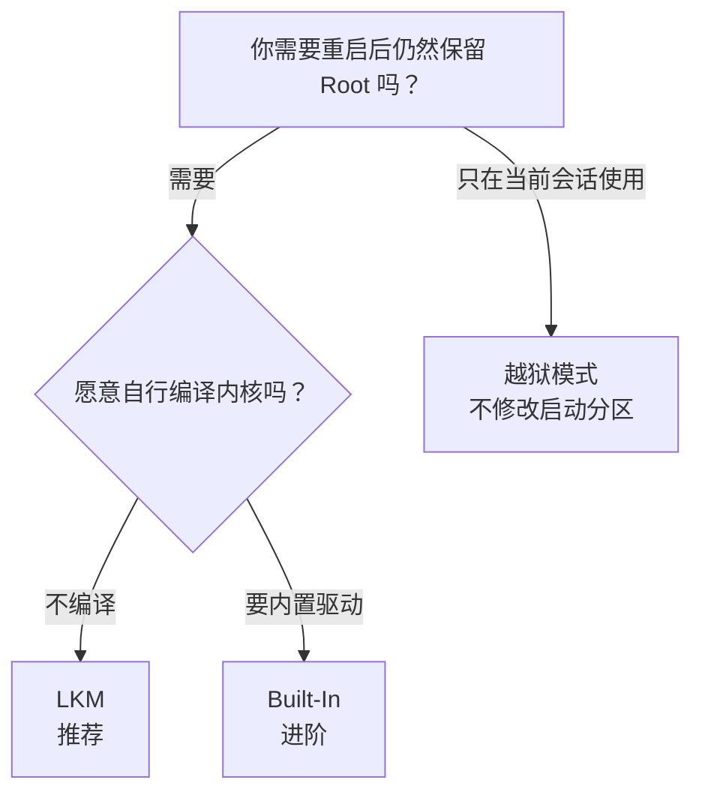

# 安装与刷写

<Badge text="先选方案" type="warning" /> <Badge text="不要混用 Root" type="danger" />

安装 FinaSU 管理器 APK 不等于安装驱动。持久 Root 必须写入启动链：LKM 修改 ramdisk，Built-In 修改内核，越狱模式则在系统启动后加载驱动。先选对方案，再准备镜像和刷写工具。

::: danger 动手前先准备救砖

开始前请完整阅读[救砖](/guide/rescue-bootloop/)。至少保留与当前设备型号、系统版本和槽位完全匹配的原厂启动镜像，并确认电脑可以使用 `fastboot` 或对应的官方刷写工具。不要等到刷坏后才寻找镜像。

:::

::: tip 已经有 Root？

如果设备当前已经由 Magisk、KernelSU 或其分支、APatch/KernelPatch 提供 Root，不要直接在旧启动镜像上叠加 FinaSU。先看对应的切换文章：

- [从 Magisk 切换](/guide/switch/magisk/)
- [从 KernelSU 切换](/guide/switch/kernelsu/)
- [从 APatch 切换](/guide/switch/apatch/)

:::

## 分类菜单

::: table 选择你的安装方案

| 分类 | 解决什么问题 | 是否修改启动分区 | 适合谁 |
| --- | --- | --- | --- |
| **方案概览** | 先判断分区、风险和安装路线 | 否 | 第一次安装 |
| [LKM](/guide/install/lkm/) | 把 `kernelsu.ko` 放进 ramdisk | 是，通常是 `boot` 或 `init_boot` | 大多数用户 |
| [Built-In](/guide/install/built-in/) | 把驱动直接编入 Linux 内核 | 是，通常是 `boot` | 自行编译内核的用户 |
| [越狱模式](/guide/install/jailbreak/) | 启动后加载驱动，不修改启动分区 | 否 | 无法或不想修改启动分区的设备 |

:::

::: warning 三种方案只能选一种

不要在同一个系统里同时保留 LKM、内置驱动和其他 Root 方案。切换方案前先移除旧驱动和启动链修改。

:::

::: tip 术语约定

本文统一用“刷回”表示把**原厂镜像**恢复到分区，用“刷入”表示把**修补后或新构建的镜像**写入分区。看到“刷回原厂 boot”时是恢复；看到“刷入修补后的镜像”时是安装。

:::

## 先认清启动分区

Android 启动时，Bootloader 先加载启动镜像，再启动 Linux 内核和第一个用户态程序 `init`。FinaSU 必须在很早的阶段介入，因此持久安装会写入启动链中的一个镜像。

::: table 启动分区

| 分区 | 主要内容 | 与 FinaSU 的关系 |
| --- | --- | --- |
| `boot` | Linux 内核；部分设备也包含通用 ramdisk | Built-In 修改内核；没有 `init_boot` 时 LKM 修改这里的 ramdisk |
| `init_boot` | 部分新设备的独立通用 ramdisk | 有它且 KMI 不是 `android12-*` 时，LKM 通常修改这里 |
| `vendor_boot` | 厂商启动资源和 ramdisk | 少数设备使用；以管理器显示为准 |

:::

一句话记法：==Built-In 换内核，LKM 改 ramdisk，越狱模式不写启动分区==。

::: important `init_boot` 不是每台设备都有

`init_boot` 常见于出厂搭载 Android 13 及以上的部分 GKI 设备。设备没有这个分区是正常的，不要为了“补全分区”凭空刷入一个 `init_boot`。最终以管理器识别到的分区为准。

:::

## 怎么选

- **大多数用户选 LKM**：它不替换 Linux 内核，安装和恢复都更直接。
- **需要内置驱动、SUSFS 或自行维护内核时选 Built-In**：必须重新编译完整内核。
- **无法或不想修改启动分区时选越狱模式**：重启后会丢失 Root，不是持久安装。

## 安装前准备

1. 确认设备型号、Android 构建、内核版本和 KMI。相邻的系统版本不能代替 KMI 匹配。
2. 准备与当前系统完全匹配的完整 OTA 或 factory 固件，并提前找出其中的 `boot`、`init_boot` 或 `vendor_boot` 镜像。
3. 解锁 Bootloader，安装可用的 Android USB 驱动，并确认电脑能执行 `fastboot devices`。
4. 先移除 Magisk、KernelSU 或其分支、APatch/KernelPatch 等旧 Root，避免多个方案同时接管启动链。
5. 保持足够电量，安装和首次启动期间不要断电，也不要同时执行系统 OTA。
6. 开始前再次阅读[救砖](/guide/rescue-bootloop/)，确认自己知道需要恢复哪个分区、哪个槽位。

## 下一步

- [LKM 安装](/guide/install/lkm/)：选择文件、下载镜像、直接安装、未使用槽位、本地 LKM 与 AnyKernel3。
- [Built-In 安装](/guide/install/built-in/)：清理旧集成、编译内核、刷入完整内核。
- [越狱模式安装](/guide/install/jailbreak/)：CVE 提权、动态提权工具与首页 Jailbreak 的边界。
- 从其他方案切换：[Magisk](/guide/switch/magisk/)、[KernelSU](/guide/switch/kernelsu/)、[APatch](/guide/switch/apatch/)。

*[LKM]: Loadable Kernel Module，可加载内核模块
*[KMI]: Kernel Module Interface，Android 内核模块接口版本
*[GKI]: Generic Kernel Image，Android 通用内核镜像
*[OTA]: Over-The-Air，系统在线更新
*[AVB]: Android Verified Boot，Android 启动验证
