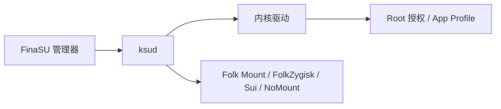

**欢迎使用 FinaSU！**

==FinaSU== 是一款基于 [KernelSU](https://github.com/tiann/KernelSU) 的内核级 ROOT 管理器，保留内核授权、App Profile 和模块体系，并把常用引擎、主题与日常管理集中到同一套界面。

FinaSU 不要求所有用户接受同一种界面。无论你喜欢简约布局、动态背景，还是需要 Zygisk、Sui、模块挂载和系统级管理，都可以在同一套管理器中完成配置。

## 运行结构

管理器负责操作，`ksud` 负责用户态执行，最终授权与策略由内核驱动裁决。

## 核心特性

<CardGrid :cols="{ sm: 1, md: 2, lg: 2 }">
  <Card title="内核级 Root" icon="ri:shield-check-line">
    <ul>
      <li><strong>Root 由内核裁决</strong>：<code>su</code>、白名单和 App Profile 不依赖管理器伪造。</li>
      <li><strong>三种安装方式</strong>：LKM 推荐，Built-In 进阶，越狱模式仅在当前启动会话有效。</li>
    </ul>
  </Card>
  <Card title="内置能力" icon="ri:apps-2-line">
    <ul>
      <li>Folk Mount、FolkZygisk、Sui 和 NoMount 随 FinaSU 发布，由 <code>ksud</code> 管理。</li>
      <li>Sui 依赖 Zygisk；外部兼容提供者也可使用，但 FinaSU 无法验证其注入结果。</li>
    </ul>
  </Card>
  <Card title="高度自定义" icon="ri:palette-line">
    <ul>
      <li>5 套首页布局、15 组主题色，以及图片、视频、字体、图标、音乐、音效和振动。</li>
      <li>支持 <code>.fpt</code> 主题导入导出与在线主题商店。</li>
    </ul>
  </Card>
  <Card title="模块与维护" icon="ri:tools-line">
    <ul>
      <li>支持 systemless 模块、WebUI、Metamodule 和 Lua 插件，并可从多个模块源获取。</li>
      <li>可备份授权、模块和启动分区；SUSFS 需要外部内核集成或匹配的 SUSFS-LKM。</li>
    </ul>
  </Card>
</CardGrid>

如果能给我一个 star，那将是对我莫大的鼓励。

<RepoCard repo="LyraVoid/FinaSU" />

::: tip
如果您想交流 FinaSU，请加入：

- Telegram: [FinaSU](https://t.me/FinaSU)

:::
