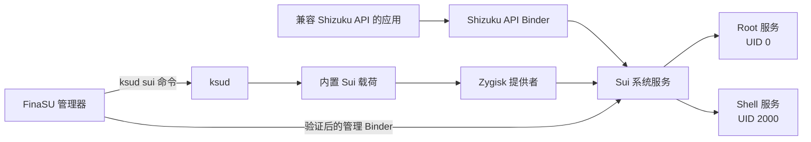

# Sui 服务

<Badge text="重磅功能" type="danger" /> <Badge text="需要 Zygisk" type="warning" />

==Sui== 是 FinaSU 内置的 Shizuku API 后端。它让已经支持 Shizuku API 的应用获得受管理的 **root** 或 **shell** 执行身份，因此用户不需要再单独安装 Shizuku 管理器。

::: tip 不需要安装 Shizuku 本体

FinaSU 已经把 Sui 服务端、守护进程和权限管理入口打包进当前发布流程。兼容应用连接的是 Sui，不需要同时运行官方 Shizuku 应用。

:::

::: warning Sui 不是另一种无条件 Root

Sui 只向明确请求 Shizuku 权限的应用提供接口。应用不会因为设备安装了 FinaSU 就自动获得 Root；每一次访问仍受应用 UID、权限模式、默认策略和隐藏规则约束。

:::

## 适用范围

Sui 面向遵循 Shizuku API 的应用，而不是让任意应用自动提权。应用需要先发现并连接 Sui 的 Binder 服务，再请求权限。

::: table Sui 能力边界

| 场景 | Sui 提供的能力 | 不包含的内容 |
| --- | --- | --- |
| 兼容 Shizuku API 的应用 | 通过 Sui 执行受管理的系统 API 调用 | 不自动修改应用逻辑 |
| Root 模式 | 请求获准后以内核认可的 root 身份执行 | 不等于给应用永久写入 Root 白名单 |
| Shell 模式 | 以 Android shell 身份执行，权限低于 root | 不能访问 root 才能访问的数据 |
| 权限管理 | 按应用允许、拒绝、隐藏或询问 | 不能替代 FinaSU 的超级用户授权 |
| Zygisk 集成 | 通过 Zygisk 提供者注入 Sui 服务 | 不与第二个 Sui 实例共存 |

:::

## 运行条件

Sui 同时依赖 FinaSU 驱动、Zygisk 提供者、内置载荷和管理通道。缺少任何一项都可能只显示“未启用”“不可用”或“状态异常”。

:::: field-group

::: field FinaSU 驱动
@type `required`
@default `LKM 或 Built-In`
设备必须已经获得可用的 FinaSU Root，`ksud` 需要能够执行 Sui 生命周期命令。
:::

::: field Zygisk
@type `required`
@default `内置或外部提供者`
Sui 需要可用的 Zygisk 后端。可以使用内置 [FolkZygisk](/builtin/folkzygisk/)，也可以使用其他兼容的 Zygisk 提供者，但只能保留一个活动实现。使用外部提供者时 Sui 可以正常运行，只是 FinaSU 无法验证其注入结果。
:::

::: field 架构
@type `required`
官方发布需要在 `ksud` 中携带对应 ABI 的 Sui 载荷。当前流程不提供 riscv64 的 Sui 载荷。
:::

::: field 管理器身份
@type `required`
@default `自动登记`
只有受信任的 FinaSU 管理器可以读取和修改 Sui 权限。管理器会在服务启动后登记包名、UID 和签名信息。
:::

::: field 通知权限
@type `optional`
Sui 在应用处于后台时通过通知提示授权请求。Android 13 及以上拒绝通知权限不会阻止 Sui 工作，但可能看不到后台请求提醒。
:::

::::

## 快速启用

::: steps

1. **确认 Zygisk 后端**

   检查当前使用的 Zygisk 提供者，确认引擎已启用且没有启动保护拦截。内置 **FolkZygisk** 和其他兼容提供者都可以作为 Sui 的后端，但只能保留一个活动实现。

2. **启用 Sui**

   进入 **设置 → 内置能力 → Sui**，确认状态卡显示的 Zygisk 和载荷信息，再打开开关并确认启用。

3. **重启设备**

   管理器会安装 Sui 载荷，但 Zygisk 只能在启动阶段注入 Zygote。首次启用、载荷更新或切换 Zygisk 提供者后，通常需要重启才能进入“运行中”状态。

4. **确认服务状态**

   重启后回到 Sui 页面。只有显示 **运行中** 时，才表示 Zygisk 注入、root 服务、shell 服务和管理通道都通过了当前检查。

5. **配置应用权限**

   点击 **管理 Sui 权限**。应用首次请求时也可以直接在管理器的授权对话框中处理。

:::

::: important 先看状态，再看应用

应用显示“Shizuku 不可用”时，先检查 Sui 自身是否为 **运行中**。Sui 未运行时，重新安装兼容应用不会解决问题。

:::

## 启动生命周期

Sui 不是在管理器界面内常驻运行。它需要经过载荷发布、系统启动、Zygisk 注入、守护进程拉起和管理器登记。

::: timeline Sui 从启用至可用

- 发布载荷
  time=步骤 1 type=info

  `ksud sui enable` 校验内置载荷文件哈希，将内容发布到 `finasu-sui` 模块目录，并登记“下次启动应启用 Sui”。

- Zygisk 注入
  time=步骤 2 type=tip

  下一次启动时，Zygisk 提供者把 Sui 代码注入系统进程。使用内置 FolkZygisk 时，FinaSU 可以核对注入状态。

- 启动守护进程
  time=步骤 3 type=success

  Sui 需要同时有两个服务：root 服务和 shell 服务。两者都在运行、且本次启动标记匹配后，状态才会进入“运行中”。

- 登记管理器
  time=步骤 4 type=info

  root 服务读取 FinaSU 管理器的 UID 与证书，并建立受验证的管理通道。权限列表和全局设置都通过该通道读写。

- 接受应用请求
  time=步骤 5 type=tip

  兼容应用连接 Shizuku API 并请求权限。管理器弹出授权选项，或由已经配置的默认规则直接处理。

:::

### 数据流



图中的两条服务路径不是两套独立产品。它们都服务于同一个 Sui，只是根据应用权限决定以 root 还是 shell 身份执行。

## 状态说明

管理器的开关表示“用户是否希望启用 Sui”，运行状态则表示 FinaSU 对载荷、Zygisk、守护进程和启动标记进行核对后的结果。两者不一致时，以运行状态为准。

::: table Sui 状态含义

| 界面状态 | 含义 | 建议操作 |
| --- | --- | --- |
| **未启用** | 当前没有要求启动 Sui，或载荷尚未安装 | 打开开关并确认 |
| **已启用，等待重启生效** | 载荷已安装，但当前会话尚未完成注入或启动登记 | 重启设备后复查 |
| **运行中** | 使用内置 FolkZygisk，注入与两个守护进程均已确认 | 可以管理应用权限 |
| **第三方注入，无法验证** | 外部 Zygisk 提供者正在工作；Sui 服务进程已出现，但 FinaSU 无法验证注入链 | 在兼容应用中测试连接；失败时检查外部提供者的启动日志 |
| **不可用** | Zygisk 未启用、引擎缺失、启动保护或注入检查失败 | 查看状态卡的依赖与注入原因 |
| **状态异常** | 存在冲突 Sui、载荷损坏、模块被禁用或外部修改 | 展开诊断；必要时修复载荷 |

:::

::: collapse accordion

- **Zygisk 未启用**

  进入 FolkZygisk 页面启用引擎并重启。Sui 不会在 Zygisk 关闭时强行注入。

- **Zygisk 引擎不可用**

  查看显示在括号中的具体原因。先修复 FolkZygisk 载荷或引擎，再启用 Sui。

- **Zygisk 启动保护已锁定**

  这表示启动保护阻止了本会话的 Zygisk 注入。先处理 FolkZygisk 的启动保护状态，再重启复查。

- **Zygisk 注入失败**

  检查 Android 版本、Zygisk 提供者和最近一次启动诊断。不要通过反复开关 Sui 代替重启。

- **检测到其他 Sui**

  系统里存在冲突目录 `/data/adb/modules/zygisk-sui` 或其更新目录。移除旧 Sui，只保留 FinaSU 的 `finasu-sui`，再重启。

- **载荷缺失或版本过旧**

  使用 **修复载荷**。管理器会从当前 `ksud` 重新发布内置文件，并校验载荷清单中的哈希。

:::

## 权限模型

Sui 权限以应用 UID 为单位保存。管理器只列出拥有启动入口、且 UID 不低于 `10000` 的普通应用，因此 root、shell 和系统 UID 不会出现在应用权限列表中。

### 应用权限

::: table Sui 应用权限模式

| 模式 | 行为 | 适用情况 |
| --- | --- | --- |
| **默认** | 没有单独规则，继承“默认权限” | 希望由全局策略决定 |
| **允许 root** | 应用通过 Sui 以 root 身份执行 | 只用于完全信任、明确需要 root 的应用 |
| **允许 shell** | 应用通过 Sui 以 shell 身份执行 | 需要系统 API、但不需要完整 root |
| **拒绝** | 明确拒绝该应用 | 不再询问，适合确定不需要 Sui 的应用 |
| **隐藏 Sui** | 向该应用隐藏 Sui 服务 | 不希望该应用发现或使用 Sui |

:::

### 默认权限

“默认权限”只作用于没有单独规则的应用，可以选择：

- **询问**：首次请求时弹出授权对话框。
- **允许 root**：未配置应用直接以 root 执行。
- **允许 shell**：未配置应用直接以 shell 执行。
- **拒绝**：未配置应用不获得服务。
- **隐藏 Sui**：未配置应用看不到 Sui。

::: danger 谨慎设置全局默认 Root

默认值设为 **允许 root** 会让所有符合条件、且没有单独规则的应用直接获得 root 执行能力。除非你清楚设备上每个兼容应用的来源与行为，否则保留 **询问** 或使用 **拒绝**。

:::

### 授权询问

应用请求权限时，管理器提供四种选择：

| 选择 | 是否授权 | 执行身份 | 是否记住 |
| --- | --- | --- | --- |
| **以 root 允许** | 是 | root | 是 |
| **以 shell 允许** | 是 | shell | 是 |
| **仅允许一次** | 是 | root | 否 |
| **拒绝** | 否 | — | 是 |

直接关闭授权窗口只会放弃当前请求，不会自动写入“拒绝”规则。下次请求时仍可能再次询问。

如果应用在后台发起请求，Android 可能阻止管理器直接弹出界面。授予通知权限后，FinaSU 会发送请求通知；未授予时，请求仍可能等待在管理器内，但没有后台提醒。

## 权限管理页

点击 **管理 Sui 权限** 后可以使用：

- **搜索**：按应用名称或包名筛选。
- **只显示 Shizuku 应用**：只保留在清单中声明 Shizuku 权限，或已经显式配置 root/shell 的应用。
- **默认权限**：修改无单独规则应用的处理方式。
- **对 Sui 隐藏的应用**：显示当前被隐藏的应用数量。
- **应用权限列表**：点击应用，单独设置默认、root、shell、拒绝或隐藏。

::: warning “隐藏 Sui”不是通用反检测

隐藏只改变 Sui 对该应用的可见性和服务行为，不会自动隐藏 FinaSU Root、模块、挂载或其他内核特征，也不能代替专门的隐藏配置。

:::

## 高级选项

权限管理页右上角菜单还包含 Sui 自身的兼容与调试选项。

::: table Sui 高级选项

| 选项 | 作用 | 生效时机 | 建议 |
| --- | --- | --- | --- |
| **旧版 Shizuku 兼容** | 响应旧客户端通过 `rikka.shizuku.intent.action.REQUEST_BINDER` 发起的 Binder 请求，且仅在官方 Shizuku 应用未安装或未在该 UID 启用时介入 | 保存后 | 只有旧应用无法连接时开启 |
| **阻止 Shell 提权（KSU）** | 阻止 Sui 的 shell 侧进程经 KernelSU 再次提权到 root | 重启后 | 需要严格限制 shell 模式时开启；内核不支持时自动回退为关闭 |
| **ADB Root** | 配置 Sui 的 ADB Root 支持：关闭、下次启动仅一次、始终开启 | 下次启动 | 仅用于明确需要的调试场景 |

:::

### ADB Root 的风险

ADB Root 会改变调试守护进程的运行方式。开启后，具备本机 ADB 访问条件的人可能获得比普通 shell 更高的能力。不要在公共电脑、不可信 USB 连接或不需要调试时保持开启。

::: danger

“始终开启”会持续改变 ADB 调试行为。完成调试后切回 **关闭** 并重启，不要把它当作普通 Root 权限开关。

:::

## 启用、停用与修复

::: code-tabs

@tab:active 状态

```sh
/data/adb/ksud sui status --json
```

@tab 启用

```sh
/data/adb/ksud sui enable
```

@tab 停用

```sh
/data/adb/ksud sui disable
```

@tab 修复

```sh
/data/adb/ksud sui repair
```

:::

普通用户应优先使用管理器。这些命令只用于理解管理器行为或在排错时读取状态。

- **启用**：校验并发布内置载荷，登记启用状态，应用 SELinux 规则并尝试启动看护进程。通常要重启后才能完成 Zygisk 注入。
- **停用**：停止 Sui 守护进程，并在模块目录写入禁用标记。已经注入当前 Zygote 的代码不会只靠停用立刻消失，重启后才完全清除。
- **修复**：从当前 `ksud` 重新发布载荷，校验文件清单和哈希。修复载荷不会自动修复不兼容的 Zygisk 提供者。

### 升级后提示载荷过旧

FinaSU 更新可能携带新的 Sui 版本。状态卡提示“不完整或版本过旧”时：

::: steps

1. 确认 FinaSU 更新已完整安装。
2. 在 Sui 诊断区点击 **修复载荷**。
3. 等待修复完成并重启设备。
4. 回到 Sui 页面确认载荷版本和运行状态。

:::

## 存储结构

Sui 的模块载荷、运行状态、日志和管理器身份分开保存。不要手动修改状态文件来强制切换权限。

::: file-tree title="Sui 主要目录"

- /data/adb/modules/finasu-sui
  - module.prop  # 内置模块信息
  - sui.dex
  - sui.apk
  - bin/sui  # Sui 原生入口
  - zygisk  # 按 ABI 提供的 Zygisk 库
  - sepolicy.rule  # 安装时解析设备 SELinux 上下文
  - disable  # 存在时禁止下一次启动
- /data/adb/ksu/sui
  - state.json  # 启用意图、载荷版本和哈希
  - manager.json  # 受信任管理器的 UID 与证书信息
  - boot  # 当前启动标记
  - daemon.log  # Sui 守护进程日志
  - watchdog.lock  # 防止重复看护进程
- /data/adb/sui
  - 权限数据库
  - shell 配置
  - 兼容与调试标记

:::

::: info 为什么不直接编辑 `state.json`

`state.json`、`manager.json` 和启动标记是 FinaSU 的内部控制数据。手动修改可能与模块禁用标记、Sui 权限数据库或当前启动状态不一致，应使用管理器或 `ksud sui` 命令。

:::

## 兼容应用与开发者

支持 Shizuku API 的应用不需要识别 FinaSU。应用只需要：

1. 连接可用的 Shizuku API Binder。
2. 检查自身权限是否已授予。
3. 未授予时发起请求，并处理用户选择。
4. 在 Binder 存活期间调用系统 API 或远程服务。

Sui 会向获准应用提供 root 或 shell 身份。应用仍应按照最小权限原则设计：能够使用 shell 完成的操作，不应无条件请求 root。

::: important 多进程应用

每个需要访问 Shizuku API 的进程都必须完成 Sui 初始化并建立 Binder。只在主进程初始化，不能自动让其他隔离进程获得服务。

:::

开发者文档：

- [Shizuku API 使用指南](https://github.com/RikkaApps/Shizuku-API)
- [FinaSU 内置能力设置](/setting/builtin/)
- [FinaSU 日志与反馈](/troubleshoot/logs/)

## 常见问题

::: chat title="Sui 使用问答"
{用户}
还需要安装 Shizuku 吗？

{.}
不需要。FinaSU 已内置 Sui 服务端。只要 Sui 显示“运行中”，支持 Shizuku API 的应用就可以请求权限。

{用户}
为什么打开开关后不能立刻使用？

{.}
首次启用要把载荷加入 Zygisk 的启动流程。Zygisk 只能在设备启动时注入 Zygote，因此通常需要重启。状态显示“已启用，等待重启生效”时不要反复开关。

{用户}
为什么应用已经安装，却没有出现在权限列表？

{.}
列表只显示具有启动入口、UID 不低于 10000 的普通应用。应用还必须真正请求 Shizuku 权限或已经拥有 Sui 规则；系统应用、root 和 shell UID 不会作为权限目标显示。

{用户}
Root 模式和 Shell 模式有什么区别？

{.}
Root 模式以内核认可的 root 身份执行，能力更高、风险也更高。Shell 模式以 Android shell 身份执行，受 Android 权限和 SELinux 限制，适合不需要完整 root 的应用。

{用户}
停用 Sui 后为什么应用还可能连上？

{.}
停用会立即停止守护进程，但已经注入当前 Zygote 的代码要到重启后才完全消失。需要彻底停用时，请停用后重启设备。

{用户}
第三方 Zygisk 提供者下显示“无法验证”怎么办？

{.}
这表示 Sui 能看到服务进程，但 FinaSU 无法核对外部提供者的注入链。先在兼容应用中实际验证；若无法连接，请按当前 Zygisk 提供者的文档检查注入和启动日志。
:::

## 排错顺序

遇到问题时按以下顺序检查，避免直接修改系统文件：

1. 确认 FinaSU 驱动显示为 `LKM` 或 `Built-In`。
2. 确认只有一个 Zygisk 提供者，且当前后端没有启动保护拦截。
3. 查看 Sui 状态和诊断区是否提示载荷缺失、冲突或注入失败。
4. 修复载荷并重启。
5. 确认 Sui 显示“运行中”，再测试应用权限。
6. 检查授权模式、默认权限、隐藏规则和通知权限。
7. 仍然失败时收集日志，参考 [驱动运行异常](/troubleshoot/runtime/) 和 [日志与反馈](/troubleshoot/logs/)。

::: danger 不要同时安装两个 Sui

不要同时保留 `finasu-sui` 和 `/data/adb/modules/zygisk-sui`。重复的 Sui 服务会竞争 Binder 与权限状态，FinaSU 会阻止启用并报告冲突。

:::

*[Shizuku API]: 面向 Android 应用的受管理系统 API 接口框架
*[Zygisk]: 在 Android Zygote 启动阶段注入模块的机制
*[Binder]: Android 进程间通信接口
*[UID]: Android/Linux 用户标识符
*[SELinux]: Android 的强制访问控制机制
*[ADB]: Android Debug Bridge
