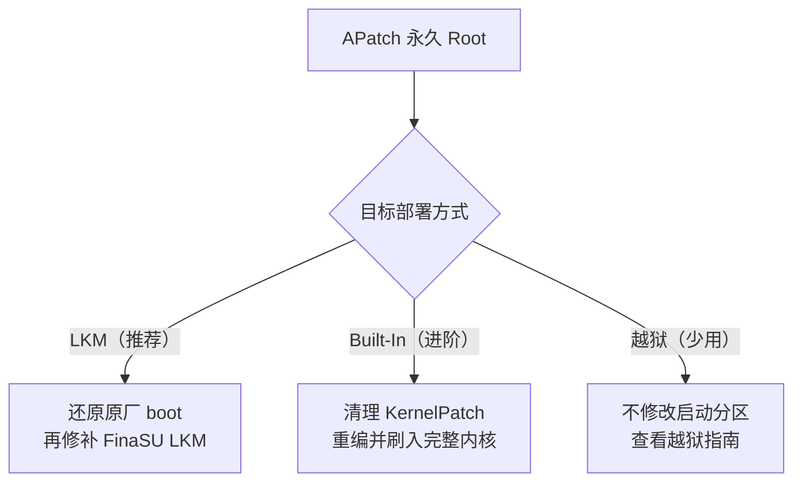

# 从 APatch 切换

<Badge text="内核补丁" type="danger" /> <Badge text="先还原 boot" type="warning" />

::: important 先分清三个 KernelPatch 管理器

目前常见的 KernelPatch 管理器有三个：**APatch**、**FolkPatch** 和 **Aster**。它们的内核底座都是 KernelPatch，区别主要在管理器界面、模块生态和附加功能。本文说的“APatch”泛指这三个方案；如果你用的是 FolkPatch 或 Aster，内核清理和切换思路相同，但界面入口名称可能不同。

**FolkPatch 不是 FinaSU**。FolkPatch 是 KernelPatch 管理器，FinaSU 是 KernelSU 系方案；两者名字相似，但内核底座、管理器信任和切换流程都不同。

:::

这三个管理器都通过 KernelPatch 修改 Linux 内核镜像来提供 Root，FinaSU 不能接管正在运行的 KernelPatch 内核。使用这些管理器的人通常已经有永久 Root，因此推荐切换到 **FinaSU LKM**；需要内置驱动时再选择 **FinaSU Built-In**；越狱只在无法或不想永久修改启动分区时考虑。

::: danger APatch 改的是内核，不只是 ramdisk

APatch 的 KernelPatch 通常写在 `boot` 的内核镜像里。只刷回 `init_boot` 不会移除它；反过来，只还原 APatch 的启动镜像也不能自动变成 FinaSU。切换时必须先回到不含 APatch 的内核状态。

:::

::: tip 最短路线

备份 → 还原原厂 `boot` → 重启确认没有 Root → 安装 FinaSU → 用原厂 `init_boot`（存在时）或 `boot` 修补 → 刷回同一个分区 → 重启验证 **LKM**。

:::

## 先确认启动分区

APatch 基本只能修补 `boot` 的内核镜像。即使设备有独立 `init_boot`，APatch 的补丁通常也不在那里；切换时至少还原原厂 `boot`。如果 `init_boot` 也曾被其他 Root 方案修补，再一并还原。

::: table APatch 的修改位置与还原目标

| 当前情况 | APatch 改在哪里 | 还原时刷回 |
| --- | --- | --- |
| 标准 APatch 安装 | `boot` 的内核 | 原厂 `boot` |
| `init_boot` 也被其他方案修补过 | `init_boot` 的 ramdisk | 原厂 `init_boot` |
| 不确定 | 可能涉及多个启动分区 | 原厂 `boot` 和 `init_boot`（存在时） |
| A/B 设备 | 当前槽位 | 当前槽位的对应分区 |

:::

::: warning 不要只刷 init_boot

APatch 的核心修改在 Linux 内核里。只刷 `init_boot` 会保留 APatch 内核补丁，设备仍然可能有 Root 或继续与 FinaSU 冲突。标准 APatch 切换至少要还原原厂 `boot`。

:::

### 还原原厂分区

优先使用 APatch 的恢复原厂镜像/卸载内核补丁功能，并保留 APatch 应用直到 FinaSU 验证完成。如果没有可用的原厂镜像恢复能力，使用与当前系统版本、内核版本和槽位完全匹配的原厂镜像手动刷回。A/B 设备只处理当前槽位，保留另一个能启动的槽位。

::: code-tabs

@tab 非 A/B 设备

```sh
# APatch 内核补丁通常在这里
fastboot flash boot boot.img

# 如果 init_boot 也被修改过
fastboot flash init_boot init_boot.img
```

@tab A/B 设备

```sh
fastboot getvar current-slot

# 当前槽位是 a 时；如果是 b，把 _a 换成 _b
fastboot flash boot_a boot.img
fastboot flash init_boot_a init_boot.img
```

:::

::: collapse 不确定 APatch 改了哪个分区

1. 打开 APatch 的卸载/恢复页面，查看它准备还原的镜像。
2. 执行 `adb shell getprop ro.boot.slot_suffix` 确认当前槽位；输出为空表示不是 A/B 设备。
3. 仍然不确定时，刷回匹配当前系统的原厂 `boot`；如果设备存在 `init_boot`，也刷回原厂 `init_boot`。
4. 重启后确认 APatch 不再提供 Root，再继续安装 FinaSU。

:::

## 切换路径



## 路径一：APatch → FinaSU LKM（推荐）

LKM 把 FinaSU 的 `kernelsu.ko` 放入启动镜像的 ramdisk，不替换 Linux 内核。由于 APatch 的补丁就在内核里，必须先还原原厂 `boot`，否则 APatch 和 FinaSU 会同时存在。

::: steps

1. **备份**

   备份当前槽位的 `boot`、`init_boot`（存在时）、`/data/adb/ap` 中仍需保留的配置和需要迁移的模块。记录系统版本、KMI 和槽位。

2. **移除 APatch 内核补丁**

   使用 APatch 的恢复原厂镜像/卸载内核补丁功能，或把匹配当前系统的原厂 `boot` 刷回当前槽位。只卸载 APatch 应用不会移除内核补丁；保留应用直到 FinaSU 验证完成。

3. **重启确认 Root 已移除**

   重启后确认 APatch 不再能授权。若 Root 仍然存在，说明 `boot` 没有真正还原，或设备上还有另一套 Root。

4. **安装 FinaSU 管理器**

   安装官方 FinaSU APK。此时设备没有 Root，属于正常的中间状态。

5. **修补原厂启动镜像**

   在 FinaSU 中选择 **安装与刷写 → 选择文件并修补**，使用原厂 `boot` 或 `init_boot`。管理器会根据设备选择 LKM 的目标分区：

   - 有 `init_boot` 且 KMI 不是 `android12-*`：通常修补 `init_boot`。
   - 没有 `init_boot`，或 KMI 是 `android12-*`：修补 `boot`。
   - 以安装页显示为准。

6. **刷回对应分区**

   把修补后的镜像刷回原分区并重启。不要交叉刷写 `boot` 和 `init_boot`。

7. **验证并清理**

   首页应显示 **LKM**，Root 和模块正常。确认后卸载 APatch，并在不再需要时清理 `/data/adb/ap`；不要删除整个 `/data/adb`。

:::

::: timeline APatch 到 FinaSU LKM

- 备份 boot/init_boot、APatch 配置与模块
  time=准备 type=tip

- 还原原厂 boot，移除 KernelPatch
  time=还原

- 安装 FinaSU，修补原厂镜像
  time=替换

- 刷回对应分区并重启
  time=生效

- 验证 LKM、Root 和模块
  time=收尾 type=success

:::

::: warning 不要保留 APatch 内核补丁

FinaSU LKM 只改 ramdisk，不能覆盖 `boot` 内核里的 APatch 补丁。继续使用 APatch 内核时直接安装 FinaSU，只会得到两套 Root。

:::

## 路径二：APatch → FinaSU Built-In（进阶）

FinaSU 内置构建同样需要修改内核，但不能在 APatch 已经打补丁的内核上继续叠加。正确做法是从干净的内核源码重新构建。

::: steps

1. **回到干净内核**

   刷回原厂 `boot`，或从与设备系统匹配的原始内核源码开始。确认 APatch 的 KernelPatch、hook 和初始化入口都已移除。

2. **接入 FinaSU**

   按[内核集成](/developer/builtin-integration/)执行 `kernel/setup.sh`，启用 `CONFIG_KSU=y`，并编入与目标管理器匹配的证书。

3. **构建并检查**

   使用匹配的编译器和配置构建，显式传入 `KSU_REQUIRE_PREINIT=1`。检查日志中的版本、KMI 和证书信息。

4. **刷入完整内核**

   把完整内核镜像刷入 `boot`，而不是把 LKM 放进 ramdisk。`init_boot` 不是内置驱动的目标；只有内核包明确要求时才操作它。

5. **验证 Built-In**

   重启后首页应显示 **Built-In**，管理器身份、Root 和模块正常。

:::

::: danger 不要在 APatch 内核上叠加 FinaSU

APatch 的 KernelPatch 和 FinaSU 内置驱动都会接管内核入口。两套补丁同时存在时，冲突比 LKM 更难排查，也可能直接导致无法开机。

:::

## 路径三：APatch → 越狱（简述）

APatch 用户通常已经有永久 Root，不需要走越狱。只有在无法或不想修改启动分区，并且设备具备现成的提权入口时，才考虑[越狱与延迟加载](/guide/jailbreak/)。

越狱只对当前启动会话有效，普通重启后会丢失 Root。CVE 提权、动态提权工具和固定工具的 `ksud` 替换方式见[从 KernelSU 切换](/guide/switch/kernelsu/)中的路径四。

## 数据与模块

```file-tree title="APatch 相关数据位置"
/data/adb
├── ap/                       # APatch 配置、二进制与状态
├── modules/                  # 已安装模块
├── ksud                      # FinaSU 用户态守护进程（文件）
└── ksu/                      # FinaSU 状态目录
```

::: table APatch 内容在 FinaSU 下的处理

| 内容 | 是否保留 | 建议 |
| --- | --- | --- |
| APatch 授权（旧版 superkey / 新版签名鉴权） | 不迁移 | 在 FinaSU 中重新授权 |
| `/data/adb/ap` | 不再需要 | 确认 FinaSU 正常后再清理 |
| 模块文件 | 可能保留 | 先停用，再逐个验证兼容性 |
| APatch 专用模块接口 | 不保证兼容 | 依赖 APatch/KernelPatch 接口的模块需要替换 |
| KernelPatch 内核补丁 | 必须移除 | 先还原原厂内核 |

:::

::: info 旧版和新版的鉴权方式不同

APatch 旧版使用 superkey 进行授权；新版改为与 FinaSU 类似的签名鉴权。FolkPatch 和 Aster 也各自维护授权记录。签名鉴权只说明管理器需要被内核信任，不代表这些授权记录可以直接迁移；切换后仍然要在 FinaSU 中重新授权应用。

:::

::: warning 不要删除整个 `/data/adb`

这个目录同时包含模块、授权和 FinaSU 的状态。切换时只清理明确的 APatch 专用目录或文件，不要用“清空数据”代替卸载。

:::

## 切换后检查

::: steps

1. **确认运行方式**

   首页应显示 **LKM** 或 **Built-In**，并与选择的路径一致。

2. **确认管理器身份**

   FinaSU 应能读取版本、授权应用和管理模块。若显示未安装或无法授权，检查签名与 UAPI 是否匹配。

3. **测试 Root**

   使用测试应用请求 Root，确认授权弹窗和 `su` 正常。

4. **逐个启用模块**

   先启用一个模块并重启，确认挂载和脚本正常。不要一次恢复全部 APatch 模块。

5. **验证内核状态**

   内置构建应显示 **Built-In**；LKM 应显示 **LKM**。两者都不应再出现 APatch 的授权界面。

:::

## 排错

::: collapse accordion

- **刷回 boot 后仍然有 Root**

  检查是否刷错槽位或分区，或设备上还有另一套 Root。APatch 的内核补丁只有在 `boot` 真正替换后才会消失。

- **只刷 init_boot 没有效果**

  APatch 的核心补丁通常在内核 `boot` 中。只还原 `init_boot` 不会移除 KernelPatch。

- **更新后无法开机**

  停止反复重启，按[救砖](/guide/rescue-bootloop/)恢复原厂启动镜像。常见原因是内核版本、分区或槽位不匹配。

- **FinaSU 显示未安装**

  检查启动镜像是否刷入当前槽位、KMI 是否匹配，以及管理器签名是否被内核信任。

- **模块没有挂载**

  确认模块支持 FinaSU 的挂载方式；依赖 APatch/KernelPatch 专有接口的模块可能无法使用。

- **APatch 授权数据还能看到**

  APatch 旧版使用 superkey，新版改为与 FinaSU 类似的签名鉴权；两者的授权记录不等同于 FinaSU，切换后仍需在 FinaSU 中重新授权应用。

:::

## 常见问题

::: chat title="从 APatch 切换问答"
{用户}
APatch 和 FinaSU 能共存吗？

{.}
不能。两者都会接管内核 Root，必须先移除 APatch 的内核补丁，再安装 FinaSU。

{用户}
只卸载 APatch 应用就可以了吗？

{.}
不可以。APatch 的 KernelPatch 在内核镜像里，卸载应用不会自动移除它；需要还原原厂 `boot` 或重新刷入干净内核。

{用户}
可以保留 APatch 内核，直接装 FinaSU LKM 吗？

{.}
不可以。LKM 只改 ramdisk，APatch 补丁仍在内核中，两套 Root 会冲突。

{用户}
APatch 的模块还能用吗？

{.}
模块文件可能还在，但依赖 APatch/KernelPatch 接口的模块不保证兼容。先停用，再逐个验证。

{用户}
需要清空 `/data/adb` 吗？

{.}
不需要，也不建议。只清理明确的 APatch 专用目录或文件，保留模块和 FinaSU 需要的数据。

{用户}
APatch 用户需要越狱吗？

{.}
通常不需要。越狱只在无法或不想永久修改启动分区时考虑，而且重启后会丢失 Root。详见[越狱与延迟加载](/guide/jailbreak/)。
:::

## 相关页面

- [安装与刷写](/guide/install/)
- [从 KernelSU 切换](/guide/switch/kernelsu/)
- [从 Magisk 切换](/guide/switch/magisk/)
- [越狱与延迟加载](/guide/jailbreak/)
- [内核集成](/developer/builtin-integration/)
- [救砖](/guide/rescue-bootloop/)

*[LKM]: Loadable Kernel Module，可加载内核模块
*[KMI]: Kernel Module Interface，Android 内核模块接口版本
*[UAPI]: 内核与用户态之间的稳定接口
*[AVB]: Android Verified Boot，Android 启动验证
*[GKI]: Generic Kernel Image，Android 通用内核镜像
