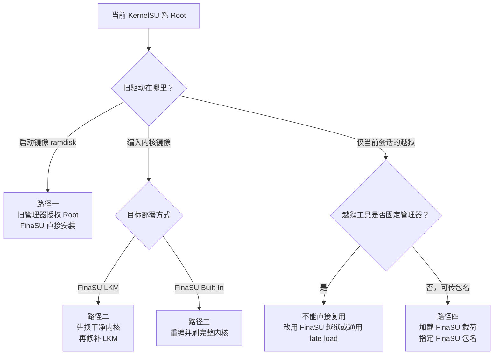

# 从 KernelSU 切换

<Badge text="四种起点" type="warning" /> <Badge text="不要双驱动" type="danger" />

FinaSU 保留了 KernelSU 的核心模型，但管理器信任、内置引擎和部分存储协议已经不同。KernelSU 系设备可能运行 LKM、把驱动编入内核，或使用只认固定管理器的越狱工具，这三类环境不能套用同一个卸载流程。

切换的第一步不是安装 FinaSU，而是确认 ==旧驱动位于哪里==。旧驱动的位置决定了能否直接安装、必须先换内核，还是只能重新越狱。

::: danger 不要叠加两套驱动

同一台设备只保留一套内核级 Root。FinaSU LKM 与旧的内置驱动、两套 LKM 同时存在时，会争抢 hook、supercall、白名单和 `/data/adb/ksud`，轻则无法授权，重则无法开机。

:::

## 先判断旧驱动形态

:::: field-group

::: field 旧管理器 LKM
@type `常见`
@default `启动镜像已修补`
旧管理器通过修补 `boot` 或 `init_boot` 提供 Root，启动镜像的 ramdisk 中存在 `kernelsu.ko`。这种情况通常可以借旧 Root 直接安装 FinaSU。
:::

::: field 内置内核构建
@type `需要换内核`
@default `CONFIG_KSU=y`
驱动编在 Linux 内核镜像里，管理器只负责授权。仅卸载旧管理器不会移除驱动，必须先刷入不含旧驱动的内核。
:::

::: field 越狱环境
@type `会话级`
@default `重启失效`
Root 只在当前启动会话中存在，没有可恢复的启动镜像补丁。切换取决于越狱工具能否加载 FinaSU 的载荷并指定 FinaSU 包名。
:::

::: field 无法确定
@type `安全优先`
@default `按内置处理`
无法确认驱动位置时，不要直接安装。先准备与当前系统匹配的原厂启动镜像，按“其他内核构建 → FinaSU LKM”的流程处理。
:::

::::

::: tip 判断 LKM 还是内置

旧管理器如果提供“卸载并恢复原厂镜像”，通常说明它修改过启动镜像；是否为 LKM 还要结合当前内核是否已经包含内置驱动判断。如果 Root 来自设备当前运行的自定义内核，而管理器没有启动镜像恢复功能，则驱动很可能已经编入内核。技术用户可以解包启动镜像，检查 ramdisk 中是否存在 `kernelsu.ko`。

:::

## 先认清 boot 和 init_boot

持久 Root 修改的是启动分区，不是管理器 APK 里的文件。新手先记住这几个分区：

- **boot**：存放 Linux 内核；部分设备也把通用 ramdisk 放在这里。
- **init_boot**：只存放通用 ramdisk。Android 13 以后的部分 GKI 设备会单独分出这个分区。
- **vendor_boot**：少数设备把厂商 ramdisk 放在这里。只有管理器明确显示 `vendor_boot` 时才选它。

::: table 内置与 LKM 分别改哪里

| FinaSU 部署方式 | 驱动实际放在哪里 | 默认修改的分区 | 回原厂时刷回 |
| --- | --- | --- | --- |
| **Built-In** | Linux 内核镜像内部 | `boot` | 原厂 `boot` |
| **LKM**，设备有 `init_boot` 且 KMI 不是 `android12-*` | `init_boot` 的 ramdisk | `init_boot` | 原厂 `init_boot` |
| **LKM**，设备没有 `init_boot`，或 KMI 是 `android12-*` | `boot` 的 ramdisk | `boot` | 原厂 `boot` |
| **LKM**，管理器显示 `vendor_boot` | `vendor_boot` 的 ramdisk | `vendor_boot` | 原厂 `vendor_boot` |

:::

一句话记法：==内置换内核，刷 boot；LKM 改 ramdisk，通常刷 init_boot，没有 init_boot 时才刷 boot==。`android12-*` 内核是例外，即使存在 `init_boot`，LKM 默认仍选择 `boot`。

如果手动选择了其他分区，回原厂时以实际修改的分区为准，不要照搬表格中的默认值。

::: important 最终以管理器显示为准

不同设备的启动布局并不相同。安装页会显示它识别到的默认分区；不要只凭 Android 版本或网上教程猜。分区选错会把内核镜像写进 ramdisk 分区，或反过来，直接导致无法开机。

:::

### 刷回原厂分区

先确认当前槽位。A/B 设备只刷当前槽位，不要同时改动另一个仍可启动的槽位。下面的命令只执行与当前部署对应的那一行，不要把 `boot.img` 刷进 `init_boot`。

::: code-tabs

@tab 非 A/B 设备

```sh
# 内置，或没有 init_boot 的 LKM
fastboot flash boot boot.img

# 有 init_boot 的 LKM
fastboot flash init_boot init_boot.img
```

@tab A/B 设备

```sh
fastboot getvar current-slot

# 当前槽位是 a 时；如果是 b，把 _a 换成 _b
fastboot flash boot_a boot.img
fastboot flash init_boot_a init_boot.img
```

:::

如果安装页明确显示 `vendor_boot`，就把上面命令中的 `boot` 或 `init_boot` 换成 `vendor_boot`，并刷回对应厂商镜像。

::: warning 镜像必须与当前系统一致

使用与当前 Android 版本、内核版本和槽位完全匹配的原厂镜像。不要拿另一个系统版本、另一个机型或另一个槽位的镜像凑合。刷错后按[救砖](/guide/rescue-bootloop/)恢复。

:::

::: collapse 不确定旧管理器改了哪个分区

1. 打开旧管理器或 FinaSU 的安装页，查看它显示的默认分区。
2. 连接电脑，执行 `adb shell getprop ro.boot.slot_suffix` 确认当前槽位；输出为空表示不是 A/B 设备。
3. 仍然不确定时，刷回与当前系统匹配的原厂 `boot`；如果设备存在 `init_boot`，也一并刷回原厂 `init_boot`。这样会移除两类启动镜像修改，但不会影响 `/data` 中的模块。
4. 不要通过“刷了还能开机”来反推分区；错误的镜像有时能启动，但会在下一次 OTA 或切换槽位时失败。

:::

## 四条切换路径

::: table 按旧驱动选择路径

| 当前状态 | 能否直接安装 FinaSU | 应走的路径 |
| --- | --- | --- |
| 其他管理器的 LKM | 通常可以，使用旧 Root | 路径一：直接安装 |
| 旧驱动编入内核，目标是 LKM | 不可以 | 路径二：先换干净内核，再安装 LKM |
| 旧驱动编入内核，目标是内置构建 | 不可以 | 路径三：重新编译并刷入内核 |
| 越狱且工具可传包名 | 视提权环境而定 | 路径四：加载 FinaSU 载荷 |
| 越狱工具写死旧管理器 | 不可以 | 不能复用，改用 FinaSU 自带越狱或通用 late-load |
| 不确定 | 不可以 | 先还原干净启动镜像，再按路径二处理 |

:::



## 路径一：其他管理器 LKM → FinaSU LKM

这是最常见的切换方式。旧管理器仍然提供可用的 Root，FinaSU 管理器只是作为另一个应用申请 Root，然后借助这个 Root 执行 `boot-patch`，把启动镜像中的旧 LKM 替换成 FinaSU 的版本。

::: info LKM 改的是 ramdisk，不是内核

LKM 只替换 ramdisk 中的 `kernelsu.ko` 和启动包装，不替换 Linux 内核。因此它修改的是 `boot` 或 `init_boot`，具体取决于设备是否存在独立的 `init_boot`。内置构建则相反，它替换的是 `boot` 里的内核。

:::

::: warning 前提是旧管理器还能授权

旧管理器必须能够给其他应用授予 Root。如果旧管理器已经损坏、无法授权，或者设备没有可用的 Root shell，就不能使用直接安装，应改走恢复启动镜像的流程。

:::

::: table 直接安装时选哪个分区

| 旧 LKM 实际所在分区 | FinaSU 直接安装应选 |
| --- | --- |
| `boot` | `boot` |
| `init_boot` | `init_boot` |
| `vendor_boot` | `vendor_boot` |
| 不确定 | 不要猜；先刷回原厂 `boot` 和 `init_boot`，再用原厂镜像做文件修补 |

:::

::: steps

1. **备份当前状态**

   备份当前槽位的 `boot` 和 `init_boot`（存在时）、`/data/adb/ksu/.allowlist`、需要保留的模块和 App Profile。记录系统版本、KMI、槽位，以及旧管理器实际修改的分区。

2. **安装 FinaSU 管理器**

   在旧管理器仍可工作时安装官方 FinaSU APK。此时先不要卸载旧管理器，也不要清理旧模块。

3. **在旧管理器中授权 FinaSU**

   打开旧管理器，给 FinaSU 管理器授予 Root。切换完成前，FinaSU 首页可能显示“未安装”或版本未知，这不影响它使用已授权的 Root shell。

4. **在 FinaSU 中直接安装**

   进入 **安装与刷写 → 直接安装**。确认 KMI 和目标分区，开启刷写前备份，然后执行。该流程会重新修补当前启动镜像，并把 FinaSU 的 `ksud` 写入 `/data/adb/ksud`。

   分区必须与旧管理器实际修改的分区一致：旧 LKM 在 `init_boot` 就选 `init_boot`，在 `boot` 就选 `boot`。如果 FinaSU 的默认分区与旧管理器不同，不要直接继续，改为手动选择旧分区，或先刷回原厂 `boot` 和 `init_boot` 再用文件修补。

5. **尽快重启**

   刷写成功后不要继续使用旧驱动运行服务。`/data/adb/ksud` 已经被替换，旧管理器依赖的守护进程可能在重启前出现异常。

6. **验证并移除旧管理器**

   重启后确认首页显示 **LKM**、管理器身份正常、Root 可用。确认 FinaSU 工作正常后，再卸载旧管理器并清理只属于旧管理器的模块或配置。

:::

::: timeline LKM 切换时序

- 备份启动镜像与 `/data/adb` 状态
  time=准备 type=tip

- 安装 FinaSU，由旧管理器授予 Root
  time=过渡

- FinaSU 修补启动镜像并写入自己的 `ksud`
  time=替换

- 重启，加载 FinaSU LKM
  time=生效

- 验证 Root、模块和内置引擎
  time=收尾 type=success

:::

### 直接安装不可用时

**直接安装**要求当前已有 Root 且设备为 GKI。条件不满足时：

1. 准备与当前系统完全匹配的原厂 `boot`；如果设备有 `init_boot`，也准备原厂 `init_boot`。
2. 在 FinaSU 安装页选择 **选择文件并修补**。
3. 使用原厂镜像而不是已经由其他管理器修补过的镜像；修补 `boot` 或 `init_boot` 后，刷回对应分区。
4. 如果旧管理器改的是 `init_boot`，不要只刷 `boot`；反过来也一样。

### 切换后不要保留两套管理器

旧管理器可以暂时保留到 FinaSU 验证完成，但不应长期共存。FinaSU 内核只信任自己的管理器证书和已登记的管理器；旧管理器既不能正确管理 FinaSU，也可能继续修改共享目录。

## 路径二：其他内核构建 → FinaSU LKM

如果旧驱动已经编入内核，==直接安装会把 FinaSU LKM 叠加在旧驱动之上==，两套驱动会同时接管内核。正确做法是先把内核换成不含旧驱动的版本，再安装 FinaSU LKM。

### 步骤

::: steps

1. **备份并确认原厂镜像**

   准备与当前 Android 版本、内核版本和槽位完全匹配的原厂 `boot` 镜像；这是移除内置驱动所必需的。如果设备存在 `init_boot`，也准备它的原厂镜像，供后续 LKM 修补使用。没有可恢复镜像时不要开始。

2. **移除旧内置驱动**

   把原厂 `boot` 刷回当前槽位，或重新编译一份关闭旧 KernelSU 集成的内核并刷入 `boot`。内置驱动在 Linux 内核里，通常就在 `boot`；只刷 `init_boot` 不会移除它。仅卸载旧管理器 APK 也不会移除内核里的驱动。

3. **重启确认 Root 已移除**

   重启后确认旧管理器不再能授权。若旧驱动仍然存在，说明内核没有真正替换，继续之前必须先解决。

4. **安装 FinaSU 管理器**

   安装与目标 FinaSU LKM 匹配的官方管理器。此时设备没有 Root，属于正常的中间状态。

5. **修补干净启动镜像**

   在 FinaSU 中选择 **选择文件并修补**。修补输入应当是原厂 `init_boot`（设备存在且 KMI 不是 `android12-*` 时），或原厂 `boot`；这与第 2 步用于移除内置驱动的 `boot` 不一定是同一个镜像。管理器会把 FinaSU 的 `ksuinit` 和对应 KMI 的 `kernelsu.ko` 放入 ramdisk。

6. **刷入并验证**

   把修补后的镜像刷回对应的 `init_boot` 或 `boot` 并重启。首页应显示 **LKM**，随后重新授权应用、逐个启用模块。

:::

::: danger 不要用“保留自定义内核”当借口跳过清理

如果必须保留自定义内核，也要先在源码中关闭旧 KernelSU 的配置和补丁，重新编译并刷入，再修补 FinaSU LKM。旧的 hook、supercall 或内核补丁仍然存在时，FinaSU 不能安全接管。

:::

### A/B 设备

切换会替换当前槽位的 `boot` 或 `init_boot`。确认另一个槽位仍有可启动的系统，并且知道如何切回。不要在 OTA 尚未完成时同时刷写两个槽位。

## 路径三：其他内核构建 → FinaSU 内核构建

目标是让 FinaSU 直接编入内核，而不是继续使用 LKM。这条路径必须重新编译完整内核，不能通过管理器安装完成。

### 清理旧集成

在目标内核源码中先移除旧的 KernelSU 系集成：

- 关闭旧的 `CONFIG_KSU` 或对应驱动选项。
- 移除旧的 hook、supercall、补丁和内核命令行参数。
- 确认没有旧驱动残留的符号或初始化入口。

不要在同一份内核里同时启用两套 KernelSU 驱动。

### 接入并构建

::: code-tabs

@tab 接入 FinaSU

```sh
./kernel/setup.sh --dir /path/to/FinaSU
scripts/config --enable KSU
scripts/config --enable KPROBES
scripts/config --enable EXT4_FS
scripts/config --enable HEADERS_INSTALL
```

@tab 构建内核

```sh
make ... KSU_REQUIRE_PREINIT=1
```

:::

完整的选项和证书要求见[内核集成](/developer/builtin-integration/)。内核必须编入与目标管理器匹配的证书大小和 SHA-256；签名不一致时，管理器无法获得管理器身份。

::: steps

1. **从干净源码开始**

   使用与设备系统和内核版本匹配的源码。不要在其他 Root 方案的补丁上继续叠加 FinaSU。

2. **执行接入脚本**

   运行 `kernel/setup.sh`，确认 KSU、KPROBES、EXT4_FS 和 HEADERS_INSTALL 等选项已启用。

3. **构建并检查日志**

   显式传入 `KSU_REQUIRE_PREINIT=1`。检查构建日志中的版本、KMI 和证书信息，不要跨内核版本复用产物。

4. **刷入完整内核镜像**

   按设备维护者的方式把完整内核刷入 `boot`，而不是把 LKM 放进 ramdisk。`init_boot` 不是内置驱动的目标；只有内核包明确要求时才操作它。刷写前准备救砖镜像。

5. **验证 Built-In**

   重启后首页应显示 **Built-In**，管理器可以被内核识别，Root 和模块正常。

6. **重新建立授权与 Profile**

   旧管理器的白名单和 App Profile 不保证兼容。逐个重新授权，先停用旧模块，再按需恢复。

:::

::: warning 内核构建与系统 OTA 绑定

系统 OTA 会替换内核。OTA 后必须重新构建并刷入匹配新系统的 FinaSU 内核，不能继续使用旧的内核镜像。

:::

## 路径四：从固定管理器的越狱工具切换

越狱模式在当前系统启动后加载驱动，没有可恢复的启动镜像补丁。FinaSU 自带的越狱流程由管理器内的 `AppZygotePreload` 触发：它执行随包的 `ksud late-load --magica 5555 --package-name <当前管理器包名>`，由 `ksud` 加载 FinaSU 的 `<KMI>_kernelsu.ko`，成功后强制停止并重新启动当前管理器。

首页的 **Jailbreak** 按钮是 FinaSU 自带的兼容方案；当前更主流的做法是先通过 CVE 漏洞取得 uid 0，再执行 FinaSU 的 `ksud late-load`。固定工具能否复用，取决于它是只启动固定管理器，还是允许替换它执行的 `ksud` 或内核模块。

::: danger 固定管理器的工具不会自动变成通用工具

这类工具可能提示“越狱成功”，实际却仍在操作旧管理器或旧载荷。不要把“工具显示成功”等同于 FinaSU 已经获得 Root。

:::

### 优先方案：可选择管理器的动态提权工具

如果提权工具支持选择已安装的管理器，应优先使用这种方式。工具会从所选管理器的原生库目录读取 `libksud.so`（本质上就是 `ksud`），而不是只认写死的 KernelSU 或分支包名。

使用时选择 FinaSU 管理器即可。官方构建的包名通常是 `me.yuki.fina`，PR 构建是 `me.yuki.fina.pr`，自定义构建可能不同；以设备上实际安装的包名为准。工具应当读取这个包内的 `libksud.so`，而不是旧管理器留下的副本。

::: tip 为什么优先用动态工具

这样不需要手工替换 `ksud`，也不会因为工具的固定包名列表而误用旧管理器。只要工具每次运行都重新解析所选管理器，FinaSU 更新 APK 后也会使用新的 `ksud`；如果工具缓存了旧路径，需要重新选择管理器或清除它的缓存。

:::

::: steps

1. **安装 FinaSU 管理器**

   确认管理器已经安装，并记录它的实际包名。不要同时保留旧的 KernelSU 或分支管理器，除非工具允许明确指定 FinaSU。

2. **在工具中选择 FinaSU**

   打开动态提权工具的管理器选择项，选中 FinaSU，确认它显示的 `ksud` 路径位于 FinaSU 的安装目录，而不是旧管理器目录。

3. **执行提权流程**

   运行对应设备内核的 CVE 流程。日志中应能看到所选管理器的 `libksud.so` 路径，以及 `late-load` 的 KMI 和退出状态。

4. **验证 FinaSU**

   打开 FinaSU，首页应显示 **Jailbreak mode** 且 Root 可用。若工具仍然使用旧路径，先清除它的缓存或卸载旧管理器，再重新选择。

:::

::: warning 动态选择管理器不等于自动提权

工具仍需对应的 CVE 或内核 profile 才能取得 uid 0。选择 FinaSU 只解决“用哪一份 `ksud`”的问题，不会绕过设备内核的漏洞匹配条件。

:::

### 情况 A：旧越狱工具仍能提供可用的 Root shell

如果旧工具允许其他应用获得 Root，可以按路径一处理：安装 FinaSU 管理器，让旧管理器或旧工具给 FinaSU 授权，然后在 FinaSU 中直接安装 LKM。这样会把切换结果固化为 LKM，而不是继续依赖越狱。

切换后仍需尽快重启，并在确认 FinaSU 正常后再移除旧工具。

### 情况 B：CVE 提权工具（当前主流）

现在更常见的越狱方式是通过 CVE 漏洞从一个普通未授权应用提权到 uid 0，再执行 FinaSU 的 `ksud late-load`。例如 GhostLock 利用 CVE-2026-43499 在匹配的内核上取得 uid 0 并绕过 seccomp，然后调用：

```sh
ksud late-load --kmi <KMI> --allow-shell
```

公开实现见 [YuKongA/ghostlock-app](https://github.com/YuKongA/ghostlock-app)。它按设备 `uname -r` 精确匹配内核 profile；内核不匹配或漏洞已被修复时不能使用。

::: warning GhostLock 默认不认识 FinaSU

GhostLock 查找 `ksud` 的顺序是：

1. 它工作目录中的 `ksud`
2. 已安装的 KernelSU 或分支管理器包内的 `libksud.so`
3. `/data/local/tmp/ksud`
4. `/data/adb/ksu/bin/ksud`

如果设备上还装着前面列出的管理器，GhostLock 可能优先使用它们的 `ksud`。要让它加载 FinaSU，可以卸载这些旧管理器，或直接替换 GhostLock 工作目录中的 `ksud`，或者在确认前两项不存在后把 FinaSU 的 `ksud` 放到 `/data/local/tmp/ksud`。

:::

::: steps

1. **准备 FinaSU 的 ksud**

   安装官方 FinaSU 管理器，或从 APK 中取出对应 ABI 的 `libksud.so`。它本质上就是可执行的 `ksud`，需要时改名为 `ksud`。

2. **推送到设备**

   把 `ksud` 放到 GhostLock 能找到的位置，并确保可执行。

3. **让 GhostLock 使用它**

   移除旧的 KernelSU 或分支管理器，或替换 GhostLock 工作目录中的 `ksud`。只把文件放进 `/data/local/tmp` 时，如果工作目录已经有旧 `ksud`，GhostLock 仍会优先使用旧的。

4. **执行 CVE 流程**

   在 GhostLock 中运行对应内核的 profile。日志应出现 `ksud=...`、`late-load kmi=...` 和 `late-load exit=0`，随后能检测到 `kernelsu` 模块。

5. **验证 FinaSU**

   打开 FinaSU，首页应显示 **Jailbreak mode** 且 Root 可用。没有进入该状态时，先检查 GhostLock 实际使用的 `ksud` 路径和 KMI。

6. **决定是否持久化**

   CVE 越狱同样只在当前启动会话有效。需要持久 Root 时，再按路径一或路径二切换到 LKM，或按路径三刷入内置内核。

:::

::: code-tabs

@tab 从 APK 取 ksud

```sh
# 把 arm64-v8a 换成设备实际 ABI
unzip -p FinaSU.apk lib/arm64-v8a/libksud.so > ksud
```

@tab 推送到临时目录

```sh
adb push ksud /data/local/tmp/ksud
adb shell chmod 755 /data/local/tmp/ksud
```

:::

::: danger CVE 工具不是通用解

GhostLock 需要与设备内核精确匹配的 profile，不能只凭 Android 版本判断支持。内核已经修复漏洞、profile 不匹配或设备不在支持列表时，不要反复尝试。错误的内核参数可能导致设备重启或无法开机。

:::

### 情况 C：FinaSU 首页 Jailbreak（兼容方案）

如果设备已经处于 Permissive SELinux 或具备 Magica 提权环境，也可以直接使用 FinaSU 首页的 **Jailbreak**。这条路径不要求 CVE profile，是更宽容的兼容方案，但不是当前主流。

::: steps

1. **准备 FinaSU**

   安装官方 FinaSU 管理器，确认其中包含对应架构和 KMI 的 `ksud` 与 `kernelsu.ko`。备份旧管理器和模块状态。

2. **确认越狱条件**

   设备需要可用的 Magica 提权环境和相应的 SELinux 状态，通常还要求允许 FinaSU 自启动。越狱不是通用提权漏洞，不满足条件时不要尝试。

3. **使用 FinaSU 的越狱入口**

   在首页点击 **Jailbreak**。流程会临时启用本机 ADB TCP 通道，通过 `adb shell` 执行 late-load，完成后恢复 ADB 属性。首页没有入口或条件不满足时，改用情况 B 的 CVE 工具。

4. **等待管理器重启**

   清理成功后管理器会被强制停止并重新启动。若约 30 秒内没有恢复，按日志检查失败原因，不要连续点击。

5. **验证并清理**

   首页应显示 **Jailbreak mode**，Root 可用。确认后移除旧越狱工具和旧管理器，避免它们再次注入。

:::

### 情况 D：继续使用固定工具，替换它执行的载荷

如果设备只能通过某个固定工具触发越狱，可以尝试让它执行 FinaSU 的载荷。这类工具最终通常只是执行数据目录中的某个 `ksud`，再由这个 `ksud` 加载同目录或内嵌的 `kernelsu.ko`；因此==替换工具实际执行的 `ksud`，通常就能让它加载 FinaSU 驱动==。部分工具还会直接加载自己的 `kernelsu.ko`，这时需要同时替换对应的模块和配置。

::: steps

1. **找到工具真正执行的文件**

   不要只凭文件名猜。查看工具的数据目录、日志和启动脚本，确认它执行的是 `/data/adb/ksud`、自带目录中的 `ksud`，还是从 APK 解压出的二进制。先把原文件完整备份。

2. **准备匹配的 FinaSU 载荷**

   从官方 FinaSU APK 的 `lib/<ABI>/libksud.so`（本质上是可执行的 `ksud`）或发布包中的独立 `ksud` 取出对应版本。工具只执行 `ksud` 时，它会从内嵌资源加载匹配 KMI 的模块；工具直接加载模块时，还要准备与该 KMI 匹配的 `<KMI>_kernelsu.ko`。ABI、KMI 或架构不匹配时不要替换。

3. **按原路径替换并保留权限**

   用 FinaSU 的 `ksud` 覆盖工具实际执行的那个文件，保持原文件名、可执行权限和 SELinux 上下文。只替换载荷，不要用工具的状态文件覆盖 `/data/adb/ksu` 中的授权或 Profile。

4. **处理固定包名**

   如果工具还写死了旧管理器的包名或 Activity，优先把启动目标改成 FinaSU；改不了时，FinaSU 驱动仍可能已经加载，但工具会重启旧管理器。此时手动打开 FinaSU，检查首页是否进入 **Jailbreak mode**。

5. **运行并验证**

   重新执行工具的越狱流程，查看日志中实际加载的模块和 `ksud` 版本。只有 FinaSU 首页显示 **Jailbreak mode**，并且 Root 可用，才算切换成功。

6. **保留回退文件**

   保留原 `ksud`、模块和配置的备份。工具更新或重新解压载荷后可能覆盖替换结果，升级后需要重新检查。

:::

::: danger 替换载荷不是官方支持路径

这是针对固定工具的手工适配，不同工具的目录结构、校验和启动参数都可能不同。工具如果校验载荷哈希或签名，替换可能直接失败；不要为了绕过校验而关闭设备上其他安全保护。错误的内核模块可能导致无法开机。

:::

::: tip 替换 `ksud` 和替换 `kernelsu.ko` 不是一回事

如果工具自己执行 `insmod` 或直接加载固定的 `kernelsu.ko`，只替换 `ksud` 不会改变驱动。此时必须替换它实际加载的模块；如果工具执行的是 FinaSU 的 `ksud late-load`，则由 FinaSU 的 `ksud` 从自己的内嵌资源中加载对应模块。

:::

::: warning 越狱只在当前会话有效

普通重启会丢失 Root，需要重新执行越狱。需要持久 Root 时，应改用 LKM 或内置内核构建。锁定 Bootloader 的设备不要为了持久化而刷写分区。

:::

::: info 为什么工具会写死管理器

部分面向小白的越狱工具只适配某一个管理器的包名、Activity、APK 位置或签名。FinaSU 使用自己的包名、`ksud` 与驱动载荷，即使底层载荷格式相同，也需要工具把包名和载荷指向 FinaSU。写死管理器不等于完全不能用：如果工具执行的是可替换的 `ksud` 或模块，手动替换载荷仍可能让 FinaSU 接管；但这是手工适配，不是自动迁移。

:::

## 数据与模块

```file-tree title="KernelSU 系常见数据位置"
/data/adb
├── ksud                      # 用户态守护进程，切换时会被替换
├── ksu/
│   ├── .allowlist            # 授权状态
│   ├── .dynamic_manager      # 管理器登记
│   └── profile/              # App Profile
└── modules/                  # 已安装模块
```

KernelSU 与 FinaSU 可能使用相同路径，所以数据看起来“还在”不代表格式完全兼容。切换后应：

- 重新检查授权应用和默认策略。
- 先停用旧管理器专用模块，再逐个启用。
- 不手工编辑 `.allowlist` 或 `.dynamic_manager`。
- 不把旧管理器的 APK、`ksud` 或 `kernelsu.ko` 复制进 FinaSU 的目录。

::: warning 模块兼容性

依赖旧管理器专有接口的模块可能在新驱动下失败。模块 ZIP 结构相似不代表行为相同；出现启动异常时，先进入安全模式或移除最近启用的模块。

:::

## 切换后检查

::: steps

1. **确认运行方式**

   首页应显示 **LKM**、**Built-In** 或 **Jailbreak mode**，并且与选择的路径一致。

2. **确认管理器身份**

   FinaSU 应能正常读取版本、授权应用和管理模块。若显示未安装或无法授权，先检查签名与 UAPI 是否匹配。

3. **测试 Root**

   使用一个测试应用请求 Root，确认授权弹窗和 `su` 都正常。

4. **验证模块**

   先启用一个模块并重启，确认挂载和脚本正常。不要一次恢复全部旧模块。

5. **验证内置引擎**

   使用 Sui、FolkZygisk 或 NoMount 时，逐个检查状态。Zygisk 和 Sui 通常需要重启才能完成注入。

:::

## 排错

::: collapse accordion

- **直接安装不可用**

  该选项要求当前已有 Root 且设备为 GKI。检查旧管理器是否仍能授权，并改用“选择文件并修补”处理原厂启动镜像。

- **切换后显示未安装**

  先确认启动镜像确实已经刷入，且 KMI 与设备匹配。签名不一致时，内核不会把 FinaSU 识别为管理器。

- **Root 可用但模块没有加载**

  检查 `/data/adb/ksud` 是否为新版本、模块是否被旧管理器标记为禁用，以及模块是否依赖旧管理器的专有接口。

- **旧管理器仍能授权**

  说明旧驱动仍然存在。检查是否刷入了干净内核或启动镜像；不要在两套驱动共存时继续启用模块。

- **越狱超时**

  检查 Magica 环境、SELinux 状态、ADB 通道和管理器自启动权限。约 30 秒没有恢复时先看日志，不要连续触发。

- **越狱工具提示成功但 FinaSU 没有 Root**

  工具很可能写死了旧管理器或旧载荷。改用 FinaSU 自己的越狱入口，或使用能指定 FinaSU 包名和载荷的 late-load 流程。

- **切换后无法开机**

  停止反复重启，按[救砖](/guide/rescue-bootloop/)恢复原厂启动镜像。常见原因是刷错分区、槽位或内核版本不匹配。

:::

## 常见问题

::: chat title="从 KernelSU 切换问答"
{用户}
旧管理器还能用，可以先保留吗？

{.}
可以暂时保留到 FinaSU 验证完成，但不要长期共存。FinaSU 内核只信任自己的管理器，旧管理器可能继续修改共享目录。

{用户}
为什么旧管理器 LKM 可以直接安装？

{.}
因为旧驱动仍然能提供 Root shell。FinaSU 借助这个 Root 重新修补启动镜像，把旧 LKM 替换成自己的模块，并在重启后接管。

{用户}
旧驱动是内置的，也能直接安装吗？

{.}
不能。直接安装只会把 FinaSU LKM 加进 ramdisk，旧内置驱动仍在内核里，两套驱动会冲突。必须先刷入不含旧驱动的内核。

{用户}
卸载旧管理器 APK 就能移除内置驱动吗？

{.}
不能。APK 只负责授权和管理，内置驱动在 Linux 内核镜像里，必须重新编译或刷入干净内核。

{用户}
越狱工具为什么认不出 FinaSU？

{.}
部分工具写死了旧管理器的包名、Activity、载荷路径或签名。FinaSU 需要把自己的包名和载荷交给 late-load 流程，安装 FinaSU 不会改变工具的硬编码。

{用户}
切换后旧模块会自动恢复吗？

{.}
不一定。模块目录可能仍在，但依赖旧管理器接口的模块会失败。先停用旧模块，再逐个启用并验证。
:::

## 相关页面

- [安装与刷写](/guide/install/)
- [更新 FinaSU](/guide/update/)
- [内核集成](/developer/builtin-integration/)
- [救砖](/guide/rescue-bootloop/)
- [常见问题与解答](/guide/faq/)

*[KSU]: KernelSU，基于内核的 Android Root 方案
*[LKM]: Loadable Kernel Module，可加载内核模块
*[KMI]: Kernel Module Interface，Android 内核模块接口版本
*[GKI]: Generic Kernel Image，Android 通用内核镜像
*[UAPI]: 内核与用户态之间的稳定接口
*[AVB]: Android Verified Boot，Android 启动验证
*[ADB]: Android Debug Bridge
