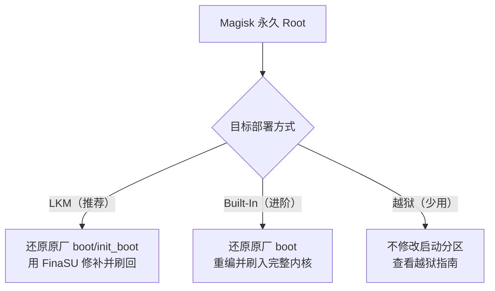

# 从 Magisk 切换

<Badge text="永久 Root" type="tip" /> <Badge text="先还原原厂镜像" type="danger" />

Magisk 与 FinaSU 都会接管启动链和模块注入，不能同时保留。使用 Magisk 的人通常已经有永久 Root，因此最常见的路线是切换到 **FinaSU LKM**；内置内核适合愿意自行编译内核的用户；越狱只在无法或不想永久修改启动分区时考虑。

::: danger FinaSU 不会直接接管 Magisk 修补过的镜像

FinaSU 的启动镜像修补会拒绝 Magisk 已修补的 ramdisk，并报出 `Cannot work with Magisk patched image`。切换时必须先还原与当前系统匹配的原厂启动镜像，不能把 FinaSU 直接叠在 Magisk 补丁上。

:::

::: tip 最短路线

备份 → 在 Magisk 中还原原厂镜像 → 重启确认没有 Root → 安装 FinaSU → 用原厂 `boot` 或 `init_boot` 修补 → 刷回同一个分区 → 重启验证 **LKM**。

:::

## 先确认 Magisk 改了哪个分区

Magisk 通过修补启动镜像的 ramdisk 提供 Root。设备有独立 `init_boot` 时，修补通常落在 `init_boot`；没有 `init_boot` 或使用旧布局时，落在 `boot`。

::: table Magisk 的修改位置与还原目标

| 当前情况 | Magisk 改在哪里 | 还原时刷回 |
| --- | --- | --- |
| 设备没有 `init_boot` | `boot` 的 ramdisk | 原厂 `boot` |
| 设备有 `init_boot`，Magisk 修补了它 | `init_boot` 的 ramdisk | 原厂 `init_boot` |
| 不确定 Magisk 改了哪里 | 可能同时涉及 | 原厂 `boot` 和 `init_boot`（存在时） |
| A/B 设备 | 当前槽位 | 当前槽位的对应分区 |
| 管理器显示 `vendor_boot` | `vendor_boot` 的 ramdisk | 原厂 `vendor_boot` |

:::

::: warning 不要刷错分区

`boot.img` 不能刷进 `init_boot`，反之亦然。只刷另一个分区不会移除 Magisk 的修改，还可能让设备无法启动。分区布局以 Magisk 或 FinaSU 安装页显示为准。

:::

### 还原原厂分区

优先使用 Magisk 的“还原原厂镜像”，并保留 Magisk 应用直到 FinaSU 验证完成。如果已经无法还原，使用与当前系统完全匹配的原厂镜像手动刷回。A/B 设备只处理当前槽位，保留另一个可启动槽位。

::: code-tabs

@tab 非 A/B 设备

```sh
# 没有 init_boot 的设备
fastboot flash boot boot.img

# 有 init_boot 且 Magisk 修补了它
fastboot flash init_boot init_boot.img
```

@tab A/B 设备

```sh
fastboot getvar current-slot

# 当前槽位是 a 时；如果是 b，把 _a 换成 _b
fastboot flash boot_a boot.img
fastboot flash init_boot_a init_boot.img
```

:::

::: collapse 不确定该刷哪个分区

1. 打开 Magisk 的卸载/还原页面，查看它准备还原的分区。
2. 执行 `adb shell getprop ro.boot.slot_suffix` 确认当前槽位；输出为空表示不是 A/B 设备。
3. 仍然不确定时，刷回与当前系统匹配的原厂 `boot`；如果设备存在 `init_boot`，也刷回原厂 `init_boot`。
4. 刷完后重启，确认 Magisk 已经不能再提供 Root，再继续安装 FinaSU。

:::

## 切换路径



## 路径一：Magisk → FinaSU LKM（推荐）

LKM 不替换 Linux 内核，只把 FinaSU 的 `kernelsu.ko` 放入启动镜像的 ramdisk。它适合绝大多数 Magisk 用户，也是迁移成本最低的永久 Root 方案。

::: steps

1. **备份**

   备份当前槽位的 `boot`、`init_boot`（存在时）、`/data/adb/modules` 和需要保留的模块配置。记录系统版本、KMI、槽位和 Magisk 实际修改的分区。

2. **还原原厂启动镜像**

   在 Magisk 中执行“还原原厂镜像”，或用 `fastboot` 刷回匹配当前系统的原厂 `boot` 或 `init_boot`。不要保留 Magisk 修补过的镜像；如果只能完整卸载，先确认已经备份原厂镜像。

3. **重启确认 Root 已移除**

   重启后确认 Magisk 不再能授权。若 Root 仍然存在，说明还原的分区或槽位不对，先解决再继续。

4. **安装 FinaSU 管理器**

   安装官方 FinaSU APK。此时设备没有 Root，属于正常的中间状态。

5. **修补原厂镜像**

   在 FinaSU 中选择 **安装与刷写 → 选择文件并修补**，使用原厂 `boot` 或 `init_boot`。管理器会根据设备自动选择 LKM 的目标分区：

   - 设备有 `init_boot` 且 KMI 不是 `android12-*`：通常修补 `init_boot`。
   - 没有 `init_boot`，或 KMI 是 `android12-*`：修补 `boot`。
   - 以安装页显示为准。

6. **刷回对应分区**

   把修补后的镜像刷回原分区并重启。不能把修补后的 `init_boot` 刷进 `boot`，反过来也一样。

7. **验证并清理**

   首页应显示 **LKM**，Root 和模块正常。确认后卸载 Magisk 应用，并按需清理 `/data/adb/magisk`；不要删除整个 `/data/adb`。

:::

::: timeline Magisk 到 FinaSU LKM

- 备份 boot/init_boot 与模块
  time=准备 type=tip

- 卸载 Magisk，刷回原厂镜像
  time=还原

- 安装 FinaSU，修补原厂镜像
  time=替换

- 刷回对应分区并重启
  time=生效

- 验证 LKM、Root 和模块
  time=收尾 type=success

:::

::: tip 为什么不能直接用 Magisk 的 Root 刷 FinaSU

FinaSU 的启动镜像修补会检查 ramdisk 是否已经由 Magisk 修补；检测到后直接拒绝。即使 Magisk 能授权 Root，也不能绕过这个检查。必须使用原厂启动镜像。

:::

## 路径二：Magisk → FinaSU Built-In（进阶）

内置构建把驱动编进 Linux 内核，适合需要内置驱动或自行维护内核的用户。它不是把 FinaSU 模块放进 Magisk 的 ramdisk。

::: steps

1. **还原原厂 boot**

   Magisk 的 ramdisk 补丁必须移除。刷回与当前系统匹配的原厂 `boot`，并确认设备不再由 Magisk 提供 Root。

2. **准备内核源码**

   使用与设备系统版本匹配的内核源码，先移除 Magisk 或其他 Root 方案的启动修改。

3. **接入 FinaSU 并构建**

   按[内核集成](/developer/builtin-integration/)启用 `CONFIG_KSU=y`，并编入与 FinaSU 管理器匹配的证书。

4. **刷入完整内核**

   把完整内核镜像刷入 `boot`，而不是把 LKM 放进 ramdisk。`init_boot` 不是内置驱动的目标；只有内核包明确要求时才操作它。

5. **验证 Built-In**

   重启后首页应显示 **Built-In**，管理器身份、Root 和模块正常。

:::

::: danger 不要把内置内核和 Magisk 叠在一起

Magisk 的 ramdisk 修改、FinaSU 的内置驱动和其他 Root 方案同时存在时，会争抢启动流程。刷入 FinaSU 内核前先还原原厂 `boot`。

:::

## 路径三：Magisk → 越狱（简述）

Magisk 用户通常已经有永久 Root，不需要走越狱。只有在无法或不想修改启动分区，并且设备具备现成的提权入口时，才考虑[越狱与延迟加载](/guide/jailbreak/)。

越狱只对当前启动会话有效，普通重启后会丢失 Root。固定管理器越狱工具的切换方式见[从 KernelSU 切换](/guide/switch/kernelsu/)中的路径四；CVE 提权和手工替换 `ksud` 也在那里说明。

## 模块、Zygisk 与数据

::: table Magisk 内容在 FinaSU 下的处理

| 内容 | 是否保留 | 建议 |
| --- | --- | --- |
| `/data/adb/modules` | 文件通常保留 | 先停用，再逐个启用兼容模块 |
| Magisk 模块脚本 | 不保证兼容 | 依赖 `magisk`、`magiskpolicy` 等接口的脚本可能失败 |
| Zygisk 模块 | 需要 Zygisk 提供者 | 使用内置 [FolkZygisk](/builtin/folkzygisk/) 或其他兼容提供者，只保留一个 |
| Magisk DenyList / Shamiko | 不能按原方式使用 | 改用 FinaSU 的隐藏与 App Profile 配置 |
| `/data/adb/magisk` | 不再需要 | 确认 FinaSU 正常后再清理 |
| Magisk Root 授权 | 不迁移 | 在 FinaSU 中重新授权 |

:::

::: warning 不要直接复制 Magisk 的状态文件

`magisk.db`、DenyList 配置和 Magisk 的模块数据库不是 FinaSU 的格式。复制它们不会恢复 Root 授权，反而可能造成冲突。只迁移模块文件，并在新管理器中重新配置。

:::

## 切换后检查

::: steps

1. **确认运行方式**

   首页应显示 **LKM** 或 **Built-In**，并与选择的路径一致。

2. **确认管理器身份**

   FinaSU 应能读取版本、授权应用和管理模块。若显示未安装或无法授权，检查签名与 UAPI 是否匹配。

3. **测试 Root**

   使用一个测试应用请求 Root，确认授权弹窗和 `su` 正常。

4. **逐个启用模块**

   先启用一个模块并重启，确认挂载和脚本正常。不要一次恢复全部 Magisk 模块。

5. **验证 Zygisk**

   使用 Zygisk 模块时，确认只有一个 Zygisk 提供者，并检查 FolkZygisk 或外部提供者的状态。

:::

## 排错

::: collapse accordion

- **提示 `Cannot work with Magisk patched image`**

  说明修补输入仍然是 Magisk 修补过的镜像。先在 Magisk 中还原原厂镜像，或刷回匹配系统版本的原厂 `boot` / `init_boot`。

- **刷回后 Root 仍然存在**

  检查是否刷错分区或槽位，或设备上还有另一套 Root。不要在两套 Root 共存时继续安装 FinaSU。

- **更新后无法开机**

  停止反复重启，按[救砖](/guide/rescue-bootloop/)恢复原厂启动镜像。常见原因是分区、槽位、KMI 或内核版本不匹配。

- **模块没有挂载**

  确认模块支持 FinaSU 的挂载方式，并检查 Folk Mount 的提供方。依赖 Magisk 专有接口的模块可能无法使用。

- **Zygisk 模块不工作**

  确认 FolkZygisk 已启用，或只保留一个兼容的外部 Zygisk 提供者；切换提供者后通常需要重启。

- **FinaSU 显示未安装**

  检查启动镜像是否刷入当前槽位、KMI 是否匹配，以及管理器签名是否被内核信任。

:::

## 常见问题

::: chat title="从 Magisk 切换问答"
{用户}
可以保留 Magisk，再安装 FinaSU 吗？

{.}
不可以。两套启动链修改和 Root 管理会冲突。切换前要还原 Magisk 修补的启动镜像。

{用户}
能用 Magisk 给 FinaSU 授权后直接安装吗？

{.}
不能用 FinaSU 直接修补 Magisk 已修补的镜像，工具会拒绝。需要先还原原厂 `boot` 或 `init_boot`，再使用 FinaSU 修补。

{用户}
Magisk 模块还能继续用吗？

{.}
模块文件可能还在，但不保证兼容。依赖 Magisk 专有接口或 Zygisk 实现的模块需要替换或重新配置。

{用户}
Zygisk 模块怎么办？

{.}
使用 FinaSU 内置的 FolkZygisk，或一个兼容的外部 Zygisk 提供者；只能保留一个活动实现。

{用户}
需要先卸载 Magisk 应用吗？

{.}
先还原原厂启动镜像并确认 Root 已移除。FinaSU 验证正常后，再卸载 Magisk 应用和清理 `/data/adb/magisk`。

{用户}
Magisk 用户需要越狱吗？

{.}
通常不需要。越狱只在无法或不想永久修改启动分区时考虑，而且重启后会丢失 Root。详见[越狱与延迟加载](/guide/jailbreak/)。
:::

## 相关页面

- [安装与刷写](/guide/install/)
- [从 KernelSU 切换](/guide/switch/kernelsu/)
- [越狱与延迟加载](/guide/jailbreak/)
- [内核集成](/developer/builtin-integration/)
- [救砖](/guide/rescue-bootloop/)
- [常见问题与解答](/guide/faq/)

*[LKM]: Loadable Kernel Module，可加载内核模块
*[KMI]: Kernel Module Interface，Android 内核模块接口版本
*[UAPI]: 内核与用户态之间的稳定接口
*[AVB]: Android Verified Boot，Android 启动验证
*[GKI]: Generic Kernel Image，Android 通用内核镜像
