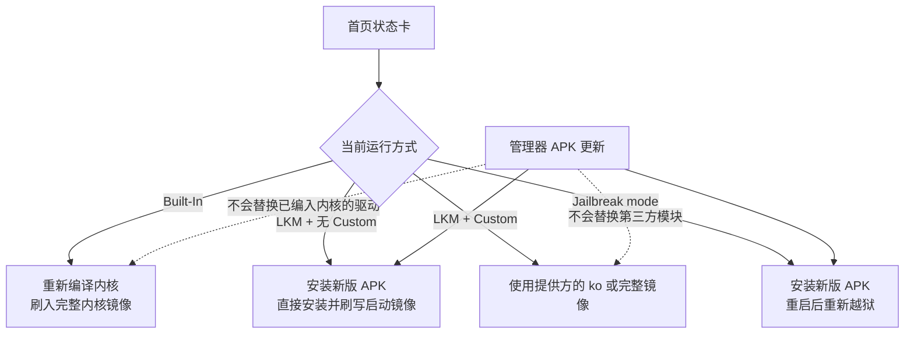

# 更新 FinaSU

<Badge text="三种部署方式" type="warning" /> <Badge text="先确认再动手" type="danger" />

FinaSU 由管理器 APK、内核驱动 `kernelsu.ko`、用户态命令行工具 `ksud` 和内嵌引擎组成。它们可能来自同一次发布，但**安装位置和生效时机并不相同**：更新管理器 APK 不会自动替换正在运行的内核驱动，内置内核构建也不会因为安装新版 APK 而改变。

因此更新前必须先确认设备属于哪一种部署方式：**内置内核构建**、**LKM**，还是**越狱模式**。三者的驱动文件可以相同，加载方式和更新路径却完全不同。

::: warning 管理器版本不等于驱动版本

只看到管理器版本变化，不能推断内核驱动也已更新。更新完成后应同时核对首页的运行方式、管理器版本、内核构建版本和 UAPI 版本。

:::

## 先确认部署方式

打开管理器首页的状态卡，按下面三项判断当前部署方式。

:::: field-group

::: field 运行方式
@type `必看`
@default `LKM 或 Built-In`
显示 **LKM** 表示驱动以可加载模块形式运行；显示 **Built-In** 表示驱动已经编入内核镜像，而不是另一个独立代码分支。
:::

::: field 自定义标记
@type `可选`
@default `Custom`
出现 **Custom** 徽标表示当前 LKM 不是管理器 APK 自带的那一份，而是第三方或自行构建的模块。
:::

::: field 越狱标记
@type `必看`
@default `Jailbreak mode`
出现 **Jailbreak mode** 表示驱动是在系统启动后延迟加载的。该模式只对当前启动会话有效，普通重启后 Root 会消失。
:::

::::

::: tip 三种方式不是三套功能

内置构建和 LKM 使用的是同一套内核源码。内核侧只有在按模块构建时才设置 LKM 标志位，因此 `CONFIG_KSU=y` 编入内核后首页显示 **Built-In**。越狱模式同样加载标准的 `kernelsu.ko`，只是改在启动后由已经获得权限的进程加载。

:::

## 更新路径总览

更新路径由驱动当前的部署方式决定，而不是由管理器版本决定。先看首页状态卡，再按对应分支处理：

- **Built-In**：驱动已经编入内核，必须重新编译并刷入完整内核镜像。
- **LKM（无 Custom）**：驱动来自 APK 随包载荷，安装新版 APK 后通过直接安装或未使用槽位重新修补启动镜像。
- **LKM（Custom）**：驱动由第三方或自行构建，使用提供方的模块、完整镜像或本地 `.ko` 更新。
- **Jailbreak mode**：安装新版 APK 后完整重启，再重新执行越狱，让新载荷进入当前内核会话。

下面的流程图把同样的判断画成可视路径：



这些路径的共同点是：**管理器 APK 负责用户态和随包资源，内核驱动必须按它自己的部署方式单独更新**。更新过程中不要同时进行系统 OTA、模块批量刷写或切换其他 Root 方案。

::: danger 先准备救砖手段

任何写入启动分区的操作都可能因为镜像、分区、KMI 或槽位不匹配导致无法开机。更新前请阅读[救砖](/guide/rescue-bootloop/)，并确认能够恢复与当前系统完全匹配的原厂镜像。

:::

## 更新管理器 APK

管理器默认在启动后检查更新。开启 **设置 → 通用 → 检查更新** 时，它会请求 FinaSU 仓库的最新正式发布，并从发布资产中解析版本信息。

::: steps

1. **确认当前版本**

   在首页记录管理器版本、内核构建版本和运行方式。这样即使更新后出现问题，也能判断是用户态还是内核侧发生了变化。

2. **阅读发布说明**

   管理器发现新版本后会显示版本号与更新说明。确认该版本面向当前部署方式，并且没有要求先更换内核。

3. **下载官方 APK**

   更新卡片会打开浏览器的下载地址。只使用 FinaSU 官方发布页提供的 APK，不要混用来源不明的管理器或所谓“增强版”。

4. **覆盖安装**

   Android 只允许相同签名的 APK 覆盖安装。签名不同时必须先卸载旧管理器，而内核是否接受新管理器还取决于它信任的证书。

5. **按部署方式继续**

   管理器安装完成后，LKM 和越狱模式仍要按后文对应章节更新驱动；内置内核构建则需要重新刷入内核。

:::

### 发布资产的命名

管理器从资产文件名中解析版本号，因此官方发布使用固定格式。文件名不匹配时，即使发布存在，更新检查也可能无法识别。

::: code-tabs

@tab 命名格式

```text
<应用名>_<版本名>_<版本码>-<构建类型>.apk
```

@tab 正式版示例

```text
FinaSU_v1.0.10_33034-release.apk
```

@tab 预发布示例

```text
FinaSU_v1.1.0-beta1_33102-release.apk
```

:::

版本名来自 `git describe`，通常以 `v` 开头；版本码由 `30000 + 提交数` 生成。带 `-beta`、`-rc` 等后缀的标签会作为预发布发布，不会进入“最新正式发布”的检查结果；需要测试版时必须手动下载。

::: important 签名比版本号更重要

内核会校验管理器的 APK 签名。不同签名的管理器即使版本更新，也可能无法获得管理器身份或 Root 权限。自定义签名构建必须同时更新内核侧信任的证书大小与 SHA-256。

:::

## 更新 LKM 驱动

LKM 模式下，驱动以 `kernelsu.ko` 的形式放在启动镜像的 ramdisk 中，由 `ksuinit` 在启动早期加载。更新驱动意味着重新修补并刷写启动镜像，而不是替换管理器内的某个文件。

### 随包 LKM

没有 **Custom** 徽标时，当前驱动来自 FinaSU 官方 APK 内置的载荷。当内核版本码与管理器版本码不一致，且 UAPI 兼容时，首页会提示有新版本的内置 LKM。

::: steps

1. **处理版本提示**

   点击“有新版本的内置 LKM 可用”提示，进入[安装与刷写](/guide/install/)页面。

2. **选择刷写方式**

   当前设备已有 Root 且为 GKI 时，可以选择 **直接安装**。A/B 设备在刚完成 OTA、尚未重启时，可以选择 **安装到未使用的槽位**。

3. **确认目标镜像与分区**

   检查管理器自动识别出的 KMI、槽位和分区。不要手动把 `boot` 与 `init_boot` 互换，也不要用其他系统版本的镜像代替当前镜像。

4. **开启刷写前备份**

   如果设置中尚未开启，请在安装页临时启用备份。更新失败时，原始启动镜像往往比任何日志都更有用。

5. **刷写并重启**

   刷写完成后正常重启。只有重启后首页仍显示 **LKM**，且版本与 UAPI 均已更新，驱动才算真正生效。

:::

::: warning 非 GKI 设备没有“直接安装”

安装页只在设备已有 Root 且为 GKI 时提供 **直接安装**。非 GKI 设备即使收到 LKM 更新提示，也需要先取得与当前系统匹配的启动镜像，再使用“选择文件并修补”。

:::

### 自定义 LKM

出现 **Custom** 徽标时，管理器不会把驱动视为随包载荷，也不会提示替换为官方内置 LKM。此时驱动由内核作者或自行构建提供。

更新方式取决于提供方：

- 提供完整内核或 AnyKernel3 包时，按提供方的说明刷入。
- 只提供新的 `kernelsu.ko` 时，在安装页选择 **使用本地 LKM 文件**，再重新修补当前启动镜像。
- 手动选择 `.ko` 前必须确认架构、KMI 和管理器签名信任关系都匹配。错误的模块会在启动阶段加载失败。

::: danger 不要混用模块与管理器

把第三方 LKM 与任意版本的官方管理器组合，可能因 UAPI 或签名差异导致无法授权。更新其中一侧前，先确认提供方给出的兼容范围。

:::

### LKM 更新时序

::: timeline 一次完整的 LKM 更新

- 管理器发现新版本并下载 APK
  time=准备 type=tip

- 覆盖安装管理器，随包资源和 `ksud` 更新
  time=用户态

- 选择直接安装或未使用槽位，重新打包启动镜像
  time=驱动

- 刷写目标分区并重启
  time=生效

- 首页确认 LKM 标志、版本和 UAPI
  time=验证 type=success

:::

## 更新内置内核构建

内置内核构建把驱动编进内核镜像，驱动不再是 ramdisk 中的独立模块。管理器无法通过“直接安装”替换这种驱动，相关提示也不会提供一键安装入口。

### 重新构建

更新时必须基于目标内核源码重新编译，并继续使用与当前管理器匹配的证书配置。

::: code-tabs

@tab 接入 FinaSU

```sh
./kernel/setup.sh --dir /path/to/FinaSU
scripts/config --enable KSU
scripts/config --enable KPROBES
scripts/config --enable KALLSYMS_ALL
scripts/config --enable EXT4_FS
scripts/config --enable HEADERS_INSTALL
```

@tab 构建内核

```sh
make ... KSU_REQUIRE_PREINIT=1
```

:::

完整的选项说明与证书要求见[内核集成](/developer/builtin-integration/)。构建产物是完整内核，不是可以放进 ramdisk 的独立模块。

::: steps

1. **同步源码**

   拉取目标版本的 FinaSU 源码，并按当前内核版本重新执行接入脚本。不要只替换旧内核源码中的单个文件。

2. **确认配置**

   保持 `CONFIG_KSU=y`，并显式传入 `KSU_REQUIRE_PREINIT=1`。缺少 UAPI 头文件时，静默关闭 preinit 会让启动阶段行为与预期不一致。

3. **重新编译**

   使用与设备内核版本、编译器和配置匹配的构建环境。跨版本复用编译产物可能直接导致无法启动。

4. **刷入完整内核镜像**

   按内核维护者的方式刷入新镜像。内置构建通常直接替换 `boot` 中的内核，而不是修补 ramdisk。

5. **验证管理器身份**

   重启后确认首页显示 **Built-In**，并且管理器能够正常授权。签名不匹配时，驱动会拒绝管理器。

:::

::: danger 内核与系统版本必须匹配

内置构建随系统 OTA 一起被整体替换。系统升级后继续使用旧内核，可能出现无法开机、模块失效或 UAPI 不兼容。系统更新后必须重新构建并刷入匹配新系统的内核。

:::

## 更新越狱模式

越狱模式（late load）在当前系统启动后加载驱动，适合无法直接修补启动镜像、但已经具备提权入口的设备。它**不是另一套驱动**：加载的仍然是标准的 `<KMI>_kernelsu.ko`，安装的仍然是同一份 `ksud`，加载后同样执行安装、模块和启动脚本流程。

::: info 复用的是同一份文件

越狱流程会从当前 `ksud` 的内嵌资源中取出与设备 KMI 对应的 `kernelsu.ko`，这个文件名与修补启动镜像时使用的模块相同。加载成功后，它还会通过常规安装路径写入 `ksud`。因此更新越狱模式的关键，是让**当前 APK 内嵌的那份载荷**变成新版本。

驱动加载后仍由同一套 `ksu_cred`、SELinux 域和授权模型接管，不存在“越狱专用”的低权限版本。差异来自加载时机：延迟加载会跳过启动早期的部分 kprobe 注册。

:::

### 为什么不能直接更新

越狱模式没有可重新刷写的启动镜像补丁，管理器也不会在这种模式下提供内核更新按钮。此外，越狱流程启动时会先检查系统中是否已经存在 KernelSU：

- 尚未加载时，它才从内嵌资源加载 `kernelsu.ko`。
- 已经加载时，它跳过模块加载，只重新执行后续安装和启动脚本。

这意味着在同一个启动会话中重复执行越狱，**不会替换已经在内存里的驱动**。越狱模式下随包标记也没有实际意义，因为无法通过刷写启动镜像来更新它。

### 更新步骤

::: steps

1. **更新管理器 APK**

   按“更新管理器 APK”章节覆盖安装新版。新的 `ksud` 和 `<KMI>_kernelsu.ko` 会随 APK 一起到位。

2. **正常重启**

   普通重启会结束当前内核会话，Root 也会随之消失。这是让旧驱动退出内存的必要步骤。

3. **重新执行越狱**

   设备启动后再次执行越狱。此时加载的是新 APK 内嵌的驱动，而不是上一次会话中的旧模块。

4. **核对版本**

   越狱成功后首页应同时显示 **Jailbreak mode** 与新的内核构建版本。只更新 APK 而没有重新越狱时，驱动仍是旧版本。

:::

::: warning 软重启不能更新驱动

软重启会保留已经加载的内核模块，只重新启动 Android 用户态，适合让模块改动生效，但不适合替换驱动。需要更新越狱模式驱动时，必须完整重启后重新越狱。

:::

## Android 系统 OTA

系统 OTA 会替换启动链和内核，因此所有部署方式都要在 OTA 后重新确认 FinaSU 状态。模块和大部分设置位于 `/data`，通常不会被 OTA 删除，但旧模块可能因系统变化而失效。

::: table OTA 后的处理方式

| 部署方式 | A/B 设备 | 非 A/B 设备 |
| --- | --- | --- |
| 随包 LKM | OTA 完成后先不要重启，选择**安装到未使用的槽位**，再重启进入新系统 | 先恢复原厂镜像完成 OTA，再重新修补当前系统的启动镜像 |
| 自定义 LKM | 使用提供方针对新系统发布的内核或模块 | 同左，必须等待兼容新系统的构建 |
| 内置内核构建 | 重新编译匹配新系统的内核并刷入 | 同左，OTA 已覆盖旧内核 |
| 越狱模式 | OTA 后重新执行越狱 | 同左，没有需要保留的启动分区补丁 |

:::

“安装到未使用的槽位”需要当前已有 Root、设备为 GKI，并且使用 A/B 分区。条件不满足时，管理器不会提供该选项。

::: danger OTA 后不要抢先重启

对 A/B 设备而言，“安装到未使用的槽位”只能在 OTA 已写入但尚未重启时完成。先重启进入新系统会失去这次直接修补的机会，只能重新提取镜像或重新越狱。

:::

## 随包引擎与模块

`ksud`、FolkZygisk、Sui、NoMount 载荷和管理器 APK 一起发布。更新 APK 后，这些用户态组件会在下一次启动或对应功能重新发布载荷时生效。

- **FolkZygisk** 和 **Sui** 需要重启才能重新注入 Zygote。
- **Sui** 状态异常时，可以在其页面执行“修复载荷”，从当前 `ksud` 重新发布文件。
- **NoMount** 的内核模块按 KMI 编译；更换系统内核后必须使用匹配新 KMI 的版本。
- 已安装模块由“检查模块更新”独立检查，与 FinaSU 自身的版本更新不是同一件事。

::: warning 模块更新不是系统更新

模块作者没有提供可靠版本信息时，管理器可能不会提示更新。不要把模块列表中的“最新”理解为整个 FinaSU 已是最新版本。

:::

## 更新后检查

::: steps

1. **确认运行方式**

   首页应显示预期的 **Built-In**、**LKM** 或 **Jailbreak mode**。运行方式与更新前不一致时，先停止后续操作。

2. **核对三个版本**

   记录管理器版本、内核构建版本和 UAPI 版本。状态卡会以 `内核版本码-UAPI` 的形式显示驱动信息；内核构建版本来自驱动，旧内核不支持该接口时会隐藏这一行，这本身也是一条兼容性信息。

3. **检查兼容性提示**

   首页不应出现“需要更新管理器”或“需要更新内核”的警告。仍有提示时，按下一节处理。

4. **验证 Root 与模块**

   打开一个已授权应用测试 Root，并确认模块挂载和 Folk Mount 提供方正常。仅看到管理器界面正常，不代表驱动工作正常。

5. **验证内置引擎**

   使用 Sui、FolkZygisk 或 NoMount 时，分别检查其运行状态。注入类功能通常需要一次完整重启。

:::

## 版本不匹配时

管理器的兼容性提示基于内核 UAPI 与管理器 UAPI 的比较，而不是版本号字符串。

::: table 常见提示与处理

| 界面提示 | 含义 | 处理方式 |
| --- | --- | --- |
| **Manager update required** | 内核 UAPI 高于管理器 | 安装更新的官方管理器 APK |
| **Kernel update required. Tap to install.** | 管理器 UAPI 高于内核，且当前允许刷写 | 按 LKM 流程更新驱动 |
| **Kernel update required**（无按钮） | 内置构建或越狱模式无法直接刷写 | 重编内核，或重启后重新越狱 |
| **A newer bundled LKM is available** | 随包 LKM 的版本码与管理器不同 | 使用直接安装或未使用槽位 |
| **Custom** 徽标 | 当前 LKM 不是官方随包载荷 | 使用提供方更新 |
| **Jailbreak mode** 标签 | Root 只对当前启动会话有效 | 重启后重新越狱 |

:::

## 更新相关文件

```file-tree title="更新涉及的常见位置"
/data/adb
├── ksud                      # 用户态命令行工具
├── ksu/
│   ├── .allowlist            # 授权与 Profile 状态
│   ├── profile/
│   └── sui/                  # Sui 状态目录
└── modules/                  # 已安装模块
    └── <模块 ID>/
```

不要为了“更新干净”而手动删除整个 `/data/adb/ksu` 或 `/data/adb/modules`。这些目录同时保存授权、Profile、模块和引擎状态，误删会造成权限丢失或模块无法恢复。

## 排错

::: collapse accordion

- **更新 APK 后提示内核过旧**

  这表示管理器 UAPI 高于当前驱动。随包 LKM 可以通过直接安装更新；内置构建需要重新编译内核；越狱模式需要重启后重新越狱。

- **安装页没有“直接安装”**

  该选项要求当前已有 Root 且设备为 GKI。非 GKI 设备需要先准备匹配当前系统的启动镜像，再使用“选择文件并修补”。

- **更新后无法开机**

  立即停止反复重启，按[救砖](/guide/rescue-bootloop/)恢复原厂镜像。常见原因是分区、槽位、KMI 或内核版本不匹配。

- **越狱成功但版本仍是旧的**

  同一启动会话中，越狱流程检测到驱动已加载就会跳过模块加载。完整重启后重新越狱，才能使用新 APK 内嵌的驱动。

- **更新检查没有提示**

  确认“检查更新”已开启、网络可用，并且当前版本不是更新的预发布。预发布不会进入“最新正式发布”的检查结果。

- **内置引擎更新后没有生效**

  注入类组件需要重启。Sui 载荷异常时执行“修复载荷”，然后重启；不要通过反复开关代替重启。

- **模块在 OTA 后消失或失效**

  检查 `/data/adb/modules` 是否仍存在，并确认模块支持新的系统与 KMI。系统升级后需要重新验证模块兼容性。

:::

## 常见问题

::: chat title="更新 FinaSU 问答"
{用户}
只更新管理器 APK，内核驱动会一起更新吗？

{.}
不会。APK 更新的是管理器、`ksud` 和随包资源。内置构建需要重新刷内核；随包 LKM 需要重新修补启动镜像；越狱模式需要重启后重新越狱。

{用户}
内置构建和 LKM 的驱动文件不一样吗？

{.}
源码相同，部署形式不同。LKM 把驱动编译成独立模块放进 ramdisk；内置构建把驱动直接编进内核镜像。首页的 **Built-In** 和 **LKM** 只是内核报告的加载方式。

{用户}
越狱模式复用的是同一份文件吗？

{.}
是。它从当前 `ksud` 的内嵌资源中加载与设备 KMI 匹配的 `kernelsu.ko`，并安装同一份 `ksud`。区别在于加载时机和加载方式，而不是另一套驱动。

{用户}
为什么越狱模式下不能点“安装内核更新”？

{.}
越狱模式没有可重新刷写的启动分区补丁，而且设备可能处于锁定 Bootloader 状态。管理器不会在这种模式下提供内核刷写入口。

{用户}
OTA 后可以直接重启吗？

{.}
A/B 设备如果希望把 FinaSU 安装到新槽位，必须在 OTA 完成但尚未重启时操作。其他部署方式也应在重启前确认新系统对应的内核或越狱条件。

{用户}
更新失败后最先检查什么？

{.}
先确认是否还能进入系统或恢复模式。如果不能，优先救砖；如果能，检查运行方式、管理器版本、内核构建版本和 UAPI，再判断问题出在用户态还是驱动。
:::

## 相关页面

- [安装与刷写](/guide/install/)
- [内核集成](/developer/builtin-integration/)
- [更新与版本设置](/setting/update/)
- [救砖](/guide/rescue-bootloop/)
- [常见问题与解答](/guide/faq/)

*[LKM]: Loadable Kernel Module，可加载内核模块
*[KMI]: Kernel Module Interface，Android 内核模块接口版本
*[UAPI]: 内核与用户态之间的稳定接口
*[OTA]: Over-The-Air，系统在线更新
*[GKI]: Generic Kernel Image，Android 通用内核镜像
*[AVB]: Android Verified Boot，Android 启动验证
