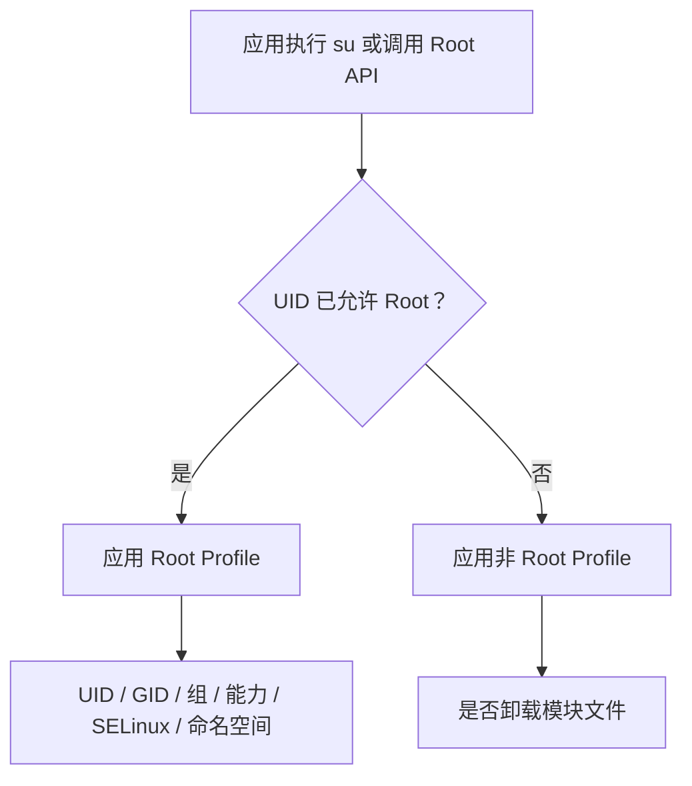

# App Profile

<Badge text="按 UID 生效" type="tip" /> <Badge text="权限边界" type="warning" />

App Profile 是某个 UID 的完整应用策略。它既决定应用获得 Root 后使用什么身份与权限，也决定应用没有 Root 时是否看见模块注入的文件。

::: tip 进入方式

管理器 → **超级用户** → 点击应用或 UID 分组。在详情页顶部切换 Root 授权，在下方选择 Profile 模式。

:::

## 页面结构

顶部应用卡片显示应用名、包名、版本、UID，以及多用户或共享 UID 标记。右上角菜单还可以：

- **启动**：打开目标应用；
- **强制停止**：结束目标应用进程；
- **重新启动**：先停止再启动目标应用。

这些操作只用于让应用重新读取 Root 与文件可见性状态，不会修改授权。

::: important Root 开关只出现在这里

超级用户列表用于查找和查看状态。真正修改 Root 授权要进入 App Profile 后切换“超级用户”开关。关闭授权不会删除应用数据。

:::

## 两套 Profile

同一个应用有 Root 与非 Root 两套策略，管理器根据 Root 开关显示对应配置。

### Root Profile 模式

:::: table Root Profile

| 模式 | 行为 | 适合谁 |
| --- | --- | --- |
| **默认** | 使用内核默认 Root Profile，不再保存应用级自定义参数。 | 普通用户和大多数需要普通 Root 的应用。 |
| **模板** | 选用模板时复制当时的 Root Profile 字段，并记录模板 ID。之后修改模板不会自动改写已保存的应用策略。 | 需要复用一组固定权限策略。 |
| **自定义** | 只对此 UID 保存一套参数。 | 明确理解 UID、GID、capability、SELinux 与挂载命名空间的人。 |

::::

::: tip 先用默认或预设模板

不了解各字段时，==保持“默认”或选择用途合适的预设模板==。没有必要为了让应用获得 Root 就修改 UID、SELinux 或 capability。

:::

### 非 Root Profile 模式

非 Root Profile 只有“默认”和“自定义”两种：

- **默认**：跟随当前内核的默认非 Root 策略；
- **自定义**：单独决定是否为这个 UID 卸载模块注入的文件。

“卸载模块”开启后，应用看到的是模块注入前的系统文件视图；关闭后，应用可以看到模块文件。模板只描述 Root Profile，不控制非 Root 的“卸载模块”。

## 自定义 Root Profile 字段

:::: field-group

::: field UID
@type `整数`
Root 进程使用的用户 ID。默认值为 `0`，表示 root。除明确需要模拟其他身份的场景外，不要修改。
:::

::: field GID
@type `整数`
Root 进程使用的主组 ID。默认值为 `0`。错误的 GID 可能让文件访问和进程组行为与预期不同。
:::

::: field Groups
@type `最多 32 项`
附加用户组。勾选 `root`、`system`、`shell` 或具体组后，Root 进程会加入对应组。组越多不代表兼容性越好，应按应用实际需要选择。
:::

::: field Capabilities
@type `能力集合`
传给 Root 进程的 capability 集合。取消 `SYS_ADMIN`、`DAC_OVERRIDE`、`NET_ADMIN` 等能力可能直接破坏依赖 Root 的功能。
:::

::: field 挂载命名空间
@type `继承 / 全局 / 独立`
`继承`保持发起进程当前命名空间；`全局`切到全局挂载视图；`独立`创建私有挂载命名空间。除非模块可见性有特殊要求，否则使用“继承”。
:::

::: field Flags
@type `NO_NEW_PRIVS`
阻止该 Root 上下文通过 KernelSU 继续提升权限。普通应用通常不需要开启；调试受限 Root 环境时才使用。
:::

::: field SELinux
@type `上下文与规则`
设置 Root 进程的 SELinux 域和额外规则。字段会校验格式；错误域或规则可能导致应用被拒绝访问，也可能扩大权限。默认值不应随意替换。
:::

::::

::: danger 自定义不是“权限越多越好”

自定义 Profile 会改变真实的内核凭据。错误组合可能让应用获得超出预期的能力，也可能使文件管理、终端、备份等 Root 功能全部失效。保存前先用不重要的测试应用验证。

:::

## 模板

模板入口是 **设置 → 通用 → App Profile 模板**，不是应用详情页里的“模板”文字本身。

模板通常包含 ID、名称、描述和一组 Root Profile 参数。选择“模板”模式时，管理器会把当时的模板字段复制到该 UID，并记录模板 ID：

- 模板不是实时继承；修改模板不会自动更新已经保存的 UID 策略；
- 要让某应用使用新模板值，需要重新选择并应用该模板；
- 删除模板不会自动清空应用当前已经复制到内核的字段，但会移除之后重新应用的来源；
- 管理器不会在模板编辑器中列出所有使用该 ID 的应用，修改前应自行记录影响范围；
- 导入模板等于接受其中全部 UID、组、能力和 SELinux 设置；
- 普通用户应优先使用页面已加载的预设，不必自己创建。

完整字段说明见 [App Profile 模板](/setting/profile-template/)。

## 动态管理器

动态管理器开关只在以下条件同时满足时出现：

- 当前内核支持动态管理器；
- 当前条目不是特殊 UID；
- 应用是预置管理器、已经被授权，或设置中启用了实验性的“允许任意应用成为动态管理器”。

打开开关时，管理器会提取目标 APK 的签名证书大小和 SHA-256，把签名登记到内核，并授权这个 UID。关闭时：

- 支持应用 ID 授权表的新内核只撤销该 UID 的管理权限，保留已登记签名；
- 旧内核没有独立撤销能力时，会删除整个签名登记。

::: danger 动态管理器权限很高

动态管理器能够管理内核 Root。不要因为“包名看起来一样”就授权；升级、重新签名或换用不同构建后都必须重新核对。详见[动态管理器](/manager/dynamic-manager/)。

:::

## 共享 UID

多个包可能共享一个 UID。详情页会显示“影响以下应用”，列出所有受影响条目。

- Root 状态按 UID 保存；
- 非 Root 的“卸载模块”也按 UID 生效；
- Root Profile 的自定义身份、能力和 SELinux 同样由整个 UID 共享；
- 给其中任意一个包授权，其他同 UID 包也能获得相同 Root 资格。

## 修改后验证

:::: steps

1. 保存 Profile，确认页面没有报错。
2. 用右上角菜单强制停止或重新启动目标应用。
3. 让应用重新执行一次需要 Root 的操作。
4. 到 [SU 日志](/manager/su-log/) 确认请求 UID 与执行结果。
5. 如果仍失败，先把 Profile 改回“默认”验证，再逐项恢复自定义设置。

::::

## 常见问题

:::: collapse accordion

- **应用已授权，为什么还是说没有 Root？**

  先检查自定义 UID、GID、能力、SELinux 域和命名空间。为了排查，可临时切回默认 Root Profile。还要确认应用是否在某次执行后缓存了失败结果。

- **为什么列表没有单独的“已拒绝”标记？**

  超级用户页展示当前可枚举应用及其 Profile 状态。拒绝后的普通应用仍可能出现在列表中，只是没有 `ROOT` 徽标；管理器不保留一条永久“拒绝”徽标。实际请求历史看 SU 日志。

- **“卸载模块”关闭后，应用会获得 Root 吗？**

  不会。它只改变非 Root 状态下的文件可见性；Root 授权由顶部“超级用户”开关单独决定。

- **模板和自定义可以同时用吗？**

  不能。Root Profile 一次只能处于默认、模板或自定义三种模式之一。

- **修改模板后，所有使用它的应用都会自动变化吗？**

  不会。选中模板时，模板字段已经复制到对应 UID。修改模板后要回到每个需要更新的 App Profile，重新选择并应用模板，再重新启动应用验证。

::::

## 相关页面

- [超级用户](/manager/superuser/)：查找应用、UID 分组与授权状态。
- [App Profile 模板](/setting/profile-template/)：预设、自定义模板与导入导出。
- [动态管理器](/manager/dynamic-manager/)：管理器信任与撤销差异。
- [SU 日志](/manager/su-log/)：确认实际请求与执行结果。
