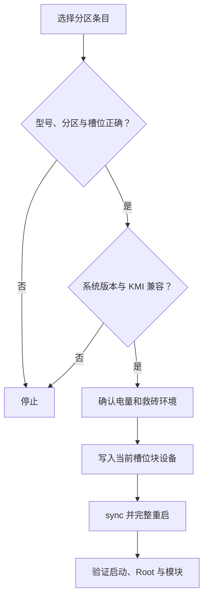

# 备份与 WebDAV

<Badge text="不只是授权" type="tip" /> <Badge text="分区恢复不可轻试" type="danger" />

管理器可以把超级用户列表、启动分区和刷写前模块快照保存到本地或 WebDAV。备份配置位于 **设置 → 备份**；本页重点说明恢复列表、实际恢复行为以及容易误解的地方。

::: tip 进入方式

管理器 → 设置 → 备份。配置完成后使用“管理备份”查看本地与 WebDAV 条目。

:::

::: important 先看权威操作说明

目标开关、备份内容、WebDAV 字段和“立即备份”的完整步骤见[设置 → 备份](/setting/backup/)。本页只补充管理器板块需要强调的恢复边界。

:::

## 备份写到哪里

### 本地

本地备份通过 Android 公共下载目录保存：

```file-tree title="本地备份结构"
Download/
└── FinaSU/
    ├── modules/
    │   └── <module-id>/
    │       ├── <module>-installer-...zip
    │       ├── <module>-snapshot-...zip
    │       └── *.meta.json
    ├── allowlist/
    │   └── allowlist-<timestamp>.json
    └── boot/
        ├── boot-stock-<sha1>.img
        ├── init_boot-current-<sha1>.img
        └── *.meta.json
```

文件名中的 `installer`、`snapshot`、`stock`、`patched` 或 `current` 是来源标记，不代表内容一定兼容当前设备。恢复前仍要查看条目来源和元数据。

### WebDAV

WebDAV 使用相同的 `modules/`、`allowlist/` 和 `boot/` 相对目录。远端路径留空时直接写入服务器地址指定的根目录。

“测试连接”检查当前地址、认证和基础访问能力，但不能保证稍后仍有空间、网络不会中断，或远端文件没有被其他客户端修改。

## 密码填写的实际行为

WebDAV 密码会加密保存在管理器的秘密存储中，但输入框本身不会回显密码。

- **不碰密码输入框**：保留已保存密码；
- **输入新密码**：立即替换已保存密码；
- **把输入框清空**：删除已保存密码，后续连接将不再携带该密码；
- **看到“已保存（留空则保持不变）”**：它描述的是未编辑状态，不代表主动清空后仍能保留。

::: warning 不要把清空当作“不改”

需要保留密码时不要选中后删除。只有确实要移除认证信息时才清空。若服务器使用应用专用密码或 Token，更新它后也要同步修改管理器中的值。

:::

## 三类备份内容

:::: table 备份内容

| 内容 | 什么时候生成 | 恢复时做什么 |
| --- | --- | --- |
| **模块** | 主要在启用“刷写前备份”后，归档本次安装或更新的安装包，并对被替换的已安装模块生成快照。 | 把备份 ZIP 重新交给 `ksud module install`，通常需要重启后生效。 |
| **超级用户列表** | 立即备份或刷写前备份选择该内容时生成。 | 逐条调用内核设置接口，恢复 Root 与 Profile 数据。 |
| **分区** | 立即备份或刷写前备份选择对应分区时生成。 | 通过 Root Shell 直接写回当前槽位对应的块设备。 |

::::

::: important “立即备份”不等于打包全部已安装模块

当前“立即备份”主要保存已启用的超级用户列表和所选分区。普通模块安装包归档主要发生在刷写前备份中，所以只打开“模块”开关但不进入刷写流程，不能期待立刻出现完整的模块打包。

:::

## 刷写前备份

启用“刷写前备份”后，安装或更新模块前会按已启用的目标与内容选择尝试保存：

- 即将安装的模块 ZIP；
- 被这次安装替换的已安装模块快照；
- 选中的超级用户列表；
- 选中的启动分区。

快照目标是“在覆盖前留下可回退材料”，不是“保证所有内容都能成功保存”。任意目标失败都应被视为风险：可以继续刷写，但不要声称已经拥有完整回滚点。

::: tip 先手动演练

第一次配置 WebDAV、修改远程路径或更换存储空间后，先执行一次“立即备份”并在“管理备份”中确认条目可见。不要等到刷写失败时才发现备份没有写成。

:::

## 启动分区备份

页面只列出管理器实际检测到的分区：

| 分区 | 通常包含什么 | 不能据此推断什么 |
| --- | --- | --- |
| `boot` | Linux 内核；Android 13 之前部分设备还包含通用 ramdisk。 | 不代表所有设备都只需要 `boot`。 |
| `init_boot` | Android 13 及以后部分 GKI 设备的通用 ramdisk。 | 这里通常没有 Linux 内核。 |
| `vendor_boot` | 厂商内核模块、设备树和厂商 ramdisk。 | 不代表每个厂商或设备都有该分区。 |

A/B 设备恢复时会优先解析当前活动槽位的块设备。备份中的设备型号、指纹和文件名只能帮助识别，不能替代人工核对槽位与系统版本。

::: danger 分区恢复会直接覆盖块设备

确认备份来自同一设备、对应正确分区和槽位，并且当前系统与 KMI 没有跨代变化。恢复前准备可用的电脑或 Recovery 救砖路径；错误的镜像可能直接导致无法启动。

:::

## 恢复列表

“管理备份”合并显示本地与 WebDAV 条目，并按模块、超级用户列表、分区归类。每行显示来源和目标大小：

```text
Local · 128.4 MiB
WebDAV · 4.2 MiB
```

::: danger 点条目就会执行恢复

恢复列表没有额外的“预览后再开始”步骤。点击条目本身即开始恢复；删除按钮有确认，但恢复没有同样明显的确认页。操作前先看清条目分组、来源、名称与大小。

:::

### 恢复模块

模块条目被重新安装到 `/data/adb/modules/<id>`：

- 快照和原始安装包都会走模块安装流程；
- 同名模块可能被覆盖；
- 脚本与文件注入通常要重启后才完整生效；
- 已经加载进内核或内存的内容不会自动替换。

### 恢复超级用户列表

恢复会逐条应用备份中的 UID 与 Profile：

- 不会自动清除备份中不存在的现有授权；
- UID、包名或 Android 用户空间变化后，旧条目可能不再对应原来的应用；
- 恢复后应逐个检查 Root、非 Root、模板引用和 SELinux 配置；
- 操作可能只应用部分条目；出现失败提示时不要假设全部成功。

### 恢复分区

管理器先把远端或本地镜像取到临时文件，再写入分区并同步。恢复完成后应完整重启验证，不要只软重启。



## 删除备份

删除会移除所选备份文件及其元数据 sidecar：

- 本地文件从 `Download/FinaSU/` 删除；
- WebDAV 文件从远端目录删除；
- 删除通常不可撤销；
- 不要删除不认识的远端文件，尤其是多人共用目录。

## 常见问题

:::: collapse accordion

- **只选“模块”后为什么不能立即备份？**

  “立即备份”要求至少选中超级用户列表或一个分区。模块归档主要由刷写前备份触发。

- **WebDAV 测试成功，为什么备份仍失败？**

  测试只验证当前连接。空间不足、权限限制、服务器不支持所需方法、网络中断或路径冲突都可能在写入时失败。

- **恢复授权后，应用为什么仍没有 Root？**

  检查 UID 是否变化、Root Profile 是否启用、模板是否仍存在，以及 SELinux、capabilities 和命名空间限制。

- **恢复模块成功提示后，为什么功能没变？**

  恢复的是磁盘模块，需要重启；加载器和挂载提供者也必须正常工作。

- **恢复分区后可以软重启吗？**

  不建议。分区级变化需要完整启动流程重新读取镜像。

::::

## 相关页面

- [设置 → 备份](/setting/backup/)：完整配置、立即备份和 WebDAV 操作。
- [模块管理](/manager/module/)：模块安装、启用与卸载。
- [超级用户](/manager/superuser/)：恢复后检查授权。
- [App Profile](/manager/app-profile/)：Profile 与模板策略。
- [`/data/adb` 存储结构](/manager/storage/)：设备内部状态目录。
