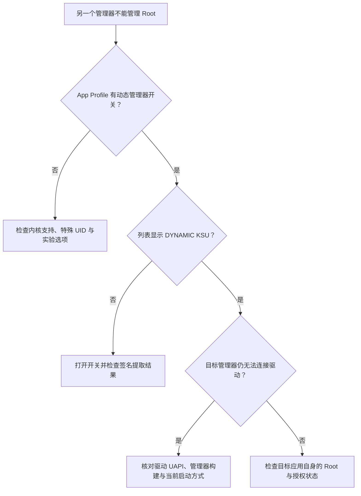

# 动态管理器

<Badge text="管理器身份" type="warning" /> <Badge text="高权限" type="danger" />

内核默认只信任构建时指定的 FinaSU 管理器签名。动态管理器允许设备上的另一个管理器 APK 登记自己的签名，并在获得该 UID 的授权后管理同一个 Root 驱动。

::: tip 入口在哪里

先打开 **超级用户 → 应用 → App Profile**。只有满足条件的应用才会显示“设为动态管理器”开关。实验性的“允许任意应用成为动态管理器”位于 **设置 → 功能**。

:::

## 三个身份级别

:::: table 管理器状态

| 状态 | 含义 | 能否管理驱动 |
| --- | --- | --- |
| 默认 FinaSU 签名 | 构建时受信任的管理器身份。 | 可以 |
| 预置管理器候选 | 内核识别该签名，但不会自动授权。超级用户列表显示 `KSU`。 | 切换前不可以 |
| 已授予动态管理器 | 签名已登记，且当前 UID 在授权表中。列表显示 `DYNAMIC KSU`。 | 可以 |

::::

“识别”与“授权”是两件事。内核认出某个签名，只说明它符合预置候选规则；并不表示任何使用该签名的应用都能直接管理 Root。

## App Profile 中的开关何时出现

“设为动态管理器”不是所有应用都能看到的通用开关。需要同时满足：

- 当前内核支持动态管理器；
- 当前不是 WebView Zygote 等特殊 UID；
- 应用属于预置管理器候选、已经获得动态管理器授权，或设置中已开启“允许任意应用成为动态管理器”。

::: warning “允许任意应用”只是显示开关

打开实验选项只会让任意应用在 App Profile 中出现动态管理器开关，不会自动授权任何应用。你仍然需要进入具体应用并主动打开开关。

:::

## 授予动态管理器

:::: steps

1. **核对 APK**

   确认包名、签名来源、版本和安装来源。包名相同不代表 APK 与官方构建相同。

2. **打开 App Profile**

   在超级用户列表找到目标应用。若没有开关，先确认内核支持与实验选项。

3. **打开“设为动态管理器”**

   管理器提取目标 APK 的 v2 签名证书大小和 SHA-256，把这组身份登记给内核，并授权对应应用 UID。

4. **重新探测 Root**

   切换期间 Root Shell 可能短暂受影响。管理器会自动重新探测身份；若界面没有恢复，打开首页触发刷新或重新启动管理器。

5. **验证接管**

   目标管理器应能读取同一驱动版本、授权列表和模块状态。两边显示不一致时，不要继续修改授权。

::::

授予操作不要求完整重启。登记表会持久化，并在后续启动时重新应用。

## 撤销动态管理器

撤销行为取决于内核能力：

### 支持应用 ID 授权表的新内核

- 只撤销目标 UID 的管理权限；
- 证书仍保持登记，应用仍可被识别；
- 重新打开开关时，可以再次授权同一 UID。

### 没有独立撤销能力的旧内核

- 只要登记了证书，使用该证书的应用就可能被当作管理器；
- 因此关闭开关时会删除整个签名登记；
- 其他共享同一签名的包也会一起失去动态管理器身份。

::: danger 同一签名可能对应多个包

动态管理器的信任对象首先是签名证书，新内核再叠加 UID 授权。关闭旧内核上的开关前，确认没有其他需要保留的管理器使用同一签名。

:::

## 持久化与升级

动态管理器配置写入 `/data/adb/ksu/.dynamic_manager`，由 `ksud` 在启动阶段重新推送给内核；内核还会保有自己的持久快照，以避免用户态 `ksud` 被其他管理器替换时丢失授权状态。

- 不要手工编辑这两个文件；
- APK 升级后如果签名没变，证书身份通常不变；
- 重新签名会生成不同证书，旧条目不能代表新构建；
- 包名相同、版本号更高，也不能替代签名核对。

## 状态不一致

常见问题：

- **开关出现但打开失败**：通常是没有有效 Root 管理通道、签名提取失败，或内核拒绝登记；
- **关闭后仍显示 `KSU`**：这是预置候选徽标，不等于仍有管理授权；
- **更新 APK 后失效**：重新签名改变了证书，需要重新登记；
- **两个管理器显示的状态不同**：确认它们连接的是同一驱动，且没有旧管理器覆盖 `/data/adb/ksud`。

## 安全边界

动态管理器可以：

- 读取和修改 Root 授权；
- 管理模块与内置引擎；
- 执行设备维护操作；
- 影响内核安全边界。

它不能仅靠“看起来像同一个应用”获得信任。只应对自己构建、签名和核对过哈希的 APK 使用此功能。

::: danger 不要为了消除报错而放开任意应用

如果目标 APK 无法证明身份，正确做法是修复来源或使用正确签名构建，而不是打开“允许任意应用”后盲目授权。

:::

## 相关页面

- [App Profile](/manager/app-profile/)：Root、非 Root 与动态管理器开关。
- [设置 → 功能](/setting/function/)：实验性动态管理器选项。
- [切换到 FinaSU](/guide/switch/kernelsu/)：不同管理器方案之间的迁移。
- [`/data/adb` 存储结构](/manager/storage/)：动态管理器文件位置。
