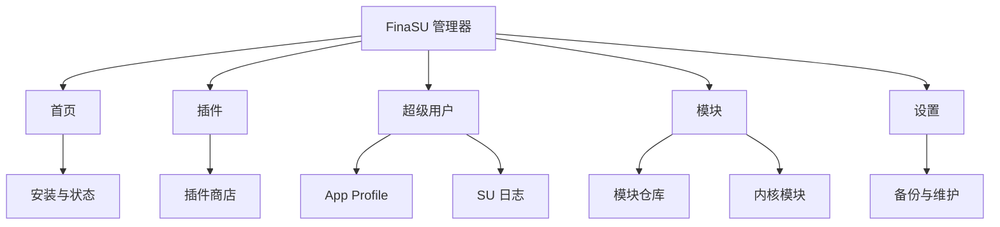
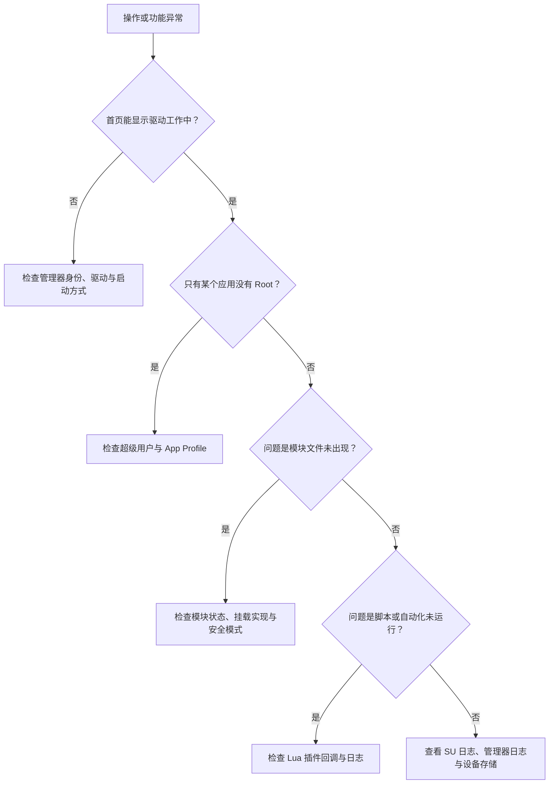

# 管理器总览

<Badge text="先找目的" type="tip" /> <Badge text="管理器不是驱动" type="warning" />

FinaSU 管理器负责显示状态、处理授权、安装模块与插件、执行维护操作。真正提供 Root 的是当前启动方式加载的内核驱动；APK 本身不会因为“已安装”就自动获得 Root。

::: tip 最快的查找方式

先看下面的“我想……”表。管理器没有把所有功能塞进设置页：普通模块入口在底部 **模块**，Lua 插件入口在底部 **插件**，应用授权入口在底部 **超级用户**。

:::

## 我想……

:::: table 按目的进入

| 我想…… | 去哪里 | 说明 |
| --- | --- | --- |
| 允许、拒绝或修改某个应用的 Root | [超级用户](/manager/superuser/) | 找到应用后进入 App Profile，Root 开关在那里。 |
| 限制应用能看到的模块文件、UID、权限或 SELinux 域 | [App Profile](/manager/app-profile/) | 同时管理 Root 与非 Root 状态下的应用策略。 |
| 安装、启停、更新或卸载普通模块 | [模块管理](/manager/module/) | 管理 `/data/adb/modules` 中的 ZIP 模块。 |
| 浏览社区模块并下载 | [模块仓库](/manager/module-store/) | 从底部 **模块** 顶部的云图标进入。 |
| 导入或管理 `.ko` 文件 | [内核模块](/manager/kernel-module/) | 从底部 **模块** 顶部的内存图标进入。 |
| 用 Lua 写开机脚本或操作入口 | [Lua 插件](/manager/plugin/) | 插件是底部独立页面，不是普通模块。 |
| 查看谁执行了 Root 命令 | [SU 日志](/manager/su-log/) | 从 **超级用户** 左上角的文档图标进入。 |
| 保存授权、模块安装包或启动分区 | [备份与 WebDAV](/manager/backup/) | 设置中的“备份”提供具体配置和操作。 |
| 让另一个管理器接管驱动 | [动态管理器](/manager/dynamic-manager/) | 需要先让目标应用显示动态管理器开关。 |
| 查 `/data/adb` 下的目录 | [`/data/adb` 存储结构](/manager/storage/) | 用于诊断，不建议直接修改。 |
| 改主题、语言、安全或内置能力 | [设置总览](/setting/overview/) | 这些选项不属于管理器板块的功能页。 |

::::

## 界面分区

底部主导航有五项，顺序由当前导航设置决定，但用途不变。

:::: table 主导航

| 入口 | 主要内容 | 常见上层入口 |
| --- | --- | --- |
| **首页** | Root 状态、运行方式、设备信息、警告、授权数、启用模块数与快捷操作。 | 安装/更新、重启、SUSFS 管理 |
| **插件** | 已安装 Lua 插件、配置、操作、日志与插件商店。 | 顶部云图标进入插件商店 |
| **超级用户** | 已安装应用及其 UID 分组、Root 状态和策略。 | 左上角进入 SU 日志 |
| **模块** | 普通模块、更新、WebUI、操作脚本。 | 顶部云图标进入模块仓库；内存图标进入内核模块 |
| **设置** | 八个分类设置、备份、诊断与维护。 | 详见[设置总览](/setting/overview/) |

::::

常用入口可以按目标记忆：

::: code-tabs

@tab 普通模块

```text
管理器 → 模块 → 右下角安装
```

@tab 内核模块

```text
管理器 → 模块 → 右上角内存图标 → 导入 .ko
```

@tab Lua 插件

```text
管理器 → 插件 → 右下角安装
```

:::



## 首页先看什么

首页布局可以在[外观 → 首页与布局](/setting/home/)中切换，以下信息不一定同时出现，但来源一致。

### 状态卡

状态卡首先回答“驱动是否已加载”：

- **工作中**：管理器已连上内核接口，并显示驱动版本。
- **未安装**：检测到可安装环境，点击状态卡或安装按钮进入安装流程。
- **不支持**：当前内核不满足该安装路径的条件，不能把“不支持”简单理解为设备永远不能安装。

成功连接后，状态卡还可能显示：

:::: field-group

::: field `LKM`
@type `运行方式`
驱动以可加载内核模块方式运行。更新与卸载通常涉及启动分区。
:::

::: field `Built-In`
@type `运行方式`
驱动已编入内核。管理器更新 APK 不等于替换内核内驱动。
:::

::: field `安全模式`
@type `启动状态`
模块与部分功能会被跳过或禁用，用于从模块导致的启动问题中恢复。
:::

::: field `越狱模式`
@type `启动状态`
驱动在当前系统会话中延迟加载。普通重启后可能需要重新执行提权流程，管理器不会在这里提供分区刷写式更新。
:::

::: field `自定义`
@type `LKM 来源`
当前 LKM 没有带“由匹配的管理器捆绑加载”的标记，可能来自自行构建的镜像或其他启动工具。不要把“自定义”误认为恶意，但升级前应确认镜像来源。
:::

::::

### 警告与版本

首页警告可能提示：

- 管理器或内核存在版本要求；
- 当前是 PR/调试构建；
- Root Shell 正在恢复或已不可用；
- 内嵌 LKM 有更新。

::: important 先处理驱动连接

如果连“工作中”状态都无法出现，不要继续安装模块、修改内置引擎或恢复分区。先确认管理器签名与当前驱动匹配，再排查启动方式。

:::

### 设备事实与支持卡

信息卡通常会显示管理器版本、内核版本、设备型号、SELinux、Seccomp，以及实际检测到的 Zygisk 和模块挂载实现；SUSFS 只在检测到时出现。部分行可以在[首页信息设置](/setting/home/)中隐藏。

首页底部卡片可以在“了解 FinaSU”“传统支持内容”“隐藏”和“自定义”之间切换。它只是展示与外链，不影响 Root 或模块功能。

## 操作会改到哪里

:::: table 操作边界

| 操作 | 立即影响 | 是否需要重启 |
| --- | --- | --- |
| 修改 Root 授权或 App Profile | 内核中的授权与策略数据 | 通常不需要；目标应用可能需要重新启动 |
| 启用或禁用普通模块 | 模块标记与后续启动计划 | 通常需要，管理器会提示 |
| 安装或更新模块 | 模块目录和待处理状态 | 通常需要 |
| 导入 `.ko` | 只保存文件与配置 | 不会自动加载 |
| 启用或禁用插件 | 自动回调的后续运行资格 | 不需要 |
| 恢复启动分区 | 直接写入对应分区 | 需要完整重启 |
| 切换动态管理器 | 内核信任与授权表 | 不需要，但可能触发身份与 Root 重探测 |

::::

::: danger 不要把“保存成功”当作“已经生效”

模块挂载、内核特性、Zygisk 与部分插件回调只在明确的启动阶段运行。页面显示已保存，只代表配置写入成功；需要重启的操作必须完成重启后再验证。

:::

## 判断问题属于哪一层



## 权限与安全

管理器会通过 JNI 内核接口和受控的 Root Shell 调用 `ksud`。因此：

- 不要给来源不明的 APK 授予动态管理器身份；
- 不要从不可信仓库安装以 Root 执行的模块或插件；
- 不要手工编辑授权、动态管理器或挂载状态文件；
- 恢复分区、永久卸载和刷写操作前先准备与设备匹配的救砖镜像。

## 继续阅读

- [超级用户](/manager/superuser/)：应用授权与 UID 分组。
- [App Profile](/manager/app-profile/)：每个应用的细粒度策略。
- [模块管理](/manager/module/)：ZIP 模块的完整操作。
- [模块仓库](/manager/module-store/)：来源、下载与完整性。
- [Lua 插件](/manager/plugin/)：生命周期、配置与安全边界。
- [内核模块](/manager/kernel-module/)：`.ko` 导入、加载与安全模式。
- [SU 日志](/manager/su-log/)：Root 事件与诊断。
- [备份与 WebDAV](/manager/backup/)：保存和恢复。
- [动态管理器](/manager/dynamic-manager/)：切换管理器身份。
- [`/data/adb` 存储结构](/manager/storage/)：目录与文件的作用。
