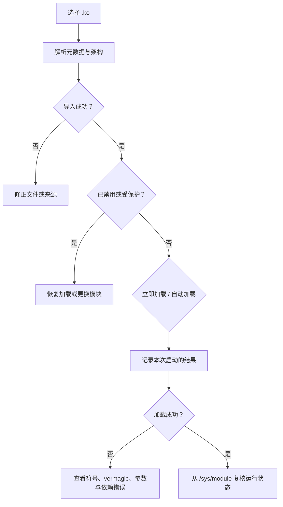

# 内核模块

<Badge text="Linux .ko" type="danger" /> <Badge text="直接进入内核" type="warning" />

“内核模块”页面管理用户主动导入的 Linux `.ko` 文件。它与“模块管理”中的 Android ZIP 模块完全不同：`.ko` 代码会在内核态执行，错误或不兼容的模块可能导致死机、重启或数据损坏。

::: tip 进入方式

管理器 → 底部 **模块** → 右上角内存图标。长按该图标会显示内核模块风险提示。

:::

::: danger 只加载你信任且匹配设备的模块

不要加载来源不明的 `.ko`，也不要把其他设备、其他内核版本或其他 KMI 的文件当成通用模块。加载失败可能导致内核崩溃，安全模式也无法保证恢复已经进入内核的代码。

:::

## 导入时检查什么

点击右下角“导入 .ko”，选择本地文件。管理器会读取 ELF 与 `modinfo` 元数据，并至少检查：

- 文件是有效的内核模块 ELF；
- 文件大小不超过管理上限；
- 设备架构与模块架构一致；
- 能够取得可信的内部模块名；
- 内部名不是受保护的 `kernelsu` 或 `nomount`；
- 现有条目没有被另一模块占用。

内部模块名无法可靠解析时，文件仍可能被保存用于查看，但“立即加载”和“开机自动加载”会不可用。

::: important 架构、vermagic 与符号

导入阶段会拒绝明确的架构不匹配。vermagic 不一致时，加载器会尝试根据内核日志重写并重试；未解析的符号会通过内核接口或 `/proc/kallsyms` 查找。即使这些步骤成功，ABI、结构体布局或内核配置仍可能不兼容。

:::

## 条目状态

一个内核模块至少有三种独立状态：

:::: field-group

::: field 开机自动加载
@type `偏好`
决定下一次启动时是否尝试加载。打开它不会立即加载当前实例。
:::

::: field 已禁用
@type `持久阻止`
存在 `disable` 标记时，手动加载和自动加载都会被拒绝。恢复加载只清除这个标记。
:::

::: field 当前已加载
@type `运行时事实`
从 `/sys/module/<name>` 读取，不根据“上次命令成功”推断。状态可能显示已加载、未加载或未知。
:::

::::

卡片还可能显示“受保护”。`kernelsu` 与 `nomount` 是保留内部名，不能通过本页面加载或自动加载。

## 四个容易混淆的操作

:::: table 操作语义

| 操作 | 会做什么 | 不会做什么 |
| --- | --- | --- |
| **立即加载** | 用当前参数调用内核加载器。 | 不改变下次开机是否加载。 |
| **开机自动加载** | 保存下次启动的加载偏好。 | 不会立即加载模块。 |
| **禁止后续加载** | 写入持久禁用标记。 | 不会卸载当前已经运行的模块。 |
| **恢复加载** | 清除持久禁用标记。 | 不会立即加载，也不会打开“开机自动加载”。 |
| **移除** | 删除管理器保存的 `.ko` 和配置。 | 不会卸载已经进入内核的实例。 |

::::

因此，“已移除”或“已禁用”之后，当前内核仍可能保留模块，直到重启或显式卸载。管理器不会假装一个仍在运行的模块已经消失。

::: danger 移除不是卸载

本页面没有“安全卸载任意内核模块”的通用操作。内核模块可能被系统或其他模块使用；强行卸载可能造成崩溃。需要停止使用时，先禁用后续加载并完整重启。

:::

## 加载参数

参数只在该模块下一次被加载或自动加载时传给内核。填写方式通常是空格分隔的 `name=value`：

```text
mode=1 debug=0
```

管理器不会把这段内容交给 Shell 求值；它作为模块参数字符串传入加载接口。存在 NUL 字节或超过长度限制会被拒绝。

::: tip 先查模块文档

参数名和取值由 `.ko` 作者定义。写错不会等价于“忽略”：内核可能拒绝加载，也可能进入作者未预期的运行状态。

:::

## 元数据与详情

“详情”页可能显示：

| 字段 | 用途 |
| --- | --- |
| 管理 ID | 管理器保存该条目的稳定标识 |
| 内核模块名 | 加载后出现在 `/sys/module` 的名称 |
| 版本、作者、许可证 | 核对文件来源与授权 |
| 架构 | 必须与设备一致 |
| Vermagic | 显示模块编译环境；加载器可能按内核要求重写 |
| 依赖 | 自动加载前需要先满足的模块名 |
| 参数列表 | 模块声明可接受的参数 |
| 文件大小与 SHA-256 | 核对当前保存文件 |
| 元数据提示 | ELF 或 `modinfo` 中无法解释的内容 |

模块更新会保留旧的开机加载偏好与参数，同时重新校验文件。更新已经加载的模块不会替换内存中的旧实例。

## 上次结果

每次手动或自动加载都会记录：

- 操作类型；
- 成功、失败、已加载或未完成；
- 内核启动 ID；
- 限长的错误信息。



如果上次记录为“进行中”，管理器会阻止同一模块再次加载，避免未知状态叠加。先完整重启，再判断是否需要继续。

## 依赖与自动加载

自动加载会按模块声明的依赖安排顺序：

- 依赖可以已经由内核或其他加载器提供；若依赖由管理器收录，则它必须是已启用、会参与自动加载的候选；
- 依赖成环时不会盲目加载；
- 本次启动已经尝试过的模块不会无限重试；
- 上次加载未完成时，后续自动加载会被保守阻止。

自动加载在工作线程中完成。管理器启动阶段只等待一段有限时间；超时后它可以继续显示状态，但不应当把“页面已打开”误认为所有模块都已加载。

## 安全模式

进入安全模式时，启动流程会为所有受管内核模块写入禁用标记：

- 导入和移除仍可能可用；
- 恢复加载、开启自动加载和立即加载会被拒绝；
- 这不是“安全卸载”，已经加载的实例仍在；
- 退出安全模式后，需要逐个决定哪些模块重新启用。

::: warning 安全模式不是内核崩溃保险

如果某个 `.ko` 已经在当前启动中导致内核不稳定，安全模式只能影响下一次启动的策略，无法撤销已经执行的代码。

:::

## 常见失败

:::: collapse accordion

- **导入提示架构不匹配**

  文件不是为当前设备编译的。不要通过改文件名绕过；换用与设备架构和内核环境匹配的构建。

- **开机自动加载开关不可用**

  通常是没有可信内部名、模块已禁用或内部名受保护。先看详情中的元数据提示。

- **加载失败，提示找不到符号**

  模块依赖的内核符号在当前内核不存在、被隐藏，或 ABI 不同。升级内核与该模块必须一起处理。

- **刚更新模块，但当前状态仍显示已加载**

  更新只替换磁盘文件。旧实例保留到重启或下一次显式加载。

- **禁用后为什么仍然存在**

  禁用只阻止未来加载。当前内核不会因为文件标记变化自动卸载。

- **移除后为什么列表消失了但功能还在**

  代码已经加载进内核。管理器删除的是保存文件和配置，不是内存实例。

::::

## 相关页面

- [模块管理](/manager/module/)：Android ZIP 模块。
- [SU 日志](/manager/su-log/)：Root 执行与授权事件。
- [`/data/adb` 存储结构](/manager/storage/)：`/data/adb/ksu/lkm/` 的内容。
- [设置 → 功能](/setting/function/)：NoMount 与挂载引擎，不是本页的任意 `.ko`。
