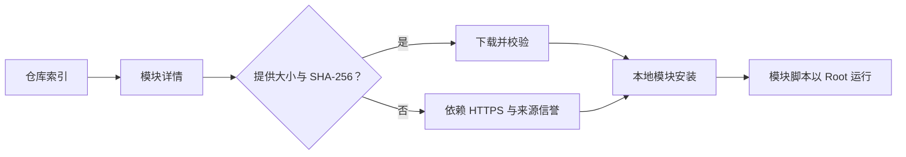

# 模块仓库

<Badge text="下载入口" type="tip" /> <Badge text="仓库不等于审核" type="danger" />

模块仓库把不同来源的模块目录统一显示为名称、版本、作者、说明和可下载发行版。仓库只负责列出与下载模块，安装仍由本地模块刷写流程完成。

::: tip 进入方式

管理器 → 底部 **模块** → 左上角云图标。

:::

## 仓库来源

顶部“仓库来源”菜单提供四类入口：

:::: table 来源

| 来源 | 用途 | 选择方式 |
| --- | --- | --- |
| **内置索引** | 项目提供的内置模块索引。 | 直接选择，不需要填写地址。 |
| **社区仓库** | 读取仓库集群列表，再选择一个具体社区仓库。 | 列表显示仓库名称、说明和模块数量。 |
| **KernelSU 仓库** | 读取 KernelSU 模块注册表。 | 列表进入详情时再加载该模块的发行版。 |
| **自定义仓库** | 使用兼容的仓库根地址或 JSON 索引。 | 输入 `http://` 或 `https://` 地址。 |

::::

::: important 社区仓库不是单个固定站点

“社区仓库”会打开仓库选择器。列表顶部通常会补入默认的 GMR 仓库，其他仓库由集群索引提供；也可以选择“手动输入地址”。

:::

### 自定义仓库地址

自定义来源接受两种形式：

- 以 `.json` 结尾：直接把该地址当作模块列表文档；
- 其他目录地址：管理器会按兼容仓库规则查找 `json/modules.json`。

地址必须是绝对 HTTP(S) URL。输入框中的非法地址不会保存，也不会触发刷新。

## 浏览与搜索

仓库列表支持：

- 下拉刷新；
- 搜索模块名称和描述；
- 打开模块详情；
- 在详情中查看发行版、更新说明、许可证、主页、源码与支持链接。

搜索不会匹配作者字段。若作者名可见但搜不到，改用模块名、描述或模块 ID 查找。

::: tip 网络状态

离线或仓库服务器不可达时，管理器会保留已经加载的列表并显示错误，不应把空列表误认为“所有模块都被删除”。恢复网络后下拉刷新。

:::

## 详情与发行版

模块详情可能包含：

| 字段 | 是否总会存在 | 作用 |
| --- | --- | --- |
| 名称、版本、作者、描述 | 取决于来源 | 识别模块和用途 |
| 发行版与更新时间 | 取决于来源 | 选择要下载的版本 |
| 更新说明 | 否 | 判断兼容性与行为变化 |
| 许可证、主页、源码、支持 | 否 | 核对来源和反馈渠道 |
| 下载按钮 | 必须存在可下载发行版 | 进入本地模块安装流程 |

某些来源只提供最新版本，另一些来源可以列出多个发行版。KernelSU 仓库的列表文档只包含目录信息，打开详情时才读取版本和下载地址。

## 安装流程

:::: steps

1. **选择模块**

   先读名称、作者、描述和更新说明。名称相似不代表来自同一作者。

2. **开始下载**

   点击安装或下载。Android 13 及以上可能请求通知权限，以显示长时间下载的进度。

3. **校验下载**

   当条目携带可用的大小与 SHA-256 时，管理器边下载边校验；大小或哈希不匹配会中止安装。

4. **进入模块刷写**

   下载完成后进入本地模块安装确认。若启用了安装验证或刷写前备份，此时可能要求认证或先创建快照。

5. **重启并验证**

   普通模块的文件注入通常要到下一次启动才完整生效。按[模块管理](/manager/module/)中的步骤检查状态。

::::

::: warning 没有哈希不等于一定有恶意

不同仓库提供的完整性元数据并不一致。没有大小或 SHA-256 时，管理器仍可能下载，但只能依赖 HTTPS、仓库本身和你的来源判断。==缺少校验信息的模块应降低信任，而不是自动提高信任==。

:::

## 完整性与安全边界

需要记住：

- 仓库收录不等于 FinaSU 审核；
- 下载校验证明文件匹配元数据，不证明作者可信；
- 模块 ZIP 可以执行安装脚本、启动脚本和 WebUI；
- 更新版本可能改变挂载目标或脚本行为，不能只看版本号；
- 从聊天群转发的同名 ZIP 不应覆盖仓库来源。

## 常见失败

:::: collapse accordion

- **列表一直加载失败**

  检查网络、仓库地址和 TLS 证书。自定义仓库要确认地址返回兼容 JSON，而不是仓库首页的 HTML。

- **社区仓库列表为空**

  集群索引可能暂时不可用。切回内置索引或 KernelSU 仓库验证管理器网络是否正常。

- **详情有模块，但没有下载按钮**

  该条目没有可下载发行版，或发行版缺少合法下载 URL。换一个版本或来源。

- **下载完成但安装失败**

  下载成功只代表 ZIP 已取得。安装还会检查模块包结构与本地刷写条件；到[模块管理](/manager/module/)查看具体错误。

- **自定义仓库里的相对下载地址失效**

  相对地址会按仓库根地址解析。若仓库文件与 ZIP 不在同一目录，作者应提供正确的相对路径或绝对 HTTPS URL。

::::

## 相关页面

- [模块管理](/manager/module/)：安装、启停、WebUI 与更新。
- [备份与 WebDAV](/manager/backup/)：保存刷写前模块安装包。
- [更新 FinaSU](/guide/update/)：管理器与驱动更新路径。
- [模块卡片与横幅](/setting/module-cards/)：模块列表展示设置。
