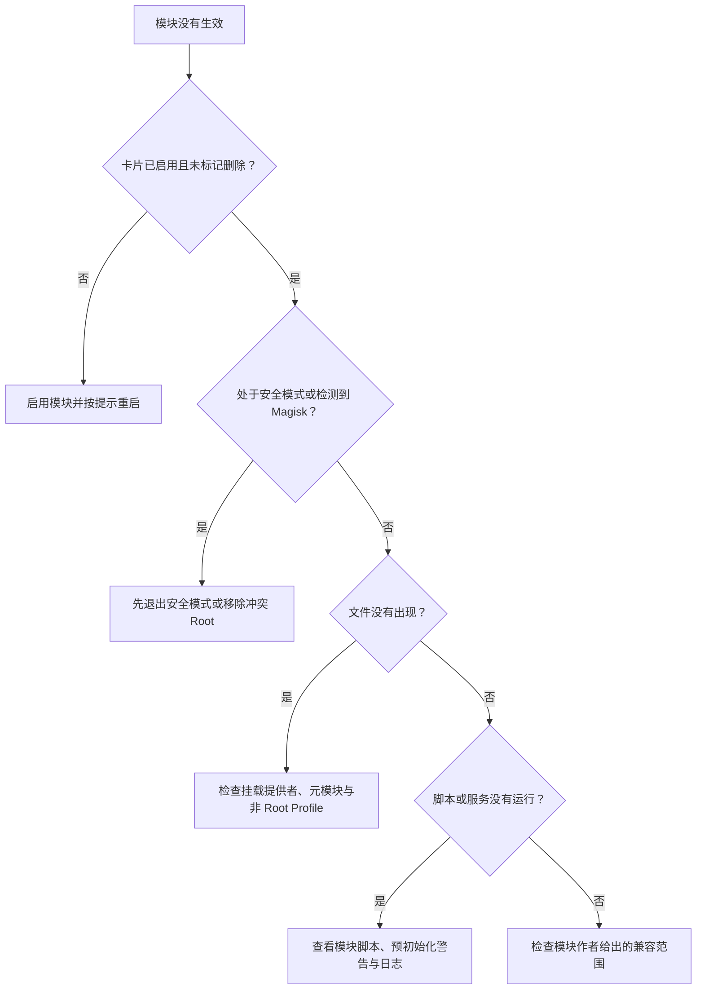

# 模块管理

<Badge text="ZIP 模块" type="tip" /> <Badge text="重启后生效" type="warning" />

模块页管理 `/data/adb/modules` 中的普通模块。模块可以把文件注入系统路径、执行启动脚本、提供 WebUI 或操作按钮；这些内容通常以 Root 身份运行，来源不明时不要安装。

::: tip 进入方式

管理器 → 底部 **模块**。顶部的云图标进入[模块仓库](/manager/module-store/)，内存图标进入[内核模块](/manager/kernel-module/)；长按内存图标会显示 `.ko` 风险提示。

:::

::: important 普通模块不是 `.ko`

本页安装的是带 `module.prop` 的 Android 模块 ZIP。Linux 内核模块 `.ko` 是另一套管理逻辑，见[内核模块](/manager/kernel-module/)。

:::

## 页面概览

底部的安装按钮用于选择一个或多个模块 ZIP。以下情况会隐藏安装按钮：

- 设备处于安全模式；
- 检测到 Magisk 正在接管模块挂载。

搜索支持模块 ID、名称、描述、作者和拼音。列表和搜索框中的操作使用同一份模块状态。

## 安装

:::: steps

1. **选择 ZIP**

   点击安装按钮，选择一个或多个模块安装包。兼容 FinaSU、KernelSU 与常见 Magisk 模块格式，但模块脚本本身仍由作者决定兼容范围。

2. **确认模块信息**

   管理器读取安装包并列出准备安装的模块名称。安装包可能改变系统文件、执行脚本或替换已有模块，确认来源和设备兼容性后再继续。

3. **等待刷写流程**

   安装仍走本地模块刷写流程。若启用了模块安装验证或刷写前备份，可能先要求认证或创建备份。

4. **按提示重启**

   文件挂载通常要到下一次启动才完整生效。页面提示重启时，可以选择立即重启或稍后处理。

::::

::: warning Android 13 及以上的下载通知

从模块仓库下载时，管理器可能请求通知权限来显示下载进度。拒绝通知权限不会授予 Root；它只影响进度展示。

:::

::: timeline 一次模块安装与生效

- 用户选择 ZIP 并进入刷写确认
  time=安装

- 安装流程写入模块目录或待处理更新
  time=保存

- 用户重启设备，启动流程读取模块标记
  time=重启

- `ksud` 执行更新合并、启动脚本与文件挂载
  time=生效

- 管理器重新读取卡片状态，Zygisk 模块开始检查提供者
  time=验证

:::

## 模块卡片

卡片可以显示模块名称、版本、作者、说明以及状态徽标：

:::: table 徽标与按钮

| 元素 | 含义 |
| --- | --- |
| 启用开关 | 决定模块是否参与后续启动。需要重启时，管理器会给出提示。 |
| `META` | 该模块声明为元模块。 |
| `WebUI` | 模块提供 `webroot`，且当前可打开。 |
| `Action` | 模块提供 `action.sh`，可手动执行一次操作。 |
| `Update` | 模块自带的更新信息发现了更高版本。 |
| Zygisk 缺失提示 | 模块声明依赖 Zygisk，但当前没有可用提供者；WebUI 与操作按钮可能因此不可用。 |
| 删除/撤销 | 正常状态为“卸载”；已经标记待删除时为“撤销”。 |

::::

模块操作受[模块卡片与横幅设置](/setting/module-cards/)影响。长按卡片可以修改当前模块的横幅；卡片被折叠时，先点按展开操作按钮。

### WebUI 与操作脚本

- 只有在模块已启用、未标记删除且不缺少 Zygisk 依赖时，WebUI 才能打开；
- 操作按钮执行模块的 `action.sh`，结果由模块脚本决定；
- 长按 WebUI 或操作按钮可以创建桌面快捷方式；
- 操作完成不代表模块更新完成，必要时仍需重启。

::: danger WebUI 和 action 不是沙箱

它们属于模块本身，可以看到模块目录并执行作者编写的逻辑。不要因为“只是打开一个网页”就忽略模块来源。

:::

## 启用、禁用与卸载

### 启用与禁用

启停开关修改模块的持久标记：

- **禁用**：模块不参与下一次启动的脚本与文件注入；
- **启用**：删除禁用标记，让模块重新参与下一次启动；
- 当前已经运行的脚本或进程不会因为切换开关而被强行撤回；
- 管理器会根据设置提示普通重启或软重启。

### 卸载与撤销

正常卸载先给模块写入 `remove` 标记。设备重启后，启动流程才会完成清理，因此：

- 重启前可在管理器中点“撤销”恢复；
- 重启后模块目录会被清理，撤销入口也应消失；
- 已经加载进内存的脚本、服务或内核对象不会保证立刻消失；
- 卸载元模块前，管理器会额外警告其挂载或依赖影响。

:::: steps

1. 点模块卡片上的“卸载”。
2. 阅读确认文字；若为元模块，确认依赖它的功能是否仍需保留。
3. 决定稍后重启还是立即重启。
4. 重启后确认卡片消失，再检查相关文件和服务是否已恢复正常。

::::

## 更新

管理器能否检查更新，取决于[通用设置](/setting/general/)和模块自身的更新元数据：

- 只有已启用且元数据完整的模块更容易被纳入检查；
- 发现更新后，点击“更新”会下载对应 ZIP，再进入模块刷写流程；
- 没有更新提示不代表模块一定最新，可能只是作者没有提供可解析的更新信息；
- 更新前应阅读发布说明，并确认新版本仍支持当前系统与架构。

::: tip 更新失败时保留旧版本

安装包在真正替换前会先检查；如果下载或安装前置检查失败，不应把半成品当成已更新。仍建议在重要模块升级前使用[刷写前备份](/manager/backup/)。

:::

## 排序与搜索

右上角排序面板可以控制：

- 元模块、Zygisk 模块、LSPosed 模块、带 WebUI 模块、带操作模块的优先顺序；
- 是否让已启用模块排在停用模块之前；
- 自定义拖动顺序；
- 重置自定义顺序。

自定义顺序适合常用模块很多、但又不想频繁搜索的情况。它只改变管理器中的显示顺序，不改变模块启动脚本的执行优先级。

## 预初始化警告

模块卡片出现预初始化警告时，问题发生在系统较晚阶段之前的配置同步：

| 提示 | 含义 | 怎么处理 |
| --- | --- | --- |
| 空间不足 | metadata 空间不足，配置未同步 | 清理 metadata 空间后重启验证 |
| 同步失败 | 本轮保留上次配置 | 查看日志，确认模块目录与文件系统状态 |
| 多次启动未完成 | 预初始化被暂停，避免继续引发启动问题 | 先进入安全模式或禁用可疑模块 |
| 不支持 | 当前内核或运行方式没有预初始化能力 | 不要反复重启碰运气 |

## 安全模式

安全模式用于从模块导致的启动异常中恢复：

- 普通模块的启动脚本会被跳过，并可能被批量禁用；
- 安装按钮会隐藏，避免在恢复状态继续加入模块；
- 恢复后需要手动重新启用仍然需要的模块；
- 安全模式不能修复内核崩溃、错误启动镜像或其他 Root 部署问题。

## 元模块

元模块可以接管模块安装或挂载流程。一个设备只能有一个活动元模块。

::: danger 卸载元模块会影响所有模块

如果元模块负责挂载，卸载后普通模块的文件可能全部不可见；如果它接管安装，后续模块安装也可能失效。先确认替代挂载方案，再卸载元模块。

:::

## 排查顺序

常见判断：

- **开关已变但功能没变**：先完成管理器提示的重启；
- **只有某个应用看不到模块文件**：检查该应用的“卸载模块”设置；
- **所有模块文件都不可见**：检查 Folk Mount/NoMount 状态与元模块；
- **模块导致无法启动**：使用安全模式或救援流程，不要继续叠加模块；
- **Zygisk 模块不可用**：确认当前有实际运行的 Zygisk 提供者。

## 相关页面

- [模块仓库](/manager/module-store/)：从索引或自定义来源下载模块。
- [内核模块](/manager/kernel-module/)：导入和加载 `.ko` 文件。
- [App Profile](/manager/app-profile/)：控制单个应用是否看到模块文件。
- [备份与 WebDAV](/manager/backup/)：保存刷写前安装包和模块状态。
- [模块卡片与横幅](/setting/module-cards/)：改变模块列表的显示方式。
