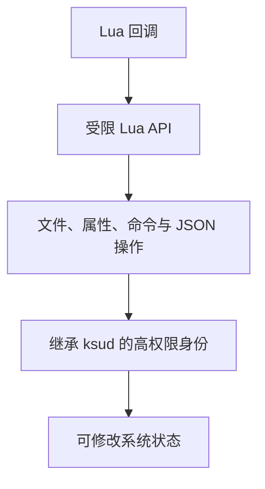

# Lua 插件

<Badge text="独立扩展" type="tip" /> <Badge text="继承 Root 身份" type="danger" />

FinaSU 的 Lua 插件由内置 Lua 解释器运行，存放在 `/data/adb/plugins/<id>/`。插件可以响应启动阶段、提供手动操作、声明配置或以常驻回调重复运行。

::: tip 进入方式

管理器 → 底部 **插件**。左上角云图标进入插件商店，右下角安装按钮选择本地插件 ZIP。

:::

::: important 插件不是普通模块

插件不通过模块文件挂载工作，也不需要写 `module.prop`。它以 `plugin.json` 声明身份，由 `ksud` 调度。不要为了安装插件去“模块管理”里刷写。

:::

## 安装本地插件

插件 ZIP 必须包含 `plugin.json` 和声明的入口文件，默认入口是 `main.lua`。安装包可以直接把文件放在 ZIP 根目录，也可以统一包在一层目录中。

:::: steps

1. **选择 ZIP**

   点击插件页右下角安装按钮。管理器先把文件复制到应用缓存，再交给 `ksud` 检查。

2. **检查并暂存**

   `ksud` 会检查插件 ID、入口文件名、依赖、文件数量、单文件大小、总大小、压缩比以及重复或危险路径。

3. **事务式发布**

   通过检查后才把暂存目录发布到 `/data/adb/plugins/<id>/`。更新时先准备新目录；失败时不应破坏已安装版本。

4. **确认运行资格**

   安装或重新启用意味着你确认当前包内容可以进入自动启动阶段。之后如果包文件被外部替换，插件会被拒绝自动运行，直到重新确认。

::::

::: warning 不要手工替换插件文件

直接编辑或替换插件包可能改变其指纹，使自动回调停止运行。应通过管理器重新安装。底层文件系统不支持原子目录交换时，覆盖更新会明确失败并保留旧版本。

:::

## 插件目录

```file-tree title="一个已安装插件"
/data/adb/plugins/
└── <plugin-id>/
    ├── plugin.json       # 身份、入口、依赖、配置与回调声明
    ├── main.lua          # 默认入口，可由 plugin.json 改名
    ├── config.json       # 管理器写入的插件配置
    ├── last_output.log   # 追加保存的回调输出
    └── disable           # 停用标记
```

`/data/adb/ksu/plugin_locks/`、`plugin_stage/` 和 `plugin_state/` 是本管理器 private 运行状态，不应手动清理。

## 页面与插件卡片

已安装页面支持按插件 ID、名称和描述搜索。卡片可以显示：

- 启用开关；
- 版本、作者、描述和依赖；
- 当前包的读取错误；
- **配置**按钮；
- **执行**按钮；
- **输出日志**按钮；
- **卸载**按钮。

长按卡片可以编辑横幅。若列表开启折叠模式，先展开卡片再使用操作按钮。

::: important 停用插件

停用会创建 `disable` 标记，停止该插件的运行进程和常驻回调，并让它不再参加后续自动阶段。重新启用会重新检查包清单与依赖。

:::

## 生命周期

插件可通过清单声明回调。自动阶段包括：

:::: table 自动回调

| 阶段 | Lua 回调 | 时机 |
| --- | --- | --- |
| `post-fs-data` | `post_fs_data` | 早期启动，与模块脚本共享启动预算 |
| `service` | `service` | Android 服务阶段，在后台派发 |
| `boot-completed` | `boot_completed` | 启动完成阶段，在后台派发 |

::::

每个自动回调最多运行 120 秒。`post-fs-data` 还要与同一启动预算中的脚本竞争，预算耗尽时剩余插件会留给下一次启动，而不是阻塞开机。

`main` 是常驻回调：服务阶段启动后按固定间隔重复执行，每轮重新创建 Lua 解释器，因此不能依赖上一轮的内存全局变量。插件消失或被停用后，常驻实例会停止。

## 执行、配置与日志

### 执行

“执行”会调用清单声明的 quick action；没有声明时回退到 `action` 回调。手动回调最长运行 300 秒，超过期限会终止整个插件进程组。

执行完成只表示回调进程退出，不代表它执行的外部程序一定达到了预期效果。失败原因通常会写入插件日志的最后一行。

### 配置

插件可以在 `plugin.json` 中声明配置字段。管理器支持文本、数字、布尔值和预设选项等控件：

- 保存后写入插件目录的 `config.json`；
- “恢复默认”会删除单个已保存值，让包内默认值重新生效；
- 配置不会自动证明脚本安全，插件仍可读取目录中的其他文件；
- 某些插件可能只在下次回调或下次启动时读取新配置。

### 输出日志

日志来自 Lua API 的 `info`、`warn`、回调错误以及插件进程输出。它会追加写入 `last_output.log`，超过大小上限后从头清空；适合快速排查，不替代 SU 日志或模块日志。

## 依赖与卸载

插件可以声明依赖。启用前，被依赖插件必须已经安装；停用或卸载一个插件时，如果仍有已启用插件依赖它，操作会被拒绝。

卸载会：

1. 检查是否存在已启用依赖者；
2. 停止该插件的普通与常驻进程；
3. 写入停用标记并删除插件目录；
4. 同步插件根目录。

::: warning 卸载前处理依赖

先停用所有依赖者，再卸载被依赖插件。直接删除 `/data/adb/plugins` 下的目录会绕过检查和进程停止。

:::

## 插件商店

插件商店从官方插件索引读取可安装条目：

- 支持按名称和描述搜索；
- 显示名称、版本和描述；
- 下载后交给与本地 ZIP 相同的安装流程；
- 商店条目名称只是索引标签，真正插件 ID 来自包内 `plugin.json`。

商店下载失败不等于已经安装；只有安装流程成功完成后，插件才会出现在已安装列表。

## 安全边界



插件 API 对单次读取、写入、命令输出、目录条目、JSON 大小和 Lua 内存设有上限，但**这些上限不是权限沙箱**：

- 插件可以执行系统程序；
- 插件可以读写其身份允许访问的路径；
- 插件可以修改系统属性和文件权限；
- 插件代码与 `ksud` 具有相同的高权限边界。

只安装能核对来源、内容和更新方式的插件。完整开发接口见 [Lua 插件接口](/developer/lua-plugin/)。

## 常见问题

:::: collapse accordion

- **插件安装了，但开机没有运行**

  检查启用开关、依赖是否满足、卡片是否显示清单错误，以及自动阶段预算是否耗尽。

- **手动执行提示没有回调**

  清单没有声明 quick action，且入口脚本也没有 `action` 函数。查看插件作者提供的回调名。

- **修改配置文件后没有变化**

  插件可能只在下次回调、下次启动或重新加载时读取配置。先执行一次回调，必要时重启。

- **为什么不能停用或卸载**

  可能有其他已启用插件依赖它。先处理依赖者。

- **为什么替换文件后不再自动运行**

  自动运行依赖安装时确认的包指纹。文件被外部改动后，确认失效，需要重新安装或重新启用。

::::

## 相关页面

- [Lua 插件接口](/developer/lua-plugin/)：清单、回调与 Lua API。
- [`/data/adb` 存储结构](/manager/storage/)：插件目录和私有状态。
- [模块管理](/manager/module/)：普通系统模块。
- [SU 日志](/manager/su-log/)：Root 调用与授权事件。
