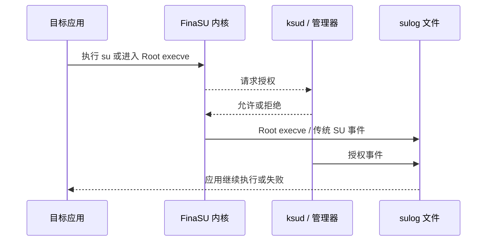

# SU 日志

<Badge text="Root 事件" type="tip" /> <Badge text="可能含敏感信息" type="warning" />

SU 日志记录与 Root 相关的事件，帮助确认应用是否发起请求、请求来自哪个 UID，以及 `ksud` 是否正常执行或被重启。

::: tip 进入方式

管理器 → **超级用户** → 左上角文档图标。

:::

## 日志记录什么

:::: table 事件类型

| 类型 | 记录内容 | 常见用途 |
| --- | --- | --- |
| **Root execve** | 在 Root 上下文中执行的进程、PID、UID、命令行与返回值。 | 确认某个应用到底执行了什么命令。 |
| **传统 SU** | 通过 `/system/bin/su` 兼容入口提权的请求。 | 排查只支持经典 `su` 的旧应用。 |
| **授予 Root** | 管理通道下发 Root 授权的事件。 | 区分“应用请求”与“管理器授权”。 |
| **守护进程重启** | `sulogd` 会话启动、重新执行或恢复。 | 判断日志中断是否由守护进程重启造成。 |

::::

日志还可能包含 `Dropped` 或未知类型。`Dropped` 表示内核事件队列来不及写出而丢失了部分事件；这类记录始终显示，便于发现日志不完整。

## 一次 Root 请求怎样出现在日志里



事件的具体顺序取决于请求路径。排查时不要只看最后一条；把应用、UID、PID、命令和返回值放在一起判断。

## 页面状态

页面可能显示四种能力状态：

:::: field-group

::: field `supported`
@type `可使用`
内核支持 SU 日志。若日志开关关闭，页面会显示启用按钮。
:::

::: field `forced`
@type `已强制开启`
启动配置决定日志已开启，管理器不能在此关闭。
:::

::: field `managed`
@type `由模块管理`
日志能力由外部模块控制，页面不应与模块争夺开关。
:::

::: field `unsupported`
@type `不支持`
当前内核没有 SU 日志能力。升级管理器 APK 不会补上内核功能。
:::

::::

::: tip 第一次看不到记录

先确认日志开关已开启，再触发一次实际 Root 请求。刚启用日志时，之前发生的事件不会补写。

:::

## 浏览与筛选

页面支持下拉刷新和按类型筛选：

- 搜索会匹配事件的原始字段、时间和值；
- 点击条目打开详情，可查看完整键值；
- `Success` 或 `Exit <code>` 显示执行结果；
- 事件会倒序排列，最新事件在上方。

每读取一个日志文件，界面最多保留最后 1000 行，避免超大日志拖慢管理器。更早的内容仍可能在文件中，需要从设备导出后分析。

## 日志文件

日志位于 `/data/adb/ksu/log/`，按日期命名：

```file-tree title="SU 日志文件"
/data/adb/ksu/log/
├── sulog-2026-10-25.log
├── sulog-2026-10-25-1.log
└── sulog-2026-10-24.log
```

默认按天清理，保留 3 天；单文件达到 10 MiB 时创建同一天的后续编号文件。具体阈值属于 `sulogd` 的持久配置，清理策略由后台守护进程执行。

## 清空日志

顶部清理按钮会根据当前选择处理：

- 选择最新日志文件时，清空文件内容，保留当天继续写入的文件；
- 选择较早的日志文件时，直接删除该文件。

::: danger 清理不可撤销

删除后的日志不能从管理器恢复。准备反馈问题或排查事故时，先把需要的文件导出或复制到电脑，再清理设备端记录。

:::

## 隐私

日志可能包含：

- 应用包名与 UID；
- 命令路径和参数；
- 进程名、PID 与父进程；
- 文件路径与执行结果。

::: warning 分享前先检查

公开日志前删除个人目录、令牌、账号、内网地址和私有脚本参数。必要时只截取相关时间段和事件，不要发送整个 `/data/adb` 或完整日志压缩包。

:::

## 用日志定位问题

:::: steps

1. **确认日志已开启**

   如果页面显示未启用，先点击启用，再重新触发问题。

2. **按时间定位**

   记录问题发生的大概时间，选择对应日期文件。最新文件中没有记录时，再查较早文件。

3. **按事件类型筛选**

   应用调用 `su` 时先看传统 SU；执行 Root 命令时看 Root execve；授权异常时看授予 Root。

4. **核对身份**

   对比日志中的 UID 与超级用户页面的应用 UID。多用户、分身和重装应用都可能改变 UID。

5. **检查结果**

   非零退出码可能来自拒绝授权、命令本身失败或权限策略限制。失败不等于日志系统坏了。

::::

::: chat title="SU 日志问答"
{用户}
日志里没有我的应用，是不是 Root 坏了？

{.}
不一定。应用可能没有发起 Root 请求、请求发生在日志开启前，或日志守护进程刚刚重启。先重新触发一次，再检查应用 UID 与日志开关。

{用户}
为什么授权已允许，命令仍返回失败？

{.}
允许 Root 只表示 UID 可以进入 Root 上下文。App Profile 的 UID、GID、能力、SELinux 域、命名空间和命令自身错误都可能导致后续失败。

{用户}
日志中出现 Dropped 要怎么办？

{.}
表示事件在写出前已被丢弃。先降低日志噪声、清理旧文件或检查存储空间，再复现问题；不能把缺失区间当成“没有发生请求”。
:::

## 相关页面

- [超级用户](/manager/superuser/)：检查目标应用与 UID。
- [App Profile](/manager/app-profile/)：Root 与非 Root 权限策略。
- [`/data/adb` 存储结构](/manager/storage/)：日志与运行状态目录。
- [诊断与反馈](/setting/diagnostics/)：导出管理器日志和诊断信息。
