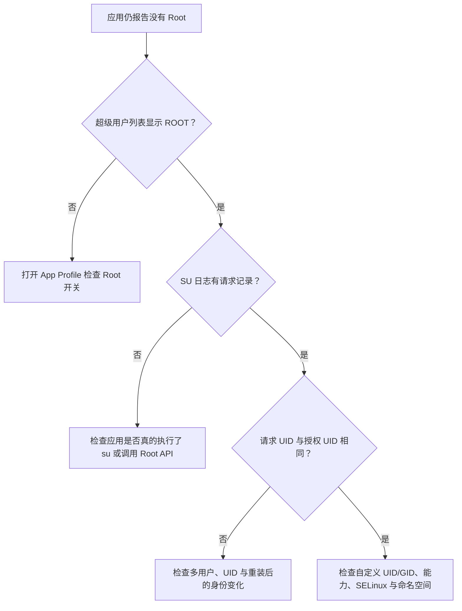

# 超级用户

<Badge text="应用授权入口" type="tip" /> <Badge text="按 UID 生效" type="warning" />

“超级用户”列出管理器能枚举到的应用，并显示各应用当前的 Root 与 Profile 状态。它不是一份只包含已请求 Root 应用的历史记录；默认隐藏大部分系统应用，但普通已安装应用仍会出现在列表里。

::: tip 进入方式

打开管理器 → 底部 **超级用户**。左上角的文档图标进入 [SU 日志](/manager/su-log/)。

:::

## 列表里的内容

每一行可能对应一个应用，也可能对应共享同一 UID 的多个应用。管理器自身不会作为普通条目出现。点击条目进入该 UID 的 [App Profile](/manager/app-profile/)；Root 授权开关在详情页，不在列表右侧。

:::: table 状态徽标

| 徽标 | 含义 |
| --- | --- |
| `DYNAMIC KSU` | 该 UID 已被授予动态管理器身份，可管理当前驱动。 |
| `KSU` | 识别到预置管理器签名，但尚未获得动态管理器授权。 |
| `ROOT` | 当前 UID 的 Root Profile 已允许 Root。 |
| `UMOUNT` | 该 UID 在非 Root 状态下的策略会隐藏模块注入的文件。 |
| `CUSTOM` | 该应用没有使用对应状态的默认 Profile，而是启用了模板或自定义配置。 |
| `USER <id>` | 应用属于工作资料、分身或其他 Android 用户；同一个包在不同用户下可能具有不同 UID。 |

::::

::: important 徽标描述的是当前策略，不是请求历史

应用曾经弹过授权框、后来被拒绝，并不会让列表永久显示一个“拒绝记录”。这里展示的是当前内核 Profile 的结果；具体请求是否发生，应到 SU 日志中查对应包名和 UID。

:::

## 搜索

搜索框可以匹配：

- 应用显示名称；
- 包名或特殊 Profile 标识；
- 应用名称对应的拼音。

搜索完全空白时，结果区还会显示 **最近安装**，范围为最近 60 分钟内安装的应用。它只是查找辅助，不会被加入 Root 白名单。

::: tip 搜不到某个应用

先清空搜索并打开“显示系统应用”。如果应用位于其他 Android 用户中，还要确认“只显示主用户应用”没有被开启。

:::

## 筛选

右上角的更多菜单提供：

:::: field-group

::: field 显示系统应用
@type `筛选`
默认关闭。开启后会加入系统应用；WebView Zygote 这类特殊 UID 以及已有 Root 或自定义 Profile 的条目仍会按自身规则显示。
:::

::: field 只显示主用户应用
@type `多用户`
只在管理器检测到多个 Android 用户时出现。开启后只显示主用户中的条目，避免工作资料或分身应用混入列表。
:::

::::

::: warning 系统应用不是普通应用

系统与特殊 UID 的权限边界更复杂。只应在明确知道调用方和用途时授予 Root；FinaSU 也会拒绝某些系统 UID 的普通 Root 授权。

:::

## 排序

右上角排序菜单支持：

| 排序字段 | 适合的场景 |
| --- | --- |
| 应用名 | 按当前系统语言的应用名称查找 |
| 包名 | 包名比显示名称更稳定时 |
| 安装时间 | 找最近加入设备的应用 |
| 更新时间 | 找最近升级、可能改变行为的应用 |

“倒序”反转当前排序方向。管理器仍会把动态管理器、预置管理器、已授权应用和有自定义策略的应用放在更靠前的位置，排序字段主要用于这些状态分组内部。

## 授权、拒绝与撤销

应用请求 Root 时，管理器可能显示授权弹窗。错过弹窗后，不需要等应用重新请求：

:::: steps

1. **找到应用**

   在超级用户页搜索应用名或包名。必要时开启“显示系统应用”。

2. **进入 App Profile**

   点击应用条目或 UID 分组。

3. **切换 Root**

   打开或关闭“超级用户”开关。关闭只改变授权，不会清除应用数据，也不会自动卸载应用。

4. **重新启动目标应用**

   某些应用会缓存 Root 检查结果。授权已生效但应用仍认为没有 Root 时，使用详情页右上角的“强制停止”或“重新启动”。

::::

授权决定和 App Profile 由内核保存，正常重启后仍然存在。恢复备份或重装应用可能改变 UID；应用重装后如果 UID 变了，旧策略不会自动套到新 UID 上。

## 同一 UID 的多个应用

Android 应用可以声明 `sharedUserId`，多个包因此共享一个 UID。内核按 UID 判断授权，这些应用无法只在其中某一个上获得不同的 Root 结果。

- 列表会把它们折叠为一行，并显示包含的应用数量。
- 长按折叠行可以展开应用列表。
- 详情页的“影响以下应用”会列出该 UID 下的所有包。
- 修改 Root、非 Root 的“卸载模块”或自定义 Profile 时，影响的是整个 UID。

::: danger 先确认 UID 影响范围

给共享 UID 授权，等同于给该 UID 下的每个包授权。不要只看当前打开的应用名称；在详情页确认受影响列表后再保存策略。

:::

## 仍然没有 Root 时

常见原因：

- Root 开关已关闭；
- 目标应用与授权条目属于不同 Android 用户；
- 应用升级或重装后 UID 改变；
- 自定义 Root Profile 限制了 capability 或 SELinux 域；
- 应用只显示缓存状态，尚未重新启动；
- 请求根本没有通过 Root API 或 `su`，SU 日志中没有对应事件。

## 相关页面

- [App Profile](/manager/app-profile/)：逐个 UID 配置权限与文件可见性。
- [SU 日志](/manager/su-log/)：确认请求、执行与授权事件。
- [动态管理器](/manager/dynamic-manager/)：授予或撤销管理器身份。
- [备份与 WebDAV](/manager/backup/)：保存和恢复授权列表。
