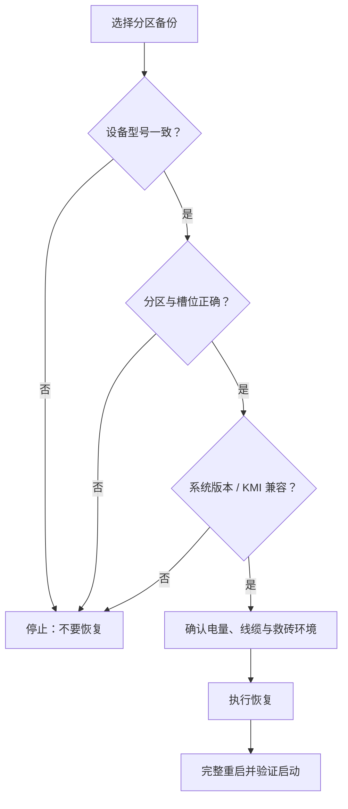

# 备份

<Badge text="设置入口 8/8" type="info" /> <Badge text="恢复分区前必须核对" type="danger" />

“备份”可以把模块、超级用户列表和启动分区保存到本地或 WebDAV，并从“管理备份”恢复。普通模块备份和启动分区恢复都可能直接改变设备状态，不能只看一个“恢复成功”提示。

::: tip 进入方式

打开管理器 → 设置 → 点第二行第四个 **备份**。

:::

## 先选备份到哪里

### 本地目录

本地备份写入公共下载目录：

```file-tree title="本地备份位置"
Download/
└── FinaSU/
    ├── modules/
    ├── allowlist/
    └── boot/
```

打开“本地目录”后，可以用“打开备份目录”跳转到系统下载页面。文件保存在公共目录，普通卸载管理器不会自动删除备份。

### WebDAV

开启 WebDAV 后，需要填写：

:::: field-group

::: field 服务器地址
@type `必填`
WebDAV 根地址，例如服务商提供的 HTTPS URL。地址或证书错误时连接会失败。
:::

::: field 用户名
@type `按服务商要求`
用于 HTTP Basic 认证的账号。某些私有服务可以使用空用户名或访问令牌。
:::

::: field 密码
@type `秘密`
保存后不会回显。输入新密码会替换已保存值；不修改密码时不要清空或改写该字段。
:::

::: field 远程路径
@type `可选`
备份在 WebDAV 根地址下的子目录。留空则使用根地址。
:::

::: field 测试连接
@type `检查`
验证地址、认证和写入能力。连接成功后再执行备份。
:::

::: field 浏览 WebDAV
@type `文件管理`
查看远程目录、预览可见内容并删除远程文件。
:::

::::

::: warning 不要绕过 TLS 校验

WebDAV 密码需要交给网络请求使用，因此应以可逆形式保存在管理器的秘密存储中。服务器证书不可信时，正确做法是修复地址或证书，不是关闭 HTTPS 校验。

:::

## 备份内容

::: table 三类内容

| 内容 | 包含什么 | 什么时候使用 |
| --- | --- | --- |
| **模块** | 刷写前从所选安装包归档的模块 ZIP，以及相关模块快照 | 刷写前后需要找回或重装模块 |
| **超级用户列表** | Root 授权应用与相关策略数据 | 迁移、恢复或误改授权后 |
| **分区** | 管理器检测到的 `boot`、`init_boot`、`vendor_boot` | 启动镜像更新前留底或需要恢复 |

:::

### 模块开关的真实作用

“模块”开关主要用于**刷写前备份**：安装或刷写动作覆盖模块前后，管理器可以归档所选安装包与相关状态。

::: important “立即备份”主要保存授权与分区

当前“立即备份”不会把普通模块列表当作独立恢复项处理；它执行的是已启用的超级用户列表和所选分区备份。不要把“模块”开关理解成随时一键打包全部已安装模块。

:::

### 超级用户列表

保存哪些应用获得 Root、对应的 App Profile 策略等管理数据。恢复后仍应逐个检查应用授权，因为包名、UID 或系统环境变化都可能让旧策略不再合适。

### 启动分区

页面只列出管理器实际检测到的分区。常见含义：

- **`boot`**：Linux 内核；Android 13 之前部分设备也把通用 ramdisk 放在这里。
- **`init_boot`**：Android 13 及以后部分 GKI 设备的独立通用 ramdisk。
- **`vendor_boot`**：厂商内核模块、设备树和厂商 ramdisk。

设备没有某个分区时不会列出，不要手动猜测或补刷。不同 Root 方案修改的分区不同，备份多个分区比只备份一个更稳妥。

## 刷写前备份

开启“刷写前备份”后，管理器会在刷写覆盖前尝试对相关模块或分区创建快照。

- 需要至少一个可写目标（本地或 WebDAV）。
- 备份是尽力而为；失败会写入日志，不应被当作刷写成功的保证。
- 刷写前仍要单独确认原厂镜像、设备型号、槽位与系统版本。

::: tip 先手动跑一次

第一次配置 WebDAV 或新的备份目录后，先点“立即备份”验证权限、空间与远程路径。不要等到刷写失败时才发现备份从未写入。

:::

## 立即备份

“立即备份”会按当前目标与内容选择运行一次备份。至少需要：

- 本地或 WebDAV 中有一个目标开启。
- 超级用户列表或至少一个分区被选中。

只开启“模块”不足以启动立即备份。运行结束后会显示写入、跳过和失败数量。

:::: steps

1. 选择本地目录、WebDAV，或两者同时开启。
2. 选择超级用户列表和需要保存的分区。
3. 确认目标空间充足；分区镜像可能很大。
4. 点“立即备份”，等待完成统计。
5. 点“管理备份”确认条目真的出现在列表中。

::::

## 管理备份

“管理备份”会从本地与 WebDAV 读取可识别条目，并按模块、授权列表、分区分组。

- 每个条目显示来源与大小。
- 点条目执行恢复。
- 删除会移除备份文件及其元数据，通常不能撤销。
- WebDAV 条目从远程读取；网络中断时恢复会失败。

::: danger 恢复前先核对

恢复分区会让备份镜像直接写回设备。执行前必须确认：

- 备份来自同一设备型号。
- 镜像对应正确分区和正确槽位。
- 系统版本与 KMI 没有跨代变化。
- 当前 Root 部署方式允许写回该分区。
- 电脑或 Recovery 救砖路径可用。

恢复管理数据时，也要避免两个管理器实例同时写同一个目录。

:::

## 恢复分区



分区恢复完成后通常需要完整重启。若设备无法启动，按 [救砖](/guide/rescue-bootloop/) 使用与当前系统完全匹配的原厂镜像恢复，不要连续尝试不同来源的镜像。

## WebDAV 浏览

浏览页可以：

- 进入远程目录。
- 查看可见文件的大小和预览。
- 删除远程条目。

删除远程文件后不一定能从回收站恢复。不要在这里清理不认识的服务器文件，尤其是其他应用共享的 WebDAV 目录。

## 安全与维护

:::: collapse accordion

- **为什么默认备份到 Download/FinaSU？**

  该目录用户可见、便于拷出，并且不会随管理器卸载自动消失。分区镜像较大，记得定期清理。

- **本地和 WebDAV 可以同时开启吗？**

  可以。每次备份会向所有已启用且可写的目标写入。

- **WebDAV 测试成功就一定能恢复吗？**

  不一定。测试只验证当前连接和基本读写；文件权限、远程空间、网络稳定性和服务器实现仍可能影响后续操作。

- **恢复授权列表后，为什么应用仍没有 Root？**

  检查 UID、包名、App Profile 和内核白名单。系统重装或应用重装可能改变 UID。

- **删除管理器后本地备份还在吗？**

  本地备份在公共下载目录，通常不会随管理器卸载删除。不要把它当成唯一备份，重要镜像应另存到电脑或可信存储。

::::

## 相关页面

- [更新 FinaSU](/guide/update/)
- [安装与刷写](/guide/install/)
- [救砖](/guide/rescue-bootloop/)
- [App Profile](/manager/app-profile/)
- [备份与 WebDAV（管理器说明）](/manager/backup/)
