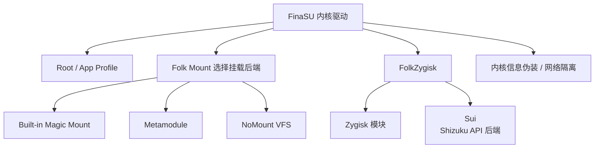

# 功能

<Badge text="设置入口 4/8" type="info" /> <Badge text="会改变系统行为" type="danger" />

“功能”不是普通外观页。这里控制模块怎样挂载、哪些内核信息被隐藏、Zygisk 与 Sui 是否运行，以及应用能否联网。改动前先确认当前部署方式和内核支持范围。

::: tip 进入方式

打开管理器 → 设置 → 点第二行第一个 **功能**。

:::

## 功能之间是什么关系

::: important 开关可点不等于当前内核支持

很多功能会把内核返回的状态映射成 `supported`、`forced`、`managed` 或 `unsupported`。置灰通常表示内核不支持、启动配置强制或模块接管，而不是按钮坏了。

:::

## Root 与模块可见性

### 卸载模块（总开关）

该开关是 App Profile 模块卸载策略的总开关。开启后，内核可以按策略为目标应用隐藏模块注入内容。

- 开启后，符合策略的应用看到更接近原厂的文件系统视图。
- 关闭后，内核不执行这层按应用卸载。
- 实际看到的文件仍受当前 Folk Mount 后端影响。

该能力与 NoMount 的例外应用不是同一套列表。NoMount 有自己独立的可见性模型。

### 默认卸载模块

设置 App Profile 中“卸载模块”的全局默认值。

- 开启：没有单独配置的应用默认隐藏模块注入。
- 关闭：没有单独配置的应用默认保留模块文件。
- 单个应用的 App Profile 可以覆盖默认值。

### 自定义卸载挂载点

除了按 UID 应用整体卸载策略，还可以指定精确挂载点，让目标 App 在之后启动时看不到它。

- 规则只作用于 App Profile 允许卸载模块的 UID；
- 路径必须是目标 namespace 中的挂载点根，不支持目录递归、通配符或正则；
- 已运行的应用不会即时变化，保存后要重新启动目标 App；
- 模块自动添加的条目只读，管理器不会删除它；
- 这改变真实挂载和文件内容，与“隐藏挂载记录”的 `/proc` 显示过滤不同。

完整操作、验证与排错见 [自定义卸载挂载点](/setting/umount-paths/)。

::: tip 应用找不到模块文件时

不要先关闭整个模块挂载系统。先检查该应用的 App Profile 是否启用了“卸载模块”，再到 NoMount 例外列表中检查是否需要让它看到注入内容。

:::

### 隐藏挂载记录

从普通应用和隔离进程的 `/proc` 挂载视图中移除 Root 与模块相关记录。

可用时会显示开关；当前内核无法使用时会显示“不可用”，写入失败时开关会回到实际状态。该功能不会删除模块，也不会替代按应用卸载。

## 日志与安全辅助

### AVC 日志伪装

处理 SELinux 审计日志中的 KernelSU 目标上下文，降低日志直接暴露相关对象的概率。

它不是完整的 SELinux 隐身，也不会隐藏所有系统差异。内核未报告支持时开关不可修改。

### SU 日志

记录 Root 执行、传统 SU、授权和日志事件。关闭后不再记录新的 SU 事件，但已有日志不会被此开关自动删除。

查看与筛选方法见 [SU 日志](/manager/su-log/)。

### 允许任意应用成为动态管理器

这是实验功能。默认只有预置签名的管理器能在应用界面中看到“设为动态管理器”；开启后，任意应用都可能出现该入口。

::: danger 这会扩大信任范围

不要为了尝试而随意把未知应用设为动态管理器。该入口在当前内核不支持时会完全隐藏。

:::

动态管理器流程见 [动态管理器](/manager/dynamic-manager/)。

## FolkZygisk

FolkZygisk 是 FinaSU 驱动的 Zygisk 后端，用于向 Android 应用进程注入 Zygisk 模块。

状态行可能显示：

- **已注入**：本次启动检测到注入成功。
- **部分注入**：只有部分目标或进程注入成功。
- **正在启动**：注入流程尚未完成。
- **注入失败**：启动期间失败。
- **未验证**：没有拿到可以证明注入成功的结果。

列表中还会显示下一次启动是否启用、检测到的外部提供者、需要重启或启动保护信息。启动保护暂停注入时，会出现“恢复”操作。

::: warning 开启状态不等于本次启动已经生效

开关表达的是下次启动选择。若同时安装外部 Zygisk 提供者，内置 FolkZygisk 会让位；实际注入状态以状态行和重启后的结果为准。

:::

详见 [FolkZygisk](/builtin/folkzygisk/)。

## Sui

<Badge text="依赖 Zygisk 后端" type="warning" />

Sui 是 FinaSU 内置的 Shizuku API 后端。Sui 本身不是 Zygisk 提供者，==它必须依赖可用的 Zygisk 后端才能运行==。可以使用内置 FolkZygisk，也可以使用外部兼容的 Zygisk 提供者；两者都能作为 Sui 的后端。

外部提供者与内置提供者的实际差异是：==Sui 可以运行，但 FinaSU 无法验证该外部提供者的注入结果==。因此状态可能显示为“外部提供者已启用，但注入未验证”，这不等于 Sui 一定不可用。

功能页负责：

- 查看 Sui 当前状态和依赖的 Zygisk 后端。
- 启用或关闭 Sui。
- 在载荷缺失或版本陈旧时尝试修复载荷。
- 打开 Sui 权限管理页。
- 查看守护进程、冲突和载荷诊断。

启用 Sui 时会出现确认提示。若当前 Zygisk 不可用、存在冲突或载荷缺失，开关可能不可操作；先按诊断结果处理。

::: info 完整生命周期

Sui 的启用、载荷安装、双守护进程、管理器登记、权限和排错见 [Sui 使用指南](/builtin/sui/)。

:::

## Folk Mount

Folk Mount 决定启动时由谁把模块文件注入系统。模式修改后通常需要重启，摘要会同时显示“配置模式”和“本次启动实际提供者”。

::: table 五种模式

| 模式 | 行为 | 适合 |
| --- | --- | --- |
| **自动** | 有可用 metamodule 时交给 metamodule，否则使用内置 Magic Mount | 大多数用户 |
| **Built-in (Magic Mount)** | 始终使用内置 Folk Mount | 固定使用内置挂载引擎 |
| **仅 metamodule** | 始终交给 metamodule | 已明确使用某个悬挂模块 |
| **Built-in (VFS)** | 使用 NoMount VFS 驱动；驱动不可用时回退到内置引擎 | 需要 NoMount 的路径级注入方式 |
| **关闭挂载** | 不注入任何模块内容 | 临时排查模块问题 |

:::

::: warning NoMount 的默认可见性不同

切换到 VFS 后，NoMount 初始会让所有应用看到注入文件；内置 Magic Mount 默认会按 App Profile 对非 Root 应用隐藏。要保留旧行为，重启前到“NoMount → 例外应用”选择需要看到原厂文件系统的应用。

:::

::: tip 本次启动和下次启动

模式下拉框是下次启动配置；“本次启动”行才是当前正在使用的提供者。两者不同是正常的，重启后才一致。

:::

详见 [Folk Mount](/builtin/folk-mount/)。

## NoMount

NoMount 页面显示 VFS 驱动、注入规则、模块贡献和例外应用。

### 驱动

状态可能是：

- **就绪**：驱动响应，可以使用注入与可见性设置。
- **不可用**：驱动未加载或当前安装包缺少对应 KMI 的模块。
- **版本不匹配**：内核驱动 API 过旧，需要升级内核。
- **由其它模块接管**：同名驱动由另一个模块管理，内置后端主动让位。

### 注入

- **重定向规则**：显示已生效规则数与预期规则数。
- **重新注入**：让当前模块规则重新写入驱动。
- **清空规则**：重启前不再注入模块文件。
- 模块列表可以立即注入某个模块，或把它撤下直到下次重启。

### 可见性

NoMount 的默认模型是“所有应用都能看到注入文件”。在“例外应用”中选中的应用会看到原厂文件系统。

- 共享 UID 的应用会一起受到影响。
- 可以从 App Profile 复制“卸载模块”的应用，但复制后不会自动跟随 Profile 后续变化。
- “清空全部”会删除规则和例外，直到下次重启。

详见 [NoMount](/builtin/nomount/)。

## 内核信息伪装（UTS View）

UTS View 让选定应用或所有仍使用初始 UTS namespace 的进程看到不同的 `uname` 信息。

### 常用字段

- **系统名**
- **节点名**
- **内核版本**
- **构建版本**
- **机器架构**
- **域名**

通常只需修改“内核版本”。字段应保持自洽；版本、构建时间和架构组合明显冲突时，可能引发新的兼容性问题。

### 生效范围

- **只让选中的应用生效**：最多选择 128 个应用。
- **所有应用和终端**：忽略应用列表，对仍使用初始 UTS namespace 的进程生效。

已经拥有私有 UTS namespace 的进程不会被追溯修改。修改后，目标应用通常要彻底关闭再重新打开。

### 与 SUSFS 的关系

如果 SUSFS 正在提供 UTS 伪装，UTS View 会显示“由 SUSFS 接管”。可以使用“改用本功能伪装”让 UTS View 接管；这会先恢复 SUSFS 的 `uname` 伪装，再由 UTS View 保存的值接管。

“恢复真实信息”会关闭 UTS View 并删除内容；若当前由 SUSFS 提供伪装，则只删除 UTS View 设置，不影响 SUSFS 的设置。

### 诊断

“运行日志”显示命中次数、最近 UID/PID、跳过原因和创建独立 UTS namespace 的失败次数。目标应用仍看到旧值时，先彻底关闭应用并重新打开，再看日志。

## 网络隔离

网络隔离阻止选定应用创建新的 IPv4/IPv6 出站连接。

:::: field-group

::: field 普通隔离
@type `模式`
阻止新的外网连接，也阻止回环。
:::

::: field 允许回环
@type `模式`
只允许以 `127.0.0.0/8` 和 `::1` 为目的地的回环连接。本机代理仍可能把流量转发到外网。
:::

::: field 彻底断网
@type `模式`
阻止应用创建 IPv4/IPv6 套接字；已有连接不会中断。
:::

::: field 应用策略
@type `逐应用`
内核支持时，可以为每个目标应用单独选择普通、回环或彻底模式。
:::

::: field 例外
@type `可选`
允许私有网络、mDNS/SSDP 本地发现。严格封锁套接字开启时，这些例外不可同时使用。
:::

::::

补充规则：

- 已经建立的连接不保证立即断开。
- 管理器自身始终豁免，包括工作资料中的管理器。
- 最多选择 256 个 UID。
- 当前内核不支持逐应用策略或 32 位应用覆盖时，相关控件会置灰。
- “最近拦截现场”用于查看拦截事件；清空事件不会改变隔离配置。

::: warning 隔离不是关机断网

它只约束选中的应用新建连接的范围。不要把它当作系统级防火墙，也不要把关键系统进程加入列表。

:::

## 推荐排查顺序

:::: steps

1. **确认状态，不先反复切换**

   先看 `forced`、`managed`、`unsupported` 或具体错误文本，确认问题是权限、内核还是配置。

2. **区分配置值和本次启动值**

   Folk Mount、Zygisk、Sui 等有“下次启动”和“本次运行”两种状态。先确认是否已经重启。

3. **检查依赖链**

   Sui 检查 Zygisk；NoMount 检查驱动 API 与 KMI；模块挂载检查当前 Folk Mount 提供者。

4. **一次只改一项**

   不要同时切换挂载后端、Zygisk、Sui 和隐藏策略。逐项重启验证，才能知道是哪项造成变化。

5. **需要时回到安全基线**

   把 Folk Mount 切回“自动”，关闭不用的实验功能，再按日志定位。

::::

## 功能问答

::: chat title="功能设置问答"
{用户}
FolkZygisk 显示已开启，为什么 Sui 还不能用？

{.}
检查本次启动的 Zygisk 注入状态。开启是下次启动选择；若 FolkZygisk 让位给外部提供者，或注入尚未完成，Sui 仍可能不可用。

{用户}
外部 Zygisk 提供者能用 Sui 吗？

{.}
可以。Sui 依赖可用的 Zygisk 后端，内置 FolkZygisk 和外部兼容提供者都可以。区别只是 FinaSU 无法验证外部提供者的注入结果。

{用户}
切换到 NoMount 后为什么应用都能看到模块？

{.}
NoMount 初始没有例外应用。需要隐藏时，在“NoMount → 例外应用”中选择应看到原厂文件系统的应用，然后重启或按页面提示应用。

{用户}
关闭 Folk Mount 会卸载模块吗？

{.}
不会删除已安装模块。它只是本次启动不注入模块内容，模块会保持已安装但不生效的状态。

{用户}
网络隔离能立即切断正在下载的应用吗？

{.}
不保证。它主要阻止新建连接；已有连接可能继续工作到自行结束。
:::

## 相关页面

- [Root 与挂载策略](/setting/root-policy/)
- [自定义卸载挂载点](/setting/umount-paths/)
- [FolkZygisk](/builtin/folkzygisk/)
- [Folk Mount](/builtin/folk-mount/)
- [NoMount](/builtin/nomount/)
- [Sui 使用指南](/builtin/sui/)
- [UTS View](/builtin/uts-view/)
- [网络隔离](/builtin/net-isolate/)
- [SUSFS](/builtin/susfs/)
- [SU 日志](/manager/su-log/)
- [动态管理器](/manager/dynamic-manager/)
