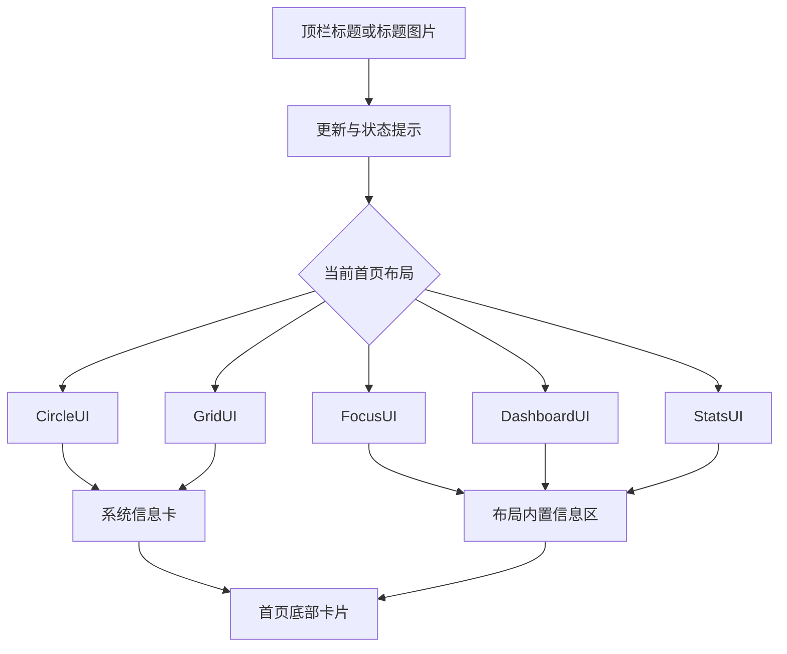

# 首页与布局

<Badge text="首页外观" type="info" /> <Badge text="不改变 Root 状态" type="tip" />

首页由顶栏标题、状态与更新区域、当前首页布局、系统信息卡和底部卡片组成。本页解释这些区域怎样排列、怎样隐藏，以及自定义内容到底在什么条件下才会显示。

::: tip 入口

打开管理器 → 设置 → 外观，然后在“布局”和“首页信息”分组中调整。页面布局选择的是“首页布局”，不要再把它和“布局变体”混为一谈。

:::

## 首页结构

布局决定主要内容的排布，底部卡片独立于布局选择。隐藏系统信息或切换底部卡片都不会修改 Root 授权、模块状态或内核功能。

## 五种首页布局

::: table 布局选择

| 布局 | 首页重点 | 适合 |
| --- | --- | --- |
| **CircleUI** | 圆形状态区与集中式首页 | 喜欢简洁、重点看 Root 状态的用户 |
| **GridUI** | 双列卡片与更多可扫视入口 | 希望在首页看到更多信息块 |
| **FocusUI** | 突出主要状态，并随屏幕方向调整 | 手机、平板混合使用 |
| **DashboardUI** | 仪表盘式分区卡片 | 喜欢按模块查看信息的用户 |
| **StatsUI** | 超级用户、模块、插件与实时指标统计 | 需要快速看数量与运行指标 |

:::

切换首页布局会立即改变首页内容，不影响主题颜色、壁纸、字体或底部卡片设置。不同布局内部的信息卡位置不同：CircleUI 和 GridUI 在布局主体后显示系统信息卡，其他布局把信息放在自己的面板中。

## 布局变体

布局变体作用于插件、超级用户和模块页面：

- **M3E**：大标题、可折叠搜索栏，滚动层次更明显。
- **传统**：紧凑顶栏，一屏能显示更多内容。

首页本身保持紧凑顶栏；该选项不会把首页改成另一种布局。

## 首页底部卡片

底部卡片位于首页内容之后，是一张可点击的快捷信息卡。进入“外观 → 布局 → 首页底部卡片”选择显示方式。

::: table 四种模式

| 模式 | 实际内容 | 点击后 |
| --- | --- | --- |
| **了解 FinaSU**（默认） | “了解 FinaSU”标题和“了解 FinaSU 的功能与模块”说明 | 用外部浏览器打开 FinaSU 官网 |
| **支持开发与 KernelSU** | 第一行“支持开发”，第二行“了解 KernelSU” | 分别打开捐赠页和 KernelSU 指南 |
| **隐藏** | 完全不绘制卡片 | 无 |
| **自定义** | 你自己填写的标题、副标题和链接 | 打开填写的 HTTP(S) 链接 |

:::

### 了解 FinaSU

这是默认模式，只有一行：

- 标题：了解 FinaSU。
- 副标题：了解 FinaSU 的功能与模块。
- 点击：打开 `https://fina.mysqil.com/`。

不知道选什么时保持这个模式即可。

### 支持开发与 KernelSU

该模式显示两行：

:::: field-group

::: field 支持开发
@type `捐赠入口`
@default `打开 Patreon`
说明 KernelSU 保持免费开源，点击后打开项目的捐赠页面。
:::

::: field 了解 KernelSU
@type `文档入口`
@default `本地化链接`
打开与当前界面语言对应的 KernelSU 指南，用来了解 KernelSU 的安装与模块开发。
:::

::::

这里打开的是外部网页。没有浏览器、网络不可用或链接被系统拦截时，页面不会在管理器内部展开。

### 隐藏

选择“隐藏”后，首页不会绘制底部卡片，也不会显示空白占位。

隐藏只影响当前显示。以后切回“了解 FinaSU”或“自定义”，之前保存的自定义内容仍然保留。

### 自定义

选择“自定义”后，设置页会出现三个可点击的文本项：

::: table 自定义字段

| 字段 | 显示位置 | 填写建议 |
| --- | --- | --- |
| **卡片标题** | 卡片第一行，粗体显示 | 简短说明“这是什么” |
| **卡片副标题** | 标题下方 | 说明“点进去能做什么” |
| **链接地址** | 不显示完整网址 | 填写目标网页的完整 HTTP(S) 地址 |

:::

点击任一项会打开输入框；确认后立即保存，取消则保留原内容。

::: warning 自定义卡片必须三项齐全

标题、副标题和链接必须全部非空。缺少任何一项时，即使选择了“自定义”，首页也不会显示卡片，效果与“隐藏”相同。这不是故障，而是避免显示半成品卡片。

:::

链接必须使用 `http://` 或 `https://`：

- `https://example.com/guide`：可以保存。
- `http://example.com`：可以保存。
- `example.com`：缺少协议，会提示重新输入。
- `ftp://example.com`、`javascript:...`：不受支持。

链接无效时不会覆盖旧值，输入框会继续保留；填入有效地址并确认后才保存。

### 一次完整配置

:::: steps

1. 在“首页底部卡片”中选择“自定义”。
2. 打开“卡片标题”，输入标题并确认。
3. 打开“卡片副标题”，输入说明并确认。
4. 打开“链接地址”，输入完整的 `https://` 地址并确认。
5. 返回首页，确认整张卡片可见且点击后能打开目标页面。

::::

::: tip 想临时不显示卡片

不必清空自定义内容。把模式切到“隐藏”即可；以后切回“自定义”会继续使用原内容。

:::

## 顶栏标题

文字标题有三种模式，另外可以启用标题图片：

- **应用名**：显示当前管理器应用名称。
- **KernelSU**：显示 KernelSU 标题。
- **自定义**：打开输入框，填写自己的标题。
- **标题图片**：不是文字模式；启用后由图片替代当前文字标题。

### 标题图片

高级标题图片是独立开关。选择图片时会自动启用标题图片；清除图片会关闭它。

启用图片后可以调整：

- **日间不透明度**：浅色模式下图片的透明度。
- **夜间不透明度**：深色模式下图片的透明度。
- **暗化程度**：压暗图片，避免标题区域过亮。
- **水平偏移**：范围 `-200 dp` 到 `200 dp`，用于左右移动图片。

关闭图片开关后会回到所选文字标题。标题图片只用于顶部标题区域，不属于壁纸背景。

## 首页信息显隐

首页信息区提供四项隐藏开关：

- **隐藏系统指纹**：移除系统与内核标识行。
- **隐藏 Zygisk 实现**：仅在当前确实存在 Zygisk 实现时出现。
- **隐藏 SUSFS**：仅在检测到 SUSFS 时出现。
- **隐藏模块挂载**：仅在 Folk Mount 状态可读取时出现。

::: info 隐藏不等于关闭

这些开关只改变首页展示。Zygisk、SUSFS、挂载后端和 Root 授权仍然按原状态工作。排查兼容问题时，先恢复显示再判断实际状态。

:::

## 其他首页相关设置

### 启动器图标

可在默认、几何和 KernelSU 三种启动器图标之间切换。它只替换桌面图标，不改变包名、签名或运行模式。

### 界面缩放

范围为 `80%–110%`。调大可读性更好，调小可显示更多内容；不会修改 Android 系统显示大小。

### 模块描述行数

模块介绍超过 `1–5` 行时自动折叠。该设置影响模块卡片，不是首页正文。

### 壁纸图鉴

设置首页的“壁纸图鉴”可以：

- 按手机、平板或融合设备筛选。
- 切换瀑布流或堆叠展示。
- 预览并下载壁纸；Android 10 及以上保存到 `Pictures/FinaSU`。

::: warning 下载不等于应用

图鉴下载的图片不会自动成为管理器壁纸。要到“外观 → 壁纸 → 选择图片”，从系统文件选择器中选中刚下载的文件。

:::

## 常见问题

:::: collapse accordion

- **选了“自定义”但首页没有卡片**

  检查标题、副标题、链接是否都已填写并保存，尤其确认链接以 `http://` 或 `https://` 开头。

- **改了标题，点击卡片却还是旧网页**

  链接是独立字段，需要单独修改。只改标题或副标题不会改变点击地址。

- **为什么无效链接没有保存？**

  管理器只允许 HTTP(S) 网页地址，避免把文件路径、应用跳转或其他协议误当成网页链接。

- **切到“隐藏”会删除自定义内容吗？**

  不会。自定义文字和链接仍保存在设置中，切回“自定义”即可继续使用。

- **图鉴下载后为什么壁纸没变化？**

  下载只保存图片。需要到壁纸页重新选择图片，下载不会自动替换当前背景。

::::

## 相关页面

- [外观](/setting/appearance/)
- [主题与颜色](/setting/theme/)
- [壁纸](/setting/wallpaper/)
- [壁纸图鉴](/setting/wallpaper-gallery/)
- [导航](/setting/navigation/)
- [模块卡片与横幅](/setting/module-cards/)
