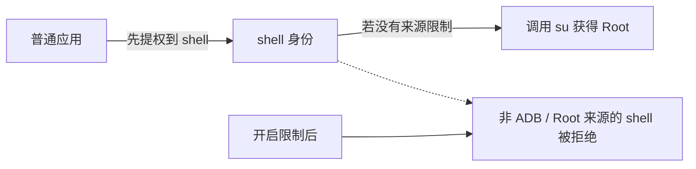

# 安全

<Badge text="设置入口 5/8" type="info" /> <Badge text="改变系统安全边界" type="danger" />

“安全”管理的是内核安全状态与调试入口，不是管理器应用锁。应用启动密码和敏感操作验证在[验证](/setting/authentication/)分类中。

::: tip 进入方式

打开管理器 → 设置 → 点第二行第二个 **安全**。

:::

## 四个安全功能

::: table 功能速查

| 功能 | 作用 | 风险 |
| --- | --- | --- |
| **隐藏 SELinux 修改** | 减少应用检测到 FinaSU 对 SELinux 策略的修改 | 可能需重启；不是万能隐藏 |
| **SELinux 模式** | 查看当前模式，并在 Enforcing 与 Permissive 间切换 | Permissive 会降低整机防护 |
| **ADB Root** | 以 Root 运行 `adbd`，让 ADB Shell 直接获得高权限 | 暴露调试入口 |
| **限制 Shell 仅可通过 ADB 获取 Root** | 阻止普通应用先成为 shell 再取得 Root | 可能影响非 ADB 的 Shell 工作流 |

:::

## 隐藏 SELinux 修改

SELinux 是 Android 的强制访问控制机制。FinaSU 为了实现 Root 与模块功能，可能加载额外策略或改变运行状态；开启该选项会尽量阻止应用检测这些修改。

使用方式：

:::: steps

1. 在“安全”页找到“隐藏 SELinux 修改”。
2. 开关可用时切换，管理器会把状态写入启动配置。
3. 如果提示“重启生效”，完整重启后再检查。
4. 重启后验证应用检测、模块挂载和授权是否仍正常。

::::

::: warning 它不是完整隐身

该功能只针对 SELinux 修改检测。应用仍可能通过挂载记录、内核版本、Zygisk、Root 痕迹或其他环境差异发现问题。不要把它当成“一键对所有检测隐身”。

:::

控件显示 `forced`、`managed` 或 `unsupported` 时，按页面说明处理。强行修改外部配置可能与启动脚本或其他模块冲突。

## SELinux 模式

点击“SELinux 模式”会打开确认对话框，页面会先显示当前模式。

::: table 可切换模式

| 模式 | 含义 | 在设置中的行为 |
| --- | --- | --- |
| **Enforcing（强制执行）** | 策略拒绝的操作会被阻止并记录 | 可以从 Permissive 切回 |
| **Permissive（宽容模式）** | 策略拒绝被记录，但通常不阻止操作 | 可以从 Enforcing 切到 |

:::

对话框中只有这两个选项。系统实际执行的是 `setenforce 1` 或 `setenforce 0`：

- `setenforce 1` → Enforcing。
- `setenforce 0` → Permissive。
- 没有“把 SELinux 切换为 Disabled”的选项或命令。

::: info 为什么页面可能显示“被禁用”

管理器读取 `getenforce` 的结果并支持显示 `Disabled`。如果设备启动时 SELinux 已经在内核或系统层被彻底关闭，当前状态会显示“被禁用”；这是**只读状态**，不能从这里重新切换为 Disabled，也不是第三个可选目标。

:::

::: danger Permissive 是调试状态

切到 Permissive 会削弱整台设备的强制访问控制。除越狱流程或明确排错外，不应长期保持。越狱模式也可能依赖 Permissive；切回 Enforcing 前先确认当前 Root 流程是否仍可用。

:::

切换前会再次确认。写入失败时，页面保留实际读回的当前模式，不会假装成功。

## ADB Root

ADB Root 以 Root 权限运行 `adbd`，让通过 ADB 连接的 Shell 直接具备高权限。

适用场景：

- 调试系统服务。
- 查看普通 ADB Shell 无法访问的日志或路径。
- 在救援和排错时执行需要 Root 的命令。

::: warning 只在使用时开启

开启后，能连接 ADB 的人获得的能力更强。不要在公共电脑、不可信 USB 调试环境或长期无人管理的设备上保持开启。用完应关闭。

:::

如果电脑仍显示普通 Shell，可以重新插拔 USB、重启 ADB 服务或断开重连。不同厂商对 `adbd` 和调试授权的限制不同。

## 限制 Shell 仅可通过 ADB 获取 Root

该功能为已经授权的 Shell 增加来源检查：只有由 `adbd` 或 KernelSU 系 Root 进程启动的 Shell，才能进一步取得 Root。

它主要阻止这条攻击链：

这不是“禁止 Shell 使用 Root”，而是限制 Shell 进程来自哪里。通过 ADB 建立的调试 Shell，以及由受信任 Root 进程启动的 Shell，仍可使用 Root。

::: tip 终端应用突然不能用 Root 时

先检查该终端应用自己的 Root 进程是否属于允许来源。关闭本项可以恢复旧的宽泛行为，但也会重新暴露“应用 → shell → Root”的链条。

:::

## 安全基线

:::: timeline 建议的日常安全顺序

- 保持 SELinux 为 Enforcing，只有越狱或排错时才临时切到 Permissive
  time=系统 type=success

- 不需要电脑调试时关闭 ADB Root，并关闭 Android 的无线调试
  time=调试

- 保留“限制 Shell 仅可通过 ADB 获取 Root”，除非明确的工作流要求关闭
  time=Root

- 只给可信应用 Root，并用 App Profile 缩小权限
  time=应用

- 为管理器启动和高风险操作启用[验证](/setting/authentication/)
  time=管理器 type=tip

:::

## 常见问题

:::: collapse accordion

- **隐藏 SELinux 修改后为什么还要重启？**

  某些策略或检测面只在启动早期建立。当前会话无法完全替换时，管理器会提示重启。

- **Permissive 能让所有 Root 应用都正常工作吗？**

  不一定。它只放宽 SELinux 拒绝行为，不能解决文件权限、挂载、签名或应用自身兼容问题。

- **ADB Root 和“允许任意应用成为动态管理器”是一回事吗？**

  不是。ADB Root 改变调试 Shell 的身份；动态管理器选项改变哪些应用能成为管理器。

- **限制 Shell 来源后，为什么 ADB 模块也受影响？**

  检查模块启动 Shell 的实际父进程。只有被识别为 `adbd` 或 KernelSU 系 Root 来源的链路才符合条件。

- **这些选项能代替应用锁吗？**

  不能。它们是内核与调试边界；应用锁属于“验证”分类。

::::

## 相关页面

- [隐藏与内核安全](/setting/hiding/)
- [访问控制](/setting/access/)
- [验证](/setting/authentication/)
- [App Profile](/manager/app-profile/)
