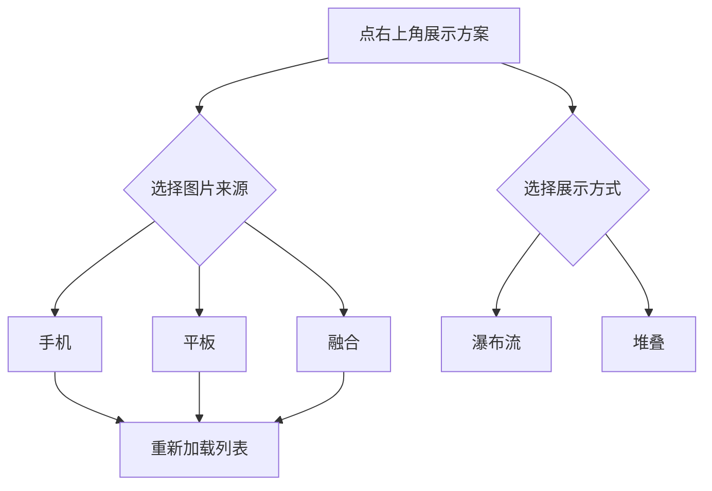

# 壁纸图鉴

<Badge text="设置首页入口" type="info" /> <Badge text="下载不等于应用" type="warning" />

“壁纸图鉴”是一个独立的图片浏览页，入口位于设置首页的快捷入口列表，不属于八个设置分类。

它用来看图、预览和下载壁纸。==下载不会自动替换当前管理器壁纸==，下载完成后仍要回到“外观 → 壁纸”手动选择。

::: tip 从哪里进入

打开管理器 → 设置 → 在八个分类下面点 **壁纸图鉴**。

:::

## 页面能做什么

::: table 功能一览

| 操作 | 位置 | 结果 |
| --- | --- | --- |
| **切换展示方案** | 顶栏右侧的调节图标 | 选择设备范围与瀑布流/堆叠布局 |
| **浏览更多** | 向下滚动列表 | 继续加载图片 |
| **刷新图库** | 从顶部下拉 | 清理当前图库缓存并重新获取 |
| **预览** | 点任意图片 | 打开大图预览 |
| **下载** | 预览弹窗中的“下载” | 把图片保存到设备图片目录 |
| **取消** | 预览弹窗中的“取消” | 关闭预览，不保存文件 |

:::

## 调整展示方案

点右上角的“展示方案”图标，会从底部打开设置面板。

### 图片来源设备

- **手机**：主要显示适合手机屏幕的图片。
- **平板**：主要显示适合平板屏幕的图片。
- **融合**：同时混合手机与平板来源。

切换设备范围后，列表会按新的范围重新加载。

### 展示方式

- **瀑布流**：不同宽高比的图片连续排列，适合快速浏览大量图片。
- **堆叠**：使用层叠卡片展示，图片会更集中。

展示方式只改变浏览排版，不改变下载后的图片文件。



## 浏览和预览

图片以卡片形式显示。点图片会打开预览弹窗，弹窗中有两个操作：

:::: field-group

::: field 取消
@type `关闭`
@default `不保存`
关闭预览，不下载图片，也不修改当前壁纸。
:::

::: field 下载
@type `保存图片`
@default `不自动应用`
下载成功后提示“已保存”；失败时显示失败原因。
:::

::::

向下滚动接近列表末尾时，页面会继续加载图片。网络不可用、图库暂时为空或加载失败时，页面会显示提示和“重试”按钮。

::: tip 下拉刷新会清空图库缓存

刷新不是只重新排列当前列表，而是清理图库缓存后重新获取。已经下载到 `Pictures/FinaSU` 的图片不受影响。

:::

## 下载到哪里

保存位置取决于 Android 版本：

::: table 保存位置

| 系统版本 | 保存位置 | 是否容易在文件管理器中找到 |
| --- | --- | --- |
| **Android 10 及以上** | 公共图片目录 `Pictures/FinaSU` | 是，可从“图片”或“文件”应用查看 |
| **Android 9 及以下** | 管理器专属外部图片目录下的 `FinaSU` | 取决于设备文件管理器，可能不如公共目录直观 |

:::

Android 10 及以上通常可以在文件管理中按以下路径找到：

```file-tree title="Android 10+ 下载位置"
Pictures/
└── FinaSU/
    └── 下载的壁纸图片
```

下载页不会自动清理旧壁纸。需要释放空间时，用系统文件管理器删除不需要的图片。

## 下载后怎样设为壁纸

:::: steps

1. 在壁纸图鉴中点开图片并选择“下载”。
2. 看到“已保存”后，返回设置。
3. 进入“外观 → 壁纸”。
4. 开启“启用壁纸”。
5. 点“选择图片”，从系统文件选择器中找到刚刚下载的图片。
6. 按需要调整表面不透明度、模糊、遮罩和日夜显示。

::::

::: warning 图鉴不会直接设置壁纸

图鉴页面只负责浏览和保存图片，没有“立即设为壁纸”按钮。下载完成后不进入壁纸页选择，当前管理器背景不会改变。

:::

## 不想用图鉴图片

可以选择：

- 回到 [壁纸](/setting/wallpaper/) 从设备选择其他图片。
- 使用视频背景。
- 选择“恢复默认主题”清除当前壁纸与相关主题资源。

图鉴下载的文件仍会保留，恢复默认壁纸不会删除 `Pictures/FinaSU` 中已经下载的图片。

## 常见问题

:::: collapse accordion

- **壁纸图鉴一直加载不出来**

  先检查网络，再从页面顶部下拉刷新；仍失败时点“重试”。如果图库缓存损坏，刷新会重新建立缓存。

- **为什么下载后壁纸没有变化？**

  下载只保存图片。必须回到“外观 → 壁纸”重新选择该文件。

- **为什么下载失败？**

  常见原因是网络中断、图片地址失效、设备存储空间不足或系统无法写入图片目录。错误提示会给出当前失败原因。

- **图鉴页面能删除下载的图片吗？**

  不能。图鉴页面只提供预览和下载，删除文件需要使用系统“图片”或“文件”应用。

- **切换瀑布流/堆叠会重新下载图片吗？**

  不会。展示方式只影响排版；图片来源范围变化才会触发列表重新加载。

- **下载会覆盖同名文件吗？**

  不应依赖同名覆盖来更新图片。下载前确认文件名和保存目录，避免混淆不同来源的壁纸。

::::

## 相关页面

- [外观](/setting/appearance/)
- [壁纸](/setting/wallpaper/)
- [首页与布局](/setting/home/)
