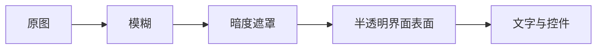

# 背景高斯模糊

<Badge text="只作用于图片背景" type="tip" /> <Badge text="UI 0–50" type="info" /> <Badge text="运行上限 64" type="warning" />

壁纸页的“模糊”改变静态图片或 GIF 背景的模糊半径。它不模糊按钮文字，也不模糊视频背景；卡片上的透明度与暗度是另外两层。

## 三个范围必须分开看

:::: table 模糊值的三层边界

| 层级 | 范围 | 行为 |
| --- | --- | --- |
| 壁纸设置 UI | `0..50` | 用户拖动滑块时可直接选择的范围 |
| 主题导入校验 | `0..100` | 此范围内的主题字段会通过数值校验 |
| 运行时保存 | `0..64` | `WallpaperConfig.updateBlur` 最终把值夹到 64 |

::::

因此导入一个 `backgroundBlur: 80` 的主题时，字段可通过导入校验，但运行时有效值是 64。不要把这个差异理解成“主题写 100 就一定渲染 100”。

## 生效对象

- JPG、PNG、WebP、JPEG 静态背景；
- GIF 等能被系统解码的动画图片；
- 单图壁纸；
- 多背景模式中的分页图片。

以下内容不使用该模糊值：

- `video_background.*` 视频背景；
- 导航栏、状态栏等系统界面；
- 卡片内部图片资源本身；
- 主题商店预览图。

视频背景持续播放时会暂停或隐藏图片层，因此调整图片模糊不会再产生可见变化。

## 与透明度、暗度的关系



概念上三层解决不同问题：

- **模糊**降低背景纹理，让边缘和文字更安静；
- **暗度**压暗背景，提高浅色文字对比度；
- **表面不透明度**决定卡片遮住多少背景。

实际渲染由 Wallpaper、surface token 与页面材质共同决定，三个值不是简单的 CSS 滤镜顺序。

## 建议

::::: steps

1. 先关闭暗度极端值，选择一张有细节的壁纸。
2. 从 10–20 开始增加模糊，观察首页小字和卡片边缘。
3. 再调整暗度，确保深色背景和浅色背景都能阅读。
4. 最后调整表面不透明度，避免所有内容都被一张“磨砂板”盖住。
5. 在低端设备上滚动长列表，确认没有明显掉帧。

:::::

:::: warning 高分辨率不会自动变清晰

背景使用裁切填充，超大图片会先带来解码与显存成本。高模糊值也不保证低对比度文字可读；文字仍依赖暗度、surface 和主题配色。

::::

## 主题字段

```json
{
  "isBackgroundEnabled": true,
  "backgroundBlur": 20
}
```

`backgroundBlur` 只在背景启用时才有实际意义。主题导入后可在“设置 → 外观 → 壁纸”继续调整；再次导出会写入运行时保存的值。

## 相关页面

- [壁纸](/setting/wallpaper/)：选择图片、滑块与暗度。
- [全局背景](/theme/global/transparency/)：界面表面与卡片背景。
- [视频背景](/theme/global/video/)：视频为什么不使用图片模糊。
