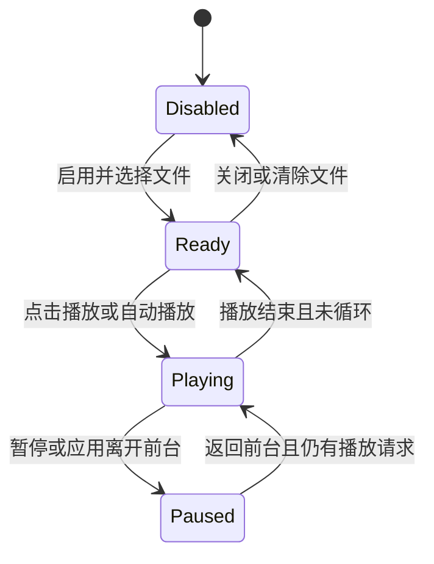

# 背景音乐

<Badge text="仅管理器前台播放" type="tip" /> <Badge text="使用实际文件名" type="warning" /> <Badge text="不属于系统媒体控制" type="info" />

背景音乐由 FinaSU 管理器的 `MediaPlayer` 播放，只在应用处于前台时继续。离开应用后停止播放，返回应用时按“手动播放”或“自动播放”状态恢复。

## 设置项

:::: table 音乐设置

| 设置 | 字段 | 行为 |
| --- | --- | --- |
| 背景音乐 | `isMusicEnabled` | 总开关；关闭时不加载资源 |
| 选择文件 | `musicFilename` | 使用系统文件选择器导入音频 |
| 自动播放 | `isAutoPlayEnabled` | 进入前台时自动开始 |
| 循环播放 | `isLoopingEnabled` | 到达结尾后重播 |
| 音量 | `musicVolume` | 0–1，播放中即时调整 |
| 手动播放/暂停 | 播放器状态 | 只在已启用且有文件时出现 |

::::

选择文件会自动启用音乐。播放器按系统 `MediaPlayer` 支持范围解码；主题格式没有额外限制音频编码，但设备不支持时仍会显示播放失败。

## 生命周期



播放器只初始化一次，并进行异步准备。应用进入后台时会暂停，声音不会变成系统级后台播放服务，也不会注册到 Android 媒体通知。

## 主题包

主题使用实际文件名引用音乐：

```json
{
  "isMusicEnabled": true,
  "musicFilename": "background_music.mp3",
  "musicVolume": 0.7,
  "isAutoPlayEnabled": true,
  "isLoopingEnabled": true
}
```

ZIP 中必须有同名条目，例如：

```file-tree title="音乐资源示例"
fpt 根目录
├── theme.json
└── background_music.mp3
```

导入器只在音乐启用时查找并复制该条目。`musicFilename` 是查找包内资源的键，不是任意文件系统路径。

:::: warning 启用字段和资源要同时正确

只写 `isMusicEnabled=true` 但没有同名文件时，会显示资源缺失警告；只放入音频却不写文件名，也不会自动播放。

::::

## 文件与体积

- 推荐使用较短的循环片段；
- 长音频会显著增大 `.fpt`；
- 高码率无损格式在手机上可能占用更多解码资源；
- 主题分享前应确认音频版权与分发许可；
- 清除音乐会同时关闭音乐并删除管理器私有副本。

## 常见问题

::::: collapse accordion

:::: collapse 设置里显示文件，但没有声音
先点击播放，检查音量为 0、文件解码失败或应用处于后台。播放器错误会在设置中显示“无法播放”。
::::

:::: collapse 每次返回应用都会自动播放
自动播放开启时，进入前台会恢复播放。想手动控制就关闭“自动播放”。
::::

:::: collapse 音乐和视频声音同时存在
视频背景与背景音乐是两个独立播放器。降低其中一个音量，或关闭不需要的媒体。
::::

:::: collapse 主题导入后音乐被旧文件占用
导入会停止当前播放、替换文件并重新加载。若仍异常，清除音乐后重新导入。
::::

:::::

## 相关页面

- [多媒体设置](/setting/multimedia/)：音乐、音效和振动的完整设置入口。
- [音效](/theme/global/sound/)：触摸与启动音效。
- [视频背景](/theme/global/video/)：独立视频音轨。
- [主题包结构](/developer/theme-package/)：音乐文件映射与校验。
