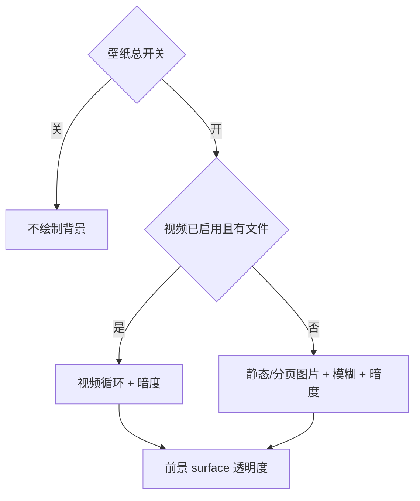

# 视频背景

<Badge text="循环播放" type="tip" /> <Badge text="系统解码器决定兼容" type="warning" /> <Badge text="体积增长明显" type="danger" />

视频背景在管理器前台循环播放，替换静态图片背景层。它仍受壁纸总开关与暗度控制，但图片模糊不适用于视频。

## 支持的资源名

主题资源策略接受：

```text
video_background.mp4
video_background.webm
video_background.mkv
```

优先级依次为 `mp4`、`webm`、`mkv`。是否真的能播放取决于 Android `VideoView` / `MediaPlayer`、设备解码器和视频编码参数；“扩展名受支持”不等于“任意编码都能播放”。

## 播放行为

- 使用 `SCALE_TO_FIT_WITH_CROPPING` 裁切填满窗口；
- 自动循环；
- 前台 `ON_START` 时继续播放；
- 应用进入后台时暂停；
- 声音由 `videoVolume` 控制，范围 0–1；
- 背景层上叠加壁纸暗度。

视频不会变成 Android 动态壁纸，也不会影响桌面、锁屏或其他应用。它不是常驻后台播放服务。

## 与图片、模糊和透明度的关系



视频本身没有图片模糊。视频模式下壁纸页会隐藏全局不透明度与模糊滑块；已保存的不透明度仍参与表面 token，因此视频会透出多少取决于卡片表面材质，而不是视频资源内嵌的 alpha。

## 主题字段

```json
{
  "isBackgroundEnabled": true,
  "isVideoBackgroundEnabled": true,
  "videoVolume": 0.0,
  "backgroundDim": 0.2
}
```

`isBackgroundEnabled` 是总开关。只把 `isVideoBackgroundEnabled` 设为 true、但总开关关闭时，视频不会绘制。资源缺失会产生 warning 并使用回退。

视频条目会显著增加 `.fpt` 体积。导出前检查容器上限和设备剩余空间，分享时不要把它误标成只有几 MB 的壁纸包。

## 性能与格式建议

::::: steps

1. 选择短循环片段，减少解码持续压力。
2. 优先 H.264/AVC MP4 等目标设备常见组合。
3. 分辨率不要明显高于主要使用屏幕。
4. 关闭不必要的音频，或把 `videoVolume` 设为 0。
5. 在低端设备上滑动长列表并按 Home 键返回，检查暂停和恢复。

:::::

:::: danger 解码失败可能只显示空背景

播放器错误会被消费而不让应用崩溃，但用户可能只看到暗色背景。先用系统播放器验证文件，再检查 codec、profile 和音频轨道。

::::

## 常见问题

::::: collapse accordion

:::: collapse 视频有声音但没有画面
可能是视频编码或分辨率不受支持。转码为设备常见格式，避免只改扩展名。
::::

:::: collapse 切到后台后没有继续播放
这是设计行为。视频背景只在前台播放，避免后台持续解码与耗电。
::::

:::: collapse 视频背景和背景音乐互相干扰
两者是独立播放器。关闭视频音轨、降低视频音量，或关闭背景音乐。
::::

:::: collapse 想给视频加模糊
当前视频层没有模糊参数。需要静态虚化效果时应使用图片或视频编辑阶段处理。
::::

:::::

## 相关页面

- [壁纸](/setting/wallpaper/)：选择、清除视频和音量。
- [背景模糊](/theme/global/blur/)：仅静态图片/GIF 的模糊。
- [背景音乐](/theme/global/music/)：独立音乐播放器。
- [主题包结构](/developer/theme-package/)：视频条目和校验。
