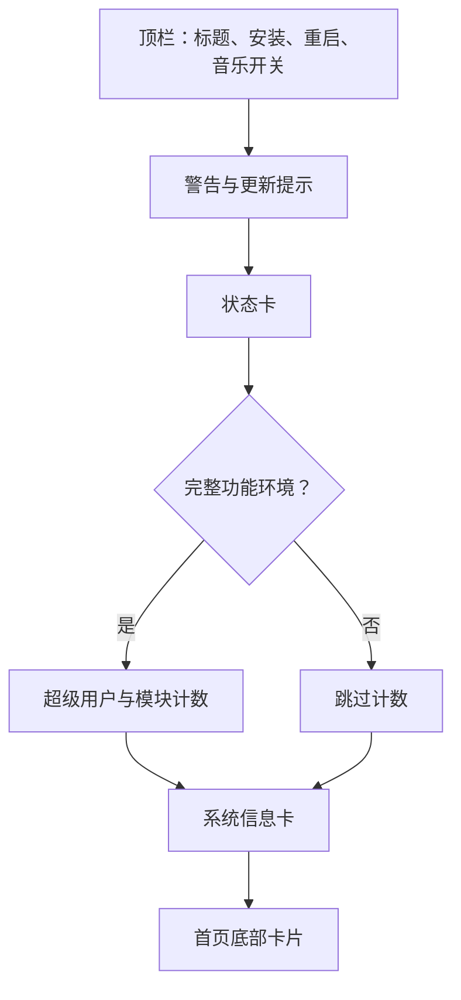

# Circle 主题概览

<Badge text="默认布局" type="tip" /> <Badge text="单列卡片流" type="info" /> <Badge text="无专属卡面" type="warning" />

CircleUI 是 FinaSU 的默认首页布局，token 为 `circle`。它把状态、计数、系统事实和底部卡片按单列排列，重点保持信息层级清楚，而不是追求最多信息块。

## 首页结构

:::: table 页面组成

| 区域 | 内容 |
| --- | --- |
| 顶栏 | 标题/标题图、音乐、安装、重启 |
| 状态卡 | 运行中、未安装或不支持；版本与运行模式 |
| 计数 | 超级用户数量、已启用模块数量 |
| 系统信息 | 管理器、内核、设备、SELinux、Seccomp 与可选能力 |
| 底部 | 了解 FinaSU、传统支持、自定义或隐藏 |

::::

## 什么时候显示计数

计数只在 `useFullFeaturedLayout()` 为 true 时绘制。它代表当前界面具备完整功能环境，而不是“只要安装管理器就永远显示两个数字”。

完整环境中，两张计数卡横向并排：

- 点击超级用户卡进入超级用户页面；
- 点击模块卡进入模块页面；
- 数字来自当前管理器状态。

## 布局兼容

::::: field-group

:::: field FinaSU
@type `circle`
在“设置 → 外观 → 布局 → 首页布局”中选择 CircleUI。
::::

:::: field FolkPatch
@type `default` / `sign`
导入时映射到 CircleUI；若本地布局没有被其他设置改动，再次导出可保留原历史 token。
::::

:::: field 未知 token
@type `保留当前布局`
不支持的布局值会被删除并产生 warning，不会强行套用一个新布局。
::::

:::::

## Circle 没有什么

CircleUI 当前没有独立的“工作卡图片”surface。以下配置属于其他布局：

- Grid 工作卡背景 `grid_working_card_background.*`；
- Focus 四张卡背景；
- Dashboard Hero `dashboard_card_bg.*`。

Circle 仍可使用页面壁纸、全局表面透明度、暗度、模糊、颜色、字体与底部卡片。需要独立卡片图片时，应切换到对应布局，而不是在 Circle 页面寻找不存在的入口。

## 页面

- [基础样式](/theme/theme-circle/basic/)
- [背景设置](/theme/theme-circle/background/)
- [工作卡片](/theme/theme-circle/working-card/)
- [组件隐藏](/theme/theme-circle/component-hiding/)
- [动画与交互](/theme/theme-circle/interaction/)
