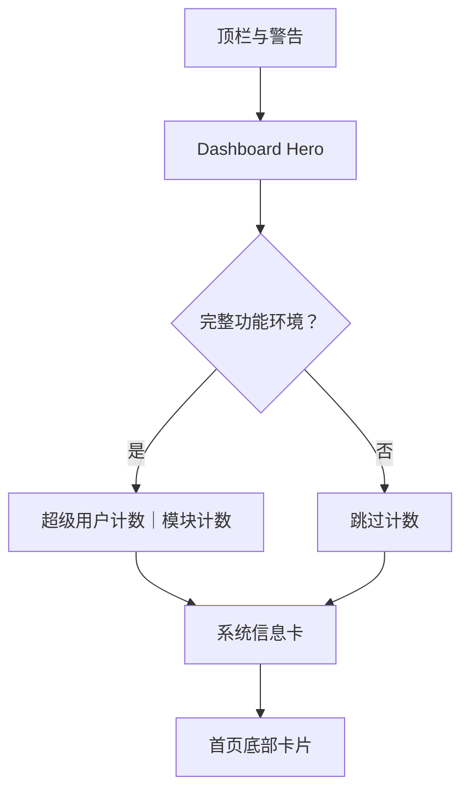

# Dashboard 主题概览

<Badge text="宽幅 Hero" type="tip" /> <Badge text="始终单列" type="warning" /> <Badge text="Hero 可独立换图" type="info" />

DashboardUI 的 token 是 `dashboard_ui`。它用一张宽幅 Hero 汇总核心状态，下方是两张计数卡和系统信息卡。

## 结构



Dashboard 当前没有根据宽度变成双列。即使平板宽度满足 600dp，Hero、计数和系统信息仍按纵向排列；这与 FolkPatch 某些参考布局的实现差异应以 FinaSU 当前源码为准。

## Hero

Hero 包含：

- 状态图标与标题；
- 版本摘要；
- 运行/安全/越狱/自定义 LKM 状态；
- 三项事实：模块版本、内核、SELinux；
- 未安装且 SELinux Permissive 时的越狱按钮。

Hero 可以独立使用图片：

```text
dashboard_card_bg.*
surface.layout.dashboard.hero
```

## 计数与系统信息

完整功能环境显示超级用户与已启用模块数量，横向各占一半。系统信息卡随后显示管理器、内核、设备、SELinux、Seccomp 和可选能力。

## 与 Stats 的区别

Dashboard：

- 不持续采集设备指标；
- 不做 CPU/RAM 波形；
- 不做环形统计；
- Hero 和系统信息是主要视觉层。

StatsUI：

- 持续采样；
- 包含监控卡和模块/用户/插件环形图；
- 宽屏可分成两列。

## 页面

- [基础样式](/theme/theme-dashboard/basic/)
- [状态信息](/theme/theme-dashboard/hardware/)
- [统计入口](/theme/theme-dashboard/statistics/)
- [动画与交互](/theme/theme-dashboard/interaction/)
