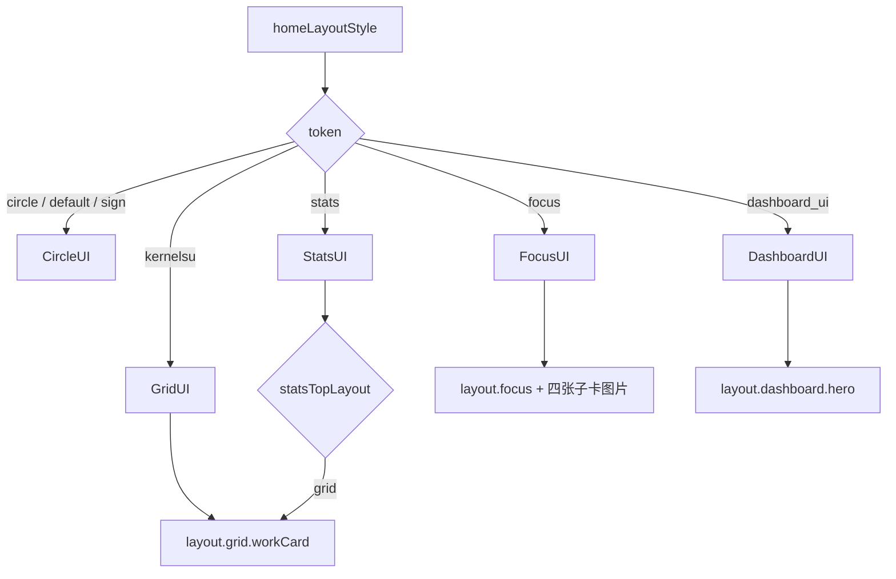

# 成为主题开发者

<Badge text="从导出开始" type="tip" /> <Badge text="平铺资源包" type="warning" /> <Badge text="没有签名保护" type="danger" />

开发 FinaSU 主题最可靠的方式不是从空 JSON 猜字段，而是先在管理器中配置一套可用的外观，导出 `.fpt`，再修改已知字段和资源。管理器的导出流程会自动写入当前版本实际支持的结构、资源扩展名和兼容键。

==主题开发的对象是显示资源与偏好字段，不是可执行模块。==不要把脚本、路径穿越、任意 Web 内容或 Root 配置写进主题包。

## 工作流

::::: timeline 从设计到发布

- 确定手机/平板目标与五套布局中要支持的范围
  time=设计 type=tip

- 在干净的管理器环境中设置颜色、壁纸、字体、布局和媒体
  time=制作 type=info

- 从“壁纸 → 导出主题包”填写元数据并导出
  time=封装 type=warning

- 解包检查 `theme.json`，只修改文档列出的字段与平铺资源
  time=调整 type=warning

- 在手机、平板、浅色、深色和不同布局中实际导入
  time=验证 type=tip

- 检查再次导出、跨端回导、失败回滚和资源缺失提示
  time=回归 type=success

:::::

## 主题包目录

`.fpt` 解码后是一个平铺 ZIP，所有条目都在根目录，不允许嵌套目录。

```file-tree title=".fpt 内部结构"
theme.fpt（加密容器）
└── ZIP 根目录
    ├── theme.json
    ├── background.webp
    ├── background_home.webp
    ├── video_background.mp4
    ├── title_image.png
    ├── grid_working_card_background.webp
    ├── focus_card_kernel_bg.webp
    ├── dashboard_card_bg.webp
    ├── font.ttf
    ├── nav_icon_Home.png
    ├── background_music.mp3
    └── sound_effect_custom.wav
```

实际条目由当前配置决定，不需要把所有示例文件都放进主题。`original.json` 和 `applied.json` 是管理器内部记录，用户主题 ZIP 中禁止出现这两个名称。

:::: warning 文件名是平铺条目，不是路径

条目名称不能包含 `/`、`\`、NUL；不能为空；不能重复；不能是 `.`、`..`、`original.json` 或 `applied.json`。资源引用必须使用同一 ZIP 根目录中的实际文件名。

::::

## 最小元数据

```json
{
  "meta_name": "Example Theme",
  "meta_type": "phone",
  "meta_version": "1.0.0",
  "meta_author": "Example Author",
  "meta_description": "A FinaSU manager theme."
}
```

:::: table 元数据字段

| 字段 | 默认值 | 行为 |
| --- | --- | --- |
| `meta_name` | 空 | 导入预览和导出文件名的主要名称 |
| `meta_type` | `phone` | `phone` 或 `tablet`；其他值保留并给出警告 |
| `meta_version` | `1` | 内容版本字符串，不参与覆盖比较 |
| `meta_author` | 空 | 作者显示 |
| `meta_description` | 空 | 说明文本 |

::::

导出对话框要求名称非空，并允许选择手机或平板。文件名会删除不适合作为文件名的字符，写出到 `Download/FinaSU/Themes/<名称>.fpt`。

## 常用字段

::::: code-tabs

@tab:active 外观与布局

```json
{
  "customColor": "indigo",
  "folksu_keyColor": -12345678,
  "nightModeEnabled": true,
  "nightModeFollowSys": true,
  "useSystemDynamicColor": false,
  "colorGenerationMode": "custom",
  "colorStandard": "M3E_2025",
  "colorStyle": "TONAL_SPOT",
  "colorContrast": "STANDARD",
  "homeLayoutStyle": "focus",
  "statsTopLayout": "list",
  "isListWorkingCardModeHidden": false
}
```

@tab 主壁纸与视频

```json
{
  "isBackgroundEnabled": true,
  "backgroundOpacity": 0.6,
  "backgroundBlur": 20,
  "backgroundDim": 0.2,
  "isDualBackgroundDimEnabled": true,
  "backgroundDayDim": 0.2,
  "backgroundNightDim": 0.4,
  "isMultiBackgroundEnabled": true,
  "wallpaper_use_color": true,
  "isVideoBackgroundEnabled": false,
  "videoVolume": 0.0
}
```

@tab 高级标题与字体

```json
{
  "isAdvancedTitleStyleEnabled": true,
  "titleImageDayOpacity": 1.0,
  "titleImageNightOpacity": 0.8,
  "titleImageDim": 0.1,
  "titleImageOffsetX": 0.0,
  "titleTextMode": "custom",
  "titleCustomText": "FinaSU",
  "fontMode": "custom",
  "isFontEnabled": true
}
```

@tab 音乐与音效

```json
{
  "isMusicEnabled": true,
  "musicFilename": "background_music.mp3",
  "musicVolume": 0.7,
  "isAutoPlayEnabled": true,
  "isLoopingEnabled": true,
  "isSoundEffectEnabled": true,
  "soundEffectFilename": "sound_effect_custom.wav",
  "soundEffectScope": "bottom_bar"
}
```

@tab 导航图标

```json
{
  "navIconCustomEnabled": true,
  "navIcons": {
    "Home": "nav_icon_Home.png",
    "KModule": "nav_icon_Plugin.png",
    "SuperUser": "nav_icon_SuperUser.png",
    "AModule": "nav_icon_Module.png",
    "Settings": "nav_icon_Settings.png"
  }
}
```

:::::

这些只是常用字段，不是完整协议。布局专属 surface 键见各布局页面和[主题包结构](/developer/theme-package/)。

## 资源选择规则

:::: table 基础名与扩展名优先级

| 类型 | 基础名 | 扩展名优先级 |
| --- | --- | --- |
| 普通图片 | `background`、`title_image`、surface 基础名 | `jpg`、`png`、`gif`、`webp`、`jpeg` |
| 视频 | `video_background` | `mp4`、`webm`、`mkv` |
| 字体 | `font` | `ttf`、`otf` |
| 分页背景 | `background_home`、`background_kernel`、`background_superuser`、`background_system_module`、`background_settings` | 同普通图片 |

::::

同一基础名存在多个允许扩展名时，只选择优先级最高的一个。额外文件会作为未知资源保留，但不保证被渲染。GIF 只有在系统解码器支持时才会播放；普通图片和视频仍取决于 Android 媒体能力。

## 布局兼容键

::::: field-group

:::: field CircleUI
@type `circle`
FolkPatch 的 `default` 与 `sign` 映射到 CircleUI。Circle 没有独立工作卡背景；导入原 token 可在本地设置未改变时继续保留到再次导出。
::::

:::: field GridUI
@type `kernelsu`
工作卡图片基础名为 `grid_working_card_background`。图片存在与功能启用是两个状态，同时还有透明度、暗度和元素隐藏字段。
::::

:::: field FocusUI
@type `focus`
四张卡共享父 surface 的不透明度和暗度，只各自保存图片：kernel、app、device、storage。
::::

:::: field DashboardUI
@type `dashboard_ui`
Hero 使用 `dashboard_card_bg`，包含图片、启用、透明度、暗度与日夜变体。
::::

:::: field StatsUI
@type `stats`
`statsTopLayout` 为 `list` 或 `grid`。选择 `grid` 时顶部会复用 Grid 工作卡，因此其 surface 设置也属于 Stats。
::::

:::::

## 布局 token 与界面



## 校验与兼容

导入器会处理以下错误，并把可恢复问题列入 warning：

- JSON 不是对象、`theme.json` 缺失或被删除；
- ZIP 条目为空、重复、越过数量限制或超出解密总量；
- 布尔值不是布尔或大小写不敏感的 `"true"` / `"false"`；
- 数值不是有限数字，或超出字段范围；
- 枚举值不受支持；
- 功能开启但资源缺失；
- 导航目的地不存在或图标文件不存在；
- 音乐/音效声明的文件名不在包内；
- 同一资源基础名出现多个扩展名。

==未知字段不会被无条件解释为功能。==校验器会删除非法类型或不受支持的枚举；布尔、数字和资源缺失则按各自规则回退。导出时，已保存的未知字段和资源仍可能被带回去，以支持有限的双向兼容。

## 从 FolkPatch 主题开始

FinaSU 接受 FolkPatch 生态常用的容器与历史字段，但兼容不是逐项等价：

- 先在 FinaSU 的五个布局中逐一导入，检查历史 surface 键是否仍对应正确卡片；
- 检查 `default`/`sign` 布局是否应按 CircleUI 解释；
- 检查颜色 token 是否映射到 FinaSU 的 20 个兼容色值；
- 检查关闭状态、图片存在标志和功能启用标志是否一致；
- 检查 FinaSU 扩展字段经其他实现保存后是否仍存在；
- 把主题从 FinaSU 导出后再次导入，确认资源没有丢失。

跨端中转可能改变或丢失扩展语义，发布时不要宣称“两边完全无损互通”。

## 发布前检查

:::: steps

1. **从空主题恢复后导入**

   清除旧主题影响，再验证背景、布局、字体、图标、媒体和语言是否按预期生效。

2. **覆盖导入一次**

   保留已有本地资源，再次导入同主题，确认旧文件被正确替换或清理。

3. **验证失败回滚**

   使用缺少 `theme.json`、错误枚举或损坏资源的测试包，确认当前主题没有被半应用状态破坏。

4. **验证再次导出**

   导入后不做修改直接导出，比较再次导入的结果。未知资源与兼容 token 应尽量保留。

5. **跨尺寸和多语言测试**

   至少检查窄屏、横屏、平板宽度、浅色、深色、AMOLED，以及没有完整 CJK 字形时的字体回退。

6. **检查包体与性能**

   视频、GIF、高分辨率图片和字体都会增加包体与渲染成本。测试滚动、页面切换、返回前台和低内存场景。

::::

## 发布与分发

仓库文档没有规定自动提交、商店人工审核或固定上架时限。你可以通过文件分享、项目社区或兼容主题索引分发 `.fpt`；是否被某个商店收录，以该商店实际流程为准。

分享时建议同时提供：

- 主题名称、作者、版本和适用手机/平板类型；
- 支持的 FinaSU 版本范围；
- 使用了哪些布局、字体和媒体资源；
- 预览图与原始 `.fpt`；
- 已知限制，例如只支持 Focus、没有平板适配或依赖大字体。

## 不要把主题写成模块

:::: danger 这不是 Root 功能包

主题不能安装模块、执行 shell、修改 allowlist、加载 `.ko`、改变 SELinux 或授予 Root。即使 ZIP 中存在同名脚本，也不会因此进入模块执行链。

::::

## 相关页面

- [主题包结构](/developer/theme-package/)：容器、完整字段组、导入事务和调试表。
- [导出主题](/theme/export/info/)：管理器导出范围与保存位置。
- [分享主题](/theme/export/share/)：分发和接收者操作。
- [夜间模式与颜色](/theme/global/theme-style/)：颜色目录与生成模式。
- [全局背景](/theme/global/transparency/)：背景、透明度与 surface 关系。
