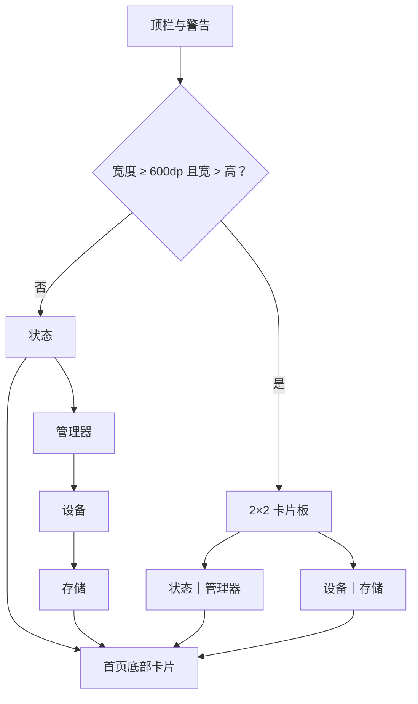

# Focus 主题概览

<Badge text="四卡信息板" type="tip" /> <Badge text="横屏 2×2" type="info" /> <Badge text="持续采样指标" type="warning" />

FocusUI 的 token 是 `focus`。它把首页拆成状态、管理器、设备、存储四张语义卡，避免同一事实在多个卡片重复出现。

## 结构



2×2 重排还要求当前处于完整功能布局。仅屏幕宽度达到 600dp 仍不够，窗口必须同时比高度更宽。

## 四张卡

:::: table 卡片职责

| 卡片 | 主要内容 | 操作 |
| --- | --- | --- |
| 状态 | 运行状态、版本-UAPI、运行/安全/越狱/自定义 LKM 状态 | 安装、更新管理器、越狱 |
| 管理器 | 管理器、内核、设备、SELinux、Seccomp、可选能力 | SUSFS 行可管理 |
| 设备 | 电池温度、CPU 温度、电池电量 | 无独立按钮 |
| 存储 | Data、RAM、zram、swap | 无独立按钮 |

::::

设备与存储只在管理器首页是当前页且当前布局为 Focus/Stats 时持续采样。

## 表面配置

Focus 的四张卡共享一个父 surface：

```text
layout.focus
```

共享内容包括：

- 总开关；
- 不透明度与日夜不透明度；
- 暗度与日夜暗度。

四张子卡只分别保存图片：

```text
layout.focus.card.kernel
layout.focus.card.app
layout.focus.card.device
layout.focus.card.storage
```

父级关闭后，四张卡都不绘制图片背景。

## 页面

- [基础样式](/theme/theme-focus/basic/)
- [硬件信息](/theme/theme-focus/hardware/)
- [平板适配](/theme/theme-focus/tablet/)
- [动画与交互](/theme/theme-focus/interaction/)
